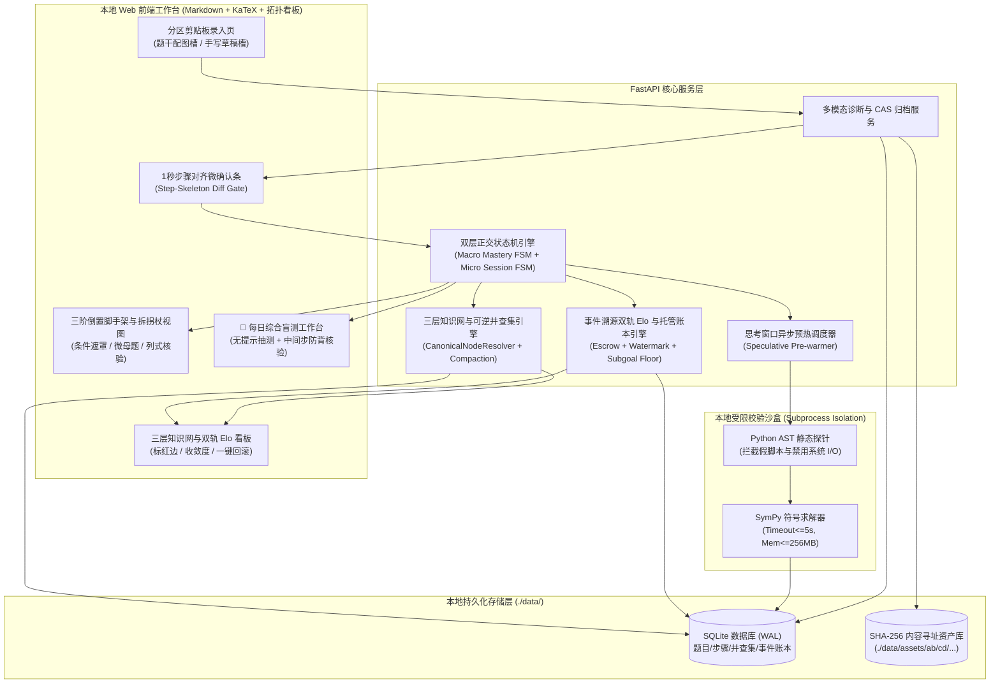
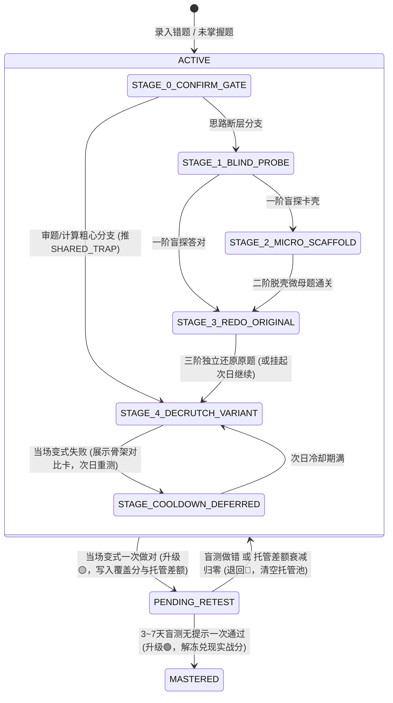

# 数理自适应刷题与验证框架（刷题 Harness）

*   **Author:** nakseuksa
*   **Status:** Draft
*   **Date:** 2026-11-13

--------------------------------------------------------------------------------

## Overview

本项目构建一个面向**数学与物理学科**的本地 Web 自适应刷题与验证框架（刷题 Harness）。系统接收包含 LaTeX 公式、题干本地配图及手写演算草稿截图的 Markdown 错题输入，在**零预设考纲（完全冷启动）**条件下运行。

系统由**微观单题闭环**与**宏观二维全局导航**两层架构咬合而成：
*   **微观单题闭环层**负责接管用户录入的每一道具体错题或未掌握题，通过多模态手写草稿卡点诊断、1 秒步骤对齐人工微确认、倒置防剧透三阶降阶脚手架（配合后台异步 Python/SymPy 沙盒预热校验），以及当场同构变式“拆拐杖”与 3～7 天延迟无提示盲测，将题目从“看懂解析”推进至“脱离提示独立解出”。
*   **宏观全局导航层**负责在无预设静态题库与考纲的前提下，通过固定深度三层语法路径（`L1 学科模块 / L2 核心实体与定理 / L3 原子转化算子`）与可逆并查集（Union-Find）Compaction 自发汇聚知识图谱，并基于 [理论基础.md](./理论基础.md) 的四维难度 Rubric $[C, S, T, L]$ 按模块独立核算“覆盖分（借助脚手架上限）”与“实战分（盲测兑现水位）”双轨动态 Elo 评分。

## The Problem

在数学与物理学科的备考训练中，学习者普遍面临以下四个结构性痛点，现有工具（传统静态题库 App、通用大模型聊天窗口、普通双链笔记或 Anki 闪卡）均未能形成有效闭环：

1.  **草稿归因缺失与“一刀切”讲题导致剧透假懂**：
    学习者做不出综合大题时，通常已在草稿纸上完成了部分前置推导（如已完成受力分析与运动学方程，仅卡在临界几何相切条件）。通用 AI 聊天工具或传统解析会直接展示完整标准答案，或在不了解手写草稿停滞位置的情况下直接喂给核心中间结论。这种“直接捅破窗户纸”的剧透会让学习者误以为自己已经掌握，实则仅停留在短期工作记忆复述，遇到同构变式依然无从下手。
2.  **冷启动个人错题本缺乏可靠的靶向降阶题与同构变式题**：
    个人错题本在冷启动阶段（前 1～2 个月）几乎只包含中高难度的卡壳题，内部缺乏恰好能充当某道压轴题中间步骤铺垫的基础微母题。若完全依赖通用 LLM 零样本实时编造数理题，常因缺乏符号计算器校验而产出条件矛盾、无解、数据无法整除或丢失原题核心陷阱的废题；反之，若在前端同步等待多轮代码沙盒验算，又会造成数十秒的交互阻塞。
3.  **零预设考纲下的知识点标签同义爆炸与覆盖度失真**：
    预先人工录入完整考纲与万级题库的冷启动成本极高；但若放任 LLM 为每道错题自由生成知识点标签，很快会产生颗粒度混乱的“同义词爆炸”（如同时长出“均值不等式”、“基本不等式求最值”、“常数代换法”等互不联通的节点）。此外，缺乏固定考纲分母时，每录入一道新领域错题就会导致传统覆盖率分母膨胀、指标断崖下跌。
4.  **错题采样偏差导致的水平评估失真与复习债堆积**：
    优秀学生往往只往系统里录入自己做错的高难压轴题（如 `2100 分`），若按传统做题正确率或普通 Elo 扣分，系统会将其判定为低水平；而即使他在 `2100 分` 压轴题中已独立推导出前两步（对应 `1550 分` 水准），传统评分也无法识别这一保底能力底线。同时，单题在“草稿保底、脚手架通关、当场变式、隔日盲测”多阶段流转中极易发生重复加分通胀或复习队列饥饿。

**解决方案摘要**：
本设计通过**分区剪贴板录入 + VLM 一次性草稿转录 + 1 秒步骤对齐确认条**解决错因与卡点归因问题；通过**倒置三阶脚手架（一阶条件遮罩盲探 $\to$ 二阶脱壳微母题 $\to$ 三阶回原题）+ 思考窗口后台异步 SymPy 沙盒预热校验**消除剧透与实时命题幻觉；通过**当场半程立式拆拐杖 + 3～7 天独立入口延迟盲测**杜绝背答案假销账；通过**全局 L1/L2 骨架注入 + 同父 L2 作用域可逆并查集 Compaction + 分布熵校准收敛度**实现零预设知识网自收敛；通过**绑定四维 Rubric $[C, S, T, L]$ 的事件溯源双轨 Elo 账本与单题托管池（Escrow）**实现跨阶段零通胀的精准能力定级。

## Goals

*   **G1（多模态低摩擦录入与精准卡点分流）**：支持题干/配图与手写演算草稿分区粘贴导入，自动生成幂等 `question_uid` 并归档至本地 SHA-256 内容寻址资产库（CAS）；在单次 VLM 转录后输出题级与步骤级四维难度 $[C, S, T, L]$（覆盖 `800～2800` 分），提供 `< 3 秒` 的步骤对齐微确认条，支持用户一键修正卡点步骤或切换“审题/计算粗心 vs. 思路断层”归因。
*   **G2（零剧透三阶脚手架与非阻塞数理自校验）**：严格执行“一阶条件遮罩盲探子目标 $\to$ 二阶脱壳微母题 $\to$ 三阶无提示回原题”顺序；利用一阶思考窗口在后台异步完成二阶微母题与当场变式题的生成与 Python AST + SymPy 沙盒验算（单次硬超时 `<= 5s`，最大重试 `2 次`），将用户感知的正常流等待耗时控制在 `< 2s`，并在非纯代数题型上优雅降级至双盲 LLM 交叉求解校验。
*   **G3（负荷分级拆拐杖与防背题隔日盲测闭环）**：将宏观掌握状态机（`🔴ACTIVE`、`🟡PENDING_RETEST`、`🟢MASTERED`）与微观训练会话状态机正交解耦；当原题运算负荷 $L \ge 2$ 时，当场拆拐杖变式仅考核“核心方程组列式（SymPy 代数等价校验）”；提供独立的“每日综合盲测”入口与每日配额上限（`<= 3 道大题`），盲测回退至原题时强制要求同时核验曾卡壳的一阶中间子目标与最终答案。
*   **G4（三层路径锚定与可逆并查集自收敛知识网）**：强制按 `[L1 学科模块] / [L2 核心实体与定理] / [L3 原子转化算子]` 提取考点，入库时注入现有 `L1/L2` 骨架树并拉取同父 `L2` 下 `Top-15` 候选 `L3` 节点交 AI 裁判复用；后台 Compaction 严格限制在同一 `L1/L2` 作用域内通过 `redirect_to_id` 合并近义 `L3` 节点，自动消除跨知识点标红边的自环，支持按批次 ID 一键无损回滚（Un-merge），并输出“版图攻克率”与“分布熵校准收敛度”双指标。
*   **G5（事件溯源的分模块双轨动态 Elo 评分）**：按每个 `L1` 模块独立维护“覆盖分”与“实战分”，所有分数变动通过不可变事件流 `elo_mutation_ledger` 与单题托管池（Escrow）计算；落地水位线高斯衰减过滤、受严格单调性硬锁约束的前缀子问题 $[C_{\text{sub}}, S_{\text{sub}}, T_{\text{sub}}, L_{\text{sub}}]$ 保底实战分推演，以及仅针对未兑现托管差额的温和超时衰减。

## Non-Goals

*   **NG1（不内置静态海量题库或绑定特定教材章节树）**：系统不爬取或预置数万道外部静态题库，也不硬编码绑定某一地区或教材的固定考纲目录。
*   **NG2（不构建多租户云端 SaaS 或社交排行榜）**：系统采用纯本地优先（Local-First）Web 架构（本地前后端服务 + 本地 SQLite 数据库 + 本地文件资产库 + 本地受限 Python 子进程沙盒），不包含分布式多租户鉴权与云端计费体系。
*   **NG3（不在浏览器内自研实时手写压感笔迹画板）**：用户在纸质草稿本或平板笔记软件上完成演算后，通过截图/拍照粘贴进入系统，不在 Web 前端开发类 GoodNotes 的实时矢量书写引擎。
*   **NG4（不引入形式化定理证明器与文科语篇修辞拓扑）**：不对立体几何作图或定性推理引入 Lean/Coq 级形式化证明；明确排除 [理论基础.md](./理论基础.md) 第五、六部分中针对英语和文言文的语篇修辞结构（`RST_*`）与文科干扰项拓扑，仅保留数理六大易错陷阱算子与可选的 AnkiConnect 幂等同步接口。

## Open Questions

当前阶段所有核心架构分歧（SymPy 沙盒异步预热与降级边界、L1/L2 全局骨架注入与同域可逆并查集、单题幂等托管池与步骤对齐微确认条）已在 [concepts_brief.md](./concepts_brief.md) 中达成共识并锁定，暂无未决阻塞问题。

## Critical User Journeys (CUJs)

### CUJ 1: 多模态错题与手写草稿录入及 1 秒步骤对齐确认

*   **Given**: 用户在本地启动刷题 Harness Web 界面，手头有一道做错或卡壳的高中物理“带电粒子在有界复合场中运动”压轴题，包含题干文本/配图以及自己在草稿纸上写到一半的演算过程截图。
*   **When**:
    1. 用户在录入页的 `[题干区]` 粘贴题目文本与配图（或直接粘贴原题截图由系统 OCR 转写为 Markdown + LaTeX），在 `[手写草稿区]` 粘贴演算草稿截图，标记初始状态为 `错题`。
    2. 系统自动生成幂等 `question_uid`，将图片按 SHA-256 哈希归档至本地受管资产库，调用 VLM 完成最优解题路径拆解、四维难度打标（如 $(C=3, S=3, T=2, L=3) \Rightarrow \text{Elo } 2085$）及手写草稿一次性 LaTeX 转录对齐。
    3. 界面弹出单行“步骤对齐确认卡”：`Step 1 [电场加速动能定理]: ✅ 已独立完成 -> Step 2 [有界磁场放缩圆临界相切几何关系]: ❌ 思路中断 -> Step 3 [联立周期与时间求解]: ⬜ 未触及（保底子问题评估：C_sub=2, S_sub=1, T_sub=1, L_sub=1 => 保底水位 1345）`。
    4. 用户核对无误后按回车键（或点击确认按钮）通过门禁（若系计算抄错，可一键点击切换为 `⚠️ 计算/审题粗心`）。
*   **Then**:
    1. 题目正式落库并挂载至 `[电磁学] / [带电粒子在有界磁场中的运动] / [放缩圆与临界相切几何构造]` 路径；若用户当前“电磁学”模块实战分低于 `1345`，系统向 `elo_mutation_ledger` 写入一条 `PARTIAL_DRAFT_SUBGOAL_FLOOR` 事件，将其实战分向 `1345` 保底正向修正，并展示自然语言加分解释条。
    2. 系统立即切入针对 `Step 2` 的一阶盲探子目标界面；与此同时，后台异步 Worker 在思考窗口内静默启动该卡点的“二阶脱壳微母题”与“拆拐杖同构变式题”的生成与 SymPy 沙盒验算预热。

### CUJ 2: 倒置防剧透三阶降阶脚手架训练与微母题沙盒自校验

*   **Given**: 用户在 CUJ 1 中确认卡在 `Step 2（有界磁场放缩圆临界相切几何关系）`，题目处于 `🔴ACTIVE（攻坚中）` 状态，且后台已完成或正在执行微母题预热。
*   **When**:
    1. **一阶（条件遮罩盲探子目标）**：系统隐去原题最终求解目标，仅高亮框出 `Step 2` 所需的两个局部已知条件（入射方向角与磁场边界宽度 $d$），追问：“仅根据粒子入射角 $\theta=30^\circ$ 与条形磁场宽度 $d$，当粒子恰好不从右边界射出时，轨迹圆半径 $R$ 与 $d$ 满足什么几何等量关系？”
    2. 用户尝试作答但填写错误（或点击“仍无思路，请求二阶微母题铺垫”）。
    3. **二阶（脱壳微母题）**：系统优先检索本地题库中是否存在同考点的 `SCAFFOLD_PRE` 前置子题；因冷启动未命中，系统直接调出后台已通过 Python AST + SymPy 双断言沙盒验算的“1 步脱壳几何微母题”（剥离电磁学背景，改为纯平面几何圆与平行线相切求半径比值的单步题，或换掉数值与入射方向）。用户独立算出正确关系式。
    4. **三阶（无提示回原题贯通）**：系统撤去所有提示与微母题，重新展开原题完整题干，要求用户结合刚才打通的几何关系完成 `Step 2` 与 `Step 3` 并提交最终答案。
*   **Then**:
    1. 用户在未遭受原题结论直接剧透的前提下独立走通原题；后台验算通过的那道 AI 合成微母题自动标记 `origin_type = 'AI_SYNTHETIC'` 沉淀入库，并建立指向原题的 `SCAFFOLD_PRE` 有向边供日后复用。
    2. 会话自动流转至模块 3 的“当场拆拐杖变式验证”环节（若用户此时感到疲劳，可点击“暂存进度，次日继续拆拐杖”实现断点续传）。

### CUJ 3: 负荷分级当场拆拐杖验证与 3～7 天防背题延迟盲测销账

*   **Given**: 用户在 CUJ 2 中已完成三阶原题重做，原题运算负荷为 $L=3$（高计算负荷）。
*   **When**:
    1. **当场半程立式拆拐杖**：因原题 $L \ge 2$，系统调出同构变式题（改变入射角与边界条件），开启“核心列式验证模式”——仅要求用户输入决定临界状态的 **核心几何方程与洛伦兹力半径公式**，由 SymPy 校验方程组与标准方程组代数等价，免去繁琐的根式化简体力消耗。用户一次列式正确。
    2. **进入延迟盲测队列**：题目宏观状态由 `🔴ACTIVE` 升级为 `🟡PENDING_RETEST（待复测）`，系统按原题难度 $D_{\text{orig}} = 2085$ 大幅提升“电磁学”模块的**覆盖分（Coverage Elo）**，并将完整通关应得实战分与已发保底分之间的差额 $\Delta \text{Elo}_{\text{escrow}}$ 冻结在单题托管池中，设定盲测解锁窗口为 `[当前时间 + 3天, 当前时间 + 7天]`。
    3. **隔日无提示盲测**：4 天后，用户点击首页 `🎯 每日综合盲测（Due Drill）` 入口。系统在隐藏原错题来源、隐藏所属知识点路径的前提下，混入该题的换数同构题（若回退抽取原题，则强制要求同时输入曾卡壳的 `Step 2` 中间几何关系式与最终答案）。用户无提示一次做对。
*   **Then**:
    1. 题目宏观状态正式从 `🟡PENDING_RETEST` 销账为 `🟢MASTERED（已掌握）`，对应知识网节点与跨考点组合边状态同步更新。
    2. 单题托管池中的差额 $\Delta \text{Elo}_{\text{escrow}}$ 正式解冻并合入“电磁学”模块的**实战分（Combat Elo）**，消除覆盖分与实战分之间的“水分区”；若盲测做错，则托管差额清空、状态退回 `🔴ACTIVE` 并进入冷却重训流。

### CUJ 4: 零预设三层知识网生长、同域并查集 Compaction 与一键回滚

*   **Given**: 用户已在“电磁学”与“函数与导数”模块累计录入 40 道题目，系统知识网中积累了若干细粒度 `L3` 叶子节点，且部分综合错题在多个 `L3` 节点之间生成了跨知识点组合错题标红边。
*   **When**:
    1. 新录入一道错题时，系统将当前全局 `L1/L2` 骨架目录树注入 Prompt，锁定 `[电磁学] / [电磁感应单双杆模型]`，并从该 `L2` 下召回相似度最高的 `Top-15` 个 `L3` 节点交给 AI 裁判比对；若命中既有节点“动量定理求电荷量与位移”，则直接复用其主 ID 并扩充别名库 `aliases`。
    2. 当该 `L2` 下新增满 15 个 `L3` 节点（或用户手动触发维护）时，后台 Compaction 任务在**同一 `L1/L2` 作用域内**扫描发现两个近义节点 `node_12` 与 `node_27`，将 `node_27.redirect_to_id` 指向不可变主节点 `node_12`，按悲观半格法则（`🔴 > 🟡 > 🟢`）归并状态，清除产生的自环标红边，并将完整变更快照写入 `compaction_audit_ledger`。
    3. 用户在知识网看板中查看“版图攻克率”与“按 L1 模块独立统计 + 分布熵校准的收敛度”，若发现某次自动合并不当，在合并历史面板中点击对应批次的 `[一键解绑回滚 (Un-merge)]`。
*   **Then**:
    1. 系统根据 `compaction_audit_ledger` 快照立即解除 `node_27.redirect_to_id`，恢复原有的题目挂载关系与标红边，并通过重放不可变事件流刷新受影响统计指标，全程零数据丢失。


## Technical Plan (Architecture)

### 1. 系统总体架构与数据流

系统采用 **Local-First 单机分层架构**，由前端响应式 Web 工作台、FastAPI 核心业务层、异步预热与 Compaction 调度器、受限 Python/SymPy 校验沙盒、多模态/文本大模型网关，以及本地 SQLite（WAL 模式）+ SHA-256 内容寻址资产库（CAS）组成。



---

### 2. 核心数据模型与 SQLite 表结构规范（Schema DDL）

数据库启用 `PRAGMA journal_mode=WAL; PRAGMA foreign_keys=ON;`，核心表定义如下：

#### 2.1 题目主表与多分支步骤骨架表（支持一题多解与子步定级）

```sql
CREATE TABLE questions (
    question_uid TEXT PRIMARY KEY,               -- 幂等主键 (UUIDv5 或 SHA-256 前缀)
    origin_type TEXT NOT NULL CHECK (
        origin_type IN ('USER_CANONICAL', 'AI_SYNTHETIC_SCAFFOLD', 'AI_SYNTHETIC_VARIANT')
    ),
    parent_question_uid TEXT REFERENCES questions(question_uid),
    target_grade_and_subject TEXT NOT NULL,      -- 如 '高中物理-高二'、'高中数学-高三'
    stem_md TEXT NOT NULL,                       -- 题干 Markdown (图片已转为 cas://sha256 URI)
    stem_hash TEXT NOT NULL,                     -- 题干内容 SHA-256 (用于二次导入 Diff)
    standard_answer_latex TEXT NOT NULL,         -- 标准最终答案 LaTeX / SymPy 可解析表达式
    c_score INTEGER NOT NULL CHECK (c_score BETWEEN 1 AND 4),
    s_score INTEGER NOT NULL CHECK (s_score BETWEEN 1 AND 3),
    t_score INTEGER NOT NULL CHECK (t_score BETWEEN 1 AND 3),
    l_score INTEGER NOT NULL CHECK (l_score BETWEEN 1 AND 3),
    base_elo INTEGER NOT NULL CHECK (base_elo BETWEEN 800 AND 2800),
    tier TEXT NOT NULL,                          -- 'L1_基础直达' .. 'L5-3_殿堂极限'
    primary_l1_module TEXT NOT NULL,             -- 归属主 L1 模块名称
    mastery_state TEXT NOT NULL DEFAULT 'ACTIVE' CHECK (
        mastery_state IN ('ACTIVE', 'PENDING_RETEST', 'MASTERED')
    ),
    blind_test_unlock_at DATETIME,               -- 延迟盲测最早解锁时间 (+3d 或 +2d)
    blind_test_due_at DATETIME,                  -- 延迟盲测目标截止时间 (+7d 或 +4d)
    system_deferred_days INTEGER NOT NULL DEFAULT 0, -- 因每日配额上限被系统顺延的天数（顺延期间冻结衰减）
    verification_status TEXT NOT NULL DEFAULT 'HUMAN_OR_CANONICAL' CHECK (
        verification_status IN ('HUMAN_OR_CANONICAL', 'SYMPY_VERIFIED', 'DUAL_LLM_FALLBACK')
    ),
    verification_artifact_json TEXT,             -- 保存 SymPy 脚本源码、标准解快照与版本号
    created_at DATETIME NOT NULL DEFAULT CURRENT_TIMESTAMP,
    updated_at DATETIME NOT NULL DEFAULT CURRENT_TIMESTAMP
);

-- 步骤级结构化表：支持同一道题存在 1..N 条合法解法分支 (solution_branch_id)
CREATE TABLE question_steps (
    step_id TEXT PRIMARY KEY,
    question_uid TEXT NOT NULL REFERENCES questions(question_uid) ON DELETE CASCADE,
    solution_branch_id TEXT NOT NULL DEFAULT 'canonical', -- 'canonical' 或用户一题多解分支 ID
    step_index INTEGER NOT NULL,                 -- 1-based 步骤序号
    step_goal_desc TEXT NOT NULL,                -- 该步骤子目标描述
    step_formula_latex TEXT NOT NULL,            -- 该步核心方程或转化表达式
    knowledge_node_id TEXT NOT NULL REFERENCES knowledge_nodes(node_id),
    masked_conditions_json TEXT NOT NULL,        -- 一阶盲探需高亮的局部已知条件数组
    probe_question_md TEXT NOT NULL,             -- 一阶盲探反问句（隐去最终问题）
    c_sub INTEGER NOT NULL CHECK (c_sub BETWEEN 0 AND 4),
    s_sub INTEGER NOT NULL CHECK (s_sub BETWEEN 1 AND 3),
    t_sub INTEGER NOT NULL CHECK (t_sub BETWEEN 1 AND 3),
    l_sub INTEGER NOT NULL CHECK (l_sub BETWEEN 1 AND 3),
    sub_elo INTEGER NOT NULL CHECK (sub_elo BETWEEN 800 AND 2650), -- 完成至该步的前缀子问题保底 Elo
    UNIQUE(question_uid, solution_branch_id, step_index)
);
```

#### 2.2 题目关联五边拓扑表（统一对齐《理论基础.md》第三部分）

```sql
CREATE TABLE question_relations (
    source_question_uid TEXT NOT NULL REFERENCES questions(question_uid) ON DELETE CASCADE,
    target_question_uid TEXT NOT NULL REFERENCES questions(question_uid) ON DELETE CASCADE,
    relation_type TEXT NOT NULL CHECK (
        relation_type IN ('CLONE', 'ISOMORPHIC', 'SCAFFOLD_PRE', 'CONTRASTIVE', 'SHARED_TRAP')
    ),
    is_directed INTEGER NOT NULL DEFAULT 0,      -- SCAFFOLD_PRE 为 1 (source 为前置微母题, target 为原题)
    target_step_index INTEGER,                   -- 针对原题哪一步的铺垫或变式
    surface_sim REAL NOT NULL,
    skeleton_sim REAL NOT NULL,
    containment_score REAL NOT NULL,
    trap_overlap REAL NOT NULL,
    confidence_source TEXT NOT NULL CHECK (
        confidence_source IN ('LLM_PRIOR', 'SYMPY_KERNEL_GEN', 'HUMAN_VERIFIED', 'LOG_CALIBRATED')
    ),
    PRIMARY KEY (source_question_uid, target_question_uid, relation_type)
);
```

#### 2.3 三层知识网、同域可逆并查集与跨考点标红边表

```sql
CREATE TABLE knowledge_nodes (
    node_id TEXT PRIMARY KEY,
    l1_module TEXT NOT NULL,                     -- 第一层：学科模块（如 '电磁学'、'解析几何'）
    l2_entity TEXT NOT NULL,                     -- 第二层：核心实体与定理（如 '带电粒子在有界磁场中运动'）
    l3_operator TEXT NOT NULL,                   -- 第三层：原子转化算子（如 '放缩圆与临界相切构造'）
    aliases_json TEXT NOT NULL DEFAULT '[]',     -- 同义别称 JSON 数组（上限 8 个）
    redirect_to_id TEXT REFERENCES knowledge_nodes(node_id), -- 并查集父指针（NULL 代表活跃主节点）
    created_at DATETIME NOT NULL DEFAULT CURRENT_TIMESTAMP
);

-- 跨知识点组合错题标红边（仅存储经 CanonicalNodeResolver 解析后的活跃主节点 ID 对，且强制 node_u_id < node_v_id）
CREATE TABLE concept_co_errors (
    node_u_id TEXT NOT NULL REFERENCES knowledge_nodes(node_id),
    node_v_id TEXT NOT NULL REFERENCES knowledge_nodes(node_id),
    l1_module_u TEXT NOT NULL,
    l1_module_v TEXT NOT NULL,
    active_error_count INTEGER NOT NULL DEFAULT 1,
    total_historical_count INTEGER NOT NULL DEFAULT 1,
    source_question_uids_json TEXT NOT NULL,
    last_error_at DATETIME NOT NULL DEFAULT CURRENT_TIMESTAMP,
    PRIMARY KEY (node_u_id, node_v_id),
    CHECK (node_u_id < node_v_id)                -- 物理级拦截自环边 (u == v) 与无向重复边
);

-- 并查集 Compaction 不可变审计与一键回滚表
CREATE TABLE compaction_audit_ledger (
    batch_id TEXT PRIMARY KEY,
    l1_module TEXT NOT NULL,
    l2_entity TEXT NOT NULL,
    from_node_id TEXT NOT NULL REFERENCES knowledge_nodes(node_id),
    to_node_id TEXT NOT NULL REFERENCES knowledge_nodes(node_id),
    ai_judge_evidence TEXT NOT NULL,
    previous_aliases_to_json TEXT NOT NULL,      -- 合并前主节点的 aliases 快照
    previous_co_errors_snapshot_json TEXT NOT NULL, -- 受影响标红边的合并前快照
    is_reverted INTEGER NOT NULL DEFAULT 0,
    created_at DATETIME NOT NULL DEFAULT CURRENT_TIMESTAMP,
    reverted_at DATETIME
);
```

#### 2.4 微观训练会话状态机与双轨 Elo 事件溯源账本表

```sql
CREATE TABLE diagnostic_sessions (
    session_id TEXT PRIMARY KEY,
    question_uid TEXT NOT NULL REFERENCES questions(question_uid) ON DELETE CASCADE,
    draft_image_cas_uris_json TEXT NOT NULL,     -- 原始手写草稿图片 CAS URI 列表
    draft_steps_latex_json TEXT NOT NULL,        -- VLM 一次性转录出的有序手写公式数组
    matched_branch_id TEXT NOT NULL DEFAULT 'canonical',
    last_valid_step_index INTEGER NOT NULL DEFAULT 0, -- 已独立完成的最后一步序号 (0 表示一笔未动或第1步即卡壳)
    stalled_step_index INTEGER NOT NULL DEFAULT 1,    -- 发生停滞或错误的步骤序号
    error_category TEXT NOT NULL CHECK (
        error_category IN ('ALREADY_MASTERED', 'TRAP_OR_CALC_ERROR', 'CONCEPT_BOTTLENECK')
    ),
    trap_taxonomy_tag TEXT,                      -- 命中的数理六大易错算子枚举
    user_confirmed_gate INTEGER NOT NULL DEFAULT 0, -- 是否已通过 1 秒步骤对齐确认门禁
    user_overridden INTEGER NOT NULL DEFAULT 0,  -- 用户是否手动修正了 VLM 诊断结论
    micro_stage TEXT NOT NULL DEFAULT 'STAGE_0_CONFIRM_GATE' CHECK (
        micro_stage IN (
            'STAGE_0_CONFIRM_GATE',
            'STAGE_1_BLIND_PROBE',
            'STAGE_2_MICRO_SCAFFOLD',
            'STAGE_3_REDO_ORIGINAL',
            'STAGE_4_DECRUTCH_VARIANT',
            'STAGE_COOLDOWN_DEFERRED',
            'SESSION_COMPLETED'
        )
    ),
    prewarm_scaffold_uid TEXT REFERENCES questions(question_uid),
    prewarm_variant_uid TEXT REFERENCES questions(question_uid),
    prewarm_status TEXT NOT NULL DEFAULT 'IDLE' CHECK (
        prewarm_status IN ('IDLE', 'RUNNING', 'READY_SYMPY', 'READY_FALLBACK', 'FAILED')
    ),
    created_at DATETIME NOT NULL DEFAULT CURRENT_TIMESTAMP,
    updated_at DATETIME NOT NULL DEFAULT CURRENT_TIMESTAMP
);

-- 单题实战分差额托管池（防止多阶段重复加分与过度惩罚）
CREATE TABLE question_escrow_pool (
    question_uid TEXT PRIMARY KEY REFERENCES questions(question_uid) ON DELETE CASCADE,
    l1_module TEXT NOT NULL,
    floor_elo_applied REAL NOT NULL DEFAULT 0.0, -- 模块 1 已结算的草稿子步保底实战分增量
    escrow_combat_delta REAL NOT NULL DEFAULT 0.0, -- 模块 3 冻结待盲测兑现的实战分差额
    decay_factor REAL NOT NULL DEFAULT 1.0,      -- 逾期未测衰减系数 (1.0 -> 0.0)
    escrow_status TEXT NOT NULL CHECK (
        escrow_status IN ('FLOOR_ONLY', 'FROZEN_PENDING_BLIND', 'REALIZED_MASTERED', 'FORFEITED_RESET')
    ),
    updated_at DATETIME NOT NULL DEFAULT CURRENT_TIMESTAMP
);

-- 分模块双轨 Elo 不可变事件溯源账本
CREATE TABLE elo_mutation_ledger (
    event_id INTEGER PRIMARY KEY AUTOINCREMENT,
    idempotency_key TEXT NOT NULL UNIQUE,        -- 格式: '{question_uid}:{session_id}:{mutation_trigger}'
    l1_module TEXT NOT NULL,
    question_uid TEXT NOT NULL REFERENCES questions(question_uid),
    mutation_trigger TEXT NOT NULL CHECK (
        mutation_trigger IN (
            'MASTERED_INIT',
            'WATERMARK_CLAMPED',
            'PARTIAL_DRAFT_SUBGOAL_FLOOR',
            'SCAFFOLD_COVER_GAIN',
            'BLIND_TEST_REALIZE',
            'ESCROW_TIMEOUT_DECAY',
            'COMPACTION_REPLAY_ADJUST'
        )
    ),
    eval_difficulty_elo INTEGER NOT NULL,        -- 参与本次结算的基准难度 (D_orig 或 D_sub)
    watermark_gamma REAL NOT NULL DEFAULT 1.0,   -- 水位线高斯门控系数
    coverage_elo_before REAL NOT NULL,
    coverage_elo_after REAL NOT NULL,
    combat_elo_before REAL NOT NULL,
    combat_elo_after REAL NOT NULL,
    explanation_text TEXT NOT NULL,              -- 面向前端展示的自然语言算分解释条
    created_at DATETIME NOT NULL DEFAULT CURRENT_TIMESTAMP
);
```

---

### 3. 五大核心模块算法与状态机详细设计

#### 3.1 模块 1：多模态错题导入、四维难度校准与 1 秒步骤对齐门禁

1.  **分区剪贴板导入与 SHA-256 CAS 归档**：
    *   前端录入界面物理隔离为 `[题干与配图槽]` 与 `[手写草稿截图槽]`，避免 VLM 将手写涂改线误认为原题配图。
    *   所有上传图片经本地预处理（长边限制 `<= 1536px`，转码 WebP）后计算 SHA-256 哈希，存储于 `./data/assets/{hash[0:2]}/{hash[2:4]}/{hash}.webp`，Markdown 内统一引用 `cas://{hash}`。
    *   若导入已含 `question_uid` 的 Markdown：比对 `stem_hash`。若仅修正了 OCR 错别字（语义未变），保留全部历史盲测进度与 Elo 账本；若补充了新草稿截图，则新建一条 `diagnostic_sessions` 会话。
2.  **校准后的四维难度 Rubric 与正交熔断分档（覆盖 `800～2800`）**：
    *   VLM 绑定 `target_grade_and_subject` 学段基线，严格按照“先拆解 `optimal_solution_trace` 与各维度 `evidence`，后输出整数分 `[C, S, T, L]`”的 JSON Schema 执行评估。
    *   后端通过确定性公式合成连续 Elo 分值：
        $$\text{base\_elo}(C, S, T, L) = \min\left(2800,\; \max\left(800,\; 750 + 85 \cdot (2^C - 1) + 105 \cdot S + 115 \cdot T + 65 \cdot L\right)\right)$$
    *   保留 [理论基础.md](./理论基础.md) 的正交熔断分档：$C \le 2$ 时即使 $S=3, L=3$，最高封顶 `L4-A_进阶拔高(繁)`，绝不进入 `L5`；$C=4$ 时一票升档保底进入 `L5-1_压轴挑战` 及以上。
3.  **数理六大设错/易错陷阱算子（Math/Physics Trap Taxonomy）**：
    *   `TRAP_DOMAIN_BOUNDARY`：定义域/物理隐含临界边界遗漏（偶次根式、对数真数、分母非零、绳杆松弛临界 $N=0$）；
    *   `TRAP_SIGN_DIRECTION`：矢量方向/正负号反转（功与冲量正负、楞次定律方向、不等式乘负数变号）；
    *   `TRAP_EXTRANEOUS_ROOT`：增根与物理非解未舍（平方去根号、三角形钝角多解、碰撞后速度穿透违背常识）；
    *   `TRAP_FRAME_SHIFT`：参考系或研究对象暗换（整体法与隔离法混用质量 $M$ 与 $m$）；
    *   `TRAP_APPROX_CONDITION`：近似或守恒前提越界（小角近似、动量守恒忽略重力/摩擦力冲量）；
    *   `TRAP_ARITHMETIC_SLIP`：纯移项、通分或符号抄写失误。
4.  **一次性草稿转录、一题多解识别与 1 秒步骤对齐确认门禁**：
    *   首轮 VLM 调用将手写草稿图片一次性转录为 `draft_steps_latex` 数组。若检测到草稿前置推导在数理上成立但不属于默认解法，自动作为新的析取解法分支（`solution_branch_id = 'user_alt_1'`）补全后续步骤骨架并写入 `question_steps`。
    *   若用户未上传草稿（空白）：默认设 `last_valid_step_index = 0, stalled_step_index = 1, error_category = 'CONCEPT_BOTTLENECK'`。
    *   **步骤对齐确认条**：在切入训练流前，前端展示步骤对齐卡片。用户按回车一键确认（或点击将卡点步骤调整、在 `思路断层` 与 `审题/计算粗心` 间切换），确认后正式写入 `user_confirmed_gate = 1` 并触发下游动作。

#### 3.2 模块 2：倒置防剧透三阶脚手架 + 思考窗口异步 SymPy 沙盒

1.  **思考窗口投机预热（Speculative Pre-warming）**：
    *   当用户通过步骤确认门禁进入 `STAGE_1_BLIND_PROBE`（一阶条件遮罩盲探）时，一阶仅展示已提取的 `masked_conditions_json` 与 `probe_question_md`，无需实时生成新题。
    *   在用户阅读和思考一阶问题的同时，后台 `Prewarm_Worker` 立即并发启动两项任务：
        *   检索或生成针对 `stalled_step_index` 的二阶脱壳微母题（`SCAFFOLD_PRE`）；
        *   检索或生成针对整题的模块 3 当场拆拐杖变式题（`ISOMORPHIC` 或 `SHARED_TRAP`）。
2.  **内核先行（Kernel-First）+ Python AST 静态探针 + SymPy 子进程沙盒**：
    *   当本地题库检索四通道阈值未命中（如 `SCAFFOLD_PRE` 要求 $I(A \subset B) \ge 0.85$ 且 $D_B - D_A \ge 200$）而回退至 LLM 生成时，采用**参数化内核先行**协议：
        1. LLM 输出 JSON：`{ "parametric_stem_tpl": "...", "sympy_solver_code": "def solve_kernel(): ...", "constraints_check": "..." }`。
        2. **AST 静态合规探针**：解析 `sympy_solver_code` 的抽象语法树。强制校验：① 严禁出现 `import os`, `sys`, `subprocess`, `open`, `eval`, `exec`, `__import__`；② 必须包含至少一个真实的 SymPy 符号求解/化简调用（`solve`, `solveset`, `dsolve`, `simplify`, `Eq`, `integrate`, `limit`, `Matrix`），禁止直接返回常量字面量（若违反则判定为 `VACUOUS_SCRIPT_REJECTED`）。
        3. **独立子进程沙盒执行**：使用受限 `subprocess.run`（`timeout = 5.0s`，通过 `resource.setrlimit` 限制内存 `256MB`、禁用网络）运行脚本，捕获求解器算出的精确符号解/数值解并回填至题干模板。
        4. **重试与优雅降级**：若沙盒超时或断言失败，附带 stderr 错误摘要最多重试 `max_retries = 2` 次。若仍失败或属于非纯代数几何/定性图像题，自动切换至 **双盲 LLM 交叉求解校验**（独立零上下文 Solver LLM 盲做核对答案一致性），渲染时挂载 `⚠️ 未经符号沙盒强校验（支持一键跳过/换题）` 徽章，保证主流程永不死锁。
    *   通过 SymPy 强校验的合成题自动以 `origin_type = 'AI_SYNTHETIC_SCAFFOLD'` 或 `'AI_SYNTHETIC_VARIANT'` 写入 `questions` 与 `question_relations` 表，且规定合成题不得作为母题再次衍生二阶子题。

#### 3.3 模块 3：双层正交状态机、负荷分级拆拐杖与防背题延迟盲测



1.  **负荷解耦的当场拆拐杖验证（Load-Decoupled De-Crutching）**：
    *   当原题运算负荷 $L = 1$ 时：当场变式题要求提交最终答案。
    *   当原题运算负荷 $L \ge 2$ 时：开启**半程立式验证模式（Equation-Skeleton Verification）**，用户只需输入核心物理定律方程组或关键几何转化等式，后端调用 SymPy 验证用户方程组与标准方程组在消元意义下代数等价（`simplify(lhs - rhs) == 0`），免除重复的高体力算术化简。
2.  **独立每日盲测入口、配额熔断与防背答案双重核验**：
    *   Web 首页设独立入口 `🎯 每日综合盲测（Due Drill）`。每日抽取处于解锁窗口内的 `🟡PENDING_RETEST` 题目，硬上限默认 `3 道大题/日`。
    *   **配额熔断与衰减冻结**：若当日到期题超过 3 道，超出部分自动顺延并递增 `system_deferred_days`；系统顺延期间**完全冻结超时衰减计时器**，仅对已进入当日 3 题题单但用户超过 3 个活跃日拒做的题目执行托管差额衰减。
    *   **上位母题连带销账**：若用户在盲测中无提示一次做对了高阶母题 $B$，则满足 `SCAFFOLD_PRE`（$A \prec B$ 且包含度 $I \ge 0.85$）的待复测子题 $A$ 自动连带销账。
    *   **防背题双重核验**：盲测界面物理剥离原题来源与 `[L1]/[L2]/[L3]` 标签；优先推送未曝光过的 `CLONE / ISOMORPHIC` 变式题；若回退推送原题，强制要求用户同时填入**曾卡壳步骤的中间子目标表达式**与**最终答案**，两项均正确方可销账为 `🟢MASTERED`。

#### 3.4 模块 4：三层路径锚定、同域可逆并查集与分布熵校准收敛度

1.  **全局 `L1/L2` 注入与同父 `L2` 邻域 `Top-15` 召回**：
    *   每次新题入库提取 `[L1] / [L2] / [L3]` 时，Prompt 动态注入当前数据库中全部活跃的 `[L1] / [L2]` 目录树（若产生全新 `L1`，前端提示用户一键确认，防止顶层模块碎片化）。
    *   确定 `L1/L2` 后，检索该 `L2` 下的活跃 `L3` 节点（`redirect_to_id IS NULL`）。若节点数 $\le 25$ 则全量送入 AI 裁判；若 $> 25$ 则先通过本地 BM25 + 字符 N-gram 预筛 `Top-15` 候选节点（含 `aliases`）送入 AI 裁判比对。命中则直接复用既有 `node_id` 并将新名称并入 `aliases_json`（上限 8 个）。
2.  **同域并查集 Compaction 与不变量维护**：
    *   后台 Compaction 严格限制在**同一 `(l1_module, l2_entity)` 作用域内**扫描近义 `L3` 叶子节点，**物理禁止跨 `L1` 或跨 `L2` 重定向**。
    *   当 `from_node_id` 合并入主节点 `to_node_id` 时，在同一 SQLite 事务内执行：
        1. **一次性路径压缩**：更新 `from_node_id` 及所有原指向 `from_node_id` 的子节点，使其 `redirect_to_id = to_node_id`（确保任意节点跳数 $\le 1$）；
        2. **悲观状态合并半格（Pessimistic Semilattice）**：节点展示状态由其下挂载的所有 `USER_CANONICAL` 题目动态聚合，优先级为 `🔴ACTIVE > 🟡PENDING_RETEST > 🟢MASTERED`；
        3. **标红边去自环与归并**：重算相关 `concept_co_errors` 的规范化端点 `(u', v') = (resolve(u), resolve(v))`；若 $u' == v'$ 则删除该自环边，若与既有边重合则累加 `active_error_count`；
        4. **写入审计快照**：将合并前状态写入 `compaction_audit_ledger`，支持前端一键执行 `Un-merge` 逆操作。
3.  **双指标数学定义（版图攻克率 + 分布熵校准收敛度）**：
    *   **版图攻克率（仅统计用户录入题关联的活跃主节点）**：
        $$\text{MasteryRate}_m = \frac{N_m^{(\text{🟢})} + 0.5 \cdot N_m^{(\text{🟡})}}{N_m^{(\text{total})}} \times 100\%$$
    *   **模块分布熵校准收敛度（防单点垃圾桶坍缩与冷启动除零）**：
        设模块 $m$ 下活跃主 `L3` 节点数为 $N_m$，最近 $W=20$ 道录入题（不足 20 题时取实际题数 $w$，且设最小样本门槛 $w \ge 5$）中直接复用老节点的次数为 $k_{\text{reuse}}$，各节点挂载题目占比为 $p_i$：
        $$\rho_m = \begin{cases} 0, & w < 5 \\ \frac{k_{\text{reuse}}}{w}, & w \ge 5 \end{cases}, \qquad \eta_m = \begin{cases} 0, & N_m < 3 \\ \frac{-\sum_{i=1}^{N_m} p_i \ln p_i}{\ln N_m}, & N_m \ge 3 \end{cases}$$
        $$\text{Convergence}_m = \rho_m \cdot \left(0.4 + 0.6 \cdot \eta_m\right) \times 100\%$$

#### 3.5 模块 5：分模块双轨制动态 Elo 与单题幂等托管池（Escrow）

每个 `L1` 模块独立初始化 `Coverage_Elo = 1200, Combat_Elo = 1200`，并严格维持不变量 $\text{Combat\_Elo}_m \le \text{Coverage\_Elo}_m$。设标准期望通过率为 $E(R, D) = \frac{1}{1 + 10^{(D - R)/400}}$：

1.  **法则 1：水位线高斯门控过滤（防刷简单题膨胀）**：
    当用户直接录入 `已掌握` 题（难度 $D_q$）时，计算相对于当前模块实战分 $R_{\text{combat}}$ 的水位线衰减门控系数 $\gamma$：
    $$\gamma(D_q, R_{\text{combat}}) = \begin{cases} 1.0, & D_q \ge R_{\text{combat}} - 200 \\ \exp\left(-\frac{(R_{\text{combat}} - 200 - D_q)^2}{2 \cdot 150^2}\right), & R_{\text{combat}} - 500 \le D_q < R_{\text{combat}} - 200 \\ 0.0, & D_q < R_{\text{combat}} - 500 \end{cases}$$
    实战分增量为 $\Delta R_{\text{combat}} = \gamma \cdot K_{\text{init}} \cdot (1 - E(R_{\text{combat}}, D_q))$（$K_{\text{init}} = 24$），且同步上推覆盖分 $R_{\text{cov}} = \max(R_{\text{cov}}, R_{\text{combat}})$。
2.  **法则 2：受单调性硬锁保护的向下兼容保底推演**：
    当用户在错题 $D_{\text{orig}}$ 上独立完成前 $m$ 步（$m \ge 1$）并在第 $m+1$ 步因思路断层卡壳时，代码层对前缀子问题四维向量强制执行**单调性硬裁剪（Monotonicity Clamping）**：
    $$C_{\text{sub}} \leftarrow \min(C_{\text{sub}}, \max(1, C_{\text{orig}} - 1)), \quad S_{\text{sub}} \leftarrow \min(S_{\text{sub}}, S_{\text{orig}} - 1), \quad T_{\text{sub}} \leftarrow \min(T_{\text{sub}}, T_{\text{orig}}), \quad L_{\text{sub}} \leftarrow \min(L_{\text{sub}}, L_{\text{orig}})$$
    $$D_{\text{sub}} = \min\left(D_{\text{orig}} - 150,\; \text{base\_elo}(C_{\text{sub}}, S_{\text{sub}}, T_{\text{sub}}, L_{\text{sub}})\right)$$
    若当前实战分 $R_{\text{combat}} < D_{\text{sub}}$，则立刻发放保底实战分增量 $\Delta R_{\text{floor}} = K_{\text{floor}} \cdot (1 - E(R_{\text{combat}}, D_{\text{sub}}))$（$K_{\text{floor}} = 16$），并记录至 `question_escrow_pool.floor_elo_applied`。
3.  **法则 3：单题托管池（Escrow）两步销账兑现与温和超时衰减**：
    *   **当场变式通过升入 `🟡PENDING_RETEST`**：
        *   覆盖分立即按原题难度 $D_{\text{orig}}$ 全额结算：$\Delta R_{\text{cov}} = K_{\text{cov}} \cdot (1 - E(R_{\text{cov}}, D_{\text{orig}}))$（$K_{\text{cov}} = 32$）；
        *   计算假设按 $D_{\text{orig}}$ 独立通关应得的总实战分增量 $\Delta R_{\text{target}} = K_{\text{combat}} \cdot (1 - E(R_{\text{combat}}, D_{\text{orig}}))$（$K_{\text{combat}} = 28$），扣除已发放的 $\Delta R_{\text{floor}}$ 后，将其余额作为待兑现差额写入托管池：`escrow_combat_delta = max(0, Delta_R_target - floor_elo_applied)`（当场先兑现其中 $20\%$，剩余 $80\%$ 冻结在托管池）。
    *   **3～7 天盲测一次通过升入 `🟢MASTERED`**：
        *   将 `question_escrow_pool` 中剩余的 `escrow_combat_delta * decay_factor` 全额解冻合入 $R_{\text{combat}}$，并将托管状态置为 `REALIZED_MASTERED`。
    *   **逾期未测（Rusty State）或盲测失败**：
        *   若题目已推送至每日盲测题单但用户逾期未测，仅对托管池中的 `decay_factor` 按每日 $15\%$ 递减（同步回吐对应的未兑现覆盖分虚高部分），**绝不倒扣用户已掌握题目的实战分基线**。

---

### 4. 核心内部 API 契约

| 端点 | 方法 | 核心职责与入参/出参摘要 |
| :--- | :--- | :--- |
| `/api/v1/questions/ingest` | `POST` | 接收题干文本/配图与手写草稿图片，完成 CAS 归档、四维 Rubric 打分与草稿转录对齐，返回 `session_id` 与步骤对齐确认卡数据 |
| `/api/v1/sessions/{id}/confirm-gate` | `POST` | 接收用户确认或微调后的 `stalled_step_index` 与 `error_category`，触发保底分结算、后台异步预热 `Prewarm_Worker`，并返回一阶盲探或平行变式题 |
| `/api/v1/sessions/{id}/step-submit` | `POST` | 提交一阶盲探、二阶脱壳微母题、三阶原题重做或四阶当场拆拐杖的作答（支持数值/SymPy 代数式等价校验与结构化自评），驱动微观状态机流转 |
| `/api/v1/drills/daily` | `GET` / `POST` | 获取当日综合盲测题单（`<= 3` 道，已剥离剧透标签），提交盲测中间量与最终答案完成 `🟡 -> 🟢` 销账与托管池解冻 |
| `/api/v1/knowledge-graph` | `GET` | 获取经过 `CanonicalNodeResolver` 解析的三层知识网拓扑、跨知识点标红边、版图攻克率与各模块分布熵校准收敛度 |
| `/api/v1/knowledge-graph/compaction/{batch_id}/revert` | `POST` | 根据 `compaction_audit_ledger` 一键解绑回滚指定的并查集合并批次，并重放事件流刷新指标 |
| `/api/v1/elo/ledger` | `GET` | 查询各 `L1` 模块的双轨 Elo 水位曲线、待兑现托管池明细及自然语言算分流水解释 |


## Alternatives Considered

### Alternative 1A: 同步阻塞式纯文本后置 SymPy 脚本校验（Text-First, Verify-Later Blocking Sandbox）

*   **Pros**: 实现逻辑直接，无需设计后台投机预热队列，仅在用户触发二阶微母题或四阶当场变式时临时发起单次请求。
*   **Cons**:
    1. **严重阻塞心流**：遇到复杂物理建模或含参方程时，LLM 生成脚本常因缺省定义域报错并触发 3～5 轮重试，导致前端用户在卡点页面同步等待 30～90 秒。
    2. **自证预言伪校验（Vacuous Check）**：同一个 Prompt 先写自然语言题目后写检验脚本，模型极易写出 `assert 2 == 2` 或硬编码打印答案的假脚本骗过 `exit_code == 0`。
*   **Reason for Rejection**: Rejected by author: 同步多轮沙盒重试会造成数十秒的前端空白等待，且缺乏 AST 符号求解器静态检查与异步预热机制无法同时保障数理严密性与低延迟交互。

### Alternative 1B: 完全砍掉本地 SymPy 进程沙盒，仅依赖双盲 LLM 交叉求解核对（Pure Dual-LLM Self-Consistency）

*   **Pros**: 零子进程管理开销，无需维护 Python AST 安全白名单与超时熔断，对纯文字定性题与计算题采用统一流程。
*   **Cons**: 两路同架构或同家族的 LLM 在面对反直觉代数变形、根式增根舍去或三角函数多解边界时，极易发生“共谋性幻觉（Correlated Hallucination）”，双双算出同一个错误数值而无法被拦截。
*   **Reason for Rejection**: Rejected by author: 数理刷题系统的核心信任基石是衍生题 100% 算得通且答案唯一正确；采用“思考窗口异步预热 + AST 防伪 + SymPy 沙盒 5s 硬超时降级至双盲 LLM”能够将 SymPy 作为确定性主防线，仅在非代数题型上将双盲 LLM 作为降级兜底。

### Alternative 2A: L1/L2 完全自由生成 + 跨模块全局并查集合并（Unconstrained Taxonomy + Global Union-Find）

*   **Pros**: 无需在 Prompt 中注入现有 `L1/L2` 骨架目录，也无需限制并查集合并的作用域。
*   **Cons**:
    1. **顶层分裂导致邻域隔离**：冷启动前 20 道题极易先后生成 `L1: 高中物理` 与 `L1: 经典力学`，或 `L2: 动能定理` 与 `L2: 功能关系`，导致同义 `L3` 叶子节点散落至不同子树，使“同父 L2 邻域拉取”完全失效。
    2. **跨模块合并撕裂 Elo 账本**：若后台 Compaction 将跨 `L1` 模块的节点合并，会导致按 `L1` 独立核算的双轨 Elo 水位线、托管池与历史分布熵账本出现断裂。
*   **Reason for Rejection**: Rejected by author: 早期 `L1/L2` 同义分裂会破坏局域召回前提，跨 `L1` 重定向则会污染分模块双轨 Elo 的历史归属一致性。

### Alternative 2B: 硬编码静态 YAML 预设全部 L1/L2 考纲树 + SQLite 原地 `UPDATE/DELETE` 合并节点

*   **Pros**: 省去 `redirect_to_id` 并查集解析层与 `compaction_audit_ledger` 审计表，合并仅需一行外键 `UPDATE` 语句。
*   **Cons**: 违背本系统“零预设考纲完全冷启动（自适应不同学段、竞赛专题或大学数理课程）”的核心定位；且原地物理覆写外键并删除被合并节点属于破坏性操作，一旦 AI 裁判将两个“形似神异”的物理算子误合并，用户将无法一键解绑回滚（Un-merge）。
*   **Reason for Rejection**: Rejected by author: 破坏零预设冷启动的跨学段通用性，且物理覆写外键无法抵御 AI 误合并带来的不可逆图谱污染。

### Alternative 3A: 状态流转时直接在模块表上原地加减 Elo 浮点数（In-Place Scalar Elo Mutation）

*   **Pros**: 仅需在模块表存两个浮点字段（`coverage_elo`, `combat_elo`），无需维护 `question_escrow_pool` 与 `elo_mutation_ledger`。
*   **Cons**: 一道错题先后经历“草稿子步保底 $\to$ 脚手架做出原题 $\to$ 当场变式 $\to$ 3～7 天盲测”共 4 个阶段，若每次状态变更都按独立对局做原地 Elo 更新，会导致“先做错再走完脚手架”累计获得的净涨分高于“初次直接独立做对”（重复记账通胀）；且在后续调整算分公式参数或回滚节点合并时无法重放历史分数。
*   **Reason for Rejection**: Rejected by author: 原地累加无法解决单题多阶段流转的重复记账通胀，且缺乏事件溯源可解释性与参数重放能力。

### Alternative 3B: 砍掉动态双轨 Elo 与子步 `[C_sub, S_sub, T_sub, L_sub]` 保底推演，改用静态分档题数统计

*   **Pros**: 零动态算分参数，直接统计 `L1～L5` 各档位下红、黄、绿状态的题目数量。
*   **Cons**: 无法解决“优等生只录高难错题被判低水平”的核心痛点——当学生在 `2100 分` 压轴题中已独立完成前两步推导（对应 `1550 分` 水准）时，静态题数统计只会记为 `1 道 L5 未掌握`，无法将其能力基线向上保底修正，也无法直观量化覆盖分与实战分之间的“水分区”带宽。
*   **Reason for Rejection**: Rejected by author: 静态计数丢失了手写草稿前缀子目标所证明的真实能力底线，无法满足纵向能力水位导航的核心目标。

### Alternative 4: VLM 端到端黑盒直接跳转训练流（Zero-Confirmation VLM Routing）

*   **Pros**: 减少 1 次前端确认点击，上传草稿后直接进入一阶盲探或平行变式。
*   **Cons**: 真实手写草稿包含大量涂改、跳步与“一题多解（如建系法代替纯几何法）”。一旦 VLM 将单步计算抄写笔误误判为概念盲区（或反之），不仅会强迫用户多花 20 分钟走完错误的三阶降阶流程，还会把错误的子步保底分写入实战分账本。
*   **Reason for Rejection**: Rejected by author: 插入耗时 `< 3 秒` 的“步骤对齐微确认条”能以极低交互成本拦截 VLM 视觉归因幻觉并兼容一题多解。

--------------------------------------------------------------------------------

## Non-Functional Requirements

*   **Security & Sandbox Isolation（沙盒安全与资源隔离）**：
    *   本地 SymPy 校验必须在非特权独立子进程中执行，执行前强制通过 Python AST 白名单检查（拒绝任何文件读写、网络套接字、进程派生、`eval/exec/__import__` 及内省属性访问 `__subclasses__`）。
    *   子进程硬性绑定单次执行超时 `timeout <= 5.0s`、最大虚拟内存 `256MB`、禁止标准输入阻塞，防止恶意或畸形符号表达式引发本地 CPU/内存拒绝服务（DoS）。
*   **Performance, Latency & Token Economics（性能、延迟与 Token 经济学）**：
    *   **视觉 Token 受控**：上传的题干配图与手写草稿图在入库前统一压缩为长边 `<= 1536px` 的 WebP 格式；手写草稿仅在入库诊断首轮调用一次 VLM 转录为 `draft_steps_latex`，后续三阶脚手架所有轮次严禁重复携带原始图片 Base64。
    *   **思考窗口零等待感知**：利用用户在 `STAGE_1_BLIND_PROBE` 的审题思考时间异步预热二阶微母题与当场变式题，正常流切换至二阶微母题的 P95 响应延迟 `< 2.0s`。
    *   **Prompt 上下文收敛**：同父 `L2` 下活跃 `L3` 节点数超过 `25` 个时，强制先由本地 BM25/N-gram 检索截断至 `Top-15` 候选再构造 Prompt，确保单次节点对齐 Prompt 恒定控制在 `< 1500 Tokens`。
*   **Rollout, Idempotency & Rollback Safety（幂等性、可重放与回滚安全）**：
    *   **Markdown 重入库幂等**：基于 `question_uid` 与 `stem_hash` 实现无损增量更新，外部修正文字绝不冲掉在途盲测进度与历史 Elo 账本。
    *   **并查集与 Elo 全量可回滚**：所有并查集合并批次均记录于 `compaction_audit_ledger`，支持按 `batch_id` 一键逆向解绑（Un-merge）；所有模块双轨 Elo 分值均可由 `elo_mutation_ledger` 从头确定性重放（Replay）重建。

--------------------------------------------------------------------------------

### Additional Resources

*   [理论基础.md](./理论基础.md)：仓库内关于非对称难度打分体系、四维行为级 Rubric $[C, S, T, L]$、剥皮抽骨四通道题目关联拓扑及 AnkiConnect 接口的基线规范文档。
*   [concepts_brief.md](./concepts_brief.md)：上游 `/egm-brainstorm` 阶段经 7 视角 Goldfish 交叉审计后定稿的概念设计简报。

### Future Improvements

*   **可选的 Anki 防坑闪卡增量同步**：在模块 1 识别出 `TRAP_*` 易错算子或模块 2 提炼出核心转化算子后，可按需开启 [理论基础.md](./理论基础.md) 第六部分定义的 `AnkiConnect (localhost:8765)` 同步插件，将原子级“条件反射防坑卡”推送至桌面端 Anki。
*   **基于历史做题序列的隐性前置边校准（KST Log Calibration）**：当个人题库积累超过 300 道题目后，结合 `elo_mutation_ledger` 与做题日志中的条件通过率 $P(\text{Pass } B \mid \text{Fail } A)$，自动将 `question_relations` 中的 `LLM_PRIOR` 升级为 `LOG_CALIBRATED`。


--------------------------------------------------------------------------------

## Detailed Implementation Plan

### Target Files to Create/Modify

#### 1. `./pyproject.toml` (Create)

*   **Type / Scope**: Python Project & Dependency Configuration
*   **Rationale**: 定义本地 Web 后端服务、受限符号计算沙盒、图像预处理及自动化测试所需的精确依赖版本与代码质量工具链配置。
*   **Proposed Changes**:
    *   声明 Python `>=3.11` 运行时要求；
    *   配置核心运行依赖：`fastapi`, `uvicorn[standard]`, `pydantic>=2.0`, `sympy>=1.12`, `Pillow`（用于图片长边 `<=1536px` 缩放与 WebP 转码）, `rank-bm25`（用于同父 `L2` 下 `L3` 节点本地预筛）, `httpx` / `openai` / `google-genai`（用于 VLM 与 LLM 结构化输出调用）；
    *   配置开发与验证工具链：`pytest`, `pytest-asyncio`, `pytest-cov`, `ruff`, `mypy`。

#### 2. `./README.md` (Modify)

*   **Type / Scope**: Repository Root Documentation
*   **Rationale**: 将当前占位说明替换为系统架构概览、本地启动指令、目录结构导航及指向设计文档与 [理论基础.md](./理论基础.md) 的索引链接。
*   **Proposed Changes**:
    *   补充本地环境初始化（`uv sync` / `pip install -e .`）、SQLite 数据库初始化、Web 服务启动命令与测试运行指南；
    *   添加指向正式设计文档与 [理论基础.md](./理论基础.md) 的相对路径链接。

#### 3. `./backend/config.py` (Create)

*   **Type / Scope**: Python Configuration Module
*   **Rationale**: 集中管理所有确定性算法超参数、沙盒安全配额与存储路径，消除硬编码魔数。
*   **Proposed Changes**:
    *   定义 `Settings(BaseSettings)` 配置类，包含：
        *   存储路径：`DATA_DIR = Path("./data")`, `SQLITE_PATH = Path("./data/harness.db")`, `CAS_ASSETS_DIR = Path("./data/assets")`；
        *   沙盒配额：`SYMPY_TIMEOUT_SECONDS: float = 5.0`, `SYMPY_MAX_MEMORY_MB: int = 256`, `SYMPY_MAX_RETRIES: int = 2`；
        *   知识网阈值：`L3_LOCAL_RECALL_TRIGGER_COUNT: int = 25`, `L3_TOP_K_CANDIDATES: int = 15`, `MAX_ALIASES_PER_NODE: int = 8`, `COMPACTION_BATCH_THRESHOLD: int = 15`；
        *   盲测与双轨 Elo 参数：`DAILY_BLIND_DRILL_CAP: int = 3`, `BLIND_WINDOW_CONCEPT_DAYS: tuple[int, int] = (3, 7)`, `BLIND_WINDOW_TRAP_DAYS: tuple[int, int] = (2, 4)`, `K_INIT: float = 24.0`, `K_FLOOR: float = 16.0`, `K_COV: float = 32.0`, `K_COMBAT: float = 28.0`, `SUBGOAL_ELO_MARGIN: int = 150`。

#### 4. `./backend/db/schema.py` (Create)

*   **Type / Scope**: SQLite Database Initialization & Migration Module
*   **Rationale**: 持久化存储题目、多分支步骤骨架、五种题目拓扑边、三层知识网并查集、跨考点标红边、微观会话状态机、单题托管池及双轨 Elo 事件账本。
*   **Proposed Changes**:
    *   实现 `init_db(db_path: Path) -> None` 与连接上下文管理器 `get_db_connection()`，强制开启 `PRAGMA journal_mode=WAL; PRAGMA foreign_keys=ON;`；
    *   执行 `Technical Plan` 第 2 节定义的全部 9 张表（`questions`, `question_steps`, `question_relations`, `knowledge_nodes`, `concept_co_errors`, `compaction_audit_ledger`, `diagnostic_sessions`, `question_escrow_pool`, `elo_mutation_ledger`）及索引的幂等建表语句。

#### 5. `./backend/services/cas_store.py` (Create)

*   **Type / Scope**: Content-Addressable Storage (CAS) & Markdown Asset Service
*   **Rationale**: 解决本地 Markdown 中相对路径配图与手写草稿图片断链问题，并通过图像降采样控制 VLM 视觉 Token 开销。
*   **Proposed Changes**:
    *   实现 `ingest_image_bytes(raw_bytes: bytes, max_side: int = 1536) -> str`：使用 `Pillow` 将图像长边等比缩放至 `<= 1536px` 并编码为 WebP，计算 SHA-256 哈希，写入 `./data/assets/{h[:2]}/{h[2:4]}/{h}.webp`，返回 `cas://{sha256}` URI；
    *   实现 `normalize_markdown_with_frontmatter(stem_md: str, question_uid: str | None, target_grade: str) -> tuple[str, str, str]`：提取或注入不可变 `question_uid` Frontmatter，将本地图片路径替换为 `cas://` URI，并计算 `stem_hash` 用于识别二次编辑增量更新。

#### 6. `./backend/services/difficulty_rubric.py` (Create)

*   **Type / Scope**: Deterministic 4D Rubric & Sub-step Monotonicity Engine
*   **Rationale**: 将 LLM 输出的 `[C, S, T, L]` 四维整数打分转化为确定性 Elo 分值与层级标签，并强制执行子步骤保底分的单调性硬锁。
*   **Proposed Changes**:
    *   实现 `calculate_base_elo(c: int, s: int, t: int, l: int) -> dict[str, int | str]`：按校准公式 `min(2800, max(800, 750 + 85*(2**c - 1) + 105*s + 115*t + 65*l))` 计算连续分，并执行正交熔断分档（`c <= 2` 封顶 `L4-A_进阶拔高(繁)`，`c == 4` 保底进入 `L5-1_压轴挑战`）；
    *   实现 `clamp_substep_difficulty(parent_cstl: tuple[int, int, int, int], parent_elo: int, raw_sub_cstl: tuple[int, int, int, int]) -> tuple[tuple[int, int, int, int], int]`：强制执行 $C_{\text{sub}} \le \max(1, C-1),\ S_{\text{sub}} \le S-1,\ T_{\text{sub}} \le T,\ L_{\text{sub}} \le L$ 且 $D_{\text{sub}} \le D_{\text{orig}} - 150$，若违反则自动裁剪并记录 `SUBGOAL_MONOTONICITY_CLAMPED` 遥测标记。

#### 7. `./backend/services/vlm_diagnosis.py` (Create)

*   **Type / Scope**: Multimodal Draft Transcription & Diagnostic Alignment Service
*   **Rationale**: 实现题干与手写草稿的分离解析、一次性手写公式 LaTeX 转录、一题多解分支识别及步骤级卡点定位。
*   **Proposed Changes**:
    *   定义结构化输出 Pydantic Schema：`OptimalSolutionTrace`, `StepSkeletonItem`, `DraftAlignmentResult`（强制 `evidence` 字段排在 `score` 字段之前以防打标漂移）；
    *   实现 `analyze_question_and_draft(stem_md: str, stem_images: list[Path], draft_images: list[Path], target_grade: str, existing_l1_l2_tree: dict) -> DiagnosisPayload`：
        1. 若 `draft_images` 为空，跳过草稿 OCR，直接设 `last_valid_step_index = 0, stalled_step_index = 1, error_category = 'CONCEPT_BOTTLENECK'`；
        2. 若 `draft_images` 非空，单次调用 VLM 输出 `draft_steps_latex` 数组，将其与标准步骤序列对齐；若识别出合法替代解法（一题多解），生成新的 `solution_branch_id` 及其步骤骨架；
        3. 输出命中的数理六大易错算子（`TRAP_DOMAIN_BOUNDARY` 等）与每个步骤的一阶盲探遮罩条件 `masked_conditions_json`。

#### 8. `./backend/sandbox/sympy_verifier.py` (Create)

*   **Type / Scope**: Python AST Static Guard & Subprocess SymPy Verification Sandbox
*   **Rationale**: 拦截 LLM 生成的“自证预言假脚本（Vacuous Check）”，在严格受限的独立子进程中验算微母题与同构变式题，并在超时或非代数题型上安全降级。
*   **Proposed Changes**:
    *   实现 `validate_script_ast(code_str: str) -> ASTValidationResult`：使用 Python 标准库 `ast` 遍历语法树，拦截禁用导入与内置函数（`os`, `sys`, `subprocess`, `open`, `eval`, `exec`, `__import__`, `getattr`），并断言至少存在一次对 `sympy` 符号求解/化简函数（`solve`, `solveset`, `dsolve`, `simplify`, `Eq`, `integrate`, `limit`, `Matrix`）的真实调用，且返回值非纯常量字面量；
    *   实现 `run_sympy_in_sandbox(code_str: str, timeout_s: float = 5.0, max_mem_mb: int = 256) -> SandboxExecutionResult`：在独立子进程中设置 `resource.RLIMIT_AS` 内存上限并执行 `solve_kernel()`，返回 `exit_code`, `resolved_answer_latex`, `exec_duration_ms`, `error_type`；
    *   实现 `verify_equation_equivalence(user_expr_str: str, standard_expr_str: str) -> bool`：供模块 3 半程立式拆拐杖（$L \ge 2$）与一阶盲探判题使用，通过 SymPy 符号化简判定用户提交的方程/代数式与标准表达式是否等价。

#### 9. `./backend/services/scaffold_engine.py` (Create)

*   **Type / Scope**: Inverted 3-Stage Scaffolding, Speculative Pre-warmer & Session FSM Service
*   **Rationale**: 驱动微观单题训练会话状态机（`STAGE_0` 至 `STAGE_4`），并在用户思考一阶盲探的窗口内异步预生成二阶微母题与拆拐杖变式题。
*   **Proposed Changes**:
    *   实现 `confirm_diagnostic_gate(session_id: str, confirmed_stalled_step: int, confirmed_category: str) -> SessionStepResponse`：
        1. 锁定用户确认后的卡点与错因分类，调用 `elo_engine.apply_draft_subgoal_floor()` 结算草稿前缀保底实战分；
        2. 若为 `CONCEPT_BOTTLENECK`，推进至 `STAGE_1_BLIND_PROBE` 并立即通过 `asyncio.create_task` 触发 `prewarm_session_questions(session_id)`；
        3. 若为 `TRAP_OR_CALC_ERROR`，推进至 `STAGE_4_DECRUTCH_VARIANT`（生成同陷阱平行变式 `SHARED_TRAP`）；
    *   实现 `prewarm_session_questions(session_id: str) -> None`：先在本地 `questions` 表中按四通道阈值检索是否存在匹配的 `SCAFFOLD_PRE` 与 `ISOMORPHIC` 题目；若未命中，调用内核先行生成流水线 + `sympy_verifier`（最多重试 2 次，失败则降级调用独立零上下文 `verify_with_dual_llm_solver()`），将生成的合成题持久化落库并绑定至 `diagnostic_sessions.prewarm_scaffold_uid / prewarm_variant_uid`；
    *   实现 `submit_stage_answer(session_id: str, user_answer: str, self_assessment: str | None) -> SessionStepResponse`：管理一阶盲探、二阶微母题、三阶回原题与四阶拆拐杖（含 $L \ge 2$ 半程立式核验及失败进入 `STAGE_COOLDOWN_DEFERRED`）的状态流转。

#### 10. `./backend/services/knowledge_graph.py` (Create)

*   **Type / Scope**: 3-Level Knowledge Graph, Scoped Union-Find Resolver & Compaction Service
*   **Rationale**: 在零预设考纲下实现 `[L1]/[L2]/[L3]` 节点的同父邻域复用、同域可逆并查集 Compaction、标红边自环消除及双指标计算。
*   **Proposed Changes**:
    *   实现 `CanonicalNodeResolver` 类：提供 `resolve_id(node_id: str) -> str` 与 `compress_paths_in_scope(l1: str, l2: str) -> int`，确保所有读取操作穿透 `redirect_to_id` 且指针跳数恒 $\le 1$；
    *   实现 `match_or_create_l3_node(l1: str, l2: str, candidate_l3: str, candidate_aliases: list[str]) -> str`：查询同一 `(l1, l2)` 下的活跃 `L3` 节点，若 $> 25$ 个则用 `rank_bm25` 预筛 `Top-15` 送入 AI 裁判比对，命中则复用并合并 `aliases_json`（截断至最多 8 个），未命中则新建；
    *   实现 `run_scoped_compaction(l1: str, l2: str) -> list[str]`：仅在同一 `(l1, l2)` 下合并近义 `L3` 节点，设置 `redirect_to_id`，按悲观半格法则（`ACTIVE > PENDING_RETEST > MASTERED`）重算状态，清理 `concept_co_errors` 中的自环边（`u' == v'`）并归并重复边，将合并前快照写入 `compaction_audit_ledger`；
    *   实现 `revert_compaction_batch(batch_id: str) -> None`：根据 `compaction_audit_ledger` 快照还原 `redirect_to_id = NULL`、恢复原 `aliases_json` 与 `concept_co_errors`，并触发相关模块指标刷新；
    *   实现 `compute_graph_metrics(l1_module: str) -> GraphMetricsDTO`：计算排除 `AI_SYNTHETIC` 题目后的“版图攻克率”与带冷启动保护（$N_m < 3$ 或 $w < 5$ 时返回 `0.0`）的“分布熵校准收敛度”。

#### 11. `./backend/services/elo_engine.py` (Create)

*   **Type / Scope**: Event-Sourced Dual-Track Elo & Idempotent Escrow Ledger Service
*   **Rationale**: 维护按 `L1` 模块独立的“覆盖分”与“实战分”，杜绝多阶段重复记账通胀与超时倒扣已掌握基线。
*   **Proposed Changes**:
    *   实现 `compute_watermark_gamma(question_elo: int, combat_elo: float) -> float`：实现高斯水位线衰减门控公式；
    *   实现四类幂等账本写入与状态转移函数（均以 `{question_uid}:{session_id}:{trigger}` 作为唯一幂等键写入 `elo_mutation_ledger`）：
        1. `record_mastered_init(question_uid: str, session_id: str)`：直接掌握题的水位线结算；
        2. `apply_draft_subgoal_floor(question_uid: str, session_id: str, d_sub: int)`：错题草稿前缀子步保底实战分结算，并写入 `question_escrow_pool.floor_elo_applied`；
        3. `freeze_decrutch_escrow(question_uid: str, session_id: str)`：当场拆拐杖通过升入 `🟡PENDING_RETEST` 时，全额结算覆盖分增量，计算应得实战分差额存入 `question_escrow_pool.escrow_combat_delta`（当场兑现 20%，冻结 80%）；
        4. `realize_or_forfeit_blind_test(question_uid: str, session_id: str, passed: bool)`：3～7 天盲测一次通过升入 `🟢MASTERED` 时解冻剩余托管差额合入实战分；若盲测失败则将托管差额清零并退回 `🔴ACTIVE`；
    *   实现 `apply_overdue_escrow_decay(active_date: date) -> int`：仅对已进入当日盲测题单但逾期未做的题目递减 `question_escrow_pool.decay_factor`（每次递减 15%），同步回吐未兑现覆盖分，绝不扣减已掌握实战分基线；
    *   实现 `replay_module_elo_from_ledger(l1_module: str) -> DualEloState`：支持从 `elo_mutation_ledger` 事件流从头确定性重建任意模块的双轨 Elo 历史曲线。

#### 12. `./backend/services/blind_drill_scheduler.py` (Create)

*   **Type / Scope**: Daily Blind Drill Queue & Anti-Spoiler Verification Service
*   **Rationale**: 管理 3～7 天（及粗心题 2～4 天）延迟盲测队列的每日配额熔断、系统顺延衰减冻结、防背答案中间步双重核验及上位母题连带销账。
*   **Proposed Changes**:
    *   实现 `get_daily_blind_drill_queue(limit: int = 3) -> list[BlindDrillItemDTO]`：查询满足 `mastery_state = 'PENDING_RETEST' AND blind_test_unlock_at <= NOW()` 的题目；若超出 `limit`，仅抽取前 `limit` 道进入当日题单，其余到期题自动递增 `system_deferred_days` 并顺延 `blind_test_due_at`（顺延期间不触发衰减）；返回 DTO 时物理剥离 `parent_question_uid`、`l1/l2/l3` 标签与错因提示；
    *   实现 `evaluate_blind_drill_submission(question_uid: str, intermediate_sub_answer: str | None, final_answer: str) -> BlindDrillOutcomeDTO`：若抽取的是原题本身，强制校验曾卡壳步骤的 `intermediate_sub_answer` 与 `final_answer` 双重匹配；通关后检查是否存在满足 `SCAFFOLD_PRE`（包含度 $I \ge 0.85$）的待复测前置子题，若有则自动触发连带销账。

#### 13. `./backend/main.py` (Create)

*   **Type / Scope**: FastAPI Application Entrypoint & REST API Routers
*   **Rationale**: 暴露 `Technical Plan` 第 4 节定义的全部 REST API 端点，并挂载本地静态 Web 前端与 CAS 资产访问路由。
*   **Proposed Changes**:
    *   注册 `/api/v1/questions/ingest`, `/api/v1/sessions/{id}/confirm-gate`, `/api/v1/sessions/{id}/step-submit`, `/api/v1/drills/daily`, `/api/v1/knowledge-graph`, `/api/v1/knowledge-graph/compaction/{batch_id}/revert`, `/api/v1/elo/ledger` 路由与 `/assets/{cas_hash}` 静态图像服务；
    *   挂载 `./frontend/` 静态资源目录。

#### 14. `./frontend/index.html`, `./frontend/app.js`, `./frontend/styles.css` (Create)

*   **Type / Scope**: Local Web Workbench UI (Vanilla ES Modules + KaTeX + SVG/Canvas Graph)
*   **Rationale**: 提供零构建门槛、支持剪贴板双槽粘贴（题干配图槽 vs. 手写草稿槽）、1 秒步骤对齐确认条、三阶脚手架遮罩视图、每日综合盲测与三层知识网/双轨 Elo 可视化的本地 Web 界面。
*   **Proposed Changes**:
    *   `index.html` & `styles.css`：构建四大视图页签（`📥 错题与草稿诊断`、`🪜 脚手架与拆拐杖训练`、`🎯 每日综合盲测`、`🧭 知识网与双轨 Elo 看板`）；
    *   `app.js`：实现 `Ctrl+V` 剪贴板截图分槽拦截上传、步骤对齐确认条键盘快捷键（`Enter` 一键确认 / 单击切换错因）、条件遮罩高亮渲染、半程立式方程输入框，以及并查集合并批次历史与 `[一键解绑回滚]` 按钮交互。

#### 15. `./tests/test_difficulty_and_elo.py` (Create)

*   **Type / Scope**: Unit Test Suite (Rubric, Monotonicity Clamping & Escrow Elo Ledger)
*   **Rationale**: 验证四维难度校准公式、子步骤保底分单调性硬锁、高斯水位线过滤及单题托管池在全生命周期内无重复加分通胀与无倒挂。
*   **Proposed Changes**:
    *   验证 `(1,1,1,1) -> 1120 (L1)`、`(2,3,1,3) -> L4-A`（验证 $C \le 2$ 绝不入 `L5` 的熔断规则）、`(4,3,3,3) -> 2800 (L5-3)`；
    *   验证当 LLM 返回违背单调性的子步打分（如 $C_{\text{sub}} = C_{\text{orig}}$ 或 $D_{\text{sub}} > D_{\text{orig}}$）时，`clamp_substep_difficulty` 严格将其裁剪至 $\le D_{\text{orig}} - 150$；
    *   验证同一道错题依次走完“草稿保底 $\to$ 脚手架通关 $\to$ 拆拐杖变式 $\to$ 3～7 天盲测销账”全流程后，累计实战分净增量与直接独立做对该题严格守恒，且重复提交相同阶段事件因 `idempotency_key` 保持幂等；
    *   验证超时衰减仅缩减 `PENDING_RETEST` 托管池中的未兑现差额，绝不降低已达成 `MASTERED` 的实战分基线。

#### 16. `./tests/test_sympy_sandbox.py` (Create)

*   **Type / Scope**: Unit Test Suite (AST Guard, Subprocess Timeout & Fallback)
*   **Rationale**: 验证本地 SymPy 校验沙盒能够100%拦截伪校验脚本、恶意系统调用与死循环挂起，并在超时后优雅降级。
*   **Proposed Changes**:
    *   测试恒真伪脚本（如 `def solve_kernel(): return 42` 无符号求解调用）被 `validate_script_ast` 判定为 `VACUOUS_SCRIPT_REJECTED`；
    *   测试包含 `import os` 或 `__import__` 的脚本被 AST 探针直接拦截；
    *   测试构造无限循环或高耗时代数运算时，子进程在 `5.0s` 内被可靠终止并触发 `DUAL_LLM_FALLBACK` 降级状态，不阻塞调用方协程；
    *   测试 `verify_equation_equivalence` 对移项变形方程（如 `m*v**2/2 - q*U` 与 `q*U - 1/2*m*v**2`）的等价判定准确率。

#### 17. `./tests/test_knowledge_graph_dsu.py` (Create)

*   **Type / Scope**: Unit & Integration Test Suite (3-Level Graph, Scoped Union-Find & Un-merge)
*   **Rationale**: 验证三层知识网的同父 `L2` 邻域召回、同域并查集路径压缩、悲观状态合并、标红边自环消除、一键回滚及分布熵冷启动安全边界。
*   **Proposed Changes**:
    *   测试跨 `L1` 或跨 `L2` 的并查集合并请求被硬性拒绝；
    *   测试同一 `(l1, l2)` 下合并两个拥有共同错题标红边的 `L3` 节点后，`concept_co_errors` 中的自环边被自动清除，平行边计数正确归并，且节点状态遵循 `ACTIVE > PENDING_RETEST > MASTERED`；
    *   测试调用 `revert_compaction_batch(batch_id)` 后，`redirect_to_id`、`aliases_json` 与 `concept_co_errors` 100% 恢复至合并前状态；
    *   测试冷启动边界（$N_m = 1$ 或 $w = 2$）下 `compute_graph_metrics` 返回 `0.0` 且不抛出 `ZeroDivisionError` 或 `NaN`。

#### 18. `./tests/test_e2e_cuj_flows.py` (Create)

*   **Type / Scope**: End-to-End Integration Test Suite
*   **Rationale**: 端到端串联验证 CUJ 1 至 CUJ 4 的完整状态机流转、异步预热与每日盲测配额顺延逻辑。
*   **Proposed Changes**:
    *   使用 Mock VLM/LLM 与真实 SQLite + 真实 SymPy 沙盒，完整跑通“录入错题与草稿 $\to$ 1 秒步骤对齐确认 $\to$ 思考窗口异步预热 $\to$ 三阶倒置脚手架 $\to$ $L \ge 2$ 半程立式拆拐杖 $\to$ 每日盲测配额顺延（验证超出 3 题的到期题自动冻结衰减）$\to$ 原题盲测中间步+最终答案双重核验销账”。

### Verification Plan

*   **Compilation/Build**: `python3 -m py_compile backend/**/*.py tests/*.py`
*   **Unit Tests**: `pytest tests/test_difficulty_and_elo.py tests/test_sympy_sandbox.py tests/test_knowledge_graph_dsu.py -v`
*   **Static Analysis & Linting**: `ruff check backend/ tests/ && mypy backend/`
*   **Test Coverage Requirement**: 核心确定性引擎（`difficulty_rubric.py`, `sympy_verifier.py`, `knowledge_graph.py`, `elo_engine.py`, `blind_drill_scheduler.py`）分支测试覆盖率 `>= 90%`（通过 `pytest --cov=backend --cov-fail-under=85` 强制门禁校验）。
*   **E2E/Integration**: `pytest tests/test_e2e_cuj_flows.py -v`

--------------------------------------------------------------------------------

<!-- Provenance: Indicates initial structural drafting via EGM. -->

*Drafted with EGM*
