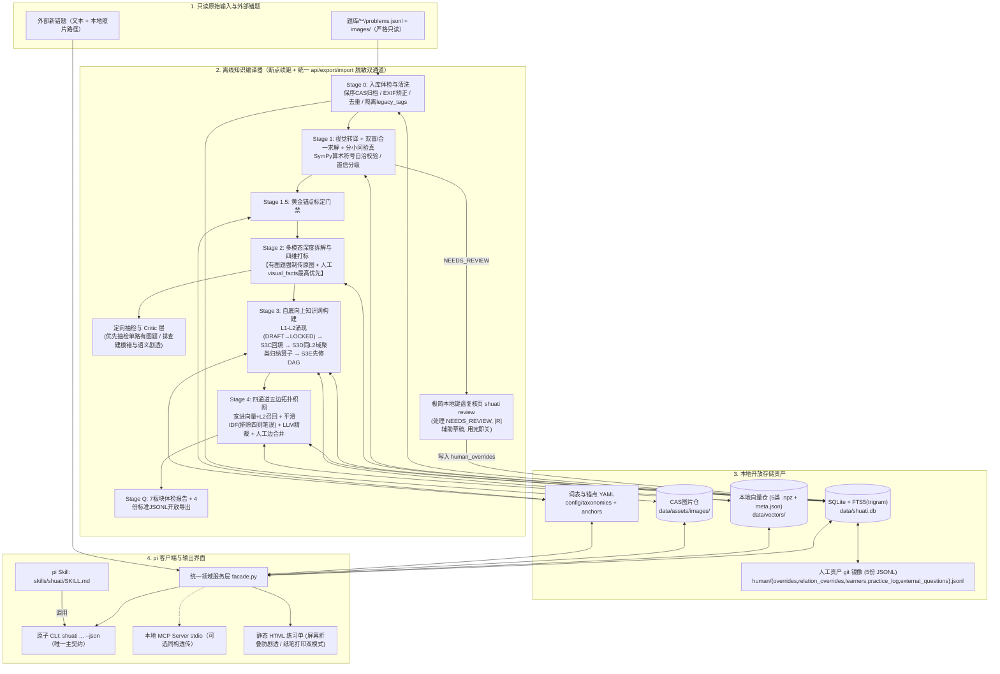

# 纯理科题库知识编译器与 `pi` 智能刷题底座 — 架构总纲（v2.6 定稿）

> **版本状态**：v2.6 权威总纲定稿（在 v2.5 的 21 项评审裁决基础上，合入第三方独立架构与 1,728 题实库实证审核的 **6 项核心拍板裁决 D-Audit-1 ～ D-Audit-6** 及 11 项代码对齐契约）  
> **文档治理（主从双层架构，D-Audit-1）**：
> - **顶层总纲（本文档）**：定义系统定位、纯理科理论基准、架构硬不变量、生命周期规则与跨模块关键裁决；凡历史文档与本文档存在冲突者，一律以本文档为准。
> - **从层实施细则**：[DESIGN.md](DESIGN.md)（保留完整 20 表 SQLite DDL、逐列 `effective.py` 解析表、M3 学习者在线 Elo 完整参数公式、组卷槽位退避细则、CLI JSON 信封规范与 HTML 打印单规范）、[REQUIREMENTS.md](REQUIREMENTS.md)（原始业务需求基线）、[理论基础.md](理论基础.md)（难度与五边拓扑理论溯源）。
>
> **当前实库工程基线（2026-11-22 实测）**：本地 `data/shuati.db` 共 **1,728 题**（剔除坏题 3 道；活跃 **1,725 题**已完成 Stage 0/1/1.5/2 及首轮 Stage 3/4 `DRAFT` 试跑，其中 `eff_is_servable = 1` 共 **1,649 题**，`NEEDS_REVIEW` 待人工复核 **76 题**；沉淀 5,385 条解题步骤、4,493 组去重 `(raw_l1, raw_l2)`；下一步按本总纲 v2.6 完成 11 项代码对齐并重跑 Stage 3d/Stage 4 后锁定 `LOCKED 1.0`）。

---

## v2.5 → v2.6 架构评审裁决演进总表

| 领域 | v2.5 已采纳基线（保留生效） | v2.6 第三方实证审核新增/修正裁决（本次定稿） |
| :--- | :--- | :--- |
| **文档治理与标尺** | ① 修正运营期题目动态校准指数方向为 $(D_{\text{old}} - \text{Student\_Elo})/400$；② 降级定位离线 `eff_base_elo` 为“启发式难度标尺（Heuristic Rating）”；③ 组卷补充低水位 ZPD 下界钳位。 | **D-Audit-1（主从双层文档）**：确立 `ARCHITECTURE.md`（总纲）+ `DESIGN.md`（DDL/公式/CLI 实施细则）主从互链，避免总纲压缩丢失 M3 实现细节。 **标尺精细化**：明确四维公式在 108 种输入组合下精确产出 **92 个离散先验值**（区间 `[1120, 2800]`）；SQLite 物理 `CHECK` 保持 `BETWEEN 800 AND 2800`（免重建 67MB 实库并兼容未来后验下调）；高段组卷因实库 `L4-B`（`1965..2135`）高于 `C=3` `L5-1`（`1850..2020`）且 `C=4` 极稀疏，改为 **`{L4-B, L5-1}` 合并按 Elo 抽题 → `L5-2` → `L5-3` 爬坡 + 空桶回退模块最高分未刷题**。 |
| **多模态与验真** | ④ 明示 SymPy 沙盒仅保证“算术与符号推导自洽”，建模与读图靠抽检与复核兜底；⑤ `hint` 第一层正则放宽“连接/作/得”等正常几何引导动词，语义剧透交 Critic 与人工复核兜底。 | **D-Audit-4（Stage 2 强制传原图 + 人工事实最高优先级）**：所有 `has_images = 1` 题目在 Stage 2 强制传入经 `exif_transpose` 矫正的原图并路由至多模态槽位；Prompt 显式规定当人工核定的 `eff_visual_facts` / `eff_final_answers` 与原图视觉直觉存在歧义冲突时**严格以人工核定事实为准**；补齐独立 `pipeline/stage2_decompose.py` 与 `shuati compile --stage 2`。 **定向抽检与隔离**：假共识抽检与 Critic（10%～15%）优先定向抽取 **`has_images = 1` 且单路 `subagent-unified`** 高风险子集；未验真 `NEEDS_REVIEW` 题不参与全局词表/先修边与分位表统计。 |
| **知识网归并与五边拓扑** | ⑥ 平滑 IDF 公式修正为 $\text{idf}(x) = \ln\frac{N+1}{\text{df}(x)+1} + 1$；⑦ `meta.json` 增加分布漂移自动重算触发器；⑧ 跨学段边废除 $\min(P_A, P_B)$ 改用全局概念桥接 + 联合骨架空间精裁；⑨ 剥离文科 RST 与 Anki 闪卡；⑩ 二期初高中理化按需扩展专用 `answer_type` 与领域验真插件。 | **D-Audit-2（Stage 3d 同 `L2` 域 `Cluster-then-Assign` 归纳 + Stage 4 宽进精裁）**：实库证明两两字面同义批裁判（68,569 对仅合并 1.8%，96% `L3` 为单题孤岛）导致 `ISOMORPHIC=0`、`SCAFFOLD=0`；升级为按同 `(grade_subject, taxonomy_version, L1, L2)` 域一次性将域内 `raw_l3` 聚类归纳为 **5～15 个标准原子算子** 并写入可逆并查集（采纳规范 `canonical_name`）；Stage 4 允许 `ISOMORPHIC` / `SCAFFOLD` 以 **“向量近邻 + `L2` 共现”宽进召回后再交 LLM 二级精裁**。 **D-Audit-3（`SHARED_TRAP` 剔除计算笔误）**：排除 `TRAP_ARITHMETIC_SLIP` 参与跨题 `SHARED_TRAP` 成边（根治实库 48.1% 同坑边沦为四则笔误噪音），且分母严格采用并集 $E_A \cup E_B$ 加权 Jaccard。 **D-Audit-5（`SCAFFOLD` 方向全局锁死）**：全链路统一锁死为 **`source = 降阶铺垫子题（低 Elo） → target = 升维母题（高 Elo）`**，修正现行代码反置。 |
| **持久化与生命周期** | ⑪ `shuati human restore` 改用幂等 `UPSERT`（严禁 `INSERT OR REPLACE`）；⑫ `taxonomy lock` 同步迁移/置空 `practice_log.stuck_node_id` 并明确重编期间进入**维护降级模式**；⑬ `base_fingerprint` 仅验真类强绑 `content_hash`，标注类与考点词表类解绑。 | **D-Audit-6（外部错题快照闭环）**：在 `human/` 下新增第 5 份 git 镜像 **`human/external_questions.jsonl`** 持久化 `source_type = 'EXTERNAL_MISTAKE'` 原始行，`human restore` 先恢复外部错题基础行并遵守 `include_practice_log` 配置开关，彻底消除“空库重编 + `human restore`”时外部错题丢失断链及空文件误清全表风险；`subagent_bridge` 增加批次返回条目完整性校验。 |

---

## 一、 产品定位、范围边界与纯理科理论基准

### 1.1 系统定位与边界（Scope & Non-Goals）

本系统是一套面向个人及多学习者共用的 **Local-First 纯理科离线题库知识编译器 + `pi` 智能检索/刷题底座**，将无答案、重配图、脏标签的原始理科题库，编译为可验证、可算难度、可按多维拓扑举一反三的本地开放知识资产。

- **核心资产形态**：单文件本地 SQLite（含 FTS5 `trigram`）+ 本地 `.npz` 向量仓 + 保序 CAS 图片仓 + YAML 标准词表/锚点 + `human/*.jsonl` git 跟踪快照 + 4 份标准 JSONL 开放导出。
- **刻意不做的边界（Non-Goals）**：
  - ❌ 不开发常驻型多页面重前端 Web 刷题平台、用户登录鉴权、云端 SaaS 多租户、社交排行或在线手写画板（仅保留用完即关的极简本地键盘复核页 `shuati review`、自包含静态双模式 HTML 练习单及 CLI/`pi` 接口）；
  - ❌ 不内置双轨 Elo 托管池（Escrow）状态机或每日盲测配额熔断；
  - ❌ **不涉及语文/英语等文科语篇修辞（RST）、干扰项设错拓扑或 Anki 词汇闪卡体系**；
  - ❌ 离线批处理解题、拆解与打标阶段严禁向模型传入原始 JSONL 的 `chapter`、`source_collection`、`question_uid`、原始图片路径或旧 `legacy_tags`，杜绝章节锚定污染。

### 1.2 纯理科非对称四维难度模型与启发式标尺

针对纯理科题目真实难度呈右偏长尾分布且人类感知呈对数特征的规律，采用“底层四维正交行为锚点 + 确定性离散先验分 + 表层左粗右细非对称 8 档”双层架构。

#### 1. 四维正交行为锚点（按学段最优标准解法评估）

LLM 严禁直接输出总分或等级，必须按 JSON 字段顺序**先输出 `evidence`（可观测解题动作证据），再输出 `[C, S, T, L]` 整数分**：

| 维度 | 取值与权重 | 可观测行为判定标准 |
| :--- | :--- | :--- |
| **`C`（概念与思维深度）** | `C ∈ [1, 4]`，指数权重 $2^C$ | 1=单模型直推；2=单点变形/常规双考点串联；3=跨模块综合/隐式建模；4=非标构造/高阶洞察。 |
| **`S`（推理链路长度）** | `S ∈ [1, 3]`，线性权重 | 不含纯四则算术：1=1～2 逻辑步；2=3～4 逻辑步；3= ≥ 5 步或 ≥ 2 种独立情况分类讨论。 |
| **`T`（信息隐蔽度与陷阱）** | `T ∈ [1, 3]`，线性权重 | 1=显式透明；2=含冗余干扰或隐含条件/图文转译；3=强反直觉、极端临界边界或连环陷阱。 |
| **`L`（运算与审题负荷）** | `L ∈ [1, 3]`，线性权重 | 1=心算/短题干；2=常规纸笔多步演算；3=高繁复计算、多变量联立或高密度信息。 |

#### 2. 确定性代码合成、离散值域与非对称 8 档映射

1. **先验难度分公式（Heuristic Rating）**：由 [difficulty.py](file:///d:/0.default/shuati-harness/src/shuati/core/difficulty.py) 确定性计算，108 种 `[C, S, T, L]` 整数输入组合经合成与上限截断后精确产出 **92 个离散先验值**，先验可达区间为 **`[1120, 2800]`**（物理表约束保留 `800..2800` 容器裕度）：
   $$\text{eff\_base\_elo} = \min\Big(2800,\; \max\big(800,\; 750 + 85 \times (2^C - 1) + 105 \times S + 115 \times T + 65 \times L\big)\Big)$$
2. **统计学定位声明**：个人与少数学习者离线场景缺乏大规模作答样本反向标定题目参数，因此 `eff_base_elo` 与派生学习者水位 $R$ 定位为**基于黄金锚点与可观测动作证据的启发式难度标尺（Heuristic Rating）**，而非严格统计收敛的 IRT 参数。
3. **非对称 8 档 `eff_tier` 映射**（完整按序判定表见 [DESIGN.md §4.4-3](DESIGN.md#3-确定性非线性难度合成引擎coredifficultypy决策-d4)）：
   - `C <= 2` 封顶 `L4-A_进阶拔高(繁)`，杜绝纯繁琐简单题混入 `L5`；`C = 4` 分档阈值为 `2400 / 2600`（决策 D4）；
   - **非单调性约定**：各档 Elo 区间存在设计性重叠（实测 `L4-B` 为 `1965..2135`，高于 `C=3` `L5-1` 的 `1850..2020`），因此 `L4-A` 与 `L4-B` 横向并列展示，不将 `tier_rank` 简单等同于严格 Elo 单调序。
4. **未来运营期动态后验校准预留公式**（仅大规模多人数据充足时可选启用）：
   $$D_{\text{new}} = D_{\text{old}} + K \cdot \left(\text{Expected\_Pass} - \text{Actual\_Pass}\right), \qquad \text{Expected\_Pass} = \frac{1}{1 + 10^{(D_{\text{old}} - \text{Student\_Elo})/400}}$$

### 1.3 纯理科“剥皮抽骨”五边拓扑理论

每道题解耦为“表皮情境（题干 + 读图描述）+ 去情境抽象骨架 + 原子算子/经典母题集合 + 数理陷阱集合”，构建五类教学关联边：

| 边类型（`relation_type`） | 理论溯源 | 方向性与约束 | 纯理科教学联动价值 |
| :--- | :--- | :--- | :--- |
| **`CLONE`（孪生换数）** | 结构映射理论（Gentner, 1983） | 无向（`u < v`，同学段） | 高表皮 + 高骨架 + 小难度差；同题型巩固与组卷 14 天冷却避重。 |
| **`ISOMORPHIC`（跨域同构）** | 问题同构理论（Simon, 1975） | 无向（`u < v`，支持跨学段） | 异表皮 + 高骨架同构；检验脱离故事包装识别底层数理模型。 |
| **`SCAFFOLD`（阶梯子母）** | 知识空间理论 KST & 学习层级 | **有向（`source = 子题 → target = 母题`，同学段，D-Audit-5）** | 子题核心考点被母题包含且 $D_{\text{target}} - D_{\text{source}} \ge 200$；错母题降阶追根，通子题升维拔高。 |
| **`CONTRASTIVE`（形似神异）** | 变式教学理论（顾泠沅 / Marton） | 无向（`u < v`，同学段） | 高表皮相似 + 低内核重合（强制经 LLM 精裁）；并排辨析破除审题定势。 |
| **`SHARED_TRAP`（同坑共病）** | 错误规则模型（BUGGY / Rule Space） | 无向（`u < v`，支持跨学段，**排除 `TRAP_ARITHMETIC_SLIP`，D-Audit-3**） | 跨模块共享同一高危数理认知陷阱（如定义域端点遗漏、增根未验、参考系漂移），靶向排雷。 |

---

## 二、 总体架构与九条架构硬不变量

### 2.1 四层系统架构（离线重编译 + 在线轻检索）

### 2.2 九条架构硬不变量（Invariants）

1. **严禁章节与旧标签污染**：Stage 1～Stage 4 所有送入模型或导出给并发 Subagent 的载荷，在类型签名与序列化白名单上严禁包含 `raw_chapter`、`legacy_tags`、`question_uid`、`source_collection` 及原始图片路径；由 `llm/prompt_builder.py` 与 `pipeline/subagent_bridge.py` 双重拦截断言。
2. **机审层与人工覆盖层物理隔离、人工数据永不物理删除**：`questions` 中可覆写字段拆为 `m_*`（仅流水线写）与 `eff_*`（唯一写入者 `core/effective.py`，安装 `set_authorizer` + `TEMP TRIGGER` 拦截越权写入），业务检索/组卷/向量/导出只读 `eff_*`。人工表与学习者日志表外键一律 `ON DELETE RESTRICT`，题目下架仅软删除（`is_retired = 1` 或 `eff_is_excluded = 1`）。
3. **学段严格隔离 + 思维原型跨学段互通**：`knowledge_nodes`（L1/L2/L3）、`taxonomy_*.yaml`、`anchors_*.yaml`、难度标尺与分模块能力水位严格限定在 `grade_subject` 内；`concepts`（`METHOD`/`MOTIF`/`TRAP`）为全局注册表支撑跨学段同构与排雷。
4. **按小问区分答案类型与验真模式（决策 D3）**：答案以 `AnswerPart[]` 为原子单位，禁止自造 `(1)-k` 子标签，小问内多值通过 `collection_mode`（`SINGLE`/`ORDERED_TUPLE`/`UNORDERED_MULTISET`/`LABELED_MAP`）表达；按小问强校验 `answer_type × verify_mode` 白名单。二期扩展初高中物理/化学无需改表，按需在 `verify/` 新增学科专属 `answer_type` 枚举与确定性校验插件。
5. **多模态真源、人工读图最高优先与确定性难度合成（D-Audit-4）**：有图题（`has_images = 1`）在 Stage 1 与 Stage 2 **均强制传入经 `exif_transpose` 矫正的原图**；当 `eff_visual_facts` 含人工覆写确认事实且与原图视觉直觉存在歧义时，严格以人工核定 `eff_visual_facts` 与 `eff_final_answers` 为准；`visual_facts` 同时服务于 FTS5、`surface` 向量拼接（`eff_question_text + "\n" + eff_visual_facts`）及复核/提示；难度分与 8 档 `tier` 100% 由确定性代码合成。
6. **SymPy 沙盒全平台安全隔离与验真边界明示**：AST 静态探针（放行算术/数论/几何函数，拦截纯常量空壳复读脚本与字符串求值 API）+ 独立子进程 + 超时进程树强杀 + 内存上限（Windows Job Object / Linux `RLIMIT_AS`）。明确 SymPy 仅证明计算与符号推导自洽，读图与建模正确性由双盲核对、定向假共识抽检与 Critic 抽检保障。
7. **原始题库目录严格只读**：`题库/`（尤其严禁读取任何 `题库/*/md/`）与 `backup/v1/` 全程只读，所有生成物、CAS 图片、向量、备份与导出均落在 `data/`（git 镜像落在 `human/`）。
8. **CLI 是唯一权威接入契约（决策 D2）**：所有面向 `pi` 的能力统一收敛在 `services/facade.py` 并以 `shuati <command> --json` 为权威契约；`pi` Skill 仅编排 CLI，可选 stdio MCP Server 仅做同构透传。
9. **人工资产与外部错题 5 文件 git 快照双写与 Upsert 安全恢复（D-Audit-6）**：每次写入 `human_overrides`、`relation_overrides`、`learners`、`practice_log` 或录入 `EXTERNAL_MISTAKE` 题目后，原子导出全表升序快照至 `human/{overrides,relation_overrides,learners,practice_log,external_questions}.jsonl`；恢复一律使用 `INSERT ... ON CONFLICT DO UPDATE`（Upsert），先恢复 `external_questions.jsonl` 基础行再做外键完整性预检，遵守 `include_practice_log` 配置保护，破坏性操作前自动执行 `VACUUM INTO data/backups/<ts>_<command>.db`。

---

## 三、 数据契约与持久化核心规则（完整 DDL 见 [DESIGN.md §3](DESIGN.md#三-数据模型与-sqlite-schema-设计)）

### 3.1 `human_overrides` 分组指纹绑定策略（消除标点微调连坐误杀）

| 字段组 | 包含字段 | 指纹/版本校验规则 | 失配后果 |
| :--- | :--- | :--- | :--- |
| **验真类** | `question_text`、`visual_facts`、`final_answers_json`、`solutions_override_json`、`verification_status`、`format`、`is_excluded` | **强绑定 `raw_questions.content_hash`** | 源题干/配图/图序变化时，同 `bundle_id` 整组自动挂起（`SOURCE_CHANGED`），`eff_verification_status` 降为 `NEEDS_REVIEW`（`OVERRIDE_STALE`）并退出组卷池。 |
| **标注类** | `difficulty_override_json`（含 `ANCHOR_CALIBRATION`）、`abstract_skeleton`、`thinking_methods_json`、`classic_motifs_json`、`trap_tags_json` | **解绑 `content_hash`**（仅保留写入时审计快照，不因源题微调自动挂起） | 源题勘误微调时继续生效，仅在 Stage Q 报告中列出“源题已变更，建议抽检”提示。 |
| **考点词表类** | `primary_l1_module`、`secondary_l1_modules_json`、`taxonomy_override_json` | **解绑 `content_hash`，仅强校验 `taxonomy_version`** | 词表换版/锁表/迁移时先按名称与 `aliases` 自动重签；无法映射项才置 `TAXONOMY_UNMAPPED` 挂起。 |

### 3.2 本地向量仓与 `meta.json` 分布漂移触发器（`data/vectors/`）

1. **5 类 `.npz` 矩阵**（`float32`、L2 归一化、带 `text_hashes` 差量同步与跨进程 `.lock` 文件锁）：
   - `surface_<slug>.npz`：**必须编码 `eff_question_text + "\n" + eff_visual_facts`**（仅纳入 `eff_is_servable = 1` 或显式指定集合）；
   - `skeleton_<slug>.npz`：编码 `eff_abstract_skeleton`；
   - `l3_nodes_<slug>.npz`：仅编码活跃 `node_level = 'L3'` 节点（`L1/L2/L3` 组合文本，严格排除 `L2` 汇总节点）；
   - `concepts_method.npz` & `concepts_motif.npz`：编码活跃非种子全局概念。
2. **`meta.json` 冻结分位表与自动漂移巡检**：
   - 记录 `embedding_model`、`dimension`、`meta_version`、建表时作用域可服务题量 $N_0$、各 L1 模块占比分布向量 $\mathbf{p}_0$，以及最多 20,000 对随机题对的 101 点经验余弦分位表。
   - **重算触发条件**：满足任一即在 `audit` / `reindex` 中告警并触发重建分位表（递增 `meta_version`，置该学段 `S4 = STALE`）：① 显式执行 `shuati reindex --quantiles` 或切换 Embedding 模型；② 作用域内 `eff_is_servable = 1` 题量相对 $N_0$ 增长 $\ge 20\%$；③ 任一 L1 模块占比偏移 $|\Delta p_i| \ge 0.10$ 或总变差距离 $\text{TVD}(\mathbf{p}, \mathbf{p}_0) \ge 0.15$。

### 3.3 人工资产与外部错题安全恢复协议（`shuati human restore`，D-Audit-6）

1. **前置条件与外部错题自举**：若目标库为空库，须先执行 `shuati ingest` 建立 `题库/` 存量题主键；随后 `restore` **第一步自动导入 `human/external_questions.jsonl`**，幂等补齐所有 `source_type = 'EXTERNAL_MISTAKE'` 的 `raw_questions` 与 `questions` 基础行；接着做全量外键预检，确认待恢复记录引用的 `question_uid` 100% 存在（缺失则立即中止并输出缺口清单，零半途崩溃）。
2. **Upsert 与隐私开关保护**：自动执行 `VACUUM INTO` 备份后，在单事务内按 `learners → human_overrides → relation_overrides → practice_log` 顺序执行 `INSERT ... ON CONFLICT DO UPDATE`；当 `settings.yaml` 中 `human_mirror.include_practice_log = false`（或快照文件为空且库内已有非空日志未显式传 `--force-wipe-logs`）时，**跳过对 `practice_log` 的裁剪删除**，严防误清空本地做题记录。
3. 恢复后自动执行 `effective.recompute` 重算受影响题目并校验快照哈希一致性。

---

## 四、 离线知识编译流水线关键契约（Stage 0 ～ Stage 4 + Stage Q）

### 4.1 Stage 0 & Stage 1：清洗去重、验真与定向抽检

- **Stage 0**：递归扫描只读 `题库/**/problems.jsonl`，经 `config/collections.yaml` 分派学段；原图无损保序 CAS 归档，外部拍照错题入库前固定执行 `exif_transpose()` + RGB 转换 + `2048px` 长边缩放；`normalize_text` 修复汉字间断行、绑定多图末尾子图标签至 `image_captions_json`、行首锚定提取选择题 `options_json`、并以 `content_hash` + `plain_fingerprint`/`dHash` 去重。
- **Stage 1 双通路**：支持常规 API 跨家族双盲求解（`PRIMARY` + `SECONDARY` + SymPy + 等价核对 + 一题多解捕获）与大批量冷启动 `UNIFIED_S1_S2` 单路推理 + SymPy 验算。
- **`NEEDS_REVIEW` 局部落库与全局统计隔离**：`NEEDS_REVIEW` 题在合一模式下允许保存其单题 Stage 2 拆解结果（免后续重复拆解），但 **`eff_is_servable = 0`，在 Stage 3a 词表涌现、Stage 3e 先修/共现边统计、向量分位表抽样与 Stage 4 五边织网中默认隔离排除**，防止未验真错解污染全局图谱。

### 4.2 Stage 1.5 & Stage 2：黄金锚点门禁与强制多模态拆解（D-Audit-4）

- **Stage 1.5**：每学段标定 $\ge 4$ 道跨梯度已验真锚点题写入 `config/anchors/anchors_<slug>.yaml` 与 `ANCHOR_CALIBRATION` 覆写，解锁 Stage 2。
- **Stage 2 强制原图输入（`pipeline/stage2_decompose.py` & `unified_import.py`）**：
  - 凡 `has_images = 1` 的题目，Stage 2 **必须将经 `exif_transpose()` 矫正的保序配图连同 `(grade_subject, eff_question_text, eff_visual_facts, verified_solutions, eff_final_answers, anchors_fewshot)` 一并送入具备视觉能力的多模态模型槽位**（纯文字题 `has_images = 0` 不传图）；
  - **权威优先级铁律**：当该题存在激活的人工 `visual_facts` 或 `final_answers_json` 覆写时，Prompt 显式注入指令——若原图印刷模糊/阴影边界与已核定 `eff_visual_facts` 冲突，必须无条件服从人工核定的 `eff_visual_facts` 与标准答案，严禁自行推翻重解；
  - **`hint` 双层防剧透**：Python 层硬拦截答案数值直出与直接剧透句式（放宽“连接/作/得”等正常几何引导词），语义变相剧透交 Critic 抽检与复核闭环纠偏。

### 4.3 Stage 3：词表锁表状态机与同 `L2` 域算子聚类归纳（D-Audit-2）

1. **`DRAFT → LOCKED 1.0` 原子锁表与维护降级模式**：
   - `shuati taxonomy lock` 先做 `VACUUM INTO` 备份并持 `CompileLock`：单事务内完成 ① `human_overrides` 词表字段自动映射/挂起；② **`practice_log.stuck_node_id` 按 `(l1, l2)` 同步映射至新词表节点或置 `NULL`（保留 `stuck_sub_goal` 文本快照，零悬空 ID）**；③ 清空机器 `m_l1/m_l2/m_knowledge_node_id`（严格保护 `raw_l1/raw_l2/raw_l3` 只读）；④ 清理旧 `draft-%` 节点与边并归档旧并查集账本；⑤ 更新 `grade_subjects` 状态与全学段 `S3C/S3D/S4 = STALE`；**事务 `commit()` 成功后**再原子写盘新 YAML 与 `human/*.jsonl`（杜绝回滚撕裂）。
   - **维护降级模式**：锁表提交后至 S3C/S3D 重编完成期间，基础题干检索、单题查看与做题日志正常服务；`--l2/--l3` 检索、知识树热力与依赖 `K_set` 的功能显式返回 `MAINTENANCE_DEGRADED` 提示，重编完毕自动恢复。
2. **Stage 3d 升级：同 `L2` 域 `Cluster-then-Assign` 标准算子归纳（D-Audit-2）**：
   - **废弃全量两两字面同义批裁判**（实测 6.8 万对仅合并 1.8%，留下 96% `df=1` 单题孤岛）；
   - **新机制（同域聚类归纳）**：在严格同一 `(grade_subject, taxonomy_version, L1, L2)` 作用域内（排除 `node_level='L2'` 汇总节点），汇总该 `L2` 下全部去重 `raw_l3` 短语及频次（若某 `L2` 下去重 `raw_l3` 超过 80 条，先以 Embedding 预聚为子簇），一次送入强推理模型（支持 `--mode api|export|import`）**归纳出 5～15 个 4～14 字标准原子转化算子（`canonical_l3`）并将每个 `raw_l3` 映射归入对应标准算子**；
   - **落库与可逆性**：每个标准算子建为活跃主 `L3` 节点（采纳 `canonical_name`），被归入的原细碎 `L3` 节点设 `redirect_to_id` 指向该标准主节点（路径跳数恒 $\le 1$），完整记入 `compaction_audit_ledger` 支持按 `batch_id` 一键 `revert-merge` 无损拆回；
   - **全局 `MOTIF` / `METHOD` 收敛**：对全局概念同样采用 Embedding 连通分量/分簇归纳归并，且对仅出现 1 次的泛化描述型伪 `MOTIF` 在 Stage 4 特征构建中降权或过滤，确保经典母题真正高复用。

### 4.4 Stage 4：宽进精裁五边拓扑织网（D-Audit-2, D-Audit-3, D-Audit-5）

默认仅对 `eff_is_servable = 1` 题目织边（`NEEDS_REVIEW` 置 `S4 = 'BLOCKED'`）。

1. **平滑 IDF 与陷阱重合度（排除四则笔误，D-Audit-3）**：
   - 平滑权重：$\text{idf}(x) = \ln\frac{N + 1}{\text{df}(x) + 1} + 1$；
   - 加权非对称包含度：$I_w(A \subset B) = \frac{\sum_{x \in K_A \cap K_B} \text{idf}(x)}{\sum_{x \in K_A} \text{idf}(x)}$（分母为 0 返回 `0.0`；支持多解分支取最大覆盖）；
   - **认知陷阱集合净化**：构造跨题匹配集合 $E_{\text{trap}}^{\text{weave}} = E_{\text{trap}} \setminus \{\text{TRAP\_ARITHMETIC\_SLIP}\}$（`TRAP_ARITHMETIC_SLIP` 绝不触发 `SHARED_TRAP` 边），并严格按**并集分母**计算加权 Jaccard：
     $$S_{\text{trap}}^{\text{IDF}}(A, B) = \frac{\sum_{t \in E_A^{\text{weave}} \cap E_B^{\text{weave}}} \text{idf}(t)}{\sum_{t \in E_A^{\text{weave}} \cup E_B^{\text{weave}}} \text{idf}(t)}$$
2. **宽进候选召回 + 结构/LLM 二级精裁（D-Audit-2 & D-Audit-5）**：
   - **`CLONE`**：`surface` 与 `skeleton` 互近邻 + 高分位/硬下界 + $|\Delta D| \le 120$；
   - **`ISOMORPHIC`**：以 `skeleton` Top-K 近邻（或共享标准 `L3`/`MOTIF`）宽进召回，剔除已命中 `CLONE` 的极高表皮对（不再用过严的 `surface_pct <= 0.60` 与原始孤岛 `k_jaccard >= 0.45` 一刀切封杀），核心高置信对直通、宽进候选带批量送 LLM 精裁确认“换皮同构”；
   - **`SCAFFOLD`（严格锁死 `source = 子题 → target = 母题`，D-Audit-5）**：要求 $D_{\text{target}} - D_{\text{source}} \ge 200$，满足“标准 `L3/MOTIF` 非对称包含 $I_w(\text{source} \subset \text{target})$ 达标”**或**“共享同一核心 `L2` 实体且 `skeleton` 近邻相关”即进入候选带，经 LLM 精裁确认“子题确为母题关键前置子步骤”后落库；
   - **`CONTRASTIVE`**：`surface` 互近邻极似且考点交集低，100% 经 LLM 精裁生成对比辨析 `pedagogical_note`；
   - **`SHARED_TRAP`**：基于净化后 $E_{\text{trap}}^{\text{weave}}$ 满足重合阈值且骨架分离，跨 L1 模块 $\times 1.3$ 加权，每题 Top-5 硬截断；
   - **跨学段边**：仅限 `ISOMORPHIC` 与 `SHARED_TRAP`，采用“共享全局 `MOTIF`/`METHOD`（或高危 `TRAP`）硬桥接 → 拼接联合骨架空间 Top-K → LLM 精裁确认”三段式生成。
3. **批次完整性校验**：所有经 `subagent_bridge` 导出的精裁/归纳/映射任务，回灌时强制核验输入 `task_item_ids` 全量覆盖（或在输出 Schema 中显式声明正负裁决），严禁将模型输出截断漏项静默当作负例放行。

---

## 五、 在线能力画像、自适应组卷与 `pi` 接入面（完整公式与命令见 [DESIGN.md §5](DESIGN.md#五-多角色能力画像组卷引擎与-pi-cliskill-交互接入设计)）

1. **分模块在线启发式水位重放**：基于 `practice_log`（剔除 `VOIDED` 及被冲销行，支持多小问 `score_ratio` 部分得分、提示折扣与 7 天重刷半 $K$ 防刷分）实时重放派生各 `(learner_id, grade_subject, L1)` 水位 $R$、8 档通过率阶梯（`L4-A` 与 `L4-B` 并列诊断怕繁/怕巧）及薄弱 `L2/L3/MOTIF/TRAP` 雷达。
2. **自适应组卷三大护栏**：
   - **低水位 ZPD 下界钳位**：当 $R + 200 < 1200$ 时，拔高窗口强制钳位至 `[1120, max(1250, R + 250)]`，防止滑入 `1120` 以下先验真空区；
   - **高水位重叠合并与断层爬坡**：当学习者进入进阶高分段（如 $R \ge 1800$）或指定拔高冲刺时，先将 Elo 重叠的 `{L4-B, L5-1}` 合并按连续 `eff_base_elo` 选拔，突破后再依次向 `L5-2`、`L5-3` 按档爬坡；若目标高阶档位在当前模块无题（如实库 `L5-3` 为空），自动回退抽取该模块未刷最高 `eff_base_elo` Top-K 题并在 `warnings` 中透明说明；
   - **`CLONE` 14 天冷却与同卷硬互斥**。
3. **防剧透契约与接入**：`reveal="quiz"` 默认隐藏答案、解法、`visual_facts` 与细粒度标签；判对错统一走不泄露标准答案的 `shuati check`；配套双模式静态 HTML 练习单渲染器（屏幕三级折叠 + `@media print` 按题型动态留白）。

---

## 六、 迈向 `LOCKED 1.0` 与 M3 的代码对齐路线图（11 项实施清单）

在当前 M2 `DRAFT` 基线上，下一步按以下优先级推进工程闭环（遵循三模型实证测试纪律）：

1. **P0 拓扑与知识网核心修正（4 项）**：
   - 修正 [topology.py](file:///d:/0.default/shuati-harness/src/shuati/core/topology.py) 与 [prompt_builder.py](file:///d:/0.default/shuati-harness/src/shuati/llm/prompt_builder.py) 中 `SCAFFOLD` 方向为 `source = 子题 → target = 母题`（D-Audit-5）；
   - 修正 [topology.py](file:///d:/0.default/shuati-harness/src/shuati/core/topology.py) 平滑 IDF 为 `+ 1.0`、陷阱重合分母改为并集 $E_A \cup E_B$，并在 `SHARED_TRAP` 中排除 `TRAP_ARITHMETIC_SLIP`（D-Audit-3）；
   - 修正 [stage4_weave.py](file:///d:/0.default/shuati-harness/src/shuati/pipeline/stage4_weave.py) 中 `surface` 向量拼接为 `eff_question_text + "\n" + eff_visual_facts`，并过滤非 `eff_is_servable` 题；
   - 升级 [stage3_taxonomy.py](file:///d:/0.default/shuati-harness/src/shuati/pipeline/stage3_taxonomy.py) 与 [knowledge_graph.py](file:///d:/0.default/shuati-harness/src/shuati/core/knowledge_graph.py) 为同 `L2` 域 `Cluster-then-Assign` 标准算子归纳归并（采纳 `canonical_name`），并放宽 Stage 4 `ISOMORPHIC`/`SCAFFOLD` 为“向量近邻 + `L2` 共现宽进召回 → LLM 精裁”（D-Audit-2）。
2. **P1 多模态 Stage 2、数据安全与生命周期补齐（5 项）**：
   - 新增独立 `pipeline/stage2_decompose.py` 与 `shuati compile --stage 2`，对 `has_images = 1` 强制传原图并注入人工 `eff_visual_facts` 最高优先级指令（D-Audit-4）；
   - 升级 [human_mirror.py](file:///d:/0.default/shuati-harness/src/shuati/db/human_mirror.py) 新增 `human/external_questions.jsonl` 镜像、外键完整性前置预检与 `include_practice_log` 防误删保护（D-Audit-6）；
   - 升级 [effective.py](file:///d:/0.default/shuati-harness/src/shuati/core/effective.py) 与 [refresh.py](file:///d:/0.default/shuati-harness/src/shuati/core/refresh.py) 落地分组 `base_fingerprint`（仅验真类强绑 `content_hash`）；
   - 升级 [taxonomy.py](file:///d:/0.default/shuati-harness/src/shuati/core/taxonomy.py) 在 `taxonomy lock` 中同步迁移/置空 `practice_log.stuck_node_id`、将磁盘 YAML 写入移至 `conn.commit()` 之后，并补齐维护降级模式状态校验；
   - 升级 [subagent_bridge.py](file:///d:/0.default/shuati-harness/src/shuati/pipeline/subagent_bridge.py) 强制校验批处理返回条目完整性，杜绝截断静默放行。
3. **P2 质检巡检完善与 M3/M4 推进（2 项）**：
   - 完善 [store.py](file:///d:/0.default/shuati-harness/src/shuati/vectors/store.py) 与 [audit.py](file:///d:/0.default/shuati-harness/src/shuati/pipeline/audit.py)：补齐 `meta.json` 漂移检测（$N_0, \mathbf{p}_0$）、单路有图题优先假共识抽检队列及 `legacy_tags` 对比板块；
   - 实库重跑优化后的 Stage 3d/Stage 4 验证五边分布健康度，审定词表锁定 `LOCKED 1.0`，随后进入 **M3（`pi` CLI/Skill 交互底座、启发式画像、自适应组卷与双模式 HTML 练习单）**。
