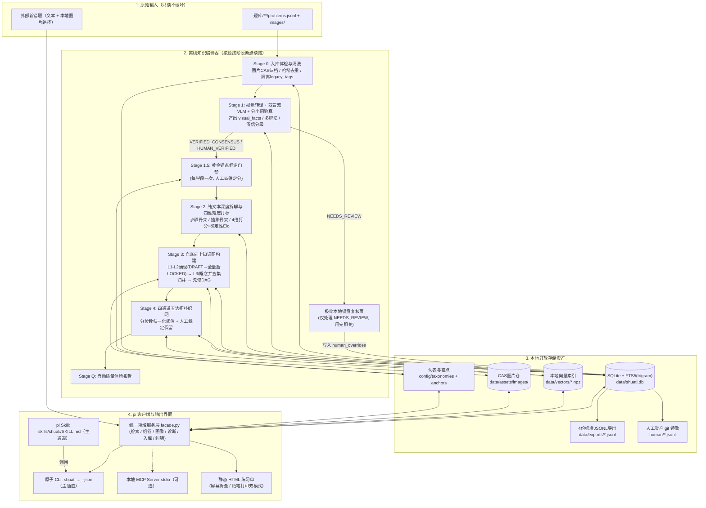
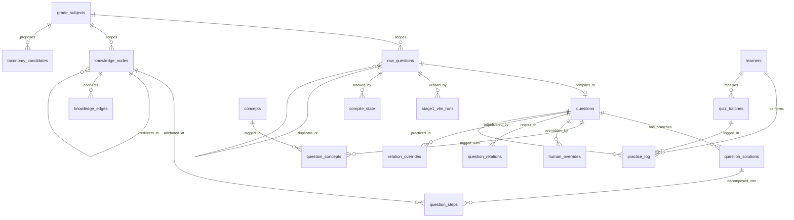

# 纯理科题库知识编译器与 `pi` 智能刷题底座 — 架构与详细设计文档（v2.3）

> **状态**：v2.3 修订稿（在 v2.2 基础上合入 2026-11-20 第三轮深度评审修复与用户决策 D5/D6，待用户终审）  
> **更新日期**：2026-11-20  
> **需求权威**：[REQUIREMENTS.md](REQUIREMENTS.md)（FR-1 ~ FR-11, NFR-1 ~ NFR-5）  
> **理论权威**：[理论基础.md](理论基础.md)（非对称四维难度模型与“剥皮抽骨”五边拓扑理论）  
> **现状核实**：本地 `题库/` 目录当前已就绪 2 个章节（`ch01_计算基础` 15 题、`ch28_平面直线图形高年级卷` 107 题，共 122 题，图片完整性 100%），后续将持续放入其余章节至 1000+ 题并平滑扩展初高中数理化。

### v2.3 修订摘要（第三轮评审 + 用户决策 D5/D6）

| 类别 | 变更 |
| :--- | :--- |
| **用户决策 D5** | 人工修正后的**生效数据物化为独立的 `eff_*` 生效列**：`questions` 中可覆写字段拆为 `m_*`（机器层）与 `eff_*`（生效层），检索 / 组卷 / 门禁 / FTS5 / 向量 / 导出只读 `eff_*`；唯一写入者为 `core/effective.py`（§3.2-4、§4.8） |
| **用户决策 D6** | 学习者水位由“75 分位”改为**分学段 × 分 L1 模块在线 Elo**，按 `practice_log` 时间序确定性重放，仍为纯事件派生（§5.1） |
| 评审建议默认采纳（可改） | 新增不泄露答案的 `shuati check` 判题命令（§5.4-2）；人工资产镜像为 git 跟踪的 `human/*.jsonl`，破坏性操作前自动快照（§3.6、不变量 9）；“数形结合”不列入泛词黑名单（与 FR-4 原文示例一致） |
| 三轮评审 P0 | 覆写增加 `base_fingerprint` + 失配自动挂起（`OVERRIDE_STALE`）；步骤级覆写与做题卡点改用 `step_fingerprint` / 登记时快照锚定；复核页 `ADOPT_RUN` 原子整体采纳（含辅路 `visual_facts`）；编译上游通用门禁 + 跨进程编译锁 + `taxonomy lock` 事务边界修正；Prompt 构建器字段白名单（uid / 集合名含章节名，禁止入 Prompt）；人工资产 git 镜像 |
| 三轮评审 P1/P2 | `config/collections.yaml` 集合→学段映射与 `grade-subject add`；定义 `normalize_text`（OCR 断词 / 残留图标签）；跨源副本建 raw 行（`duplicate_of_uid`）；源题消失下架检测；`SINGLE_RUN_ONLY` 改为重试优先；新增 `judge_llm` 槽位与 `TEXT_RESOLVE` 双车道；数值型选择题强制 SymPy 互校；题目级验真模式派生值 `SYMBOLIC` 更名 `DETERMINISTIC`；锚点预筛与允许缺档；DRAFT 换版清理与 L1 类覆写迁移；Stage 3d 改 Top-K 召回；先修 DAG 以 L2 粒度为主；Stage 4 改“每题 kNN 排名 + 冻结分位表 + 硬下界”、跨学段规则、`SCAFFOLD` 最小集合与 IDF 包含度、`CONTRASTIVE` 由 LLM 门控；组卷近期卷避重；外部错题 `--answer` 与验真语义；步骤独立防剧透 `hint` 字段；Windows UTF-8 输出、Job Object 内存上限、`sympify` 字符串求值拦截、复核页仅绑 `127.0.0.1`；UTC 时间约定；新增 `llm_calls` 账本（共 20 张表）；难度公式口径声明与 108 组合全枚举单测 |

### v2.2 修订摘要（含 v2.1 决策与二轮审核修复）

| 类别 | 变更 |
| :--- | :--- |
| **用户决策 D1** | 知识目录（L1/L2 词表）**等全量题完成 Stage 2 后再涌现并锁定**；122 题开发期只产出 `DRAFT` 草案并以“临时模式”驱动下游开发测试（§4.5） |
| **用户决策 D2** | `pi` 接入改为 **CLI（`--json`）+ `pi` Skill 为一等公民**，MCP Server 降级为可选薄封装（§5.4） |
| **用户决策 D3** | 答案结构**按小问（answer part）区分答案类型与验真模式**（`answer_type` + `verify_mode`），题目级验真模式改为派生值并新增 `MIXED`（§3.2、§4.3） |
| **用户决策 D4** | `C=4` 分档阈值采用 **`2400 / 2600`**（§4.4） |
| 一轮评审 P0/P1 | FTS5 改 `trigram`；选择题纠偏改为行首锚定正则；人工覆写与日志外键改 `RESTRICT` + 软删除；`question_uid` 加入来源集合防撞号；新增 `compile_state` / `concepts` / `question_concepts` / `taxonomy_candidates` / `relation_overrides` / `quiz_batches` 表；新增 Stage 1.5 锚点门禁；Stage 4 改分位数归一化 + `SHARED_TRAP` 防爆边；统一 `reveal` 裁剪、幂等预览与 JSON 信封 |
| **二轮评审修复** | 补全缺失的第 4～7 章；修正建库种子外键顺序；补齐 `question_relations` / `relation_overrides` 无向边有序 `CHECK`；补齐 `practice_log` 防重复冲销唯一索引与 `SOLVED_SOLO` 约束；补齐 `redirect_to_id` 部分索引与读时展开约定；修正 `question_concepts` 按 `kind` 覆盖物化语义；扩展 `AnswerPart` 支持 `SYMBOL_FILL`（含运算符）、`SET_OR_INTERVAL` 与多选题归一；明确 `DRAFT → LOCKED` 事务迁移、`TEXT_RESOLVE` 状态转移与 FTS5 多词/特殊字符转义 |

---

## 一、 架构总览与核心设计原则

### 1.1 系统定位与总体分层

本系统是一个**离线重编译 + 在线轻检索**的纯理科本地知识资产系统（Local-First），严格避免重型常驻 Web 服务，分为四个清晰层次：

1. **输入与资产层**：只读原始题库（`题库/**/problems.jsonl` + 章节相对图片）、外部拍照/截图错题、以及不可变的 CAS 图片仓库（`data/assets/images/`）。
2. **离线知识编译器（Offline Compiler）**：Stage 0 ~ Stage 4（含 Stage 1.5 锚点标定门禁与 Stage Q 体检），将无答案、带几何配图、带脏标签的原始题目，分阶段编译为带验真答案、多解法步骤、严密三层知识网（L1/L2/L3 + 先修 DAG）和全库五边关联图（`CLONE` / `ISOMORPHIC` / `SCAFFOLD` / `CONTRASTIVE` / `SHARED_TRAP`）的高纯度知识库。
3. **双层持久化存储引擎**：
   - **SQLite（含 FTS5 `trigram`）**：存放题库主表、编译状态、人工覆盖层、知识网、全局概念层、五边关系、多角色做题足迹与组卷记录；
   - **本地向量索引（`.npz` float32 矩阵）**：存放表皮向量、抽象骨架向量与 L3 算子向量，零外部向量库依赖，Windows/Linux/macOS 开箱即用；
   - **标准配置 YAML**：学段知识目录树（`taxonomy_*.yaml`，`DRAFT` → `LOCKED`）与黄金难度校准锚点（`anchors_*.yaml`）。
4. **应用与接入层**：
   - **用完即关的极简本地键盘复核页**（仅用于人工裁决 `NEEDS_REVIEW` 分歧题）；
   - **面向 `pi` 的接入面**：统一 Service 层（`facade.py`）以 **原子 Python CLI（`shuati … --json`）为主通道**，辅以 **`pi` Skill** 约束调用流程与防剧透习惯；**本地 MCP Server（stdio）为可选薄封装**，与 CLI 共享同一 JSON 契约；
   - **自包含静态 HTML 练习单渲染器**：屏幕防剧透交互 + `@media print` 纸笔作图打印双模式。



### 1.2 九条架构硬不变量（Invariants）

1. **严禁章节与旧标签污染**：Stage 1（看图解题验真）与 Stage 2（纯文本拆解与打标）的数据传递对象（DTO）**在类型签名上不包含 `chapter` 与 `legacy_tags`**，从代码结构上杜绝章节锚定污染。旧数据仅存于 `raw_questions` 表用于质检对比。此外，**`question_uid` 与 `source_collection` 含章节名（如 `ch28_平面直线图形高年级卷`），同样禁止进入 Prompt**：统一由 `llm/prompt_builder.py` 按字段白名单（仅题干、`visual_facts`、解法、答案与图片字节）组装消息，uid 只放请求元数据；回归测试断言发出的 messages 不含 `source_collection`、`chapter`、`ch\d+_` 及原始图片路径等子串。
2. **机审层与人工覆盖层彻底隔离、人工数据永不物理删除**：任何模型重跑、Prompt 升级或切换模型，**只更新机器生成表/列，绝不覆盖 `human_overrides` / `relation_overrides`**。所有业务读取一律只读**生效层**（决策 D5）：`questions` 中可被覆写的字段拆为 `m_*`（机器层，仅流水线写）与 `eff_*`（生效层，仅 `core/effective.py` 依据“`m_*` ⊕ 激活且未挂起的覆写”重算写入），检索、组卷、门禁、FTS5、向量编码与导出一律只读 `eff_*`，`EffectiveQuestion` DTO 直接由 `eff_*` 列与物化生效表装载。每条覆写记录其所依据的上游指纹 `base_fingerprint`，上游变化导致失配时**自动挂起**而非继续生效（§3.2-7）。人工覆盖层与学习者事件层的外键一律 `ON DELETE RESTRICT`，题目下架只做软删除（`is_retired`）。
3. **学段严格隔离 + 思维原型跨学段互通**：
   - `knowledge_nodes`（L1/L2/L3）、`taxonomy_*.yaml`、`anchors_*.yaml`、难度标尺与学习者分模块 Elo **严格限定在 `grade_subject` 作用域内**；
   - `concepts`（`METHOD` 思维技法 / `MOTIF` 经典母题 / `TRAP` 陷阱）为**全局注册表**，支撑跨学段同构检索（如“将军饮马”串联小学几何与初中物理光学）。
4. **按小问区分答案类型与验真模式**：答案以 `answer parts[]` 为原子单位，每个小问独立声明 `answer_type`（`NUMERIC` / `EXPRESSION` / `SET_OR_INTERVAL` / `CHOICE` / `SYMBOL_FILL` / `TEXT` / `PROOF`）与 `verify_mode`（`SYMBOLIC` / `EXACT` / `QUALITATIVE`），且二者组合由代码白名单强校验；题目级 `eff_verification_mode` 为派生值（`DETERMINISTIC` / `QUALITATIVE` / `MIXED`）。基于 `ch01_计算基础` 实测（`(1)~(8)` 多小问、`□/○` 填数与运算符号、定性说理题 `ch01_013`/`ch01_015`）与二期初高中数理化（解集区间、多选题、“计算 + 说理”混合题）前瞻，**二期扩展无需改表**。
5. **难度分纯代码确定性合成**：LLM 仅输出四维行为证据（`evidence` 必须在 JSON 字段顺序上排在 `score` 之前）与 `[C, S, T, L]` 整数分，连续 `base_elo` 与非对称 8 档 `tier` 100% 由确定性 Python 模块合成；**不实现步骤级 `sub_elo`**。组卷与水位计算只使用 `base_elo`，`tier` 仅用于展示与分档统计。
6. **SymPy 沙盒全平台安全隔离**：兼容 Windows（当前主力开发/运行环境）与 Linux/macOS，AST 静态探针（含 `sympify` / `parse_expr` 等字符串求值 API 拦截）+ 独立子进程 + 进程树超时强杀 + 内存上限（Windows Job Object / Linux `RLIMIT_AS`），绝不在宿主进程执行 `parse_expr` 或 LLM 生成代码。
7. **原始题库目录严格只读**：`题库/` 与 `backup/v1/` 在整个系统运行期间均为只读，所有拷贝、归档、索引和生成物统一落在 `data/` 目录内。
8. **CLI 是唯一权威接入契约**：所有面向 `pi` 的能力先以 `shuati <command> --json` 形式定义与测试；Skill 只编排 CLI，MCP（若启用）只做同构透传，不得出现 CLI 不具备的能力或不同的 JSON 结构；复核页的写操作同样经由 `facade.py`。
9. **人工资产双写防丢**：`human_overrides`、`relation_overrides`、`practice_log`、`learners` 每次写入，在同一服务调用内增量追加镜像至纳入 git 的 `human/*.jsonl`（可经 `shuati human restore` 重放恢复，§3.6）；`taxonomy lock|migrate`、`compile --force`、`graph revert-merge`、`human restore` 等破坏性操作执行前自动 `VACUUM INTO data/backups/<ts>_<command>.db`。

---

## 二、 目录结构与技术栈

### 2.1 仓库目录布局

```text
shuati-harness/
├── AGENTS.md                        # 会话入口与项目约定
├── pyproject.toml                   # Python >=3.11, uv 依赖管理与 CLI 入口 `shuati`
├── .env.example                     # 各模型端点与 API Key 模板（.env 已 gitignore）
├── config/
│   ├── settings.yaml                # 模型网关、并发限流、阈值与策略配置
│   ├── collections.yaml             # 题库集合目录 → grade_subject 映射（Stage 0 依此分派学段）
│   ├── taxonomies/                  # 各学段 L1/L2 词表（*.draft.yaml 草案 / *.yaml 锁定版）
│   │   └── taxonomy_primary_olympiad.draft.yaml
│   ├── anchors/                     # 各学段 4~5 道黄金难度基准题（Stage 1.5 产出）
│   │   └── anchors_primary_olympiad.yaml
│   ├── method_blacklist.yaml        # 万金油泛词黑名单与标准 6 大陷阱枚举定义（concepts 种子）
│   └── stress_test_25.yaml          # 25 题压力测试固定清单 + 人工标注题对（阈值校准集）
├── docs/
│   ├── HANDOFF.md
│   ├── REQUIREMENTS.md
│   ├── DESIGN.md                    # 本文档
│   └── 理论基础.md
├── 题库/                             # 原始输入题库（只读）
│   ├── ch01_计算基础/
│   └── ch28_平面直线图形高年级卷/
├── human/                           # 人工资产 git 镜像（覆写 / 边裁定 / 做题日志 / 角色 JSONL，纳入版本控制，不变量 9）
├── backup/v1/                       # 旧版 Web 系统只读归档（勿修改）
├── skills/
│   └── shuati/
│       ├── SKILL.md                 # 面向 pi 的主入口：触发条件、工作流、防剧透铁律（精简）
│       └── reference/
│           └── commands.md          # 每条 CLI 命令的参数、JSON 输出样例与错误码（按需加载）
├── src/
│   └── shuati/
│       ├── __init__.py
│       ├── config.py                # Pydantic Settings + YAML 加载器（模型槽位）
│       ├── models/                  # Pydantic v2 领域模型与 LLM 输出严格 Schema
│       │   ├── domain.py            # EffectiveQuestion, AnswerPart, LearnerProfile, Envelope 等
│       │   └── schemas.py           # Stage 1/2/3/4 LLM Structured Output Schema
│       ├── db/
│       │   ├── connection.py        # SQLite WAL / 外键 / FTS5 连接工厂 + 单写者队列
│       │   ├── schema.py            # 20 张核心表（questions 含 m_*/eff_* 双层列）+ FTS5 幂等建表 DDL 与迁移版本号
│       │   ├── repository.py        # CRUD + 生效列（eff_*）读取器 + 检索索引刷新
│       │   ├── human_mirror.py      # 人工资产 JSONL 增量镜像 / 恢复重放 / 破坏性操作前 VACUUM INTO 快照
│       │   └── exporter.py          # 一键导出 4 份标准 JSONL (NFR-1)
│       ├── vectors/
│       │   └── store.py             # 本地 .npz 归一化向量仓（Top-K 余弦 + 增量追加 + 过期检测 + 相似度分位统计）
│       ├── llm/
│       │   ├── gateway.py           # OpenAI 兼容多槽位异步网关 + 限流 + JSON 附错自愈重试 + llm_calls 记账
│       │   ├── prompt_builder.py    # 字段白名单 Prompt 组装（禁止 uid / 集合名 / 章节 / 原始图片路径入 Prompt）
│       │   ├── embeddings.py        # 云端 OpenAI 兼容 / 本地兼容 Embedding 客户端
│       │   └── mocks.py             # 全链路离线测试确定性 Mock 路由
│       ├── verify/
│       │   ├── sympy_sandbox.py     # 跨平台（Windows/Unix）AST 探针 + 隔离子进程 SymPy 引擎
│       │   ├── answer_parts.py      # 小问标签归一、answer_type × verify_mode 白名单校验、小问对齐
│       │   └── equivalence.py       # 分小问判等：SYMBOLIC 数学等价 / EXACT 规范化字面 / QUALITATIVE 语义裁判
│       ├── core/
│       │   ├── effective.py         # 生效层唯一写入者：m_* ⊕ 激活且未挂起覆写 → eff_*（决策 D5）
│       │   ├── difficulty.py        # 确定性四维非线性 Elo、8 档 tier 与 tier_rank
│       │   ├── knowledge_graph.py   # 同域可逆并查集 Compaction（节点 + 概念）+ 分布熵 + 先修 DAG 环检
│       │   ├── taxonomy.py          # 词表 DRAFT/LOCKED 生命周期、候选 L2、版本迁移 remap
│       │   ├── topology.py          # 四通道相似度 + 分位数归一化 + 五边判定 + 单题增量补边
│       │   ├── profiler.py          # 多角色纯事件派生能力画像（分模块在线 Elo 重放/ZPD/8档通过率/雷达）
│       │   ├── composer.py          # 专题小卷自动梯度组卷算法（2稳+2拔高+1排雷）
│       │   └── refresh.py           # 覆写/上游变更后的单题局部重算链路（STALE 传播）
│       ├── pipeline/
│       │   ├── stage0_ingest.py     # 动态扫盘、图片 CAS 归档、哈希去重、脏格式初纠偏
│       │   ├── stage1_solve.py      # 视觉转译 + 双盲双 VLM + 分小问验真 + 一题多解捕获 + 解法物化
│       │   ├── stage1_5_anchors.py  # 黄金锚点候选生成与人工定分落盘
│       │   ├── stage2_decompose.py  # 纯文本拆解、五维正交标签、锚点校准四维打分
│       │   ├── stage3_taxonomy.py   # L1/L2 涌现草案、锁表回填、L3/概念归并、先修/共现边
│       │   ├── stage4_weave.py      # 全库五边拓扑批量织网、人工裁定合并与边界精裁
│       │   └── audit.py             # 自动质量体检报告生成器（Markdown + JSON）
│       ├── review/
│       │   ├── server.py            # 用完即关的极简本地复核页（stdlib http.server，零重依赖）
│       │   └── review.html          # 单文件双栏对比 + 全键盘快捷键复核前端
│       ├── render/
│       │   ├── sheet_renderer.py    # 静态 HTML 练习单渲染器（支持 --embed-images）
│       │   └── templates/
│       │       └── sheet.html.j2    # 屏幕折叠防剧透 + @media print 纸笔留白双模式模板
│       ├── services/
│       │   ├── facade.py            # 面向 pi 的统一应用服务层（全部原子业务能力）
│       │   └── reveal.py            # 统一防剧透裁剪器（quiz / hint / full）
│       ├── cli/
│       │   └── main.py              # Typer CLI（学习者命令 + 编译/运维命令），统一 JSON 信封与退出码
│       └── mcp_server/              # 可选：本地 stdio MCP Server（逐一透传 facade.py，契约与 CLI 同构）
│           └── server.py
├── data/                            # 运行期本地资产（已 gitignore 除示例外）
│   ├── shuati.db                    # SQLite 主库
│   ├── assets/images/               # CAS 图片仓（<sha256[:16]>.<ext>）
│   ├── vectors/                     # .npz 本地向量索引 + meta.json
│   ├── drafts/                      # diagnose 产出的临时结构化草稿（<draft_id>.json）
│   ├── reports/                     # 压力测试与编译体检报告
│   ├── backups/                     # 破坏性操作前自动 VACUUM INTO 快照（默认保留 10 份）
│   ├── llm_raw/                     # llm_calls 原始响应落盘（按月分目录）
│   ├── sheets/                      # 渲染输出的静态 HTML 练习单
│   └── exports/                     # 导出的 4 份标准 JSONL
└── tests/
    ├── unit/                        # 确定性算法、Schema、沙盒、并查集、组卷、防剧透裁剪单测
    ├── integration/                 # 全流水线 Mock 端到端 + CLI 契约（JSON 快照）测试
    ├── regression/                  # 评审 Repro 脚本沉淀的防退化用例
    └── fixtures/                    # 脱敏真实样题（含几何图、多小问、脏格式、76 道含 A/B 字母的选项正则反例）
```

### 2.2 精简技术栈选型

| 层次 | 选型 | 选型理由 |
| :--- | :--- | :--- |
| 运行时与包管理 | Python 3.11+（本机 3.13） + `uv` | 已预装 `uv`，依赖锁死快，零虚拟环境折腾；`uv tool install -e .` 使 `shuati` 进入 PATH 供 `pi` 直接调用 |
| 数据校验与配置 | `pydantic >= 2.7`、`pyyaml` | 严格 Structured Output 校验、字段顺序保证 |
| 存储与全文检索 | Python 内置 `sqlite3`（WAL + FTS5 `trigram`） | 单文件便携、零运维。**注意**：`unicode61` 不切分中文（实测 SQLite 3.49.1 检索“将军饮马”命中 0），故采用 `trigram`（SQLite ≥ 3.34），检索词 < 3 字时自动回退 `LIKE` |
| 向量存储与计算 | `numpy`（`.npz` float32 矩阵） | 1k~10k 题全量余弦相似度矩阵运算 `< 5ms`，Windows 无编译依赖；通过 `VectorStore` 接口保留升级 `faiss`/`sqlite-vec` 空间 |
| 数学符号验算 | `sympy` + `Pillow`（图片尺寸/可读性校验） | 复用 v1 验证成熟的符号等价逻辑并做 Windows 跨平台加固（Windows 以 `ctypes` 调用 Job Object 限制子进程内存与进程树，零额外依赖） |
| 网络与异步并发 | `httpx` + `asyncio.Semaphore` + 令牌桶限流 | 支持多槽位独立连接池、并发控制与退避重试；SQLite 写入经单写者队列串行化 |
| 命令行与可选 MCP | `typer`（主）+ 官方 `mcp` Python SDK（可选 extra：`uv sync --extra mcp`） | CLI 适合 `pi`（默认无 MCP，走 bash + Skill）与脚本跑批；MCP 仅为其他客户端预留 |
| 静态打印单 | `jinja2` + KaTeX（支持本地静态资源包兜底） | 零后端依赖，浏览器双击即用，`Ctrl+P` 即打印 |
| 极简复核工具 | Python 标准库 `http.server` + 单文件原生 HTML/JS | 零 FastAPI/Uvicorn 重依赖，几十行即起即关 |

---

## 三、 数据模型与 SQLite Schema 设计

### 3.1 核心数据架构：四层解耦

为满足 FR-3（人工覆盖永不丢失）、FR-11（多角色隔离）与 NFR-2（断点续跑），所有数据按生命周期拆分为四层：

1. **原始与编译层（Machine-Generated，可幂等重跑）**：`grade_subjects`、`raw_questions`、`stage1_vlm_runs`、`compile_state`、`questions` 的 `m_*` 与机器专属列、`question_solutions`、`question_steps`（`m_knowledge_node_id`）、`knowledge_nodes`、`knowledge_edges`、`compaction_audit_ledger`、`taxonomy_candidates`、`concepts`、`question_concepts`、`question_relations`、`llm_calls`。
   - **生效层（Effective，决策 D5）**：`questions.eff_*`、`question_steps.eff_knowledge_node_id`，以及按覆写物化的 `question_solutions` / `question_concepts`。生效层是“机器层 ⊕ 人工覆盖层”的确定性函数，可随时由 `shuati reindex --effective` 全量重算，**不是**独立的真相来源。
2. **人工覆盖层（Immutable Human Truth）**：`human_overrides`（题目字段补丁）、`relation_overrides`（题目关联边的人工确认/否决）。重跑流水线绝不擦除，外键 `RESTRICT`；每次写入同步镜像至 git 跟踪的 `human/*.jsonl`。
3. **学习者事件层（Append-Only Practice）**：`learners`、`practice_log`。仅追加记录（误登记以 `VOIDED` 冲销记录抵消，不改不删），能力水位（分模块在线 Elo 重放，决策 D6）与薄弱雷达全部由事件实时派生，杜绝状态漂移；同样镜像至 `human/practice_log.jsonl`。
4. **会话产物层（Session Artifacts）**：`quiz_batches`（组卷快照，支撑渲染、批量登记与组卷避重）。



### 3.2 SQLite 完整表结构 DDL（20 张核心表 + 1 张 FTS5 虚表）

> 连接工厂统一开启 `PRAGMA foreign_keys = ON`、`journal_mode = WAL`、`busy_timeout = 5000`；`schema.py` 维护 `PRAGMA user_version` 迁移版本号。所有 `*_at` 时间列统一存 **UTC ISO-8601**（SQLite `datetime('now')` 即 UTC）；“最近 N 天”、按日统计与 `qz_YYYYMMDD` 编号一律按 `settings.yaml` 的 `timezone`（默认 `Asia/Shanghai`）换算。

#### 1. 学段学科注册表（`grade_subjects`）
```sql
CREATE TABLE IF NOT EXISTS grade_subjects (
    grade_subject TEXT PRIMARY KEY,              -- 如 '小学奥数', '初中数学', '初中物理'
    slug TEXT NOT NULL UNIQUE,                   -- ASCII 短名，如 'primary_olympiad'（uid 前缀与 YAML 文件名）
    display_name TEXT NOT NULL,
    subject_family TEXT NOT NULL CHECK (
        subject_family IN ('MATH', 'PHYSICS', 'CHEMISTRY', 'STEM_OTHER')
    ),
    taxonomy_status TEXT NOT NULL DEFAULT 'NONE' CHECK (
        taxonomy_status IN ('NONE', 'DRAFT', 'LOCKED')
    ),                                           -- 决策 D1：全量 Stage 2 完成前只允许 DRAFT
    taxonomy_version TEXT NOT NULL DEFAULT '',   -- 'draft-3' / '1.0' / '1.1'
    taxonomy_file TEXT,                          -- 当前生效 YAML 路径（草案或锁定版）
    anchors_file TEXT,                           -- 黄金难度基准题 YAML 路径
    anchors_version TEXT NOT NULL DEFAULT '',    -- 参与 Stage 2 input_hash，锚点变更即令 Stage 2 结果 STALE
    anchors_ready INTEGER NOT NULL DEFAULT 0,    -- Stage 1.5 完成置 1；为 0 时 Stage 2 拒绝批跑
    created_at TEXT NOT NULL DEFAULT (datetime('now'))
);
```

#### 2. 原始题库快照表（`raw_questions`，隔离旧标签）
```sql
CREATE TABLE IF NOT EXISTS raw_questions (
    question_uid TEXT PRIMARY KEY,               -- 确定性主键："{slug}:{source_collection}:{source_id}"；外部错题 "{slug}:ext:{uuid8}"
    grade_subject TEXT NOT NULL REFERENCES grade_subjects(grade_subject),
    source_type TEXT NOT NULL CHECK (
        source_type IN ('BATCH_JSONL', 'EXTERNAL_MISTAKE')
    ),
    source_collection TEXT NOT NULL,             -- problems.jsonl 所在目录相对 题库/ 的路径，如 'ch28_平面直线图形高年级卷'；外部错题为 'ext'
    source_file TEXT,                            -- 相对路径如 '题库/ch28_平面直线图形高年级卷/problems.jsonl'
    source_id TEXT NOT NULL,                     -- 原始 id 如 'ch28_001'（仅在集合内唯一，跨教辅可能撞号）
    raw_chapter INTEGER,                         -- 仅归档，严禁流入 Stage 1/2
    raw_question TEXT NOT NULL,                  -- 原始题干文本
    raw_images_json TEXT NOT NULL DEFAULT '[]',  -- 原始相对路径数组
    cas_images_json TEXT NOT NULL DEFAULT '[]',  -- 归档后的 CAS 文件名数组 ["a1b2c3d4e5f67890.jpg"]
    legacy_tags_json TEXT NOT NULL DEFAULT '{}', -- 原始 tags 完整快照（仅质检对比用）
    content_hash TEXT NOT NULL,                  -- SHA-256(normalize_text(raw_question) + sorted(cas_images)) 防重复入库（normalize_text 规则见 §4.2-3）
    duplicate_of_uid TEXT REFERENCES raw_questions(question_uid), -- 跨源完全同题副本：指向主题 uid；副本不建 questions / compile_state 行
    is_missing_from_source INTEGER NOT NULL DEFAULT 0, -- 最近一次全量扫盘未再发现该 (collection, source_id)；驱动下架候选
    last_seen_scan_id TEXT NOT NULL DEFAULT '',  -- 最近一次扫盘批次号
    ingested_at TEXT NOT NULL DEFAULT (datetime('now')),
    updated_at TEXT NOT NULL DEFAULT (datetime('now')),
    UNIQUE(grade_subject, source_collection, source_id)
);
CREATE INDEX IF NOT EXISTS idx_raw_questions_hash ON raw_questions(grade_subject, content_hash);
CREATE INDEX IF NOT EXISTS idx_raw_questions_dup ON raw_questions(duplicate_of_uid) WHERE duplicate_of_uid IS NOT NULL;
```
> **uid 稳定性规则**：uid 一经生成永不改变。源 JSONL 被修正导致同一 `(collection, source_id)` 的 `content_hash` 变化时，**原地更新 raw 行**并将该题 Stage 1 起全部 `compile_state` 置 `STALE`，绝不删行重建；其上的人工覆写保留，但因 `base_fingerprint` 失配被自动挂起（§3.2-7），题目生效状态降为 `NEEDS_REVIEW`（`OVERRIDE_STALE`），并在体检报告“覆写待复核”清单中列出。CLI/Skill 允许用 `source_id`（如 `ch28_001`）简写，唯一匹配时自动解析，歧义时返回 `AMBIGUOUS_UID` 与候选列表；解析到跨源副本（`duplicate_of_uid` 非空）时自动重定向到主题 uid。

#### 3. Stage 1 VLM 双盲求解与验真审计表（`stage1_vlm_runs`）
```sql
CREATE TABLE IF NOT EXISTS stage1_vlm_runs (
    run_id INTEGER PRIMARY KEY AUTOINCREMENT,
    question_uid TEXT NOT NULL REFERENCES raw_questions(question_uid) ON DELETE CASCADE,
    role TEXT NOT NULL CHECK (role IN ('PRIMARY', 'SECONDARY', 'TEXT_RESOLVE_A', 'TEXT_RESOLVE_B')), -- TEXT_RESOLVE_A/B=覆写 visual_facts 后的双车道纯文本重解（A=text_llm，B=vlm_secondary 纯文本模式，保持跨家族）
    model_name TEXT NOT NULL,
    prompt_version TEXT NOT NULL,
    input_hash TEXT NOT NULL,                    -- 题干 + 图片 + prompt_version + model 的指纹，判定是否可复用
    run_status TEXT NOT NULL CHECK (run_status IN ('OK', 'FAILED')),
    error_message TEXT NOT NULL DEFAULT '',
    visual_facts TEXT NOT NULL DEFAULT '',       -- 仅视觉题产出详细几何/物理拓扑事实
    visual_ambiguity_flag INTEGER NOT NULL DEFAULT 0, -- 1=模型报告图片模糊/阴影歧义
    visual_ambiguity_note TEXT NOT NULL DEFAULT '',
    method_summary TEXT NOT NULL DEFAULT '',     -- 一句话解法路线，用于一题多解判定
    solution_markdown TEXT NOT NULL DEFAULT '',
    final_answers_json TEXT NOT NULL DEFAULT '[]', -- AnswerPart 数组（见下方 Schema）
    sympy_code TEXT,                             -- 含 SYMBOLIC 小问时主路必出
    sympy_status TEXT NOT NULL DEFAULT 'NOT_RUN' CHECK (
        sympy_status IN ('PASSED', 'PARTIAL', 'FAILED', 'TIMEOUT', 'AST_REJECTED', 'SKIPPED_NO_SYMBOLIC', 'NOT_RUN')
    ),                                           -- 运行级汇总；逐小问结果见 sympy_output_json
    sympy_output_json TEXT,                      -- {"parts":[{"label":"(1)","value":"12","ok":true}], "stderr_tail":"..."}
    raw_response TEXT NOT NULL DEFAULT '',       -- 原始模型响应（排障与 Prompt 迭代）
    token_usage_json TEXT NOT NULL DEFAULT '{}',
    latency_ms INTEGER,
    created_at TEXT NOT NULL DEFAULT (datetime('now'))
);
CREATE INDEX IF NOT EXISTS idx_stage1_runs_q ON stage1_vlm_runs(question_uid, role, created_at DESC);
```
> 被 `human_overrides`（`solutions_override_json.origin_run_id`）或 `question_solutions.origin_run_id` 引用的 run **永不删除**；未被引用的 `FAILED` run 可由 `shuati audit --prune-runs` 清理。Token 与费用统一另记于 `llm_calls`（§3.2-12）。

**`AnswerPart` 小问答案 Schema（决策 D3，`final_answers_json` 的数组元素）**：
```json
{
  "label": "(1)",                    // 归一化标签："主问" | "(1)" | "(1)-1" ...；（1）/①/1) 统一归一为 "(1)"
  "answer_type": "NUMERIC",          // NUMERIC | EXPRESSION | SET_OR_INTERVAL | CHOICE | SYMBOL_FILL | TEXT | PROOF
  "verify_mode": "SYMBOLIC",         // SYMBOLIC | EXACT | QUALITATIVE（受白名单约束，见下表）
  "answer": "12",                    // 人类可读答案（可含 LaTeX）
  "unit": "平方厘米",
  "sympy_expr": "12",                // SYMBOLIC 必填（SET_OR_INTERVAL 可填方程/不等式/集合表达式）
  "choice_label": null,              // CHOICE 必填，单选如 "C"、多选排序去重归一如 "AC"；选项为数值/表达式时必须同时填 sympy_expr，由代码按题干选项表互校
  "canonical": null                  // EXACT 的规范化值，如 SYMBOL_FILL 的 "+" / "-" / ">"（全角/中文词由代码归一）
}
```

| `answer_type` | 允许的 `verify_mode` | 判等方式 | 典型来源 |
| :--- | :--- | :--- | :--- |
| `NUMERIC` / `EXPRESSION` | `SYMBOLIC`（强制） | SymPy 数学等价（单位剥离、分数小数互转、有理化），保持“纯数字不放宽反号与常数比率”红线 | 面积、长度、计算题 |
| `SET_OR_INTERVAL` | `SYMBOLIC`（强制） | 复用 v1 方程解集互代等价引擎 + 区间端点/开闭/有限集排序等价判定 | 二期中学多解方程、不等式区间、坐标组 |
| `CHOICE` | `EXACT`（选项字母）＋**选项为数值/表达式时强制** `sympy_expr` 互校 | 单选/多选字母统一大写排序去重（`"CA"→"AC"`）；两路一字母一数值时按题干选项表互译后判等 | `ch28_003`、`ch28_016`、中学多选题 |
| `SYMBOL_FILL` | `EXACT` | 规范化符号相等，覆盖比较符（`>`/`<`/`=`/`≥`/`≤`/`≠`）与四则运算符（`+`/`-`/`×`/`÷`）；同小问多空拆为 `(1)-1`..`(1)-k` | `ch01_010` 填 `□/○` |
| `TEXT` | `QUALITATIVE`（强制） | `judge_llm` 裁判判定结论科学等价 | `ch01_013`、`ch01_015`、实验现象 |
| `PROOF` | `QUALITATIVE`（强制） | 裁判核对关键论证链完整性 | 证明题 |

> 白名单由 `verify/answer_parts.py` 中的 Pydantic 校验器强制：模型**不得**把 `NUMERIC` / `EXPRESSION` / `SET_OR_INTERVAL` 小问标成 `QUALITATIVE` 以逃避 SymPy 验算；违规输出视为 Schema 错误触发自愈重试。

#### 4. 编译后题目主表（`questions`，机器层 `m_*` + 生效层 `eff_*`，决策 D5）
```sql
CREATE TABLE IF NOT EXISTS questions (
    question_uid TEXT PRIMARY KEY REFERENCES raw_questions(question_uid) ON DELETE RESTRICT,
    grade_subject TEXT NOT NULL REFERENCES grade_subjects(grade_subject),
    cas_images_json TEXT NOT NULL DEFAULT '[]',  -- CAS 图片列表
    has_images INTEGER NOT NULL DEFAULT 0,
    is_retired INTEGER NOT NULL DEFAULT 0,       -- 软删除：源题被移除/坏题下架；不参与检索与组卷，历史日志保留
    retired_reason TEXT NOT NULL DEFAULT '',

    -- ===== 机器层 m_*（仅流水线写入；凡可被 human_overrides 覆写的字段一律带 m_ 前缀）=====
    m_question_text TEXT NOT NULL,               -- Stage 0 经 normalize_text 清洗后的题干（支持 LaTeX）
    m_format TEXT NOT NULL CHECK (
        m_format IN ('选择题', '填空题', '判断题', '计算题', '解答题', '证明题', '作图操作题', '实验探究题')
    ),
    m_visual_facts TEXT NOT NULL DEFAULT '',     -- Stage 1 主路固化的视觉事实
    m_verification_status TEXT NOT NULL DEFAULT 'PENDING' CHECK (
        m_verification_status IN ('PENDING', 'VERIFIED_CONSENSUS', 'NEEDS_REVIEW')
    ),                                           -- 机器永不产出 HUMAN_VERIFIED
    m_final_answers_json TEXT NOT NULL DEFAULT '[]', -- 机器采纳的 AnswerPart 数组
    m_abstract_skeleton TEXT NOT NULL DEFAULT '',
    m_primary_l1_module TEXT NOT NULL DEFAULT '', -- Stage 3c 回填的词表枚举
    m_secondary_l1_modules_json TEXT NOT NULL DEFAULT '[]',
    m_c_score INTEGER CHECK (m_c_score IS NULL OR m_c_score BETWEEN 1 AND 4),
    m_s_score INTEGER CHECK (m_s_score IS NULL OR m_s_score BETWEEN 1 AND 3),
    m_t_score INTEGER CHECK (m_t_score IS NULL OR m_t_score BETWEEN 1 AND 3),
    m_l_score INTEGER CHECK (m_l_score IS NULL OR m_l_score BETWEEN 1 AND 3),
                                                 -- 机器层不存 Elo/tier：二者恒由生效四维分确定性合成，避免二义

    -- ===== 机器专属列（不可覆写，无 eff_ 对应）=====
    review_reason TEXT NOT NULL DEFAULT '',      -- 机器原因码（逗号分隔）+ 摘要，码表见 §4.3
    part_verdicts_json TEXT NOT NULL DEFAULT '[]', -- 逐小问裁决 [{"label","verify_mode","dual_equal","sympy_ok","judge_note"}]
    raw_l1_candidates_json TEXT NOT NULL DEFAULT '[]',    -- Stage 2 初始涌现 L1（供 Stage 3a 归纳）
    raw_l2_candidates_json TEXT NOT NULL DEFAULT '[]',    -- Stage 2 初始涌现 L2
    raw_thinking_methods_json TEXT NOT NULL DEFAULT '[]', -- 过黑名单后的原始输出；规范化查询统一走 question_concepts
    raw_classic_motifs_json TEXT NOT NULL DEFAULT '[]',   -- 同上（宁缺毋滥）
    raw_trap_tags_json TEXT NOT NULL DEFAULT '[]',        -- 6 大陷阱枚举子集；规范化查询统一走 question_concepts
    difficulty_evidence_json TEXT NOT NULL DEFAULT '{}',  -- {"C": "...", "S": "...", "T": "...", "L": "..."}

    -- ===== 生效层 eff_*（唯一写入者 core/effective.py：eff = m ⊕ 激活且未挂起的覆写）=====
    eff_question_text TEXT NOT NULL DEFAULT '',
    eff_format TEXT NOT NULL DEFAULT '解答题',
    eff_visual_facts TEXT NOT NULL DEFAULT '',
    eff_verification_status TEXT NOT NULL DEFAULT 'PENDING' CHECK (
        eff_verification_status IN ('PENDING', 'VERIFIED_CONSENSUS', 'NEEDS_REVIEW', 'HUMAN_VERIFIED')
    ),
    eff_review_reason TEXT NOT NULL DEFAULT '',  -- 机器原因码 ∪ OVERRIDE_STALE 等生效层原因码
    eff_verification_mode TEXT NOT NULL DEFAULT 'DETERMINISTIC' CHECK (
        eff_verification_mode IN ('DETERMINISTIC', 'QUALITATIVE', 'MIXED')
    ),                                           -- 由 eff_final_answers_json 派生：全部小问 ∈ {SYMBOLIC, EXACT} → DETERMINISTIC；全部 QUALITATIVE → QUALITATIVE；否则 MIXED
    eff_final_answers_json TEXT NOT NULL DEFAULT '[]',
    eff_abstract_skeleton TEXT NOT NULL DEFAULT '',
    eff_primary_l1_module TEXT NOT NULL DEFAULT '',
    eff_secondary_l1_modules_json TEXT NOT NULL DEFAULT '[]',
    eff_c_score INTEGER, eff_s_score INTEGER, eff_t_score INTEGER, eff_l_score INTEGER,
    eff_base_elo INTEGER CHECK (eff_base_elo IS NULL OR eff_base_elo BETWEEN 800 AND 2800), -- 恒由 core/difficulty.py 从 eff_c/s/t/l 合成
    eff_tier TEXT CHECK (
        eff_tier IS NULL OR eff_tier IN (
            'L1_基础直达', 'L2_常规巩固', 'L3_综合中档',
            'L4-A_进阶拔高(繁)', 'L4-B_进阶拔高(巧)',
            'L5-1_压轴挑战', 'L5-2_竞赛超难', 'L5-3_殿堂极限'
        )
    ),
    eff_tier_rank INTEGER CHECK (eff_tier_rank IS NULL OR eff_tier_rank BETWEEN 1 AND 8),
    eff_is_excluded INTEGER NOT NULL DEFAULT 0,  -- 人工下架（is_excluded 覆写）
    eff_is_servable INTEGER NOT NULL DEFAULT 0,  -- = is_retired=0 AND eff_is_excluded=0 AND eff_verification_status IN ('VERIFIED_CONSENSUS','HUMAN_VERIFIED')
    eff_overridden_fields_json TEXT NOT NULL DEFAULT '[]', -- 当前实际生效的覆写字段名（排障与 detail --reveal full 展示）
    eff_refreshed_at TEXT NOT NULL DEFAULT (datetime('now')),
    updated_at TEXT NOT NULL DEFAULT (datetime('now'))
);
CREATE INDEX IF NOT EXISTS idx_q_eff_serve ON questions(grade_subject, eff_is_servable, eff_primary_l1_module, eff_base_elo);
CREATE INDEX IF NOT EXISTS idx_q_eff_status ON questions(grade_subject, eff_verification_status);
CREATE INDEX IF NOT EXISTS idx_q_eff_tier ON questions(grade_subject, eff_tier_rank);
```

**生效层逐字段解析表（`core/effective.py::recompute(uid)`，决策 D5）**：

| 生效列 | 机器来源 | 覆写字段 | 解析规则 | 主要读者 |
| :--- | :--- | :--- | :--- | :--- |
| `eff_question_text` | `m_question_text` | `question_text` | 覆写优先 | FTS5、surface 向量、reveal、渲染 |
| `eff_format` | `m_format` | `format` | 覆写优先 | 检索、渲染留白 |
| `eff_visual_facts` | `m_visual_facts` | `visual_facts` | 覆写优先 | Stage 2 输入、FTS5、surface 向量 |
| `eff_final_answers_json` / `eff_verification_mode` | `m_final_answers_json` | `final_answers_json` | 覆写优先；mode 由生效答案派生 | `check`、`reveal=full`、渲染 |
| `eff_verification_status` / `eff_review_reason` | `m_verification_status` / `review_reason` | `verification_status`（及验真类覆写） | ① 存在被挂起的验真类覆写（题干/读图/答案/解法/验真状态）→ `NEEDS_REVIEW` + `OVERRIDE_STALE`；② 存在激活的 `verification_status` 覆写 → 取其值；③ 否则取机器值 | S2 门禁、`eff_is_servable` |
| `eff_abstract_skeleton` | `m_abstract_skeleton` | `abstract_skeleton` | 覆写优先 | skeleton 向量、FTS5 |
| `eff_primary_l1_module` / `eff_secondary_l1_modules_json` | `m_*` | 同名覆写 | 覆写优先（须属于当前生效词表） | 检索、分模块 Elo、组卷 |
| `eff_c/s/t/l_score` → `eff_base_elo` / `eff_tier` / `eff_tier_rank` | `m_c/s/t/l_score` | `difficulty_override_json` | 覆写优先；Elo/tier 恒由 `difficulty.py` 重算 | 组卷、画像、`SCAFFOLD` |
| `eff_is_excluded` / `eff_is_servable` | — / `is_retired` | `is_excluded` | 见列注释 | 一切检索与组卷候选池 |
| `question_steps.eff_knowledge_node_id` | `m_knowledge_node_id` | `taxonomy_override_json` | 按 `step_fingerprint` 匹配覆写条目 | `--l3` 检索、`K_set`、雷达 |
| `question_solutions` / `question_concepts` | Stage 1 run / `raw_*` | `solutions_override_json` / 三类概念覆写 | 物化表本身即生效结果（§3.2-6、§3.2-9） | reveal、Stage 2、`K_set` |

> **写入铁律**：① 流水线只写 `m_*` 与机器专属列，覆写服务只写 `human_overrides`，**二者均在同一事务尾部调用 `effective.recompute(uid)`**；② 除 `core/effective.py` 外任何代码不得写 `eff_*`（测试中以 `sqlite3.Connection.set_authorizer` 拦截对 `eff_*` 列的非授权 `UPDATE` 并断言）；③ 所有检索、组卷、门禁、FTS5/向量编码与导出只读 `eff_*`，读取机器层仅限 Stage Q 机审统计与复核页的双路对比展示；④ `shuati reindex --effective` 可全量重算并与现值比对，Stage Q 报告中差异数应恒为 0。

#### 5. 编译状态表（`compile_state`，NFR-2 断点续跑与过期传播）
```sql
CREATE TABLE IF NOT EXISTS compile_state (
    question_uid TEXT NOT NULL REFERENCES raw_questions(question_uid) ON DELETE CASCADE,
    stage TEXT NOT NULL CHECK (stage IN ('S1', 'S2', 'S3C', 'S3D', 'S4')),
    status TEXT NOT NULL DEFAULT 'PENDING' CHECK (
        status IN ('PENDING', 'RUNNING', 'OK', 'FAILED', 'STALE', 'BLOCKED')
    ),                                           -- BLOCKED=上游未就绪（如 NEEDS_REVIEW 待复核、词表未就绪）
    input_hash TEXT NOT NULL DEFAULT '',         -- 本阶段输入指纹（含 Effective 上游产物、prompt_version、模型、锚点/词表版本）
    prompt_version TEXT NOT NULL DEFAULT '',
    model_name TEXT NOT NULL DEFAULT '',
    attempts INTEGER NOT NULL DEFAULT 0,
    last_error TEXT NOT NULL DEFAULT '',
    updated_at TEXT NOT NULL DEFAULT (datetime('now')),
    PRIMARY KEY (question_uid, stage)
);
CREATE INDEX IF NOT EXISTS idx_compile_state_status ON compile_state(stage, status);
```
> **续跑语义**：`shuati compile --stage N` 只处理 `status ∈ {PENDING, FAILED, STALE}` 或当前计算出的 `input_hash` 与记录不一致的题，**且要求该题全部上游阶段均为 `OK`**（否则置 `BLOCKED`，不消耗 Token，规则见 §4.1）；`OK` 且指纹一致的题直接跳过。任一阶段产物变化时，`core/refresh.py` 自动将其下游阶段置 `STALE`（S1 → S2 → S3C → S3D → S4）。Stage 3a（L1/L2 草案涌现）/ 3b（人工审定与锁表）/ 3e（知识点拓扑边）为学段级批处理步骤，不在本表逐题记录，其版本号（`taxonomy_version`）计入 S3C/S3D 的 `input_hash`。

#### 6. 一题多解分支表（`question_solutions`）与步骤骨架表（`question_steps`）
```sql
CREATE TABLE IF NOT EXISTS question_solutions (
    solution_id TEXT PRIMARY KEY,                -- "{question_uid}::{branch_id}"
    question_uid TEXT NOT NULL REFERENCES questions(question_uid) ON DELETE CASCADE,
    branch_id TEXT NOT NULL,                     -- 'branch_1' (主最优解), 'branch_2' (备选本质不同解法)
    is_optimal INTEGER NOT NULL DEFAULT 1,       -- 1=该学段最优标准解法（难度评估基准）
    source_origin TEXT NOT NULL CHECK (
        source_origin IN ('PRIMARY_VLM', 'SECONDARY_VLM', 'HUMAN', 'KNOWN_ANSWER')
    ),                                           -- 内容来源标记；HUMAN 内容的权威副本在 human_overrides
    origin_run_id INTEGER REFERENCES stage1_vlm_runs(run_id),
    method_summary TEXT NOT NULL DEFAULT '',     -- 一句话概括该分支路线（如 '赵爽弦图补形法' vs '解析建系法'）
    solution_markdown TEXT NOT NULL,
    sympy_code TEXT,
    sympy_verified INTEGER NOT NULL DEFAULT 0,
    UNIQUE(question_uid, branch_id)
);

CREATE TABLE IF NOT EXISTS question_steps (
    step_id TEXT PRIMARY KEY,                    -- "{question_uid}::{branch_id}::s{step_index}"
    question_uid TEXT NOT NULL REFERENCES questions(question_uid) ON DELETE CASCADE,
    branch_id TEXT NOT NULL DEFAULT 'branch_1',
    step_index INTEGER NOT NULL,                 -- 1..5 逻辑推理步（合并纯四则计算）
    sub_goal TEXT NOT NULL,                      -- 本步教学子目标（剧透级，仅 reveal=full 返回）
    core_formula TEXT NOT NULL DEFAULT '',       -- 核心关系式/几何转化式
    hint TEXT NOT NULL DEFAULT '',               -- 本步防剧透提示：只给思考方向，不含辅助对象名称、中间结论与数值（hint 等级 k 返回前 k 步）
    step_fingerprint TEXT NOT NULL DEFAULT '',   -- sha256(normalize(sub_goal + core_formula))[:16]，供步骤级覆写与做题卡点锚定
    raw_l1 TEXT NOT NULL DEFAULT '',
    raw_l2 TEXT NOT NULL DEFAULT '',
    raw_l3 TEXT NOT NULL DEFAULT '',
    m_knowledge_node_id TEXT REFERENCES knowledge_nodes(node_id),   -- Stage 3d 机器对齐结果
    eff_knowledge_node_id TEXT REFERENCES knowledge_nodes(node_id), -- 生效节点（taxonomy_override_json 按 step_fingerprint 覆盖）；读取时经并查集 find() 解析到活跃节点
    UNIQUE(question_uid, branch_id, step_index),
    FOREIGN KEY (question_uid, branch_id) REFERENCES question_solutions(question_uid, branch_id) ON DELETE CASCADE
);
CREATE INDEX IF NOT EXISTS idx_steps_node ON question_steps(eff_knowledge_node_id);
```
> **`question_solutions` 是物化派生表**：由 Stage 1 收尾函数 `materialize_solutions(uid)` 依据“最新 `OK` 的 `stage1_vlm_runs` + 生效的 `solutions_override_json` / `final_answers_json` 覆写”重建，任何代码不得直接编辑；因此复核页“采纳辅路为 `branch_1`”“一题多解”等操作的权威记录永远在 `human_overrides`，重跑后可无损复现。**答案—解法一致性校验**：物化后若生效 `branch_1` 的来源 run 带有结构化答案，且其与 `eff_final_answers_json` 不等价，则在覆写写入场景直接拒绝写入，在重跑场景将题目置 `NEEDS_REVIEW` + `ANSWER_SOLUTION_CONFLICT`，杜绝“新机器解法 + 旧人工答案”的混搭流入 Stage 2。

#### 7. 人工覆盖层表（`human_overrides`，永不丢失 + 指纹挂起）
```sql
CREATE TABLE IF NOT EXISTS human_overrides (
    override_id INTEGER PRIMARY KEY AUTOINCREMENT,
    question_uid TEXT NOT NULL REFERENCES questions(question_uid) ON DELETE RESTRICT,
    field_name TEXT NOT NULL CHECK (
        field_name IN (
            'question_text', 'visual_facts', 'final_answers_json', 'solutions_override_json',
            'difficulty_override_json', 'primary_l1_module', 'secondary_l1_modules_json',
            'taxonomy_override_json', 'thinking_methods_json', 'classic_motifs_json', 'trap_tags_json',
            'abstract_skeleton', 'format', 'verification_status', 'is_excluded'
        )
    ),
    override_value TEXT NOT NULL,                -- 文本或 JSON 字符串（按字段 Pydantic 校验后写入）
    reason TEXT NOT NULL DEFAULT '',             -- 人工批注/修正说明
    source TEXT NOT NULL CHECK (source IN ('REVIEW_UI', 'PI_CLI', 'PI_MCP', 'MANUAL_YAML', 'ANCHOR_CALIBRATION')),
    bundle_id TEXT,                              -- 原子组：ADOPT_RUN 等一次操作写入的多条覆写共享同一 bundle_id，撤销/挂起按组生效
    base_fingerprint TEXT NOT NULL,              -- 写入时所依据的上游指纹（规则见下表）
    taxonomy_version TEXT NOT NULL DEFAULT '',   -- 引用词表名称的字段记录写入时词表版本，供换版/锁表/升级迁移
    is_active INTEGER NOT NULL DEFAULT 1,        -- 新覆写生效时旧行置 0；撤回置 0 并记 revoked_at
    is_suspended INTEGER NOT NULL DEFAULT 0,     -- 1=上游指纹失配被自动挂起：保留但不生效，等待人工确认
    suspended_reason TEXT NOT NULL DEFAULT '',   -- SOURCE_CHANGED / STEP_ORPHANED / TAXONOMY_UNMAPPED
    revoked_at TEXT,
    created_at TEXT NOT NULL DEFAULT (datetime('now'))
);
CREATE UNIQUE INDEX IF NOT EXISTS uq_overrides_active ON human_overrides(question_uid, field_name) WHERE is_active = 1;
CREATE INDEX IF NOT EXISTS idx_overrides_history ON human_overrides(question_uid, field_name, created_at DESC);
CREATE INDEX IF NOT EXISTS idx_overrides_bundle ON human_overrides(bundle_id) WHERE bundle_id IS NOT NULL;
CREATE INDEX IF NOT EXISTS idx_overrides_suspended ON human_overrides(is_suspended) WHERE is_active = 1 AND is_suspended = 1;
```

**结构化覆写字段 JSON Schema**：

| 字段 | 结构 |
| :--- | :--- |
| `final_answers_json` | `AnswerPart[]`（同 §3.2-3） |
| `solutions_override_json` | `{"branches":[{"branch_id":"branch_1","is_optimal":1,"origin_run_id":12|null,"method_summary":"...","solution_markdown":"..."}]}`；`origin_run_id` 非空表示“采纳某路原文” |
| `difficulty_override_json` | `{"C":3,"S":2,"T":3,"L":1,"note":"..."}`，生效层用确定性公式重算 `eff_base_elo` / `eff_tier` |
| `taxonomy_override_json` | `{"taxonomy_version":"1.0","steps":[{"branch_id":"branch_1","step_fingerprint":"9f2c41d0a7b3e815","step_index_hint":2,"l1":"平面几何","l2":"三角形比例模型","l3":"等高三角形面积比转底边比"}]}`；**以 `step_fingerprint` 而非 `step_index` 定位步骤**，`step_index_hint` 仅供人读；词表换版/锁表时按 §4.5 迁移 |
| `thinking_methods_json` / `classic_motifs_json` / `trap_tags_json` | 名称数组；按 `(question_uid, kind)` 执行**全量替代物化**（清除同 `kind` 机器行，写入 `origin='HUMAN'` 行；撤回或挂起时恢复物化机器行） |
| `is_excluded` | `"1"` / `"0"`：人工下架坏题（与源侧 `is_retired` 合并为 `eff_is_servable`） |

**`base_fingerprint` 规则与挂起后果**：

| 字段组 | `base_fingerprint` 组成 | 失配触发 | 挂起后果 |
| :--- | :--- | :--- | :--- |
| 验真类：`question_text`、`visual_facts`、`final_answers_json`、`solutions_override_json`、`verification_status`、`format`、`is_excluded` | `raw_questions.content_hash` | 源题干或配图修订（§4.2-3） | 同 `bundle_id` 整组挂起；`eff_verification_status = NEEDS_REVIEW`，`eff_review_reason` 追加 `OVERRIDE_STALE`，退出组卷池 |
| 标注类：`difficulty_override_json`、`abstract_skeleton`、`thinking_methods_json`、`classic_motifs_json`、`trap_tags_json`、`primary_l1_module`、`secondary_l1_modules_json` | `raw_questions.content_hash` | 同上 | 退回机器值，列入 Stage Q“覆写待复核”清单 |
| 步骤知识点：`taxonomy_override_json` | `content_hash`；条目级另以 `step_fingerprint` 匹配 | 源题修订；或 Stage 2 重跑后某条目的 `step_fingerprint` 在新步骤中找不到（`STEP_ORPHANED`） | 源题修订则整条挂起；`STEP_ORPHANED` 时仅失配条目不生效，其余条目照常，整条覆写列入待复核 |

> **复核与解挂**：复核页（`K` 键）与 `shuati override <uid> --reconfirm` 提供“确认仍有效”，实现为**以当前指纹复制一条新覆写并停用旧行**（保留完整历史）；`--revoke` 撤销。词表名称失配（换版/锁表/升级后找不到对应 L1/L2）先由 §4.5 迁移流程按名称与 `aliases` 自动重签，迁移失败才以 `TAXONOMY_UNMAPPED` 挂起。

> **覆写生效规则**：覆写写入、挂起、撤销或重签后，同一事务内调用 `effective.recompute(uid)` 刷新 `eff_*`，并由 `core/refresh.py` 标记下游 `STALE`（§4.8）；重算过程**只写机器层与生效层，绝不修改覆写的值**（挂起标记仅由 `refresh.py` 在指纹比对时设置）。新增或变更的覆写行在同一服务调用内追加到 `human/overrides.jsonl`（§3.6）。

#### 8. 三层知识网节点表（`knowledge_nodes`）、知识点拓扑边（`knowledge_edges`）、词表候选（`taxonomy_candidates`）与归并审计账本（`compaction_audit_ledger`）
```sql
CREATE TABLE IF NOT EXISTS knowledge_nodes (
    node_id TEXT PRIMARY KEY,                    -- UUID 或确定性短 ID
    grade_subject TEXT NOT NULL REFERENCES grade_subjects(grade_subject),
    taxonomy_version TEXT NOT NULL,              -- 节点所依附的词表版本（'draft-N' 为临时节点，锁表后整体重建）
    l1_module TEXT NOT NULL,                     -- 词表 L1
    l2_entity TEXT NOT NULL,                     -- 词表 L2
    l3_operator TEXT NOT NULL,                   -- 4~14 字脱壳原子转化算子
    aliases_json TEXT NOT NULL DEFAULT '[]',     -- 同义别称列表（上限 12）
    redirect_to_id TEXT REFERENCES knowledge_nodes(node_id), -- 可逆并查集父指针（NULL=活跃主节点，路径压缩保证跳数 <= 1）
    created_at TEXT NOT NULL DEFAULT (datetime('now'))
);
CREATE UNIQUE INDEX IF NOT EXISTS uq_kn_active ON knowledge_nodes(grade_subject, taxonomy_version, l1_module, l2_entity, l3_operator)
    WHERE redirect_to_id IS NULL;
CREATE INDEX IF NOT EXISTS idx_kn_scope ON knowledge_nodes(grade_subject, l1_module, l2_entity, redirect_to_id);
CREATE INDEX IF NOT EXISTS idx_kn_redirect ON knowledge_nodes(redirect_to_id) WHERE redirect_to_id IS NOT NULL;

CREATE TABLE IF NOT EXISTS knowledge_edges (
    source_node_id TEXT NOT NULL REFERENCES knowledge_nodes(node_id) ON DELETE CASCADE,
    target_node_id TEXT NOT NULL REFERENCES knowledge_nodes(node_id) ON DELETE CASCADE,
    grade_subject TEXT NOT NULL REFERENCES grade_subjects(grade_subject),
    edge_type TEXT NOT NULL CHECK (edge_type IN ('PREREQUISITE', 'CO_OCCURRENCE')),
    weight REAL NOT NULL DEFAULT 1.0,            -- 共现频次或先修置信度
    evidence_json TEXT NOT NULL DEFAULT '{}',    -- 支撑该边的样题 UID 列表与统计依据
    created_at TEXT NOT NULL DEFAULT (datetime('now')),
    PRIMARY KEY (source_node_id, target_node_id, edge_type),
    CHECK (source_node_id != target_node_id)
);
CREATE INDEX IF NOT EXISTS idx_ke_scope ON knowledge_edges(grade_subject, edge_type);

CREATE TABLE IF NOT EXISTS taxonomy_candidates (
    candidate_id INTEGER PRIMARY KEY AUTOINCREMENT,
    grade_subject TEXT NOT NULL REFERENCES grade_subjects(grade_subject),
    base_taxonomy_version TEXT NOT NULL,         -- 在哪个锁定版本上发现（仅 LOCKED 状态产生候选）
    level TEXT NOT NULL CHECK (level IN ('L1', 'L2')),
    parent_l1 TEXT NOT NULL DEFAULT '',
    proposed_name TEXT NOT NULL,
    example_question_uids_json TEXT NOT NULL DEFAULT '[]',
    status TEXT NOT NULL DEFAULT 'PENDING' CHECK (status IN ('PENDING', 'APPROVED', 'REJECTED', 'MAPPED')),
    mapped_to TEXT NOT NULL DEFAULT '',          -- MAPPED 时映射到的既有 L2
    created_at TEXT NOT NULL DEFAULT (datetime('now')),
    resolved_at TEXT
);

CREATE TABLE IF NOT EXISTS compaction_audit_ledger (
    merge_id INTEGER PRIMARY KEY AUTOINCREMENT,
    batch_id TEXT NOT NULL,                      -- 批次 UUID，支持一键按批次 Un-merge
    target_kind TEXT NOT NULL CHECK (target_kind IN ('KNOWLEDGE_NODE', 'CONCEPT')),
    scope_json TEXT NOT NULL,                    -- 节点：{"grade_subject","l1","l2"}；概念：{"kind":"MOTIF"}
    from_id TEXT NOT NULL,
    to_id TEXT NOT NULL,
    ai_judge_evidence TEXT NOT NULL,
    previous_aliases_to_json TEXT NOT NULL,
    affected_child_ids_json TEXT NOT NULL DEFAULT '[]', -- 路径压缩涉及的二级子节点快照
    is_reverted INTEGER NOT NULL DEFAULT 0,
    created_at TEXT NOT NULL DEFAULT (datetime('now')),
    reverted_at TEXT
);
CREATE INDEX IF NOT EXISTS idx_compaction_batch ON compaction_audit_ledger(batch_id, is_reverted);
```

#### 9. 全局概念注册表（`concepts`）与题目概念挂载（`question_concepts`）
```sql
CREATE TABLE IF NOT EXISTS concepts (
    concept_id TEXT PRIMARY KEY,                 -- 确定性短 ID，如 'MOTIF:将军饮马'；合并后保留原 ID 作重定向
    kind TEXT NOT NULL CHECK (kind IN ('METHOD', 'MOTIF', 'TRAP')),
    name TEXT NOT NULL,
    aliases_json TEXT NOT NULL DEFAULT '[]',
    description TEXT NOT NULL DEFAULT '',
    redirect_to_id TEXT REFERENCES concepts(concept_id), -- 可逆并查集（同 knowledge_nodes 语义）
    is_seed INTEGER NOT NULL DEFAULT 0,          -- 1=配置预置（6 大 TRAP 枚举），不可合并、不可删除
    created_at TEXT NOT NULL DEFAULT (datetime('now'))
);
CREATE UNIQUE INDEX IF NOT EXISTS uq_concepts_active ON concepts(kind, name) WHERE redirect_to_id IS NULL;
CREATE INDEX IF NOT EXISTS idx_concepts_redirect ON concepts(redirect_to_id) WHERE redirect_to_id IS NOT NULL;

CREATE TABLE IF NOT EXISTS question_concepts (
    question_uid TEXT NOT NULL REFERENCES questions(question_uid) ON DELETE CASCADE,
    concept_id TEXT NOT NULL REFERENCES concepts(concept_id),
    kind TEXT NOT NULL CHECK (kind IN ('METHOD', 'MOTIF', 'TRAP')),
    origin TEXT NOT NULL CHECK (origin IN ('MACHINE', 'HUMAN')), -- 按 (question_uid, kind) 替代物化：存在激活覆写时只保留 HUMAN 行；无覆写时由机器 raw_* 物化 MACHINE 行
    PRIMARY KEY (question_uid, concept_id)
);
CREATE INDEX IF NOT EXISTS idx_qc_concept ON question_concepts(concept_id, kind);
```
> 作用与查询铁律：
> - `search --motif 将军饮马` 走索引并自动命中别名；跨学段同构检索以全局 `MOTIF/METHOD` 集合为桥；薄弱雷达按规范化 `concept_id` 聚合，避免“蝴蝶模型 / 蝶形定理”分裂统计。
> - **并查集读时展开铁律（`knowledge_nodes` 与 `concepts` 共用）**：历史题目行可能仍指向合并前的旧 ID。所有按 `node_id` 或 `concept_id` 检索题目时，必须统一调用 `expand_canonical_ids(canonical_id)` 展开该活跃主节点及其全部直属重定向子节点（因路径压缩保证跳数 $\le 1$，依赖 `idx_kn_redirect` / `idx_concepts_redirect` 一次查完，绝不漏题）。

#### 10. 全库题目五边拓扑表（`question_relations`）与人工裁定表（`relation_overrides`）
```sql
CREATE TABLE IF NOT EXISTS question_relations (
    source_question_uid TEXT NOT NULL REFERENCES questions(question_uid) ON DELETE CASCADE,
    target_question_uid TEXT NOT NULL REFERENCES questions(question_uid) ON DELETE CASCADE,
    relation_type TEXT NOT NULL CHECK (
        relation_type IN ('CLONE', 'ISOMORPHIC', 'SCAFFOLD', 'CONTRASTIVE', 'SHARED_TRAP')
    ),
    is_directed INTEGER NOT NULL DEFAULT 0,      -- SCAFFOLD 为 1 (source 为降阶铺垫子题, target 为升维母题)；其余为 0 且强制 source < target
    is_cross_scope INTEGER NOT NULL DEFAULT 0,   -- 1=跨学段边（仅允许 ISOMORPHIC / SHARED_TRAP）
    surface_sim REAL NOT NULL,                   -- 原始余弦
    skeleton_sim REAL NOT NULL,
    surface_pct REAL NOT NULL,                   -- 作用域内分位数（判定实际使用的归一化值）
    skeleton_pct REAL NOT NULL,
    containment_score REAL NOT NULL,             -- IDF 加权非对称 Tversky 包含度 I_w(source ⊂ target)
    trap_overlap REAL NOT NULL,                  -- IDF 加权陷阱重合度
    confidence_source TEXT NOT NULL CHECK (
        confidence_source IN ('RULE_MATRIX', 'LLM_VERIFIED', 'HUMAN_VERIFIED')
    ),
    pedagogical_note TEXT NOT NULL DEFAULT '',   -- 教学联动/对比辨析说明（剧透级，仅 reveal=full 返回）
    rule_version TEXT NOT NULL DEFAULT '',       -- 阈值配置版本
    created_at TEXT NOT NULL DEFAULT (datetime('now')),
    PRIMARY KEY (source_question_uid, target_question_uid, relation_type),
    CHECK (source_question_uid != target_question_uid),
    CHECK ((relation_type = 'SCAFFOLD') = (is_directed = 1)),
    CHECK (is_directed = 1 OR source_question_uid < target_question_uid)
);
CREATE INDEX IF NOT EXISTS idx_qr_source ON question_relations(source_question_uid, relation_type);
CREATE INDEX IF NOT EXISTS idx_qr_target ON question_relations(target_question_uid, relation_type);

CREATE TABLE IF NOT EXISTS relation_overrides (
    override_id INTEGER PRIMARY KEY AUTOINCREMENT,
    source_question_uid TEXT NOT NULL REFERENCES questions(question_uid) ON DELETE RESTRICT,
    target_question_uid TEXT NOT NULL REFERENCES questions(question_uid) ON DELETE RESTRICT,
    relation_type TEXT NOT NULL CHECK (
        relation_type IN ('CLONE', 'ISOMORPHIC', 'SCAFFOLD', 'CONTRASTIVE', 'SHARED_TRAP')
    ),
    action TEXT NOT NULL CHECK (action IN ('ASSERT', 'REJECT')),
    pedagogical_note TEXT NOT NULL DEFAULT '',
    reason TEXT NOT NULL DEFAULT '',
    source TEXT NOT NULL CHECK (source IN ('REVIEW_UI', 'PI_CLI', 'PI_MCP', 'MANUAL_YAML')),
    is_active INTEGER NOT NULL DEFAULT 1,
    revoked_at TEXT,
    created_at TEXT NOT NULL DEFAULT (datetime('now')),
    CHECK (source_question_uid != target_question_uid),
    CHECK (relation_type = 'SCAFFOLD' OR source_question_uid < target_question_uid)
);
CREATE UNIQUE INDEX IF NOT EXISTS uq_rel_overrides_active
    ON relation_overrides(source_question_uid, target_question_uid, relation_type) WHERE is_active = 1;
```
> 规范化与合并规则：应用层对所有边读写统一先经 `normalize_edge_endpoints(relation_type, u, v)` 排序（非 `SCAFFOLD` 边保证 `u < v`），确保机器边与 `relation_overrides` 端点一致、`REJECT` 永不漏匹配。Stage 4 全量或单题重织网后，最后一步固定执行“人工裁定合并”：`REJECT` 删除对应机器边，`ASSERT` 补写/改写为 `HUMAN_VERIFIED`。难度差 $\Delta D$ 不落库（覆写难度后会过期），查询时由两端生效 `base_elo` 现算。

#### 11. 多角色注册表（`learners`）、做题足迹表（`practice_log`）与组卷快照表（`quiz_batches`）
```sql
CREATE TABLE IF NOT EXISTS learners (
    learner_id TEXT PRIMARY KEY,                 -- 如 'default', 'xiaoming', 'dad'
    display_name TEXT NOT NULL,
    default_grade_subject TEXT NOT NULL DEFAULT '小学奥数' REFERENCES grade_subjects(grade_subject),
    is_current INTEGER NOT NULL DEFAULT 0,       -- 当前默认角色（pi 中“切换到某角色”持久化于此）
    notes TEXT NOT NULL DEFAULT '',
    created_at TEXT NOT NULL DEFAULT (datetime('now'))
);
CREATE UNIQUE INDEX IF NOT EXISTS uq_learners_current ON learners(is_current) WHERE is_current = 1;
-- 建库初始化固定顺序（满足外键约束）：
-- 1) INSERT OR IGNORE INTO grade_subjects(grade_subject, slug, display_name, subject_family) VALUES ('小学奥数', 'primary_olympiad', '小学奥数', 'MATH');
-- 2) 写入 config/method_blacklist.yaml 中 6 大预置 TRAP concepts (is_seed = 1);
-- 3) INSERT OR IGNORE INTO learners(learner_id, display_name, default_grade_subject, is_current) VALUES ('default', '默认', '小学奥数', 1);
-- 切换当前角色必须在同一事务内先清旧置 0、再将目标角色置 1，避免触发 uq_learners_current 冲突。

CREATE TABLE IF NOT EXISTS quiz_batches (
    quiz_batch_id TEXT PRIMARY KEY,              -- 如 'qz_20261120_7f3a'
    learner_id TEXT NOT NULL REFERENCES learners(learner_id) ON DELETE RESTRICT,
    grade_subject TEXT NOT NULL REFERENCES grade_subjects(grade_subject),
    params_json TEXT NOT NULL,                   -- topic_filter / count / mix / exclude_* 等组卷参数
    items_json TEXT NOT NULL,                    -- [{"question_uid","slot_role","reason_public","reason_full"}]
    sheet_path TEXT NOT NULL DEFAULT '',         -- 最近一次 render-sheet 输出路径
    created_at TEXT NOT NULL DEFAULT (datetime('now'))
);
CREATE INDEX IF NOT EXISTS idx_quiz_learner_time ON quiz_batches(learner_id, created_at DESC);

CREATE TABLE IF NOT EXISTS practice_log (
    log_id INTEGER PRIMARY KEY AUTOINCREMENT,
    learner_id TEXT NOT NULL DEFAULT 'default' REFERENCES learners(learner_id) ON DELETE RESTRICT,
    question_uid TEXT NOT NULL REFERENCES questions(question_uid) ON DELETE RESTRICT,
    practiced_at TEXT NOT NULL DEFAULT (datetime('now')), -- UTC
    outcome TEXT NOT NULL CHECK (
        outcome IN ('SOLVED_SOLO', 'SOLVED_WITH_HINT', 'WRONG', 'SKIPPED', 'VOIDED')
    ),
    voids_log_id INTEGER REFERENCES practice_log(log_id), -- 仅 VOIDED 冲销记录使用：指向被作废的误登记
    stuck_step_index INTEGER,                    -- 可选：卡在哪一步（1-based，仅作登记时参考）
    stuck_step_fingerprint TEXT,                 -- 登记时快照：卡点步骤指纹
    stuck_node_id TEXT,                          -- 登记时快照：卡点步骤的生效知识节点（读时经并查集展开；Stage 2 重跑不改变历史含义）
    stuck_sub_goal TEXT,                         -- 登记时快照：卡点步骤子目标文本
    hint_level_used INTEGER,                     -- 可选：看到第几级提示（与 detail --hint-level 对应）
    user_note TEXT NOT NULL DEFAULT '',          -- 复盘笔记
    submitted_answer TEXT,                       -- 可选：经 shuati check --log 提交的学习者答案原文
    quiz_batch_id TEXT REFERENCES quiz_batches(quiz_batch_id),
    client_request_id TEXT,                      -- 幂等键：同一 learner 下重复提交直接返回已有 log_id
    CHECK ((outcome = 'VOIDED') = (voids_log_id IS NOT NULL)),
    CHECK (outcome != 'SOLVED_SOLO' OR hint_level_used IS NULL OR hint_level_used = 0),
    UNIQUE (learner_id, client_request_id)
);
CREATE UNIQUE INDEX IF NOT EXISTS uq_practice_voids ON practice_log(voids_log_id) WHERE voids_log_id IS NOT NULL;
CREATE INDEX IF NOT EXISTS idx_practice_learner_time ON practice_log(learner_id, practiced_at DESC);
CREATE INDEX IF NOT EXISTS idx_practice_learner_q ON practice_log(learner_id, question_uid, practiced_at DESC);
```
> 冲销保护规则：写入 `VOIDED` 时服务层强制校验被冲销记录存在、属于同一 `(learner_id, question_uid)`、且自身非 `VOIDED`；数据库级 `uq_practice_voids` 防止同一记录被重复冲销。画像与组卷读取 `practice_log` 时，先剔除 `VOIDED` 记录及其 `voids_log_id` 指向的记录。

#### 12. LLM 调用账本（`llm_calls`，NFR-2/NFR-3 成本审计）
```sql
CREATE TABLE IF NOT EXISTS llm_calls (
    call_id INTEGER PRIMARY KEY AUTOINCREMENT,
    stage TEXT NOT NULL,                         -- 'S1' / 'S1_JUDGE' / 'S1_TEXT_RESOLVE' / 'S2' / 'S3A' / 'S3C' / 'S3D_JUDGE' / 'S3E' / 'S4_REFINE' / 'DIAGNOSE' / 'CHECK_JUDGE' / 'EMBED'
    slot TEXT NOT NULL,                          -- vlm_primary / vlm_secondary / text_llm / judge_llm / embedding
    model_name TEXT NOT NULL,
    question_uid TEXT,                           -- 学段级批处理或草稿期可为空（不设外键）
    prompt_version TEXT NOT NULL DEFAULT '',
    status TEXT NOT NULL CHECK (status IN ('OK', 'FAILED', 'SCHEMA_RETRY_OK', 'SCHEMA_RETRY_FAILED')),
    prompt_tokens INTEGER,
    completion_tokens INTEGER,
    latency_ms INTEGER,
    est_cost REAL,                               -- 按 settings.yaml 中各槽位单价估算
    raw_response_path TEXT NOT NULL DEFAULT '',  -- 原始响应落盘 data/llm_raw/<yyyymm>/<call_id>.json（避免撑大主库）
    created_at TEXT NOT NULL DEFAULT (datetime('now'))
);
CREATE INDEX IF NOT EXISTS idx_llm_calls_stage ON llm_calls(stage, created_at);
CREATE INDEX IF NOT EXISTS idx_llm_calls_q ON llm_calls(question_uid) WHERE question_uid IS NOT NULL;
```

#### 13. FTS5 全文检索虚表（`questions_fts`）
```sql
CREATE VIRTUAL TABLE IF NOT EXISTS questions_fts USING fts5(
    question_uid UNINDEXED,
    grade_subject UNINDEXED,
    question_text,
    visual_facts,
    abstract_skeleton,
    tokenize = 'trigram'
);
```
> - 索引内容取生效列 `eff_question_text` / `eff_visual_facts` / `eff_abstract_skeleton`，由 `effective.recompute(uid)` 在这三列变化时同步调用 `repository.refresh_search_index(uid)`；`eff_is_servable = 0` 的题仍保留在索引中（复核与运维可见），学习者检索时按 `questions.eff_is_servable = 1` 过滤；查询串同样先经 `normalize_text`；`shuati reindex --fts` 支持全量重建。
> - **查询分词与特殊字符转义规则**：输入查询按空白拆分为多个 token；对每个 token，长度 ≥ 3 字时用双引号包裹并转义内部 `"`（防止数学公式中的 `-`, `*`, `(`, `)`, `:`, `^` 触发 FTS5 语法错误）后走 `MATCH`，长度 < 3 字（如“饮马”“容斥”）回退 `LIKE '%token%' ESCAPE '\'`（万级题量全扫 < 50ms）；多个 token 取 `AND` 交集。
> - FTS5 与向量检索互补——精确查字面公式、顶点字母、题干关键词走 FTS5；按题意/解法骨架找同构变式走本地向量检索。

### 3.3 本地向量索引设计（`data/vectors/`）

为避免 Windows 下编译型向量扩展的安装风险，同时满足 NFR-1（资产开放独立、单目录便携）：
- 按 `(grade_subject, channel)` 分别保存压缩的 `.npz` 文件：
  - `surface_<slug>.npz`：`uids: str[N]`, `text_hashes: str[N]`, `vectors: float32[N, D]`（已 L2 归一化，对 `eff_question_text + eff_visual_facts` 编码）
  - `skeleton_<slug>.npz`：同结构（对 `eff_abstract_skeleton` 编码）
  - `l3_nodes_<slug>.npz`：`node_ids: str[M]`, `vectors: float32[M, D]`（对 `L1 + L2 + L3 + aliases` 编码）
  - 跨学段同构检索在查询时拼接各学段 `skeleton_*` 矩阵，无需另存全局副本。
- **过期检测**：`text_hashes` 与当前生效文本哈希不一致即视为过期，`refresh.py` 只重编码过期行。
- **性能与增量**：10,000 题 × 1536 维 float32 仅占 ~60MB，单次 Top-K 点积耗时 `< 5ms`；单题追加时内存拼接后原子写临时文件再 `os.replace` 替换；所有 `.npz` 写入（Stage 4 全量、`refresh.py`、`ingest-mistake`）须先获取跨进程文件锁 `data/vectors/.lock`，防止“读—改—写”丢更新。
- **元数据与相似度分位统计**：`data/vectors/meta.json` 记录 `embedding_model`、`dimension`，以及每个 `(scope, channel)` 随机题对余弦的经验分布（分位点表，最多抽样 20,000 对），供 Stage 4 分位数归一化使用。**分位表按 `meta_version` 冻结**：单题追加与增量补边不重算分位表，只在显式执行 `shuati reindex --quantiles` 或切换 Embedding 模型时重建并递增 `meta_version`（从而令全量 `S4` 变为 `STALE`）。切换 Embedding 模型时自动校验并提示重建向量与分位表。
- **查询向量**：`search --semantic` / `diagnose` 需实时编码查询文本；`embedding.provider = local_st`（如 `bge-m3`）时完全离线，云端 provider 时对查询向量做本地缓存（按查询文本哈希）。

### 3.4 标准 YAML 词表与黄金基准题格式

#### 题库集合→学段映射（`config/collections.yaml`）
Stage 0 依此为每个 `problems.jsonl` 所在集合分派 `grade_subject`（`题库/` 保持只读，不在其中放配置）。未匹配任何规则的集合**拒绝入库**并在体检报告中列出，防止二期新学科目录被误标为小学奥数：
```yaml
rules:                       # 按顺序匹配 source_collection（相对 题库/ 的 POSIX 路径，glob 语法）
  - match: "ch*"
    grade_subject: 小学奥数
  - match: "初中物理/**"
    grade_subject: 初中物理   # 须先经 `shuati grade-subject add` 注册
```

#### 知识目录树（`config/taxonomies/taxonomy_primary_olympiad[.draft].yaml`）
```yaml
grade_subject: 小学奥数
version: "draft-1"          # 草案：draft-N；锁定后："1.0"，增量批准新 L2 后 "1.1" ...
status: DRAFT               # DRAFT | LOCKED（决策 D1：全量 Stage 2 完成后才允许 LOCKED）
modules:
  - l1: 平面几何
    description: 直线图形面积、曲线图形、比例模型、勾股与弦图、图形切拼
    l2_entities:
      - name: 勾股定理与赵爽弦图
        aliases: [弦图构造, 勾股求边]
      - name: 等积变形与割补平移
        aliases: [拉窗帘模型, 一半模型]
      - name: 三角形比例模型
        aliases: [鸟头模型, 燕尾模型, 蝴蝶模型, 沙漏相似]
      - name: 圆与扇形组合面积
        aliases: [容斥求阴影, 弯角与弓形]
  - l1: 计算与数感
    l2_entities:
      - name: 运算律与凑整巧算
      - name: 分数小数互化与裂项
      - name: 和差积商不变性质
  # ... 经 Stage 3a 全库涌现 + 人工一次拍板锁定（总计 6~12 个 L1）
changelog:                  # 仅 LOCKED 之后的版本升级使用，驱动 `shuati taxonomy migrate`
  - {version: "1.1", op: add,    l1: 平面几何, l2: 格点与皮克定理}
  - {version: "1.1", op: rename, l1: 计算与数感, from: 和差积商不变性质, to: 运算不变性}
```

#### 黄金难度基准题（`config/anchors/anchors_primary_olympiad.yaml`）
由 Stage 1.5 生成。每学段标定 4~5 道跨全梯度的已验真真题锚点（涵盖 `L1/L2`、`L3`、`L4-A 繁`、`L4-B 巧`、`L5-2 竞赛`），在 Stage 2 作为 Few-Shot 注入 System Prompt 尾部，压低跨批次方差：
```yaml
grade_subject: 小学奥数
version: "1"
anchors:
  - question_uid: "primary_olympiad:ch28_平面直线图形高年级卷:ch28_001"
    target_tier: L3_综合中档
    scores: {C: 2, S: 2, T: 2, L: 1}
    evidence: {C: "...", S: "...", T: "...", L: "..."}   # 人工确认的行为证据
```

### 3.5 四份标准 JSONL 资产导出（NFR-1）

`shuati export --out data/exports/` 一键导出 4 份可脱离 SQLite 独立消费的开放资产（题目字段一律取 `eff_*` 生效列，均已合并 `human_overrides` / `relation_overrides`，默认不含 `is_retired` / `is_excluded` 题，可 `--include-retired`）：
1. `questions_enriched.jsonl`：每题完整有效视图（题干、CAS 图片、`visual_facts`、验真状态、按小问的 `AnswerPart[]` 与逐小问裁决、多解法分支与步骤骨架、抽象骨架、L1/L2/L3（含 `taxonomy_version`）、规范化方法/原型/陷阱名称、四维难度与 Elo/Tier、`legacy_tags` 对比）
2. `knowledge_nodes.jsonl`：全部节点（含 `redirect_to_id`、`aliases`、挂接题量统计）
3. `knowledge_edges.jsonl`：全部先修 DAG 与跨模块共现边
4. `question_relations.jsonl`：全部五边题目关联与四通道分值（原始余弦 + 分位数）

> 学习者数据（`practice_log` / `quiz_batches`）属个人隐私，不进入默认导出；如需备份使用 `shuati export --learner-data`。

### 3.6 人工资产 git 镜像与破坏性操作快照（不变量 9）

- **镜像文件**（纳入 git，与已 gitignore 的 `data/` 分离）：`human/overrides.jsonl`、`human/relation_overrides.jsonl`、`human/practice_log.jsonl`、`human/learners.jsonl`。每行一条事件（含原始主键、全部列值与 `op ∈ {INSERT, DEACTIVATE, SUSPEND, RESUME}`），**只追加**；由 `db/human_mirror.py` 在写库事务提交后、同一服务调用内追加并 `fsync`。系统只写文件，**不自动 `git commit`**（遵循仓库提交纪律，由用户自行提交）。
- **恢复**：`shuati human restore [--from human/]` 在空库或现库上按事件顺序幂等重放（以原始主键 / `client_request_id` 去重），随后执行 `reindex --effective`。
- **一致性巡检**：`shuati human verify` 与 Stage Q 比对库内行数、最大 ID 与镜像末行，不一致即告警。
- **快照**：`taxonomy lock|migrate`、`compile --force`、`graph revert-merge`、`human restore` 执行前自动 `VACUUM INTO data/backups/<ts>_<command>.db`，默认保留最近 10 份。
- **隐私开关**：`human/practice_log.jsonl` 含学习者做题记录；若仓库会推送到公共远端，可在 `settings.yaml` 中设 `human_mirror.include_practice_log: false`，改用 `export --learner-data` 本地备份。

---


## 四、 离线知识编译流水线设计（Stage 0 ~ Stage 4 + Stage 1.5 + Stage Q）

### 4.1 流水线状态机、按题断点续跑与并发写控制（NFR-2）

为保证千题级离线编译可随时中断恢复、局部修改可精确传播过期状态，且不触发 SQLite 并发写锁错误（`database is locked`），编译引擎采用**“异步多槽位模型调用 + 单写者队列串行落库 + `compile_state` 指纹驱动”**架构：

1. **阶段指纹（`input_hash`）定义**：

   | 阶段 | `compile_state.stage` | `input_hash` 组成要素 |
   | :--- | :--- | :--- |
   | Stage 1 | `S1` | `Effective(question_text, cas_images)` + `vlm_primary.model` + `vlm_secondary.model` + `dual_vlm_policy` + `s1_prompt_version` |
   | Stage 2 | `S2` | `Effective(question_text, visual_facts, solutions, final_answers)` + `grade_subject.anchors_version` + `text_llm.model` + `s2_prompt_version` |
   | Stage 3c | `S3C` | `Stage2 产物哈希` + `grade_subject.taxonomy_version` + `s3c_prompt_version` |
   | Stage 3d | `S3D` | `question_steps(raw_l1, raw_l2, raw_l3)` + `taxonomy_version` + `embedding.model` |
   | Stage 4 | `S4` | `Effective(abstract_skeleton, node_ids, concept_ids, base_elo)` + `vectors.meta_version` + `topology.rule_version` |

   > 表中 `Effective(x)` 均指对应的 `eff_*` 生效列（或物化生效表）。`question_uid` / `source_collection` 不计入任何指纹，也不进入 Prompt（不变量 1）。

2. **幂等续跑与状态转移**：
   - 执行 `shuati compile --stage <stage> [--grade-subject ...] [--only-uids ...] [--force]` 时，仅处理 `status ∈ {PENDING, FAILED, STALE}` 或当前计算出的 `input_hash != compile_state.input_hash` 的题；`OK` 且指纹一致的题跳过；`is_retired = 1` 或 `eff_is_excluded = 1` 的题跳过；
   - **上游门禁（通用规则）**：某题第 N 阶段仅当其全部上游阶段（S1 → S2 → S3C → S3D → S4）均为 `OK` 时才可执行，否则置 `BLOCKED` 且不消耗 Token；上游转为 `OK` 时由 `refresh.py` 将直接下游的 `BLOCKED` 改为 `STALE`。S2 额外要求 `eff_verification_status ∈ {VERIFIED_CONSENSUS, HUMAN_VERIFIED}`；
   - **已人工定稿题的 S1 策略**：`eff_verification_status = HUMAN_VERIFIED`（存在激活且未挂起的验真类覆写）的题，S1 因换模型或 Prompt 变 `STALE` 时**默认跳过**（机器结果不会生效，避免浪费视觉 Token），传 `--include-human-verified` 才重跑以供对比；
   - 若某题生效状态 `eff_verification_status` 为 `NEEDS_REVIEW`（含覆写挂起导致的 `OVERRIDE_STALE`），其 `S2` 状态自动标记为 `BLOCKED`（不消耗后续 Token）；人工复核转为 `HUMAN_VERIFIED` 后自动解除 `BLOCKED` 并置 `S2 = STALE`；
   - 任何阶段开始前将 `compile_state.status` 置 `RUNNING`、`attempts += 1`，进程异常中断重启时将遗留 `RUNNING` 自动重置为 `PENDING` 续跑；
   - **跨进程编译锁**：`ingest`、`compile`、`ingest-mistake`、`taxonomy lock|migrate`、`graph compact|revert-merge`、`reindex` 启动时须独占获取 `data/.compile.lock`（Windows `msvcrt.locking` / Unix `fcntl.flock`，锁文件内记录 PID 与启动时间），获取失败即以 `PRECONDITION_FAILED` 退出；**只有持锁进程才允许把遗留 `RUNNING` 重置为 `PENDING`**。学习者命令（`log`、`check`、`override`、`profile` 等）无需此锁，依靠 WAL + `busy_timeout` 与编译进程的单题小事务共存；
   - **单写者队列**：异步协程并发请求外部 API（受各槽位 `Semaphore` + 令牌桶限流），结果统一推入 `asyncio.Queue`，由单一 SQLite 写协程按单题小事务落盘，彻底杜绝并发写锁冲突。

---

### 4.2 Stage 0：数据入库体检与清洗（`pipeline/stage0_ingest.py`）

输入：`题库/` 根目录（`Path.rglob("problems.jsonl")` 递归发现任意章节/教辅目录）+ `config/collections.yaml`（集合→学段映射，未匹配的集合拒绝入库并报告；`--grade-subject` 仅作为单集合导入时的显式覆盖）。目标学段须已在 `grade_subjects` 注册（`shuati grade-subject add --name 初中物理 --slug junior_physics --family PHYSICS`）。

1. **来源集合与确定性主键**：
   - `source_collection` = `problems.jsonl` 父目录相对 `题库/` 的 POSIX 路径（如 `ch28_平面直线图形高年级卷`）；
   - `question_uid = f"{slug}:{source_collection}:{source_id}"`，跨章节、跨教辅永不撞号。
2. **图片完整性体检与 CAS 归档**：
   - 解析 `chapter_dir / img_rel`，校验文件存在且 Pillow `Image.verify()` 通过（记录宽高与格式；损坏或缺失则记入体检报告并拒入该题）；
   - 计算图片内容 `SHA-256` 前 16 位写入 `data/assets/images/<hash>.<ext>`（已存在则原子跳过），原始 `题库/` 目录全程只读。
3. **文本规范化、内容哈希与跨源去重**：
   - **`normalize_text` 规则**（确定性、可单测；结果写入 `m_question_text`，原文保留在 `raw_question`）：① `$...$` 内的 LaTeX 原样保留；② 两侧均为汉字或中文标点的换行直接合并（修复 OCR 断词，如 `ch28_010` 中被断开的“面\n\n积”、`ch28_030`、`ch28_096`）；③ 删除仅含单个大写字母的孤立行（OCR 残留的图中标签，如 `ch01_012` 末尾的 `A\n\nB`），选项行（`A. ...`）不受影响；④ 行首尾去空白、连续空白折叠为单空格、多个空行折叠为一个；⑤ 全角数字与字母转半角（`Ａ`→`A`），中文标点保持不变。规则以 `tests/fixtures/` 中的真实样本回归锁定；
   - `content_hash = sha256(normalize_text(raw_question) + "|" + ",".join(sorted(cas_images)))`；
   - **同 `(grade_subject, source_collection, source_id)` 再次导入**：
     - `content_hash` 未变 → 幂等跳过；
     - `content_hash` 变化（源题干/配图修订）→ **原地更新** `raw_questions` 与 `questions` 基础字段，将 `S1` 起所有 `compile_state` 置 `STALE`（绝不删行）；保留既有 `human_overrides` 并在 Stage Q 报告中列出“源题变更且含覆写待复核清单”。
   - **不同来源但同 `grade_subject` 命中相同 `content_hash`**：视为跨教辅完全同题——**副本照常建 `raw_questions` 行**（保留其 `source_id` 与 `legacy_tags`）并置 `duplicate_of_uid = 主题 uid`，但不建 `questions` / `compile_state` 行；重复导入按 `(collection, source_id)` 幂等；`source_id` 简写解析到副本时自动重定向主题；若此后任一方源侧修订导致哈希不再相同，副本自动解除 `duplicate_of_uid` 并作为新题进入流水线。
   - **源题消失检测**：每次全量扫盘生成 `scan_id`，本次出现的 raw 行更新 `last_seen_scan_id`；已扫描集合内本次未出现的 raw 行置 `is_missing_from_source = 1`，列入体检报告“下架候选”，经 `shuati ingest --apply-retire` 确认后才置 `questions.is_retired = 1`（防止误删目录导致批量下架）。
4. **行首锚定选择题纠偏正则（防误伤几何字母）**：
   - 仅当题干满足以下**全部条件**时，才将原 `format`（如 `填空题`/`解答题`）纠偏为 `选择题`：
     1. 按行扫描，存在行首匹配的选项 `A`：`^[ \t]*[AＡ][\.\、．\)\）]\s*\S+`；
     2. 在其后存在行首匹配的选项 `B`：`^[ \t]*[BＢ][\.\、．\)\）]\s*\S+`（可选后续 `C`/`D`/`E`，允许单行内以 `\s{2,}` 分隔的横向选项 `A. ...  B. ...  C. ...  D. ...`）；
     3. 选项行内容非纯几何顶点声明（如不含“如图”“点 A. ”类句中句号）。
   - 该正则在 `tests/fixtures/` 中针对 122 题全量样本（含 `ch28_003`、`ch28_016` 正例，以及其余 76 道同时含 `A`/`B` 几何字母的易误伤反例；v2.3 评审实测当前正则仅命中上述 2 道正例、零误伤，并正确跳过 `ch01_012` 的 OCR 残留标签行）做回归锁定；
   - 原 `操作构造题` 映射为标准枚举 `作图操作题`。
5. **旧标签物理隔离**：
   - `chapter` 与 `tags` 仅写入 `raw_questions.raw_chapter` / `legacy_tags_json`，`questions` 表初始化不拷贝这两字段。

---

### 4.3 Stage 1：视觉转译 + 双盲双 VLM + 分小问验真 + 复核页（`pipeline/stage1_solve.py` & `review/`）

**硬隔离契约**：Stage 1 唯一允许接收的输入对象为 `Stage1Input(question_uid, grade_subject, question_text, cas_images)`，**类型定义上不含 `raw_chapter` 与 `legacy_tags`**；`question_uid` 仅用于请求元数据与日志关联，`llm/prompt_builder.py` 只把 `question_text`（取 `eff_question_text`）与图片字节写入 messages，**uid、`source_collection`、原始图片路径（如 `images/ch28_001_1.jpg`）一律不得进入 Prompt**（回归测试见不变量 1）。

#### 1. 一次性视觉事实转译与双盲求解
- **有图题（`has_images = 1`）**：
  - 主路 VLM（`vlm_primary`）接收题干与全部配图（支持多图如 `ch01_012`、`ch28_083`），JSON 首位强制先输出 `visual_facts`（精确描述顶点字母、线面拓扑、垂直/平行/等长/角度标注、**以及阴影区域的精确封闭边界与包含关系**）与 `visual_ambiguity_flag`（图模糊、标注不清或阴影界限有歧义时必须置 `true`）；
  - 辅路 VLM（`vlm_secondary`，跨模型家族）独立盲看题干与配图，同样输出 `visual_facts`、`method_summary`、`solution_markdown`、`final_answers`（`AnswerPart[]`）。
- **纯文字题（`has_images = 0`）**：
  - `visual_facts = ""`，不发送图片，直接走文本求解；
  - 受 `pipeline.dual_vlm_policy` 控制：默认 `"always"`（双盲两路并行）；若配为 `"visual_or_unverified"`，则纯文字题在主路全部小问为 `SYMBOLIC` 且 SymPy 验算全过时跳过辅路（**带图题始终强制双盲**）。

#### 2. 分小问验真流水线（决策 D3，`verify/`）
1. **小问归一化与对齐（`verify/answer_parts.py`）**：
   - 标签归一：`（1）`、`①`、`1)`、`1.` 统一归一为 `"(1)"`；单问题归一为 `"主问"`；同一小问含多个独立填空（如 `ch01_010`）按序编号 `"(1)-1"`..`"(1)-k"`；
   - Pydantic 校验器强检 `answer_type × verify_mode` 白名单（§3.2-3），严禁把 `NUMERIC`/`EXPRESSION`/`SET_OR_INTERVAL` 降级为 `QUALITATIVE` 逃避验算。
2. **跨平台 SymPy 沙盒（`verify/sympy_sandbox.py`）**：
   - 继承 v1 AST 静态探针（导入白名单仅 `sympy`/`math`/`fractions`，拦截双下划线内省、禁用调用与空壳脚本）；
   - **Windows + Linux/macOS 跨平台子进程隔离**：
     - 非 `win32` 平台保留 `resource.RLIMIT_CPU`（Linux 额外启用 `RLIMIT_AS`）与 `start_new_session=True` + `os.killpg`；
     - `win32` 平台跳过 `resource`，启动参数用 `creationflags=subprocess.CREATE_NEW_PROCESS_GROUP`，超时执行 `taskkill /F /T /PID <pid>`（失败回退 `proc.kill()`）彻底强杀进程树；
     - `win32` 平台额外以 `ctypes` 创建 **Job Object**，设置 `JOB_OBJECT_LIMIT_PROCESS_MEMORY`（默认 512MB，`sympy_memory_limit_mb`）与 `JOB_OBJECT_LIMIT_KILL_ON_JOB_CLOSE`，防止 `10**10**8` 一类代码在超时前耗尽内存；
     - **字符串求值拦截**：AST 探针额外禁止调用 `sympify` / `parse_expr` / `S(<字符串>)` / `lambdify` / `eval` / `exec` / `compile` / `open` / `getattr` / `__import__` 以及基于字符串拼接的动态属性访问（这些 API 会对字符串做 `eval`，可绕过对 `__` 字面量的拦截）；判等时需要解析模型给出的 `sympy_expr` 字符串，统一由沙盒内受控的 `safe_parse()`（`parse_expr` + 受限 `local_dict`/`global_dict` + 长度上限）完成，不由 LLM 代码自行调用；
     - 子进程以空的临时目录为 `cwd`、以精简环境变量启动；
   - 契约要求主路 `sympy_code` 实现 `verify() -> dict[str, str]`（键为归一化小问 `label`，值为 SymPy 计算结果表达式），对所有 `verify_mode == 'SYMBOLIC'` 的小问逐一核验其与主路 `sympy_expr` 数学等价。
3. **逐小问双盲判等（`verify/equivalence.py`）**：
   - 先校验主/辅两路小问数量与 `label` 集合可对齐（不对齐直接记 `PART_COUNT_MISMATCH`）；
   - 对齐后逐小问按 `verify_mode` 判等：
     - `SYMBOLIC`：复用并增强 v1 `latex_to_plain` + 全角/单位剥离 + SymPy 符号等价（保持“纯数字严格相等、不放宽反号与常数比率”红线）；`SET_OR_INTERVAL` 走解集互代等价与区间开闭端点比对；
     - `EXACT`：`CHOICE` 字母大写排序去重比对（若一路给字母、一路给数值，结合题干选项表互译后判等；选项为数值或表达式时（如 `ch28_003` 的“1300 米”）两路还须各自给出 `sympy_expr`，字母经选项表互译后须与其数学等价，否则记 `SYMPY_FAILED`）；`SYMBOL_FILL` 全角与中文词归一后精确比对；
     - `QUALITATIVE`：先做文本规范化比对，不等时调用一次 `judge_llm` 裁判判断科学结论等价性；
   - 将逐小问裁决写入 `questions.part_verdicts_json`，并由 `effective.recompute` 依据生效答案派生 `questions.eff_verification_mode`：
     - 全部小问 `verify_mode ∈ {SYMBOLIC, EXACT}` → `DETERMINISTIC`；
     - 全部小问 `verify_mode == QUALITATIVE` → `QUALITATIVE`；
     - 其余混合情况 → `MIXED`。

#### 3. 一题多解自动捕获与物化（`materialize_solutions`）
- 当全部小问双盲一致时，对比主/辅两路的 `method_summary` 与解法主体：若经 `judge_llm` 判定两者属于**本质不同的解题路线**（如“赵爽弦图补形” vs “相似比例建方程”），则同时留存为 `branch_1`（主路，默认 `is_optimal = 1`）与 `branch_2`（辅路）；
- `materialize_solutions(uid)` 每次由“最新有效 `stage1_vlm_runs` + 激活的 `human_overrides.solutions_override_json`”幂等重建 `question_solutions`，确保人工裁决永远优先且重跑不丢。

#### 4. 置信分级门禁与 `review_reason` 原因码表
- **`VERIFIED_CONSENSUS`**：双路均无 `visual_ambiguity_flag` AND 全部小问双盲等价 AND 所有 `SYMBOLIC` 小问 SymPy 验算通过 → 自动放行至 Stage 2；
- **`NEEDS_REVIEW`**：命中以下任一原因码即挂起进入复核队列（多原因逗号拼接）：

| `review_reason` 码 | 含义 |
| :--- | :--- |
| `ANSWER_MISMATCH` | 至少一个小问主/辅路答案不等价 |
| `PART_COUNT_MISMATCH` | 主/辅路拆出的小问数量或标签无法对齐 |
| `SYMPY_FAILED` | 至少一个 `SYMBOLIC` 小问 SymPy 脚本报错、AST 被拒或结果与声称答案不等 |
| `SYMPY_TIMEOUT` | SymPy 沙盒执行超时 |
| `VISUAL_AMBIGUITY` | 主路或辅路报告图片模糊、遮挡或阴影区域边界存在歧义 |
| `QUALITATIVE_UNCERTAIN` | 定性小问裁判置信不足或分歧 |
| `SINGLE_RUN_ONLY` | 仅用于 `dual_vlm_policy = visual_or_unverified` 下纯文字题主路被允许单跑、但 SymPy 未全部通过的情况。**API/网络失败不进入复核**：记 `compile_state = FAILED` 并指数退避重试，连续 `max_stage_attempts`（默认 3）轮仍失败才转人工（见 `RUN_FAILED_EXHAUSTED`） |
| `RUN_FAILED_EXHAUSTED` | 某一路模型调用在重试上限内始终失败 |
| `ANSWER_SOLUTION_CONFLICT` | 生效解法所声明的答案与生效答案不等价（§3.2-6） |
| `OVERRIDE_STALE` | 生效层原因码：验真类人工覆写因源题修订被挂起，待人工重签或修正（§3.2-7） |
| `KNOWN_ANSWER_MISMATCH` | 外部错题用户提供的已知答案与双盲共识不一致（§5.3） |

#### 5. 人工覆写 `visual_facts` 后的 `TEXT_RESOLVE` 状态转移规则
当用户在复核页或 CLI 仅修正了 `visual_facts`（未同时手写标准答案）时，无需重新花视觉 Token 调 VLM，而是触发纯文本重解（`role = 'TEXT_RESOLVE'`）：
1. 若用户**同时覆写了 `visual_facts` 与 `final_answers_json`** → 直接置 `HUMAN_VERIFIED`，写入 `human_overrides`，令 `S2 = STALE`；
2. 若用户**只覆写了 `visual_facts`** → 触发 `TEXT_RESOLVE`（双车道纯文本重解：A 车道为 `text_llm` 并附 SymPy 脚本，B 车道为 `vlm_secondary` 的纯文本模式（不传图，保持跨模型家族），分别记入 `stage1_vlm_runs(role='TEXT_RESOLVE_A' / 'TEXT_RESOLVE_B')`）：
   - 双纯文本一致且所有 `SYMBOLIC` 小问 SymPy 通过 → 状态转为 `VERIFIED_CONSENSUS`，物化新解法并自动解除 `S2 = BLOCKED`；
   - 仍有分歧或验算失败 → 保持 `NEEDS_REVIEW`，更新 `review_reason` 并在复核页展示新的 `TEXT_RESOLVE` 解法供人工拍板。

#### 6. 极简本地键盘复核页（`review/server.py` + `review.html`，FR-3）
- 启动：`shuati review [--grade-subject 小学奥数] [--port 8765]`，基于 Python 标准库 `http.server`（零 FastAPI 依赖），审完 `Ctrl+C` 关闭；**强制绑定 `127.0.0.1`**；图片只按 CAS 文件名白名单（`^[0-9a-f]{16}\.(jpg|jpeg|png|webp)$`）从 `data/assets/images/` 提供，杜绝路径穿越；所有写操作经 `facade.py`（与 CLI 共用同一服务层）；支持 `--audit` 模式处理假共识抽检队列（§4.7）；
- 布局：顶部队列进度与 `review_reason` 徽章；左侧高清可缩放原图 + 题干 + `visual_facts`；右侧双栏并排展示主/辅路解法、逐小问答案高亮差异与 SymPy 验算状态；
- 全键盘闭环：
  - `1`：**`ADOPT_RUN(主路 run_id)`**——在单一事务内以同一 `bundle_id` 原子写入该 run 的 `visual_facts`、`final_answers_json`、`solutions_override_json`（`branch_1` 指向该 run）与 `verification_status = HUMAN_VERIFIED` 四条覆写，然后自动跳到下一题；
  - `2`：**`ADOPT_RUN(辅路 run_id)`**——同上，四条覆写全部取自辅路（**包括辅路的 `visual_facts`**，防止主路读错的图继续污染 Stage 2、FTS5 与 surface 向量）；
  - `B`：双路答案均对且为一题多解（`ADOPT_RUN(主路)` + 追加辅路为 `branch_2`）；
  - `E`：内联编辑 `visual_facts` / 逐小问 `final_answers` / 解法要点（支持勾选“仅改读图并触发纯文本重解”或“直接定稿”）；
  - `X`：标记坏题下架（写 `human_overrides.is_excluded = "1"`）；
  - `S`：暂跳过；`K`：对 `OVERRIDE_STALE` 题“确认原覆写仍有效”（按当前指纹重签，§3.2-7）；`U`：按 `bundle_id` 整组撤销上一次提交（置 `is_active = 0` 并恢复队列项）。

---

### 4.4 Stage 1.5 黄金锚点标定门禁 & Stage 2 纯文本拆解与难度合成（决策 D4）

#### 1. Stage 1.5：黄金难度基准题标定门禁（`pipeline/stage1_5_anchors.py`）
- **为什么需要硬门禁**：FR-5 要求每学段以 4~5 道黄金基准题作为 Few-Shot 校准锚点压低跨批次打分方差。若 `grade_subjects.anchors_ready == 0`，`shuati compile --stage 2` **默认拒绝执行**（测试模式需显式传 `--allow-uncalibrated`）。
- **标定流程（每学段仅做一次，耗时约 5 分钟）**：
  1. 运行 `shuati anchors init --grade-subject 小学奥数`，系统从已验真（`VERIFIED_CONSENSUS`/`HUMAN_VERIFIED`）题库中按题干长度、**Stage 1 生效解法的长度与小问数**（此时尚无 Stage 2 步骤）、是否带图预筛候选；
  2. 人工挑选并确认 4~5 道覆盖全梯度的代表题（`L1/L2`、`L3`、`L4-A 繁`、`L4-B 巧`、`L5-2 竞赛`），定稿四维分 `[C, S, T, L]` 与客观行为证据 `evidence`；**允许缺档**（如开发集中找不到 `L5-2` 竞赛级题），缺档记入 `anchors_*.yaml` 的 `missing_tiers` 并在 Stage Q 告警，待 M4 全量题入库后补标；
  3. 写入 `config/anchors/anchors_<slug>.yaml`，更新 `grade_subjects.anchors_ready = 1` 与 `anchors_version`，并同步以 `source = 'ANCHOR_CALIBRATION'` 写入 `human_overrides`；后续若修改锚点文件，递增 `anchors_version` 自动令全学段 `S2` 变为 `STALE`。**成本提示**：锚点版本变更等价于全学段 Stage 2 重跑（纯文本 Token），M4 全量后若需补标缺档锚点，应一次性完成。锚点题自身在 Stage 2 打分时从 Few-Shot 中剔除（防自我泄漏），其生效难度直接取 `ANCHOR_CALIBRATION` 覆写。

#### 2. Stage 2：纯文本深度拆解与正交打标（`pipeline/stage2_decompose.py`）
- **零视觉 Token**：仅向 `text_llm` 传入 `(grade_subject, question_text, visual_facts, verified_solutions, final_answers)` 与该学段黄金锚点 Few-Shot，严禁传入 `raw_chapter` / `legacy_tags`；
- **强制 JSON Schema 字段顺序**（`models/schemas.py`）：
  1. `corrected_format`（兜底纠偏正则未识别的脏格式）；
  2. `abstract_skeleton`（去情境化抽象骨架，用于 $V_{\text{skeleton}}$）；
  3. `solution_branches[]`（每条已验真分支拆 1~5 个有教学意义的 `steps[]`，合并纯四则代入，每步产出 `sub_goal`、`hint`、`core_formula`、`raw_l1`、`raw_l2`、`raw_l3`（严格 4~14 字脱壳中文短语，正则拦截题干具体数字与单字母顶点如 `△ABC`））；**`hint` 为防剧透提示**：只给思考方向（如“先比较这两个三角形的高有什么关系”），禁止出现辅助线/辅助对象的具体名称、中间结论与任何数值，代码以正则（数字、`=`、顶点字母组合、“连接/作/得”+对象等模式）拦截，违规时触发自愈重试；`step_fingerprint` 由代码在落库时计算；
  4. `primary_raw_l1` & `secondary_raw_l1s`；
  5. `thinking_methods`（经 `config/method_blacklist.yaml` 确定性剔除“转化与化归”“逻辑推理”等万金油泛词；“数形结合”作为可操作技法保留，不列入黑名单）与 `classic_motifs`（宁缺毋滥）；
  6. `trap_tags`（强约束为 6 大预置 `TRAP_*` 枚举子集）；
  7. `dimensions.{C, S, T, L}`（**每个维度内 `evidence` 必须排在 `score` 之前**）。
- Stage 2 落库后同步将 `raw_thinking_methods_json` / `raw_classic_motifs_json` / `raw_trap_tags_json` 经 `concepts` 物化至 `question_concepts(origin='MACHINE')`（若某 `(uid, kind)` 已有激活且未挂起的人工覆写则跳过覆盖），随后调用 `effective.recompute(uid)`；并执行**步骤指纹核对**：对该题激活的 `taxonomy_override_json` 条目按 `step_fingerprint` 重新匹配，找不到的条目标记为 `STEP_ORPHANED`（§3.2-7）。

#### 3. 确定性非线性难度合成引擎（`core/difficulty.py`，决策 D4）
LLM 严禁输出总分或等级。代码执行确定性合成：
$$\text{base\_elo} = \min\Big(2800,\ \max\big(800,\ 750 + 85 \cdot (2^C - 1) + 105 \cdot S + 115 \cdot T + 65 \cdot L\big)\Big)$$

非对称 8 档 `tier` 与 `tier_rank`（严格按序匹配，采用用户决策 **D4：`C=4` 阈值 `2400 / 2600`**）：

| 顺序 | 判定条件 | `tier` | `tier_rank` | 设计意图 |
| :---: | :--- | :--- | :---: | :--- |
| 1 | `C == 1 and S == 1 and T == 1` | `L1_基础直达` | 1 | 低端宽容，忽略纯运算量 `L` |
| 2 | `C <= 2 and elo < 1400` | `L2_常规巩固` | 2 | 常规主力题区 |
| 3 | `C <= 2 and elo >= 1600` | `L4-A_进阶拔高(繁)` | 4 | **`C <= 2` 封顶防呆**，繁琐题绝不入 L5 |
| 4 | `C <= 2`（其余 `1400 <= elo < 1600`） | `L3_综合中档` | 3 | 中档常规综合 |
| 5 | `C == 3 and T == 3 and L <= 2` | `L4-B_进阶拔高(巧)` | 5 | 横向拆解：轻算重巧、强陷阱 |
| 6 | `C == 3 and elo >= 1850` | `L5-1_压轴挑战` | 6 | 跨模块长链综合压轴 |
| 7 | `C == 3`（其余） | `L3_综合中档` | 3 | 低步低坑轻综合 |
| 8a | `C == 4 and elo < 2400` | `L5-1_压轴挑战` | 6 | 单点极简非标巧思（如 `4,1,1,1 → 2310`） |
| 8b | `C == 4 and elo < 2600` | `L5-2_竞赛超难` | 7 | 典型竞赛高阶构造题 |
| 8c | `C == 4 and elo >= 2600` | `L5-3_殿堂极限` | 8 | 顶层高解析度长尾区 |

> **口径锁定**：学习者能力水位（在线 Elo）、ZPD 窗口、组卷梯度与 `SCAFFOLD` 难度差均只使用连续的 `eff_base_elo`；`eff_tier` 与 `eff_tier_rank` 仅用于展示、检索筛选与 8 档通过率阶梯统计。

> **公式权威声明**：本节公式与阈值以 [REQUIREMENTS.md](REQUIREMENTS.md) FR-5 与 v1 `difficulty_rubric.py` 为准（`750 + 85·(2^C−1) + …`，2800 封顶）；[理论基础.md](理论基础.md) 第二部分的 `800 + 95·2^C + …`、1550/1750/1950/2350 阈值以及“顶部不封顶”的表述仅作理论示意。移植 v1 代码时须把档名 `L5-2_压轴巅峰` 改为 `L5-2_竞赛超难`，并把 C=4 阈值由 `2250/2550` 改为 D4 的 `2400/2600`（v1 的 2250 低于 C=4 最低分 2310，导致 C=4 永远落不进 L5-1）。

> **档位与 Elo 非单调（设计接受）**：全枚举 108 种 `[C,S,T,L]` 组合，各档 Elo 区间为——L1 `1120–1250`、L2 `1225–1395`、L3 `1405–1840`、L4-A `1615–1860`、L4-B `1860–2135`、L5-1 `1850–2375`、L5-2 `2415–2595`、L5-3 `2605–2800`，相邻档存在重叠。因此：① `tier` 仅用于展示与分档统计，排序与窗口一律使用 `eff_base_elo`；② 8 档通过率阶梯中 **L4-A 与 L4-B 并列展示**，不把 `tier_rank` 的 4 < 5 解读为难易先后；③ `tests/unit/test_difficulty.py` 对全部 108 种组合做快照断言。

---

### 4.5 Stage 3：自底向上知识网构建与词表生命周期（决策 D1，`stage3_taxonomy.py`）

#### 1. 词表两阶段生命周期（`DRAFT` → `LOCKED`，决策 D1）
为了避免仅凭 2 章 122 题过早锁死不完整的 L1/L2 目录，同时不阻塞开发期验证全链路：

- **阶段 A：开发验证期（`taxonomy_status = 'DRAFT'`）**
  - 运行 `shuati taxonomy propose --grade-subject 小学奥数`：汇总已过 Stage 2 题目的 `raw_l1 / raw_l2` 频次，对 `raw_l2` 做 Embedding 聚类，由强文本模型归纳生成 `config/taxonomies/taxonomy_<slug>.draft.yaml`（`status: DRAFT`, `version: draft-1`）；
  - 系统在 `DRAFT` 模式下允许正常执行 S3C（回填）、S3D（L3 归并）、S3E（先修/共现边）与 Stage 4（织网），所有 `knowledge_nodes` 均打上 `taxonomy_version = 'draft-1'` 临时标签；
  - `DRAFT` 模式下**不产生** `taxonomy_candidates`，可随时迭代草案；**草案换版（`draft-N → draft-N+1`）执行与锁表相同的“迁移 + 清理 + 置 STALE”流程**（下述步骤 1～5，目标版本为新草案），保证同一学段任何时刻库内只存在一个生效词表版本的节点。

- **阶段 B：全量 Stage 2 完成后的正式锁表（`DRAFT → LOCKED 1.0`）**
  - 待全量 1000+ 题完成 Stage 2 后，重新运行 `shuati taxonomy propose` 基于全库涌现完整候选树（6~12 个 L1），人工审定微调并保存为 `config/taxonomies/taxonomy_<slug>.yaml`（`status: LOCKED`, `version: 1.0`）；
  - 执行 `shuati taxonomy lock --grade-subject 小学奥数 --file config/taxonomies/taxonomy_<slug>.yaml`（先自动 `VACUUM INTO` 快照并获取编译锁）：**步骤 1～4 在单一写事务内完成（纯本地数据操作，毫秒～秒级）；步骤 5 在事务提交后作为普通断点续跑任务执行**（含 LLM 调用，绝不长时间持有写事务）：
    1. 检查所有引用词表名称的旧版本覆写——`taxonomy_override_json`、**`primary_l1_module`、`secondary_l1_modules_json`**（以 `human_overrides.taxonomy_version` 识别）：尝试按新词表的名称与 `aliases` 自动映射（成功则以新版本号重签覆写），无法自动对齐的条目生成 `data/reports/taxonomy_override_migration.json` 提示人工核对（若存在未解决项默认中止或经 `--allow-stale-overrides` 标记待复核）；
    2. `UPDATE question_steps SET m_knowledge_node_id = NULL, eff_knowledge_node_id = NULL WHERE question_uid IN (该学段题目)`（解除外键引用，防删除报错）；
    3. 清理该学段 `taxonomy_version LIKE 'draft-%'` 的 `knowledge_edges` 与 `knowledge_nodes`（草案期 `compaction_audit_ledger` 置 `is_reverted = 1` 归档）；
    4. 更新 `grade_subjects` 为 `taxonomy_status = 'LOCKED'`, `taxonomy_version = '1.0'`，自动将该学段所有 `S3C`、`S3D`、`S4` 置为 `STALE`；
    5. 事务提交后，按断点续跑重跑 S3C → S3D → S3E → S4，完成正式知识网编译（中途中断可续跑，期间学习者命令照常可用）。

- **阶段 C：锁表后的增量演进（`1.0 → 1.1`）**
  - 增量新题或 `ingest-mistake` 遇到锁定词表覆盖不到的全新 L2 时，写入 `taxonomy_candidates(status='PENDING')`（先暂挂最接近 L2 不阻断入库）；
  - 人工批准新 L2 或重命名 L2 后写入 YAML `changelog` 并升级 `version: "1.1"`，运行 `shuati taxonomy migrate` 按 `changelog` 精准迁移受影响的节点、题目以及引用旧名称的覆写（同步骤 1 规则），无需全库重跑。

#### 2. Step 3c / 3d / 3e 详细机制
- **Step 3c（L1/L2 词表回填）**：优先按锁定 YAML 的名称与 `aliases` 精确/规范化匹配（零 LLM 成本）；未命中项按批（每批 20 题）调用 `text_llm` 从锁定枚举中严格映射，更新 `questions.primary_l1_module`、`secondary_l1_modules_json` 与 `question_steps.(raw_l1, raw_l2)` 对齐值。
- **Step 3d（同域可逆并查集归并 — L3 节点 & 全局 `concepts`）**：
  - **L3 节点归并**严格限定在同一 `(grade_subject, taxonomy_version, l1_module, l2_entity)` 作用域内，代码写入前硬断言，绝不跨学段/跨 L1/L2；
  - **全局 `concepts` 归并**严格限定在同一 `kind ∈ {'METHOD', 'MOTIF'}` 内（`is_seed = 1` 的 6 大 `TRAP` 禁止合并）；
  - 双路召回近义候选对：同作用域内向量余弦 **Top-K（默认 K=5，不设绝对余弦阈值**，与 Stage 4“绝对余弦随 Embedding 模型漂移”的立场一致；可选以作用域分位 `P ≥ 0.90` 预筛）$\cup$ 字符 2/3-gram Jaccard（`> 0.15`）；
  - AI 裁判确认语义同一后，在单对 `SAVEPOINT` 事务内执行一次性路径压缩（`from` 及其直属子节点统一指向 `to`，跳数恒 $\le 1$）、合并 `aliases_json`（上限 12）、写入 `compaction_audit_ledger`；
  - 支持 `shuati graph revert-merge <batch_id>` 按 `merge_id` 逆序精确无损恢复父指针与别名；若该批次之后另有批次在相同节点上继续合并，命令会检测依赖、提示正确的回滚顺序，并拒绝乱序回滚。
- **Step 3e（知识点拓扑边：树 → 网）**：
  - **跨模块耦合共现边（`CO_OCCURRENCE`）**：纯确定性统计每道跨模块综合题中不同 L1 下活跃 L3 节点对（均经并查集 `find()` 解析）的共现频次与支撑题集；
  - **先修依赖 DAG（`PREREQUISITE`）以 L2 粒度为主**：步骤先后只反映“使用顺序”而非严格先修，且“1～5 步 × 碎片化 L3”的共现矩阵极度稀疏，因此先在 **L2 层**统计“步骤 $i$ 的 L2 先于步骤 $j$ 的 L2”的有序频次，连同锁定词表送强推理模型梳理先修边（每条边附支撑题数与模型理由，写入 `evidence_json`）；L2 级边的端点使用 Stage 3c 为每个 L2 自动建立的汇总节点（`l3_operator = '*'`）。L3 层先修边为可选增强，仅在同一 L2 内且支撑题数 ≥ 3 时保留；落库前执行 **Kahn 拓扑排序环检测**，若出现环则自动剔除环中权重最低边并写入 Stage Q 体检告警，保证强无环（DAG）。

---

### 4.6 Stage 4：四通道五边拓扑织网（`stage4_weave.py` & `core/topology.py`）

#### 1. 四通道指纹、分位数与每题排名（抗跨 Embedding 模型分布偏移）
不同 Embedding 模型（如 `bge-m3` vs `text-embedding-3-large`）的随机余弦均值差异极大（可能从 0.25 飘到 0.65），因此 Stage 4 **不以绝对余弦作为主判据**。但“随机题对分位数”本身的选择性也不够：N=1000 时 $P \ge 0.97$ 意味着每题约有 $0.03 \times 999 \approx 30$ 个邻居达标，对 `CLONE` 而言过松。v2.3 因此采用 **“每题 kNN 排名为主 + 冻结分位数为辅 + 绝对硬下界兜底”** 三重判据：
1. 生成或更新 `surface_<slug>.npz`（编码 `eff_question_text + "\n" + eff_visual_facts`）与 `skeleton_<slug>.npz`（编码 `eff_abstract_skeleton`）；
2. **分位表（冻结）**：在 `(grade_subject, channel)` 内随机抽样最多 20,000 对题目，统计经验余弦分位点存入 `data/vectors/meta.json`，并按 `meta_version` 冻结（§3.3）；任意候选对 $(A, B)$ 的原始余弦查表得到 $P_{\text{surface}}, P_{\text{skeleton}} \in [0, 1]$；
3. **每题排名**：$\text{rank}_{\text{ch}}(A \to B)$ 为 B 在 A 的该通道近邻列表中的名次（从 1 开始）；**互为近邻**定义为 $\max(\text{rank}(A \to B), \text{rank}(B \to A)) \le k$；
4. **跨学段对**：分位取两端各自学段分位表的较小值 $P = \min(P_{\text{scope}(A)}, P_{\text{scope}(B)})$，排名在拼接后的跨学段骨架矩阵中计算；
5. 集合指纹：
   - $K_{\text{set}}$：经并查集解析后的活跃 `eff_knowledge_node_id` $\cup$ 全局 `MOTIF` `concept_id`（一题多解按分支分别计算，取最大覆盖）；包含度采用 **IDF 加权 Tversky**：$I_w(A \subset B) = \frac{\sum_{x \in K_A \cap K_B} \text{idf}(x)}{\sum_{x \in K_A} \text{idf}(x)}$，压低“几乎每题都有”的泛节点；
   - $E_{\text{trap}}$：规范化 `TRAP` `concept_id` 集合，计算 **IDF 加权陷阱重合度**：
     $$S_{\text{trap}}^{\text{IDF}}(A, B) = \frac{\sum_{t \in E_A \cap E_B} \text{idf}(t)}{\sum_{t \in E_A \cup E_B} \text{idf}(t)}, \quad \text{idf}(t) = \ln\frac{N + 1}{\text{df}(t) + 1}$$
     （有效压低 `TRAP_ARITHMETIC_SLIP` 等泛陷阱的权重，放大 `TRAP_DOMAIN_BOUNDARY`/`TRAP_EXTRANEOUS_ROOT` 等高危陷阱的区分度）。

#### 2. 两级织网判定矩阵与防爆边规则
第一级由向量 Top-25 + 倒排索引（共享 `K_set` / 共享 `E_trap`）召回候选对，按以下**初版默认规则**判定（阈值最终在 §6.3 的 ≥150 对人工标注校准集上校准，写入 `config/settings.yaml` 并递增 `topology.rule_version`）：

| 边类型 | 方向与作用域 | 默认判定条件（排名 + 分位 + 硬下界） | 防爆边与度数上限 |
| :--- | :--- | :--- | :--- |
| `CLONE`（孪生换数） | 无向 (`u < v`)，同学段 | surface 与 skeleton **均互为近邻（$k \le 3$）** AND $P_{\text{surface}} \ge 0.995$（$S \ge 0.85$）AND $P_{\text{skeleton}} \ge 0.995$（$S \ge 0.88$）AND $\lvert \Delta D \rvert \le 120$ | 每题最多 Top-5 |
| `ISOMORPHIC`（跨域同构） | 无向，**支持跨学段** | skeleton 互为近邻（$k \le 10$）AND $P_{\text{skeleton}} \ge 0.98$（$S \ge 0.76$）AND $P_{\text{surface}} \le 0.60$ AND $\text{Jaccard}(K_A, K_B) \ge 0.45$（跨学段时以共享全局 `MOTIF`/`METHOD` 替代）AND $\lvert \Delta D \rvert \le 180$；**边界带候选**（任一条件落在阈值 ±10% 内）交 LLM 精裁 | 每题最多 Top-8 |
| `SCAFFOLD`（阶梯子母 $A \to B$） | **有向**，同学段 | $\lvert K_A \rvert \ge 2$ AND $I_w(A \subset B) \ge 0.80$ AND $I_w(B \subset A) \le 0.60$ AND $D_B - D_A \ge 200$ AND $P_{\text{skeleton}} \ge 0.90$；边界带候选交 LLM 精裁 | 每题入边（铺垫）Top-5、出边（升维）Top-5 |
| `CONTRASTIVE`（形似神异） | 无向，同学段 | **规则只负责召回**：surface 互为近邻（$k \le 10$）AND $P_{\text{surface}} \ge 0.98$ AND $\text{Jaccard}(K_A, K_B) \le 0.35$；**必须经 LLM 精裁确认“字面相似而解法本质不同”才落边**（同领域题的骨架分位通常高于中位数，纯规则 $P_{\text{skeleton}} \le 0.55$ 几乎无法命中） | 每题最多 Top-5 |
| `SHARED_TRAP`（同坑共病） | 无向，**支持跨学段** | $\lvert E_A \cap E_B \rvert \ge 1$ AND $S_{\text{trap}}^{\text{IDF}} \ge 0.65$ AND $P_{\text{skeleton}} \le 0.60$；优先跨 L1（`eff_primary_l1_module` 不同则加权 $\times 1.3$） | **硬截断每题 Top-5**，按 `IDF_overlap × cross_l1_bonus` 排序，杜绝稠密团爆边 |

- **第二级 LLM 精裁（`enable_stage4_llm_refine`，默认开启）**：`CONTRASTIVE` 全部候选，以及 `ISOMORPHIC`/`SCAFFOLD` 的边界带候选，批量送 `judge_llm` 复判真伪，并生成一句 `pedagogical_note`（`confidence_source = 'LLM_VERIFIED'`）；关闭精裁时不产出 `CONTRASTIVE` 边；
- **人工裁定合并（固定尾步）**：统一执行 `relation_overrides` 合并（端点已规范化）：`REJECT` 删除对应机器边，`ASSERT` 补写或覆写为 `HUMAN_VERIFIED`；
- **以全量重建为准，增量为近似**：度数上限按全局排序截断，因此单题增量补边（`weave_single_question(uid)`，1 vs $N$，`< 100ms`）可能与全量结果存在顺序依赖差异；增量补边后只对受影响端点重新执行度数截断，Stage Q 定期对比“增量结果 vs 全量重建”的边差异率（超过 5% 即告警并建议 `compile --stage 4 --force`）；
- **预期边量护栏**：Stage Q 统计每类边的每题平均度数，超出 `settings.yaml` 中 `topology.expected_degree` 区间（默认 CLONE ≤ 1、ISOMORPHIC 1～5、SCAFFOLD 1～6、CONTRASTIVE ≤ 2、SHARED_TRAP ≤ 5）即告警，提示阈值失准。

---

### 4.7 Stage Q：自动质量体检审计报告（`pipeline/audit.py`，NFR-3）

每次全量或增量编译结束，自动在 `data/reports/audit_<timestamp>.md`（及 `.json`）输出 7 大板块量化体检：
1. **Stage 1 验真体检**：总题数、按小问统计的 `SYMBOLIC`/`EXACT`/`QUALITATIVE` 占比、双盲共识率、SymPy 通过率、`NEEDS_REVIEW` 数量及 `review_reason` 分布、一题多解占比、单题平均 Token 与成本（取自 `llm_calls`）；**假共识抽检**：每批随机抽取 `consensus_audit_ratio`（默认 5%，至少 5 题）的 `VERIFIED_CONSENSUS` 题进入抽检队列（`shuati review --audit`），累计报告假共识率及其 Wilson 95% 置信上界；
2. **难度分布体检**：8 档 `tier` 直方图、`[C, S, T, L]` 四维边缘分布（监测是否出现全打 2 分的折中偏见或 L5 异常膨胀）；
3. **知识网收敛度体检**：当前词表状态（`DRAFT`/`LOCKED` 与版本）、L1/L2 覆盖率、单 L2 下活跃 L3 数量分布、**分布熵校准收敛度**（借鉴 v1 `knowledge_graph.py` 熵公式防单点垃圾桶坍缩）、先修 DAG 无环检测结论、断边记录与每条先修边的支撑题数、待处理 `taxonomy_candidates` 数量；
4. **五边拓扑体检**：5 类边数量、每题平均度数及 `expected_degree` 护栏结论、孤立题占比、`CLONE` 疑似重复题清单、增量 vs 全量重建的边差异率；
5. **新旧标签纠偏对比**：与 `raw_questions.legacy_tags_json` 对比 `format` 纠偏数、`domain → primary_l1_module` 纠偏例证、万金油泛词清除统计；
6. **覆写一致性巡检**：`OVERRIDE_STALE` 挂起覆写清单（含 `SOURCE_CHANGED` / `STEP_ORPHANED` / `TAXONOMY_UNMAPPED` 分类）、`ANSWER_SOLUTION_CONFLICT` 清单、`reindex --effective` 全量重算差异数（应为 0）、人工资产 git 镜像一致性（§3.6）；
7. **入库健康**：`collections.yaml` 未映射集合、下架候选（`is_missing_from_source`）、跨源副本数、`normalize_text` 修复统计。

---

### 4.8 覆写与上游变更后的单题局部重算链（`core/refresh.py` + `core/effective.py`）

任何来自复核页、CLI `override`、Stage 0 源题更新、Stage 2 重跑或词表锁定的变更，均统一经 `core/refresh.py` 触发精准传播：**第一步固定为指纹核对（必要时挂起覆写）→ 第二步 `effective.recompute(uid)` 刷新 `eff_*` → 第三步按生效列的实际变化同步 FTS5、向量过期标记，并将下游阶段置 `STALE`**。整条链路**绝不修改覆写的值**。

| 变更事件 / 覆写字段 | 即时同步动作（毫秒级） | 标记 `STALE` 的下游阶段 | 说明 |
| :--- | :--- | :--- | :--- |
| 源题 `content_hash` 变化 | 更新 `raw_questions` / `m_question_text` 等；**指纹失配的覆写全部自动挂起**；`eff_verification_status` 降为 `NEEDS_REVIEW`（`OVERRIDE_STALE`）；刷新 FTS5 | `S1, S2, S3C, S3D, S4` | 挂起清单进入复核页与 Stage Q；人工按 `K` 重签或直接修正 |
| Stage 2 重跑（锚点 / Prompt / 模型变化） | 重建 `question_steps`（生成新 `step_fingerprint`）；核对 `taxonomy_override_json` 条目，找不到的标 `STEP_ORPHANED` | `S3C, S3D, S4` | 历史 `practice_log` 依赖登记时快照（`stuck_node_id` 等），含义不受影响 |
| 覆写 `question_text` | 刷新 FTS5、标记 `surface` 向量过期 | `S1, S2, S3C, S3D, S4` | 若仅修错别字，可传 `--no-reverify` 跳过 `S1` |
| 覆写 `visual_facts`（未手填答案） | 刷新 FTS5、标记 `surface` 向量过期 | 触发 `TEXT_RESOLVE` → 成功后 `S2, S3C, S3D, S4` | 详见 §4.3-5 状态转移 |
| `ADOPT_RUN` / 覆写 `final_answers_json` / `solutions_override_json` | 重建 `question_solutions` 并做答案—解法一致性校验；`eff_verification_status = HUMAN_VERIFIED`；解除 `S2 BLOCKED` | `S2, S3C, S3D, S4` | 权威副本永存 `human_overrides`，并镜像至 `human/overrides.jsonl` |
| 覆写 `difficulty_override_json` | 重算 `eff_base_elo` / `eff_tier` / `eff_tier_rank` | `S4`（可选即时跑 `weave_single_question`） | 只影响与 $\Delta D$ 相关的边；学习者 Elo 重放自动采用新难度 |
| 覆写 `primary_l1_module` / `taxonomy_override_json` | 更新 `eff_primary_l1_module` / `question_steps.eff_knowledge_node_id` | `S4`（即时局部重织边） | 影响 `K_set`、跨 L1 排雷加权与分模块 Elo 归属 |
| 覆写 `thinking_methods_json` / `classic_motifs_json` / `trap_tags_json` | 按 `(uid, kind)` 清除同 `kind` 机器行并物化 `HUMAN` 行 | `S4`（即时局部重织边） | 撤回或挂起时自动恢复物化 `MACHINE` 行 |
| 覆写 `abstract_skeleton` | 刷新 FTS5、重编码该题 `skeleton` 向量 | `S4`（即时局部重织边） | 零 LLM 调用 |
| 覆写 `is_excluded = "1"` | `eff_is_servable = 0`，从检索候选与组卷池屏蔽，清理其非人工裁定边 | 无 | 历史 `practice_log` 完好保留 |
| 覆写撤销 / 挂起 / 重签 | 同对应字段写入时的动作（以变更后的生效值为准） | 同对应字段 | 按 `bundle_id` 整组生效 |

---

## 五、 多角色能力画像、组卷引擎与 `pi` CLI/Skill 交互接入设计

### 5.1 多角色能力画像算法（分模块在线 Elo 重放，`core/profiler.py`，决策 D6，FR-5 & FR-8 & FR-11）

所有指标均基于 `practice_log`（先剔除 `VOIDED` 记录及其 `voids_log_id` 指向的被冲销记录），结合题目当前生效的 `eff_base_elo` / `eff_tier_rank` / `eff_primary_l1_module` / 活跃 `node_id` / 活跃 `concept_id`，**按时间序确定性重放**得到，不设冗余状态表；题目难度或模块归属被修正后，重放自动采用新值，无需迁移学习者数据。

> **与需求的关系**：FR-5 原文示例为“稳定通关水位（如 75 分位 Elo）”。75 分位法只统计做对的题、完全忽略做错，多做简单题反而会拉低水位，并与组卷形成反馈回路；经用户决策 D6 改为在线 Elo，仍满足“纯事件派生、零漂移”。

1. **分学段 × 分 L1 模块在线 Elo 水位 $R$**：
   - **作用域**：每个 `(learner_id, grade_subject, L1)` 一个评分 $R$；另维护一个学段总评分 $R_{\text{all}}$（全部作答参与），供跨模块或无专题过滤的组卷使用。每次作答更新该题 `eff_primary_l1_module` 对应模块的 $R$；次要 L1 模块以 $0.5K$ 同步更新（`secondary_l1_weight`，可设 0 关闭）；
   - **初值**：$R_0 = 1300$（`learner_elo.initial`，冷启动）；
   - **预期得分**（学习者视角）：$E = \dfrac{1}{1 + 10^{(D - R)/400}}$，其中 $D$ 为该题 `eff_base_elo`；
   - **实际得分** $A$：`SOLVED_SOLO = 1.0`；`SOLVED_WITH_HINT = 0.5`（`hint_level_used` 每多一级再减 0.1，下限 0.2）；`WRONG = 0`；`SKIPPED` 不参与更新；
   - **更新**：$R \leftarrow R + K \cdot (A - E)$；该模块前 10 次有效作答（快速收敛期）$K = 48$，此后 $K = 24$；同一题在上次作答后 7 天内再次作答时 $K$ 减半（防止背答案刷分）；
   - **题目难度保持固定**：学习者人数少，不按作答数据反向校准题目难度（[理论基础.md](理论基础.md) 第一部分第四节的动态后验校准留作后续可选功能）；
   - **派生输出**：当前水位 $R$、有效作答数、`is_provisional`（有效作答 < 5 时为 true）、最近 10 次水位走势；**历史最高攻克** $R_{\text{peak}}$ = 已 `SOLVED_SOLO` 题目中的最大 `eff_base_elo`；**推荐最近发展区（ZPD）** $[R + 50,\ R + 200]$；
   - **性能**：单角色万级日志全量重放 < 50ms，无需缓存表；参数集中在 `settings.yaml` 的 `learner_elo` 段，修改后在下一次重放时即生效。
2. **8 档难度通过率阶梯**：
   - 按 `eff_tier_rank 1..8` 统计每档 `attempts`、`solo_rate`、`hint_rate`、`wrong_rate`，**L4-A 与 L4-B 并列展示**（§4.4-3）；
   - 自动诊断输出：`L4-A` 显著低于 `L4-B`（差值 $\ge 20\%$ 且各档样本 $\ge 3$）时标出“偏怕繁琐计算与分类讨论”；反之标出“偏怕技巧构造与隐蔽转化”。
3. **薄弱考点与高危陷阱雷达**：
   - 筛选近期 `WRONG` / `SOLVED_WITH_HINT` 记录（最近 30 天权重 `1.5`，尚未通过后续 `SOLVED_SOLO` 转正的题权重 `2.0`），按 `expand_canonical_ids` 归并后的活跃 `L2`、`L3`、`MOTIF`、`TRAP` 汇总加权错频，输出 Top-5 薄弱项；
   - **卡点分布**按登记时快照 `stuck_node_id`（经并查集展开）统计，而不是按 `stuck_step_index` 位置统计，因此 Stage 2 重跑不会改变历史卡点的含义。

### 5.2 专题小卷自动梯度组卷算法（`core/composer.py`，FR-9）

输入：`learner_id`（默认当前 `is_current=1` 角色）、`grade_subject`、专题过滤（`l1`/`l2`/`l3`/`motif`/`method`/`trap` 任选）、`count=5`、`mix="2:2:1"`（稳固:拔高:排雷）、`exclude_solved_days=60`、`exclude_recent_quiz_batches=3`、`target_elo?`（可手动覆盖水位）。**水位 $R$ 的选取**：专题过滤落在单一 L1（`--l1`，或由 `--l2/--l3` 反查所属 L1）时取该模块的 $R$；`--motif/--method/--trap` 等跨模块过滤或无过滤时取学段总评分 $R_{\text{all}}$。

1. **可用候选池**：仅选 `eff_is_servable = 1` 的题（SQL 直接命中 `idx_q_eff_serve`）；排除该角色近 `exclude_solved_days` 天内已 `SOLVED_SOLO` 的题；**组卷避重（FR-11）**：排除该角色最近 `exclude_recent_quiz_batches` 份 `quiz_batches` 中出现过、但尚未登记任何 `practice_log` 的题（卷子发了还没做，不重复出）；
2. **三段梯度抽取**：
   - **稳固槽（默认 2 题）**：优先从目标专题内历史 `WRONG`/`SOLVED_WITH_HINT` 且尚未转正的题中最多抽 1 题（错题回练），其余选 `eff_base_elo ∈ [R - 150, R + 50]` 的新题；
   - **拔高槽（默认 2 题）**：选 `eff_base_elo ∈ [R + 50, R + 200]`（ZPD），若稳固槽已选定题目，优先沿其 `SCAFFOLD`（升维母题）或 `ISOMORPHIC`（跨域同构）边延伸；
   - **排雷槽（默认 1 题）**：优先匹配该角色薄弱 `TRAP` 雷达的 `SHARED_TRAP` 题，或与前 4 题相连的 `CONTRASTIVE`（形似神异）辨析题；
3. **互斥与降级兜底**：
   - 整卷内对 `CLONE` 孪生边硬互斥（绝不把两道换数孪生题放进同一小卷）；
   - 某槽位不足时按阶梯放宽 Elo 窗口（±100 → ±250）并向邻槽借位，并在 `warnings` 中透明说明；
4. **组卷快照落库（`quiz_batches`）**：生成 `quiz_batch_id`（如 `qz_20261120_7f3a`），每题同时存两套理由——`reason_public`（如“稳固梯度 · 匹配当前水位”，**零剧透**）与 `reason_full`（如“沿 `SCAFFOLD` 边从 `ch28_001` 升维，靶向强化 `TRAP_DOMAIN_BOUNDARY`”，仅 `reveal=full` 可见）。

### 5.3 外部新错题实时诊断与一键入库（`diagnose` & `ingest-mistake`）

1. **`shuati diagnose`（只读实时诊断，不污染主库）**：
   - 输入：新错题文本 + `--image <path>`（可多个）+ `--grade-subject` + 可选 `--answer "<已知标准答案>"`（如老师批改时给出的答案）；
   - 流程：经同一 `prompt_builder` 调用主路 VLM，提取 `visual_facts` + 解答与分小问答案 + `abstract_skeleton` + 匹配当前词表 `L1/L2` 与候选 `L3`/`concepts` + 四维难度打分（确定性算出 `base_elo`/`tier`）；若提供了 `--answer`，用 `equivalence.py` 与主路答案逐小问比对，并在诊断卡中标出一致性；实时编码 `surface` / `skeleton` 向量，在本地 `.npz` 中做内存 1 vs $N$ 检索（只读，不写向量文件）；
   - 输出：诊断卡 + 匹配到的**降阶铺垫题**（`SCAFFOLD` 方向，低 200+ Elo）、**跨域同构变式**（`ISOMORPHIC`）、**形似神异 / 同坑排雷题**（候选均限 `eff_is_servable = 1`）；完整结构化结果缓存至 `data/drafts/<draft_id>.json`（默认保留 7 天），入库时无需重复调用模型。诊断阶段只有单路结果，诊断卡显式标注“未经双盲验真”。
2. **`shuati ingest-mistake`（一键收入题库）**：
   - 输入：`--draft-id <id>`（或直接传入题干与图片）+ 可选 `--answer`，支持 `--dry-run` 预览落库 diff，支持 `--log-wrong --learner <id> --note "..."` 同步记错题日志；需获取编译锁；
   - 动作：图片 CAS 归档 → 写入 `raw_questions(source_type='EXTERNAL_MISTAKE')` + `questions`（`m_*`）+ 全部阶段的 `compile_state` 行 → **补齐 Stage 1 验真**（草稿中的主路结果复用为 `PRIMARY` run，补跑 `SECONDARY` 双盲，按 §4.3 正常分级）→ 若提供了 `--answer`，将其作为 `KNOWN_ANSWER` 第三方核验：与双盲共识一致时写入 `final_answers_json` + `verification_status = HUMAN_VERIFIED` 覆写（`source = 'PI_CLI'`），不一致则置 `NEEDS_REVIEW`（`KNOWN_ANSWER_MISMATCH`）→ 验真通过后执行 Stage 2（当且仅当 S2 `input_hash` 一致时复用草稿结果）→ L1/L2 校验（`LOCKED` 下遇到新 L2 记入 `taxonomy_candidates`）→ L3 与概念同域并查集对齐 → `effective.recompute` → 刷新 FTS5 → 追加 `.npz` 向量 → `weave_single_question` 增量补建五边；
   - 未通过验真（`NEEDS_REVIEW`）的外部错题照常入库，但 `eff_is_servable = 0`，在复核页定稿之前不进入组卷与检索候选；`--log-wrong` 的错题记录不受影响。

### 5.4 面向 `pi` 的 CLI 一等公民契约、防剧透裁剪与 Skill 设计（决策 D2）

遵循**决策 D2**与**不变量 8**：`shuati <command> --json` + `skills/shuati/SKILL.md` 为唯一一等接入通道；所有业务逻辑收敛于 `src/shuati/services/facade.py`，可选 MCP Server（`uv sync --extra mcp`，`shuati mcp-serve`）仅做同构参数透传，不得拥有差异行为。

#### 1. 统一防剧透裁剪器（`services/reveal.py`）
所有返回题目数据的命令（`search`、`related`、`compose-quiz`、`detail`、`check`）必须经过 `apply_reveal(question, reveal, hint_level)` 裁剪，默认 `reveal="quiz"`：

| 字段类别 | `reveal="quiz"`（默认，严防剧透） | `reveal="hint"`（`--hint-level k`，默认 `k=1`） | `reveal="full"`（讲题/核对模式） |
| :--- | :---: | :---: | :---: |
| `question_uid`, `source_id`, `grade_subject`, `format`, `question_text`, `cas_images` | ✅ | ✅ | ✅ |
| `base_elo`, `tier`, `primary_l1_module`（仅粗模块）, `reason_public` | ✅ | ✅ | ✅ |
| `visual_facts`（几何文字描述，默认不泄露辅助线） | ⚪ 可选开关 | ✅ | ✅ |
| `hints`（最优解前 `k` 步的防剧透 `question_steps.hint`，不含 `sub_goal` 与公式） | ❌ | ✅（`1..k` 步） | ✅（全部步骤的 `hint` + `sub_goal` + `core_formula`） |
| `final_answers`, `solutions`（含多解法分支）, `difficulty_evidence` | ❌ | ❌ | ✅ |
| 剧透型细粒度标签：`L2`, `L3`, `thinking_methods`, `classic_motifs`, `trap_tags`, `pedagogical_note`, `reason_full` | ❌ | ❌ | ✅ |

#### 2. 不泄露答案的判题命令（`shuati check`）
`pi` 需要判断学习者答案对错时，**禁止**为此调用 `detail --reveal full`（答案会进入 Agent 上下文，有剧透风险），统一使用：
```bash
shuati check <uid> --answer "(1)12;(2)C" [--learner xiaoming] [--hint-level 0] [--log] [--request-id <id>] --json
```
- 把学习者答案解析为 `AnswerPart[]`（标签归一同 §4.3-2；单问题可省略标签），复用 `verify/equivalence.py`，与 `eff_final_answers_json` 逐小问判等：`SYMBOLIC`/`EXACT` 小问确定性判定；`QUALITATIVE` 小问调用 `judge_llm`，返回 `correct | incorrect | uncertain`；
- 输出只含逐小问 `{"label", "verdict"}`、缺答/多答的小问标签与总体 `all_correct`，**绝不返回正确答案、解法或剧透型标签**（由 `reveal.py` 的 `check` 裁剪档强制保证）；
- 传 `--log` 时按结果自动登记 `practice_log`：全对且未用提示 → `SOLVED_SOLO`；全对但用过提示（`--hint-level ≥ 1`）→ `SOLVED_WITH_HINT`；否则 → `WRONG`；同时写入 `submitted_answer`；
- 题目 `eff_is_servable = 0`（如待复核）时返回 `PRECONDITION_FAILED`，不做判定。

#### 3. 统一 JSON 返回信封与退出码
所有 CLI 命令传 `--json` 时严格输出单行/格式化 JSON 信封到 `stdout`（进度与日志一律输出到 `stderr`，保证 `pi` 管道解析 100% 干净）。**Windows 编码**：CLI 入口统一执行 `sys.stdout.reconfigure(encoding="utf-8")` 与 `sys.stderr.reconfigure(encoding="utf-8")`，JSON 以 `ensure_ascii=False` 输出 UTF-8，避免管道默认 GBK 导致中文或数学符号乱码、`UnicodeEncodeError`；契约测试在 Windows 子进程管道下断言输出可被 `json.loads` 解析。示例：

```json
// 成功（exit code = 0）
{
  "ok": true,
  "command": "compose-quiz",
  "data": { "quiz_batch_id": "qz_20261120_7f3a", "items": [ ... ] },
  "warnings": ["排雷槽候选题不足，已放宽 Elo 窗口至 ±250"],
  "meta": { "schema_version": 1, "duration_ms": 18 }
}

// 失败（exit code != 0）
{
  "ok": false,
  "command": "detail",
  "error": {
    "code": "AMBIGUOUS_UID",
    "message": "简写 ID 'ch01_001' 匹配到多道题，请使用完整 question_uid",
    "details": { "candidates": ["primary_olympiad:ch01_a:ch01_001", "primary_olympiad:ch01_b:ch01_001"] }
  },
  "meta": { "schema_version": 1, "duration_ms": 4 }
}
```

- **退出码规范**：`0` 成功；`2` 参数校验失败 / 歧义 UID（`AMBIGUOUS_UID`）/ 前置门禁未就绪（`PRECONDITION_FAILED`，如锚点未标定）；`3` 资源未找到（`NOT_FOUND`）；`4` 外部模型/网关错误（`LLM_ERROR`）；`1` 内部未预期错误。
- **写操作安全机制（幂等 + 预览）**：
  - `log` / `log-batch` 支持 `--request-id <id>`（落 `practice_log.client_request_id`，重复调用幂等返回原 `log_id`），误记通过 `log-void <log_id> --reason "..."` 冲销；
  - `override` / `ingest-mistake` / `taxonomy lock` / `taxonomy migrate` 均支持 `--dry-run`（仅计算并输出变更预览 diff，不写数据库）。

#### 4. 完整 CLI 命令清单

**A. 学习者与 `pi` 高频交互命令（默认支持 `--json` 与 `source_id` 简写解析）**

| 命令 | 核心能力与关键参数 |
| :--- | :--- |
| `shuati taxonomy` | 浏览学段知识树、先修 DAG、题量与指定角色掌握热力（`--grade-subject`, `--learner`, `--l1`） |
| `shuati search` | 多维条件 + FTS5（`trigram`+短词回退）+ 骨架语义查题（`--l1/--l2/--l3/--motif/--method/--trap/--tier/--elo-min/--elo-max/--query/--semantic/--exclude-solved/--reveal quiz\|full`） |
| `shuati related <uid>` | 沿五边拓扑查铺垫/升维/同构/形似神异/同坑排雷题（`--types`, `--direction pre\|post\|both`, `--exclude-solved`, `--reveal`） |
| `shuati compose-quiz` | 按角色当前水位一键梯度组专题小卷（`--learner`, `--grade-subject`, `--l1/--l2/--motif/--trap`, `--count 5`, `--mix 2:2:1`） |
| `shuati detail <uid>` | 查看单题（`--reveal quiz\|hint\|full`，默认 `quiz`；`--hint-level 1..5`） |
| `shuati check <uid>` | 不泄露答案的逐小问判题（`--answer`, `--learner`, `--hint-level`, `--log`, `--request-id`），见 §5.4-2 |
| `shuati diagnose` | 实时诊断外部新错题并匹配铺垫/变式/排雷题（`--text`, `--image`, `--grade-subject`, `--answer`），返回 `draft_id` |
| `shuati ingest-mistake` | 将外部新错题一键入库并增量建五边（`--draft-id`, `--answer`, `--log-wrong`, `--learner`, `--dry-run`） |
| `shuati log` / `log-batch` / `log-void` | 单题登记、按 `quiz_batch_id` 整卷批量登记（带 `--request-id` 幂等）与误登记冲销 |
| `shuati profile` | 查询角色分模块在线 Elo 水位（含走势与 ZPD）、8 档通过率阶梯与薄弱雷达；子命令 `learner list\|create\|use` 管理与切换当前角色 |
| `shuati render-sheet` | 将题单或 `quiz_batch_id` 渲染为双模式静态 HTML（`--embed-images`, `--print-answers-at-end`, `--out`） |
| `shuati override <uid>` | 写入/撤回人工覆写（`--field`, `--value`, `--reason`, `--revoke`, `--reconfirm`, `--dry-run`），触发 `core/refresh.py` 局部刷新 |

**B. 离线编译与运维命令**

| 命令 | 职责 |
| :--- | :--- |
| `shuati ingest` | 执行 Stage 0 扫盘入库、图片 CAS 归档与清洗体检（`--apply-retire` 确认下架候选） |
| `shuati grade-subject add\|list` | 注册新学段学科（`--name`, `--slug`, `--family`），查看各学段词表与锚点状态 |
| `shuati compile --stage <1\|2\|3\|4\|all>` | 断点续跑各编译阶段（支持 `--only-uids`、`--stress-test-25`、`--force`） |
| `shuati review` | 按需临时启动极简本地键盘复核页处理 `NEEDS_REVIEW` |
| `shuati anchors init\|validate` | Stage 1.5 黄金难度锚点筛选与校验激活 |
| `shuati taxonomy propose\|lock\|migrate\|candidates` | 词表 `DRAFT` 草案涌现、全量后 `LOCKED` 锁表重建、版本迁移与候选 L2 审批 |
| `shuati graph compact\|revert-merge\|check-dag` | 执行或一键回滚 L3/概念并查集归并、先修 DAG 环检 |
| `shuati audit` / `shuati reindex` / `shuati export` | 生成 Stage Q 质量体检报告、重建 FTS5 / 向量索引 / 分位表 / 生效列（`reindex --fts\|--vectors\|--quantiles\|--effective`）、导出 4 份标准 JSONL |
| `shuati human restore\|verify` | 从 `human/*.jsonl` 镜像重放恢复人工资产，校验镜像与库内是否一致（§3.6） |
| `shuati mcp-serve` *(可选)* | 启动本地 stdio MCP Server（仅安装 `mcp` extra 后启用） |

#### 5. `pi` Skill 结构设计（`skills/shuati/`）
- `skills/shuati/SKILL.md`（精简常驻加载，< 150 行）：明确触发条件、角色解析步骤（先确认当前 `learner`）、**防剧透铁律**（出题只允许 `reveal=quiz`，给提示逐级升 `hint-level`，判对错只用 `shuati check`，绝不提前剧透答案与 L3/Motif）、几何带图题优先 `render-sheet` 输出 HTML 看图与打印；
- `skills/shuati/reference/commands.md`（按需查阅）：全部命令的完整参数表、JSON 信封样例与错误码处理指南。

### 5.5 自包含静态 HTML 练习单双模式（`render/sheet_renderer.py`）

- **屏幕交互模式**：
  - 优先内联或引用本地打包的精简 KaTeX 静态资源（完全断网可用），支持行内 `$...$` 与块级 `$$...$$` 公式渲染；
  - 默认 `--embed-images` 将 CAS 图片以 `data:image/...;base64,...` 内联至单个 HTML，拷贝发给其他设备或直接打印零断图；
  - 每题下方提供原生 `<details>` 三级默认折叠区：**① 逐步思路提示**（按 `sub_goal` 逐条）→ **② 标准答案**（按小问分列）→ **③ 完整解析与知识卡片**（支持一题多解标签页切换，附 `tier` 与 `L2/L3/Motif/Trap`）。
- **打印友好版（`@media print`）**：
  - 自动隐藏所有 `<details>` 展开器、屏幕工具栏与阴影背景；
  - 单题容器设 `break-inside: avoid`，按“题干 + 配图 + 留白”估算高度动态分页（几何带图解答题通常每页 1～2 题，纯文字计算/填空题每页 3～4 题）；
  - 每题下方依据题型与 `s_score`/`l_score` 自动预留纸笔作图/草稿演算留白框（几何解答题 `7cm`，普通填空/计算题 `3.5cm`）；
  - 启用 `--print-answers-at-end`（默认开启）时，在 `page-break-before: always` 后的末页集中排版紧凑版参考答案与关键步骤要点，便于撕页核对。

---

## 六、 模型网关配置、成本估算与 25 题几何压力测试方案

### 6.1 多槽位可插拔模型网关（`config/settings.yaml` + `.env`，NFR-4）

```yaml
llm:
  vlm_primary:
    base_url: "${VLM_PRIMARY_BASE_URL}"
    api_key: "${VLM_PRIMARY_API_KEY}"
    model: "${VLM_PRIMARY_MODEL}"         # 如 gemini-2.5-pro / qwen-vl-max
    temperature: 0.1
    timeout_seconds: 180
    max_concurrency: 4
    rpm_limit: 30
    max_retries: 3
  vlm_secondary:
    base_url: "${VLM_SECONDARY_BASE_URL}"
    api_key: "${VLM_SECONDARY_API_KEY}"
    model: "${VLM_SECONDARY_MODEL}"       # 跨模型家族，如 claude-sonnet-4 / doubao-vision
    temperature: 0.1
    timeout_seconds: 180
    max_concurrency: 4
    rpm_limit: 30
    max_retries: 3
  text_llm:
    base_url: "${TEXT_LLM_BASE_URL}"
    api_key: "${TEXT_LLM_API_KEY}"
    model: "${TEXT_LLM_MODEL}"            # 如 deepseek-chat / gemini-2.5-flash / qwen3
    temperature: 0.1
    timeout_seconds: 120
    max_concurrency: 12
    rpm_limit: 120
    max_retries: 3
  judge_llm:                              # 定性判等 / 一题多解 / L3·概念归并裁判 / Stage 4 精裁 / check 定性小问
    base_url: "${JUDGE_LLM_BASE_URL}"
    api_key: "${JUDGE_LLM_API_KEY}"
    model: "${JUDGE_LLM_MODEL}"           # 建议与 vlm_primary 不同家族，降低同源偏差
    temperature: 0.0
    timeout_seconds: 60
    max_concurrency: 8
    rpm_limit: 120
    max_retries: 3
  embedding:
    provider: "openai_compatible"         # openai_compatible (OpenAI/百炼/Ollama) 或 local_st
    base_url: "${EMBEDDING_BASE_URL}"
    api_key: "${EMBEDDING_API_KEY}"
    model: "${EMBEDDING_MODEL}"           # 如 text-embedding-v3 / text-embedding-3-large / bge-m3
    batch_size: 32

pipeline:
  dual_vlm_policy: "always"               # "always" | "visual_or_unverified"
  sympy_timeout_seconds: 5.0
  enable_stage4_llm_refine: true
  use_mock_llm: false                     # 设为 true 走确定性 Mock，供单测/CI 零费用运行
  max_stage_attempts: 3                   # 单题单阶段 API 失败最大轮数，超出转人工（RUN_FAILED_EXHAUSTED）
  sympy_memory_limit_mb: 512              # Windows Job Object / Linux RLIMIT_AS
  consensus_audit_ratio: 0.05             # VERIFIED_CONSENSUS 假共识抽检比例

timezone: "Asia/Shanghai"                 # 存储一律 UTC，统计与编号按此时区换算

learner_elo:                              # 决策 D6
  initial: 1300
  k_provisional: 48                       # 每模块前 provisional_attempts 次有效作答
  k_stable: 24
  provisional_attempts: 10
  hint_score: 0.5                         # 每多一级提示再减 0.1，下限 0.2
  repeat_within_days: 7                   # 7 天内重复作答同一题时 K 减半
  secondary_l1_weight: 0.5

composer:
  exclude_solved_days: 60
  exclude_recent_quiz_batches: 3

topology:
  rule_version: "2.3-init"
  expected_degree: {CLONE: [0, 1], ISOMORPHIC: [1, 5], SCAFFOLD: [1, 6], CONTRASTIVE: [0, 2], SHARED_TRAP: [0, 5]}

human_mirror:
  dir: "human/"
  include_practice_log: true
  backups_keep: 10
```

网关复用并增强 v1 `llm_gateway.py`：
- 429 / 5xx / 网络异常指数退避重试；
- JSON 解析或 Pydantic Schema 校验失败（含 `AnswerPart` 白名单违规、`evidence` 缺失等）自动附具体报错信息触发 **1 次自愈修复重试**；
- 每次调用（含 Embedding）统一记入 `llm_calls` 账本（`prompt_tokens`、`completion_tokens`、`latency_ms`、估算费用、原始响应落盘路径），Stage 1 另在 `stage1_vlm_runs` 保留解题产物，供 25 题压测与 Stage Q 精确核算成本。

### 6.2 调用量与成本控制模型

视觉 Token 只在 Stage 1 消费一次，后续所有阶段均为纯文本低成本处理：

| 规模 | Stage 1 VLM 调用（双盲） | Stage 2 纯文本拆解 | Stage 3 词表/L3裁判/DAG | Stage 4 向量 + 边界精裁 | 说明 |
| :--- | :---: | :---: | :---: | :---: | :--- |
| **25 题压测** | 50 次 | 25 次 | — | 小样本校准 | 实测真实准确率与单题均价 |
| **122 题开发集** | ~240 次 | ~122 次 | ~30 次（DRAFT） | ~80 次 | 跑通 M0~M3 全链路 |
| **1000 题全量** | ~2000 次（无图题可降文本） | ~1000 次 | ~200 次 | ~400~800 次 | 断点续跑，纯文本重标零视觉开销 |

### 6.3 25 题几何压力测试与 Stage 4 阈值校准集（NFR-5，`config/stress_test_25.yaml`）

在放量编译 1000+ 题之前，基于当前 `题库/` 122 题执行 **25 题分层几何压力测试**：

1. **固定分层抽样清单（25 题）**：
   - **阴影面积与曲线/直线组合图（8 题）**：含 `ch01_011`、`ch28_004`、`ch28_005`、`ch28_009` 等重度依赖读图的阴影边界题；
   - **弦图/勾股/割补/极值难题（7 题）**：含 `ch28_001`、`ch28_006`、`ch28_007`、`ch28_010`、`ch28_011` 等高难度构造题；
   - **双图与跨模块综合题（4 题）**：含 `ch01_012`（双平面图）、`ch28_002`（几何×行程）、`ch28_083`（双图）、`ch28_091`（双图）；
   - **脏格式、多小问与非符号边界题（6 题）**：含 `ch28_003`（将军饮马错标选择题）、`ch28_016`（错标选择题）、`ch01_006`（6 小问计算）、`ch01_010`（填 `□/○` 运算符号）、`ch01_013`（定性说理）、`ch01_015`（计算+说理 `MIXED` 混合题）。
2. **附带人工标注题对校准集**：每类边至少 20 个正例 + 20 个负例（含表皮相似但内核无关的负例），合计约 150～200 对；先由 `judge_llm` 粗标候选、再人工审定，在 M2 逐步积累，开发集中正例不足的边类型在 M4 全量后补齐；用于校准 Stage 4 的排名与分位阈值（替代拍脑袋硬编码）。
3. **5 项硬性准出标准（达标后才进入全量放量）**：
   - **双盲共识率** $\ge 75\%$（几何难题存在合理分歧转入复核页属健康行为，若过低说明需更换更强 VLM）；
   - **共识集人工全量抽检准确率** $= 100\%$（杜绝两路 VLM 同时看错图却凑巧得到同错答案的假阳性）；
   - **`visual_facts` 独立可还原度** $\ge 90\%$（遮住原图仅读 `visual_facts` 能准确还原阴影与拓扑关系）；
   - **`SYMBOLIC` 小问 SymPy 沙盒可执行通过率** $\ge 85\%$；
   - **单题实测平均耗时与成本**落在可接受预算区间内。
4. **统计效力说明**：25 题中约 19 题能达成共识，即使抽检全部正确，假共识率的 Wilson 95% 置信上界仍约为 15%。因此：① 25 题划分为 15 道“Prompt 调优集”与 10 道“留出验证集”，准出标准以留出集结果为准，防止 Prompt 过拟合；② 放量后持续执行 5% 假共识抽检（§4.7），作为长期质量信号。

---

## 七、 分阶段实施路线图与验收闭环

| 里程碑 | 核心交付物 | 自动化与实证验收标准 |
| :--- | :--- | :--- |
| **M0：工程基座与 Stage 0 入库体检** | `pyproject.toml`（`uv` 管理）、`config/` 模板（含 `collections.yaml`）、20 表（`questions` 含 `m_*`/`eff_*` 双层列）+ FTS5 `trigram` DDL 与 bootstrap 顺序、`core/effective.py`、`db/human_mirror.py`、`normalize_text`、单写者连接工厂、CAS 归档、`stage0_ingest.py`（行首锚定选择题正则） | DDL/外键/约束单元测试全绿；122 题全量正则无误伤（含 76 道 A/B 字母反例回归）；`eff_*` 写入权限审计测试与人工资产镜像重放测试全绿；当前 122 题入库零缺图、体检报告输出完整 |
| **M1：Stage 1 验真闭环 + 复核页 + 25 题真实压测** | 跨平台 Windows/Unix SymPy 沙盒、`answer_parts.py` + `equivalence.py`（全小问类型白名单与判等）、多槽位自愈网关、`prompt_builder.py`（字段白名单 + 章节泄漏回归测试）、`stage1_solve.py`（含 `TEXT_RESOLVE` 双车道、`ADOPT_RUN`）、极简键盘复核页 `shuati review` | Mock 端到端单测 + Windows 超时进程树强杀测试通过；**真实 VLM 跑完 25 题压力测试并通过 5 项准出标准** |
| **M2：Stage 1.5 ~ Stage 4 离线编译与知识网（122 题 DRAFT 贯通）** | `stage1_5_anchors.py`、`stage2_decompose.py`、`difficulty.py`（D4 `2400/2600`）、`stage3_taxonomy.py`（D1 `DRAFT` 草案词表 + L3/概念可逆并查集 + 先修 DAG 环检）、`vectors/store.py`、`stage4_weave.py`（分位数阈值 + `SHARED_TRAP` Top-5 防爆边 + 人工边裁定）、`refresh.py`、`audit.py`、`exporter.py` | 全模块单测 + 122 题完整跑通 Stage 0→4；人工题对集校准 Stage 4 阈值；成功导出 4 份标准 JSONL 与 Stage Q 体检报告 |
| **M3：`pi` CLI/Skill 交互底座与静态双模式打印单** | `facade.py`、`reveal.py`（`quiz`/`hint`/`full`/`check` 裁剪）、`profiler.py`（分模块在线 Elo 重放）、`check` 判题、`composer.py`、`diagnose` + `ingest-mistake`、Typer CLI（统一 JSON 信封/退出码/幂等/`--dry-run`）、`skills/shuati/SKILL.md` + `reference/commands.md`、`sheet_renderer.py`（KaTeX + 内联图片 + 屏幕/打印双模式）、可选 `mcp_server` 薄封装 | CLI JSON 契约快照测试、防剧透测试、`check` 不泄露答案测试、冲销与幂等测试、Windows 管道 UTF-8 测试全绿；实机浏览器验收屏幕折叠与 A4 打印排版效果 |
| **M4：全量 1000+ 题增量编译与正式锁表** | 将其余全部小学奥数章节放入 `题库/` → 增量跑 Stage 0~2 → 复核分歧队列 → **全量涌现并人工锁定 `taxonomy_primary_olympiad.yaml` (`LOCKED 1.0`)** → 执行 `DRAFT → LOCKED` 迁移与全量 Stage 3/4 编译 | 全量质量体检报告通过 NFR-1 ~ NFR-5 验收；交付可长期演进的本地题库资产 |
