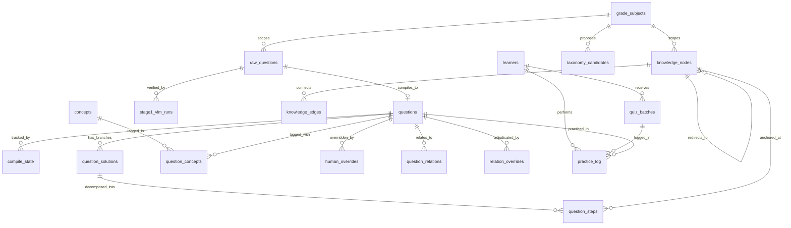

# 纯理科题库知识编译器与 `pi` 智能刷题底座 — 架构与详细设计文档（v2.2）

> **状态**：v2.2 完整修订稿（已合入 2026-11-20 两轮深度评审修复、用户 4 项决策，并完整补齐第 4～7 章，待用户终审）  
> **更新日期**：2026-11-20  
> **需求权威**：[REQUIREMENTS.md](REQUIREMENTS.md)（FR-1 ~ FR-11, NFR-1 ~ NFR-5）  
> **理论权威**：[理论基础.md](理论基础.md)（非对称四维难度模型与“剥皮抽骨”五边拓扑理论）  
> **现状核实**：本地 `题库/` 目录当前已就绪 2 个章节（`ch01_计算基础` 15 题、`ch28_平面直线图形高年级卷` 107 题，共 122 题，图片完整性 100%），后续将持续放入其余章节至 1000+ 题并平滑扩展初高中数理化。

### v2.2 修订摘要（含 v2.1 决策与二轮审核修复）

| 类别 | 变更 |
| :--- | :--- |
| **用户决策 D1** | 知识目录（L1/L2 词表）**等全量题完成 Stage 2 后再涌现并锁定**；122 题开发期只产出 `DRAFT` 草案并以“临时模式”驱动下游开发测试（§4.5） |
| **用户决策 D2** | `pi` 接入改为 **CLI（`--json`）+ `pi` Skill 为一等公民**，MCP Server 降级为可选薄封装（§5.4） |
| **用户决策 D3** | 答案结构**按小问（answer part）区分答案类型与验真模式**（`answer_type` + `verify_mode`），题目级验真模式改为派生值并新增 `MIXED`（§3.2、§4.3） |
| **用户决策 D4** | `C=4` 分档阈值采用 **`2400 / 2600`**（§4.4） |
| 一轮评审 P0/P1 | FTS5 改 `trigram`；选择题纠偏改为行首锚定正则；人工覆写与日志外键改 `RESTRICT` + 软删除；`question_uid` 加入来源集合防撞号；新增 `compile_state` / `concepts` / `question_concepts` / `taxonomy_candidates` / `relation_overrides` / `quiz_batches` 表；新增 Stage 1.5 锚点门禁；Stage 4 改分位数归一化 + `SHARED_TRAP` 防爆边；统一 `reveal` 裁剪、幂等预览与 JSON 信封 |
| **二轮评审修复** | 补全缺失的第 4～7 章；修正建库种子外键顺序；补齐 `question_relations` / `relation_overrides` 无向边有序 `CHECK`；补齐 `practice_log` 防重复冲销唯一索引与 `SOLVED_SOLO` 约束；补齐 `redirect_to_id` 部分索引与读时展开约定；修正 `question_concepts` 按 `kind` 覆盖物化语义；扩展 `AnswerPart` 支持 `SYMBOL_FILL`（含运算符）、`SET_OR_INTERVAL` 与多选题归一；明确 `DRAFT → LOCKED` 事务迁移、`TEXT_RESOLVE` 状态转移与 FTS5 多词/特殊字符转义 |

---

## 一、 架构总览与核心设计原则

### 1.1 系统定位与总体分层

本系统是一个**离线重编译 + 在线轻检索**的纯理科本地知识资产系统（Local-First），严格避免重型常驻 Web 服务，分为四个清晰层次：

1. **输入与资产层**：只读原始题库（`题库/**/problems.jsonl` + 章节相对图片）、外部拍照/截图错题、以及不可变的 CAS 图片仓库（`data/assets/images/`）。
2. **离线知识编译器（Offline Compiler）**：Stage 0 ~ Stage 4（含 Stage 1.5 锚点标定门禁与 Stage Q 体检），将无答案、带几何配图、带脏标签的原始题目，分阶段编译为带验真答案、多解法步骤、严密三层知识网（L1/L2/L3 + 先修 DAG）和全库五边关联图（`CLONE` / `ISOMORPHIC` / `SCAFFOLD` / `CONTRASTIVE` / `SHARED_TRAP`）的高纯度知识库。
3. **双层持久化存储引擎**：
   - **SQLite（含 FTS5 `trigram`）**：存放题库主表、编译状态、人工覆盖层、知识网、全局概念层、五边关系、多角色做题足迹与组卷记录；
   - **本地向量索引（`.npz` float32 矩阵）**：存放表皮向量、抽象骨架向量与 L3 算子向量，零外部向量库依赖，Windows/Linux/macOS 开箱即用；
   - **标准配置 YAML**：学段知识目录树（`taxonomy_*.yaml`，`DRAFT` → `LOCKED`）与黄金难度校准锚点（`anchors_*.yaml`）。
4. **应用与接入层**：
   - **用完即关的极简本地键盘复核页**（仅用于人工裁决 `NEEDS_REVIEW` 分歧题）；
   - **面向 `pi` 的接入面**：统一 Service 层（`facade.py`）以 **原子 Python CLI（`shuati … --json`）为主通道**，辅以 **`pi` Skill** 约束调用流程与防剧透习惯；**本地 MCP Server（stdio）为可选薄封装**，与 CLI 共享同一 JSON 契约；
   - **自包含静态 HTML 练习单渲染器**：屏幕防剧透交互 + `@media print` 纸笔作图打印双模式。

```mermaid
flowchart TD
    subgraph Input["1. 原始输入（只读不破坏）"]
        RAW["题库/**/problems.jsonl + images/"]
        EXT["外部新错题（文本 + 本地图片路径）"]
    end

    subgraph Compiler["2. 离线知识编译器（按题按阶段断点续跑）"]
        S0["Stage 0: 入库体检与清洗<br/>图片CAS归档 / 哈希去重 / 隔离legacy_tags"]
        S1["Stage 1: 视觉转译 + 双盲双VLM + 分小问验真<br/>产出 visual_facts / 多解法 / 置信分级"]
        REV["极简本地键盘复核页<br/>(仅处理 NEEDS_REVIEW, 用完即关)"]
        S15["Stage 1.5: 黄金锚点标定门禁<br/>(每学段一次, 人工四维定分)"]
        S2["Stage 2: 纯文本深度拆解与四维难度打标<br/>步骤骨架 / 抽象骨架 / 4维打分+确定性Elo"]
        S3["Stage 3: 自底向上知识网构建<br/>L1-L2涌现(DRAFT→全量后LOCKED) → L3/概念并查集归并 → 先修DAG"]
        S4["Stage 4: 四通道五边拓扑织网<br/>分位数归一化阈值 + 人工裁定保留"]
        SQ["Stage Q: 自动质量体检报告"]
    end

    subgraph Storage["3. 本地开放存储资产"]
        DB[("SQLite + FTS5(trigram)<br/>data/shuati.db")]
        VEC[("本地向量索引<br/>data/vectors/*.npz")]
        CAS[("CAS图片仓<br/>data/assets/images/")]
        YAML["词表与锚点<br/>config/taxonomies + anchors"]
        JSONL["4份标准JSONL导出<br/>data/exports/*.jsonl"]
    end

    subgraph Interface["4. pi 客户端与输出界面"]
        SVC["统一领域服务层 facade.py<br/>(检索 / 组卷 / 画像 / 诊断 / 入库 / 纠错)"]
        CLI["原子 CLI: shuati ... --json（主通道）"]
        SKILL["pi Skill: skills/shuati/SKILL.md（主通道）"]
        MCP["本地 MCP Server stdio（可选）"]
        HTML["静态 HTML 练习单<br/>(屏幕折叠 / 纸笔打印双模式)"]
    end

    RAW --> S0
    S0 --> S1
    S1 -->|"NEEDS_REVIEW"| REV
    REV -->|"写入 human_overrides"| DB
    S1 -->|"VERIFIED_CONSENSUS / HUMAN_VERIFIED"| S15
    S15 --> S2
    S2 --> S3 --> S4 --> SQ
    S0 & S1 & S2 & S3 & S4 <--> DB
    S0 --> CAS
    S15 & S3 <--> YAML
    S3 & S4 <--> VEC
    DB --> JSONL

    EXT --> SVC
    DB & VEC & CAS & YAML <--> SVC
    SVC --> CLI & HTML
    SVC -.-> MCP
    SKILL -->|"调用"| CLI
```



### 1.2 八条架构硬不变量（Invariants）

1. **严禁章节与旧标签污染**：Stage 1（看图解题验真）与 Stage 2（纯文本拆解与打标）的数据传递对象（DTO）**在类型签名上不包含 `chapter` 与 `legacy_tags`**，从代码结构上杜绝章节锚定污染。旧数据仅存于 `raw_questions` 表用于质检对比。
2. **机审层与人工覆盖层彻底隔离、人工数据永不物理删除**：任何模型重跑、Prompt 升级或切换模型，**只更新机器生成表/列，绝不覆盖 `human_overrides` / `relation_overrides`**。所有业务读取一律经由 `EffectiveQuestion` 合并层读取，人工覆写字段拥有最高优先级。人工覆盖层与学习者事件层的外键一律 `ON DELETE RESTRICT`，题目下架只做软删除（`is_retired`）。
3. **学段严格隔离 + 思维原型跨学段互通**：
   - `knowledge_nodes`（L1/L2/L3）、`taxonomy_*.yaml`、`anchors_*.yaml`、难度标尺与学习者分模块 Elo **严格限定在 `grade_subject` 作用域内**；
   - `concepts`（`METHOD` 思维技法 / `MOTIF` 经典母题 / `TRAP` 陷阱）为**全局注册表**，支撑跨学段同构检索（如“将军饮马”串联小学几何与初中物理光学）。
4. **按小问区分答案类型与验真模式**：答案以 `answer parts[]` 为原子单位，每个小问独立声明 `answer_type`（`NUMERIC` / `EXPRESSION` / `SET_OR_INTERVAL` / `CHOICE` / `SYMBOL_FILL` / `TEXT` / `PROOF`）与 `verify_mode`（`SYMBOLIC` / `EXACT` / `QUALITATIVE`），且二者组合由代码白名单强校验；题目级 `verification_mode` 为派生值（`SYMBOLIC` / `QUALITATIVE` / `MIXED`）。基于 `ch01_计算基础` 实测（`(1)~(8)` 多小问、`□/○` 填数与运算符号、定性说理题 `ch01_013`/`ch01_015`）与二期初高中数理化（解集区间、多选题、“计算 + 说理”混合题）前瞻，**二期扩展无需改表**。
5. **难度分纯代码确定性合成**：LLM 仅输出四维行为证据（`evidence` 必须在 JSON 字段顺序上排在 `score` 之前）与 `[C, S, T, L]` 整数分，连续 `base_elo` 与非对称 8 档 `tier` 100% 由确定性 Python 模块合成；**不实现步骤级 `sub_elo`**。组卷与水位计算只使用 `base_elo`，`tier` 仅用于展示与分档统计。
6. **SymPy 沙盒全平台安全隔离**：兼容 Windows（当前主力开发/运行环境）与 Linux/macOS，AST 静态探针 + 独立子进程 + 进程树超时强杀，绝不在宿主进程执行 `parse_expr` 或 LLM 生成代码。
7. **原始题库目录严格只读**：`题库/` 与 `backup/v1/` 在整个系统运行期间均为只读，所有拷贝、归档、索引和生成物统一落在 `data/` 目录内。
8. **CLI 是唯一权威接入契约**：所有面向 `pi` 的能力先以 `shuati <command> --json` 形式定义与测试；Skill 只编排 CLI，MCP（若启用）只做同构透传，不得出现 CLI 不具备的能力或不同的 JSON 结构。

---

## 二、 目录结构与技术栈

### 2.1 仓库目录布局

```text
shuati-harness/
├── AGENTS.md                        # 会话入口与项目约定
├── pyproject.toml                   # Python >=3.11, uv 依赖管理与 CLI 入口 `shuati`
├── .env.example                     # 各模型端点与 API Key 模板（.env 已 gitignore）
├── config/
│   ├── settings.yaml                # 模型网关、并发限流、阈值与策略配置
│   ├── taxonomies/                  # 各学段 L1/L2 词表（*.draft.yaml 草案 / *.yaml 锁定版）
│   │   └── taxonomy_primary_olympiad.draft.yaml
│   ├── anchors/                     # 各学段 4~5 道黄金难度基准题（Stage 1.5 产出）
│   │   └── anchors_primary_olympiad.yaml
│   ├── method_blacklist.yaml        # 万金油泛词黑名单与标准 6 大陷阱枚举定义（concepts 种子）
│   └── stress_test_25.yaml          # 25 题压力测试固定清单 + 人工标注题对（阈值校准集）
├── docs/
│   ├── HANDOFF.md
│   ├── REQUIREMENTS.md
│   ├── DESIGN.md                    # 本文档
│   └── 理论基础.md
├── 题库/                             # 原始输入题库（只读）
│   ├── ch01_计算基础/
│   └── ch28_平面直线图形高年级卷/
├── backup/v1/                       # 旧版 Web 系统只读归档（勿修改）
├── skills/
│   └── shuati/
│       ├── SKILL.md                 # 面向 pi 的主入口：触发条件、工作流、防剧透铁律（精简）
│       └── reference/
│           └── commands.md          # 每条 CLI 命令的参数、JSON 输出样例与错误码（按需加载）
├── src/
│   └── shuati/
│       ├── __init__.py
│       ├── config.py                # Pydantic Settings + YAML 加载器（模型槽位）
│       ├── models/                  # Pydantic v2 领域模型与 LLM 输出严格 Schema
│       │   ├── domain.py            # EffectiveQuestion, AnswerPart, LearnerProfile, Envelope 等
│       │   └── schemas.py           # Stage 1/2/3/4 LLM Structured Output Schema
│       ├── db/
│       │   ├── connection.py        # SQLite WAL / 外键 / FTS5 连接工厂 + 单写者队列
│       │   ├── schema.py            # 19 张核心表 + FTS5 幂等建表 DDL 与迁移版本号
│       │   ├── repository.py        # CRUD + EffectiveQuestion 合并视图读取器 + 检索索引刷新
│       │   └── exporter.py          # 一键导出 4 份标准 JSONL (NFR-1)
│       ├── vectors/
│       │   └── store.py             # 本地 .npz 归一化向量仓（Top-K 余弦 + 增量追加 + 过期检测 + 相似度分位统计）
│       ├── llm/
│       │   ├── gateway.py           # OpenAI 兼容多槽位异步网关 + 限流 + JSON 附错自愈重试
│       │   ├── embeddings.py        # 云端 OpenAI 兼容 / 本地兼容 Embedding 客户端
│       │   └── mocks.py             # 全链路离线测试确定性 Mock 路由
│       ├── verify/
│       │   ├── sympy_sandbox.py     # 跨平台（Windows/Unix）AST 探针 + 隔离子进程 SymPy 引擎
│       │   ├── answer_parts.py      # 小问标签归一、answer_type × verify_mode 白名单校验、小问对齐
│       │   └── equivalence.py       # 分小问判等：SYMBOLIC 数学等价 / EXACT 规范化字面 / QUALITATIVE 语义裁判
│       ├── core/
│       │   ├── difficulty.py        # 确定性四维非线性 Elo、8 档 tier 与 tier_rank
│       │   ├── knowledge_graph.py   # 同域可逆并查集 Compaction（节点 + 概念）+ 分布熵 + 先修 DAG 环检
│       │   ├── taxonomy.py          # 词表 DRAFT/LOCKED 生命周期、候选 L2、版本迁移 remap
│       │   ├── topology.py          # 四通道相似度 + 分位数归一化 + 五边判定 + 单题增量补边
│       │   ├── profiler.py          # 多角色纯事件派生能力画像（水位/ZPD/8档通过率/雷达）
│       │   ├── composer.py          # 专题小卷自动梯度组卷算法（2稳+2拔高+1排雷）
│       │   └── refresh.py           # 覆写/上游变更后的单题局部重算链路（STALE 传播）
│       ├── pipeline/
│       │   ├── stage0_ingest.py     # 动态扫盘、图片 CAS 归档、哈希去重、脏格式初纠偏
│       │   ├── stage1_solve.py      # 视觉转译 + 双盲双 VLM + 分小问验真 + 一题多解捕获 + 解法物化
│       │   ├── stage1_5_anchors.py  # 黄金锚点候选生成与人工定分落盘
│       │   ├── stage2_decompose.py  # 纯文本拆解、五维正交标签、锚点校准四维打分
│       │   ├── stage3_taxonomy.py   # L1/L2 涌现草案、锁表回填、L3/概念归并、先修/共现边
│       │   ├── stage4_weave.py      # 全库五边拓扑批量织网、人工裁定合并与边界精裁
│       │   └── audit.py             # 自动质量体检报告生成器（Markdown + JSON）
│       ├── review/
│       │   ├── server.py            # 用完即关的极简本地复核页（stdlib http.server，零重依赖）
│       │   └── review.html          # 单文件双栏对比 + 全键盘快捷键复核前端
│       ├── render/
│       │   ├── sheet_renderer.py    # 静态 HTML 练习单渲染器（支持 --embed-images）
│       │   └── templates/
│       │       └── sheet.html.j2    # 屏幕折叠防剧透 + @media print 纸笔留白双模式模板
│       ├── services/
│       │   ├── facade.py            # 面向 pi 的统一应用服务层（全部原子业务能力）
│       │   └── reveal.py            # 统一防剧透裁剪器（quiz / hint / full）
│       ├── cli/
│       │   └── main.py              # Typer CLI（学习者命令 + 编译/运维命令），统一 JSON 信封与退出码
│       └── mcp_server/              # 可选：本地 stdio MCP Server（逐一透传 facade.py，契约与 CLI 同构）
│           └── server.py
├── data/                            # 运行期本地资产（已 gitignore 除示例外）
│   ├── shuati.db                    # SQLite 主库
│   ├── assets/images/               # CAS 图片仓（<sha256[:16]>.<ext>）
│   ├── vectors/                     # .npz 本地向量索引 + meta.json
│   ├── drafts/                      # diagnose 产出的临时结构化草稿（<draft_id>.json）
│   ├── reports/                     # 压力测试与编译体检报告
│   ├── sheets/                      # 渲染输出的静态 HTML 练习单
│   └── exports/                     # 导出的 4 份标准 JSONL
└── tests/
    ├── unit/                        # 确定性算法、Schema、沙盒、并查集、组卷、防剧透裁剪单测
    ├── integration/                 # 全流水线 Mock 端到端 + CLI 契约（JSON 快照）测试
    ├── regression/                  # 评审 Repro 脚本沉淀的防退化用例
    └── fixtures/                    # 脱敏真实样题（含几何图、多小问、脏格式、17 道选项正则误伤样本）
```

### 2.2 精简技术栈选型

| 层次 | 选型 | 选型理由 |
| :--- | :--- | :--- |
| 运行时与包管理 | Python 3.11+（本机 3.13） + `uv` | 已预装 `uv`，依赖锁死快，零虚拟环境折腾；`uv tool install -e .` 使 `shuati` 进入 PATH 供 `pi` 直接调用 |
| 数据校验与配置 | `pydantic >= 2.7`、`pyyaml` | 严格 Structured Output 校验、字段顺序保证 |
| 存储与全文检索 | Python 内置 `sqlite3`（WAL + FTS5 `trigram`） | 单文件便携、零运维。**注意**：`unicode61` 不切分中文（实测 SQLite 3.49.1 检索“将军饮马”命中 0），故采用 `trigram`（SQLite ≥ 3.34），检索词 < 3 字时自动回退 `LIKE` |
| 向量存储与计算 | `numpy`（`.npz` float32 矩阵） | 1k~10k 题全量余弦相似度矩阵运算 `< 5ms`，Windows 无编译依赖；通过 `VectorStore` 接口保留升级 `faiss`/`sqlite-vec` 空间 |
| 数学符号验算 | `sympy` + `Pillow`（图片尺寸/可读性校验） | 复用 v1 验证成熟的符号等价逻辑并做 Windows 跨平台加固 |
| 网络与异步并发 | `httpx` + `asyncio.Semaphore` + 令牌桶限流 | 支持多槽位独立连接池、并发控制与退避重试；SQLite 写入经单写者队列串行化 |
| 命令行与可选 MCP | `typer`（主）+ 官方 `mcp` Python SDK（可选 extra：`uv sync --extra mcp`） | CLI 适合 `pi`（默认无 MCP，走 bash + Skill）与脚本跑批；MCP 仅为其他客户端预留 |
| 静态打印单 | `jinja2` + KaTeX（支持本地静态资源包兜底） | 零后端依赖，浏览器双击即用，`Ctrl+P` 即打印 |
| 极简复核工具 | Python 标准库 `http.server` + 单文件原生 HTML/JS | 零 FastAPI/Uvicorn 重依赖，几十行即起即关 |

---

## 三、 数据模型与 SQLite Schema 设计

### 3.1 核心数据架构：四层解耦

为满足 FR-3（人工覆盖永不丢失）、FR-11（多角色隔离）与 NFR-2（断点续跑），所有数据按生命周期拆分为四层：

1. **原始与编译层（Machine-Generated，可幂等重跑）**：`grade_subjects`、`raw_questions`、`stage1_vlm_runs`、`compile_state`、`questions`、`question_solutions`、`question_steps`、`knowledge_nodes`、`knowledge_edges`、`compaction_audit_ledger`、`taxonomy_candidates`、`concepts`、`question_concepts`、`question_relations`。
2. **人工覆盖层（Immutable Human Truth）**：`human_overrides`（题目字段补丁）、`relation_overrides`（题目关联边的人工确认/否决）。重跑流水线绝不擦除，外键 `RESTRICT`。
3. **学习者事件层（Append-Only Practice）**：`learners`、`practice_log`。仅追加记录（误登记以 `VOIDED` 冲销记录抵消，不改不删），能力水位与薄弱雷达全部由事件实时派生，杜绝状态漂移。
4. **会话产物层（Session Artifacts）**：`quiz_batches`（组卷快照，支撑渲染、批量登记与组卷避重）。



### 3.2 SQLite 完整表结构 DDL（19 张核心表 + 1 张 FTS5 虚表）

> 连接工厂统一开启 `PRAGMA foreign_keys = ON`、`journal_mode = WAL`、`busy_timeout = 5000`；`schema.py` 维护 `PRAGMA user_version` 迁移版本号。

#### 1. 学段学科注册表（`grade_subjects`）
```sql
CREATE TABLE IF NOT EXISTS grade_subjects (
    grade_subject TEXT PRIMARY KEY,              -- 如 '小学奥数', '初中数学', '初中物理'
    slug TEXT NOT NULL UNIQUE,                   -- ASCII 短名，如 'primary_olympiad'（uid 前缀与 YAML 文件名）
    display_name TEXT NOT NULL,
    subject_family TEXT NOT NULL CHECK (
        subject_family IN ('MATH', 'PHYSICS', 'CHEMISTRY', 'STEM_OTHER')
    ),
    taxonomy_status TEXT NOT NULL DEFAULT 'NONE' CHECK (
        taxonomy_status IN ('NONE', 'DRAFT', 'LOCKED')
    ),                                           -- 决策 D1：全量 Stage 2 完成前只允许 DRAFT
    taxonomy_version TEXT NOT NULL DEFAULT '',   -- 'draft-3' / '1.0' / '1.1'
    taxonomy_file TEXT,                          -- 当前生效 YAML 路径（草案或锁定版）
    anchors_file TEXT,                           -- 黄金难度基准题 YAML 路径
    anchors_version TEXT NOT NULL DEFAULT '',    -- 参与 Stage 2 input_hash，锚点变更即令 Stage 2 结果 STALE
    anchors_ready INTEGER NOT NULL DEFAULT 0,    -- Stage 1.5 完成置 1；为 0 时 Stage 2 拒绝批跑
    created_at TEXT NOT NULL DEFAULT (datetime('now'))
);
```

#### 2. 原始题库快照表（`raw_questions`，隔离旧标签）
```sql
CREATE TABLE IF NOT EXISTS raw_questions (
    question_uid TEXT PRIMARY KEY,               -- 确定性主键："{slug}:{source_collection}:{source_id}"；外部错题 "{slug}:ext:{uuid8}"
    grade_subject TEXT NOT NULL REFERENCES grade_subjects(grade_subject),
    source_type TEXT NOT NULL CHECK (
        source_type IN ('BATCH_JSONL', 'EXTERNAL_MISTAKE')
    ),
    source_collection TEXT NOT NULL,             -- problems.jsonl 所在目录相对 题库/ 的路径，如 'ch28_平面直线图形高年级卷'；外部错题为 'ext'
    source_file TEXT,                            -- 相对路径如 '题库/ch28_平面直线图形高年级卷/problems.jsonl'
    source_id TEXT NOT NULL,                     -- 原始 id 如 'ch28_001'（仅在集合内唯一，跨教辅可能撞号）
    raw_chapter INTEGER,                         -- 仅归档，严禁流入 Stage 1/2
    raw_question TEXT NOT NULL,                  -- 原始题干文本
    raw_images_json TEXT NOT NULL DEFAULT '[]',  -- 原始相对路径数组
    cas_images_json TEXT NOT NULL DEFAULT '[]',  -- 归档后的 CAS 文件名数组 ["a1b2c3d4e5f67890.jpg"]
    legacy_tags_json TEXT NOT NULL DEFAULT '{}', -- 原始 tags 完整快照（仅质检对比用）
    content_hash TEXT NOT NULL,                  -- SHA-256(normalized_question + sorted(cas_images)) 防重复入库
    also_seen_in_json TEXT NOT NULL DEFAULT '[]',-- 其他来源中完全重复的同题出处 [{"collection":..,"source_id":..}]
    ingested_at TEXT NOT NULL DEFAULT (datetime('now')),
    updated_at TEXT NOT NULL DEFAULT (datetime('now')),
    UNIQUE(grade_subject, source_collection, source_id)
);
CREATE INDEX IF NOT EXISTS idx_raw_questions_hash ON raw_questions(grade_subject, content_hash);
```
> **uid 稳定性规则**：uid 一经生成永不改变。源 JSONL 被修正导致同一 `(collection, source_id)` 的 `content_hash` 变化时，**原地更新 raw 行**并将该题 Stage 1 起全部 `compile_state` 置 `STALE`，绝不删行重建；其上的人工覆写保留，并在体检报告“覆写待复核”清单中列出。CLI/Skill 允许用 `source_id`（如 `ch28_001`）简写，唯一匹配时自动解析，歧义时返回 `AMBIGUOUS_UID` 与候选列表。

#### 3. Stage 1 VLM 双盲求解与验真审计表（`stage1_vlm_runs`）
```sql
CREATE TABLE IF NOT EXISTS stage1_vlm_runs (
    run_id INTEGER PRIMARY KEY AUTOINCREMENT,
    question_uid TEXT NOT NULL REFERENCES raw_questions(question_uid) ON DELETE CASCADE,
    role TEXT NOT NULL CHECK (role IN ('PRIMARY', 'SECONDARY', 'TEXT_RESOLVE')), -- TEXT_RESOLVE=覆写 visual_facts 后的纯文本重解
    model_name TEXT NOT NULL,
    prompt_version TEXT NOT NULL,
    input_hash TEXT NOT NULL,                    -- 题干 + 图片 + prompt_version + model 的指纹，判定是否可复用
    run_status TEXT NOT NULL CHECK (run_status IN ('OK', 'FAILED')),
    error_message TEXT NOT NULL DEFAULT '',
    visual_facts TEXT NOT NULL DEFAULT '',       -- 仅视觉题产出详细几何/物理拓扑事实
    visual_ambiguity_flag INTEGER NOT NULL DEFAULT 0, -- 1=模型报告图片模糊/阴影歧义
    visual_ambiguity_note TEXT NOT NULL DEFAULT '',
    method_summary TEXT NOT NULL DEFAULT '',     -- 一句话解法路线，用于一题多解判定
    solution_markdown TEXT NOT NULL DEFAULT '',
    final_answers_json TEXT NOT NULL DEFAULT '[]', -- AnswerPart 数组（见下方 Schema）
    sympy_code TEXT,                             -- 含 SYMBOLIC 小问时主路必出
    sympy_status TEXT NOT NULL DEFAULT 'NOT_RUN' CHECK (
        sympy_status IN ('PASSED', 'PARTIAL', 'FAILED', 'TIMEOUT', 'AST_REJECTED', 'SKIPPED_NO_SYMBOLIC', 'NOT_RUN')
    ),                                           -- 运行级汇总；逐小问结果见 sympy_output_json
    sympy_output_json TEXT,                      -- {"parts":[{"label":"(1)","value":"12","ok":true}], "stderr_tail":"..."}
    raw_response TEXT NOT NULL DEFAULT '',       -- 原始模型响应（排障与 Prompt 迭代）
    token_usage_json TEXT NOT NULL DEFAULT '{}',
    latency_ms INTEGER,
    created_at TEXT NOT NULL DEFAULT (datetime('now'))
);
CREATE INDEX IF NOT EXISTS idx_stage1_runs_q ON stage1_vlm_runs(question_uid, role, created_at DESC);
```

**`AnswerPart` 小问答案 Schema（决策 D3，`final_answers_json` 的数组元素）**：
```json
{
  "label": "(1)",                    // 归一化标签："主问" | "(1)" | "(1)-1" ...；（1）/①/1) 统一归一为 "(1)"
  "answer_type": "NUMERIC",          // NUMERIC | EXPRESSION | SET_OR_INTERVAL | CHOICE | SYMBOL_FILL | TEXT | PROOF
  "verify_mode": "SYMBOLIC",         // SYMBOLIC | EXACT | QUALITATIVE（受白名单约束，见下表）
  "answer": "12",                    // 人类可读答案（可含 LaTeX）
  "unit": "平方厘米",
  "sympy_expr": "12",                // SYMBOLIC 必填（SET_OR_INTERVAL 可填方程/不等式/集合表达式）
  "choice_label": null,              // CHOICE 必填，单选如 "C"、多选排序去重归一如 "AC"；若单选为数值可同时填 sympy_expr 互校
  "canonical": null                  // EXACT 的规范化值，如 SYMBOL_FILL 的 "+" / "-" / ">"（全角/中文词由代码归一）
}
```

| `answer_type` | 允许的 `verify_mode` | 判等方式 | 典型来源 |
| :--- | :--- | :--- | :--- |
| `NUMERIC` / `EXPRESSION` | `SYMBOLIC`（强制） | SymPy 数学等价（单位剥离、分数小数互转、有理化），保持“纯数字不放宽反号与常数比率”红线 | 面积、长度、计算题 |
| `SET_OR_INTERVAL` | `SYMBOLIC`（强制） | 复用 v1 方程解集互代等价引擎 + 区间端点/开闭/有限集排序等价判定 | 二期中学多解方程、不等式区间、坐标组 |
| `CHOICE` | `EXACT`（选项字母）＋可选 `SYMBOLIC`（单选数值） | 单选/多选字母统一大写排序去重（`"CA"→"AC"`）；两路一字母一数值时按题干选项表互译后判等 | `ch28_003`、`ch28_016`、中学多选题 |
| `SYMBOL_FILL` | `EXACT` | 规范化符号相等，覆盖比较符（`>`/`<`/`=`/`≥`/`≤`/`≠`）与四则运算符（`+`/`-`/`×`/`÷`）；同小问多空拆为 `(1)-1`..`(1)-k` | `ch01_010` 填 `□/○` |
| `TEXT` | `QUALITATIVE`（强制） | 轻量文本裁判判定结论科学等价 | `ch01_013`、`ch01_015`、实验现象 |
| `PROOF` | `QUALITATIVE`（强制） | 裁判核对关键论证链完整性 | 证明题 |

> 白名单由 `verify/answer_parts.py` 中的 Pydantic 校验器强制：模型**不得**把 `NUMERIC` / `EXPRESSION` / `SET_OR_INTERVAL` 小问标成 `QUALITATIVE` 以逃避 SymPy 验算；违规输出视为 Schema 错误触发自愈重试。

#### 4. 编译后题目主表（`questions`）
```sql
CREATE TABLE IF NOT EXISTS questions (
    question_uid TEXT PRIMARY KEY REFERENCES raw_questions(question_uid) ON DELETE RESTRICT,
    grade_subject TEXT NOT NULL REFERENCES grade_subjects(grade_subject),
    question_text TEXT NOT NULL,                 -- 清洗规范化后的题干（支持 LaTeX）
    cas_images_json TEXT NOT NULL DEFAULT '[]',  -- CAS 图片列表
    has_images INTEGER NOT NULL DEFAULT 0,
    format TEXT NOT NULL CHECK (
        format IN ('选择题', '填空题', '判断题', '计算题', '解答题', '证明题', '作图操作题', '实验探究题')
    ),
    is_retired INTEGER NOT NULL DEFAULT 0,       -- 软删除：源题被移除/坏题下架；不参与检索与组卷，历史日志保留
    retired_reason TEXT NOT NULL DEFAULT '',
    -- Stage 1 验真产物
    visual_facts TEXT NOT NULL DEFAULT '',       -- 固化后的纯文本几何/物理视觉事实（主路）
    verification_mode TEXT NOT NULL DEFAULT 'SYMBOLIC' CHECK (
        verification_mode IN ('SYMBOLIC', 'QUALITATIVE', 'MIXED')
    ),                                           -- 派生值：全部小问 ∈ {SYMBOLIC, EXACT} → SYMBOLIC；全部 QUALITATIVE → QUALITATIVE；否则 MIXED
    verification_status TEXT NOT NULL DEFAULT 'PENDING' CHECK (
        verification_status IN ('PENDING', 'VERIFIED_CONSENSUS', 'NEEDS_REVIEW', 'HUMAN_VERIFIED')
    ),
    review_reason TEXT NOT NULL DEFAULT '',      -- 原因码（逗号分隔）+ 摘要，码表见 §4.3
    final_answers_json TEXT NOT NULL DEFAULT '[]', -- 规范化 AnswerPart 数组（最终采纳答案）
    part_verdicts_json TEXT NOT NULL DEFAULT '[]', -- 逐小问裁决 [{"label","verify_mode","dual_equal","sympy_ok","judge_note"}]
    -- Stage 2 拆解与标签产物
    abstract_skeleton TEXT NOT NULL DEFAULT '',  -- 去情境化抽象骨架（用于 V_skeleton）
    primary_l1_module TEXT NOT NULL DEFAULT '',  -- 整题归属主 L1（Stage 3c 回填词表枚举）
    secondary_l1_modules_json TEXT NOT NULL DEFAULT '[]', -- 跨模块综合题涉及的次要 L1
    raw_l1_candidates_json TEXT NOT NULL DEFAULT '[]',    -- Stage 2 初始涌现 L1（供 Stage 3a 归纳）
    raw_l2_candidates_json TEXT NOT NULL DEFAULT '[]',    -- Stage 2 初始涌现 L2
    raw_thinking_methods_json TEXT NOT NULL DEFAULT '[]', -- Stage 2 原始输出（过黑名单后）；规范化查询统一走 question_concepts
    raw_classic_motifs_json TEXT NOT NULL DEFAULT '[]',   -- 同上（宁缺毋滥）
    raw_trap_tags_json TEXT NOT NULL DEFAULT '[]',        -- Stage 2 原始 6 大陷阱枚举子集；规范化查询统一走 question_concepts
    -- FR-5 整题四维行为打分 + 确定性非线性 Elo & 非对称 8 档（无步骤级 sub_elo）
    c_score INTEGER CHECK (c_score IS NULL OR c_score BETWEEN 1 AND 4),
    s_score INTEGER CHECK (s_score IS NULL OR s_score BETWEEN 1 AND 3),
    t_score INTEGER CHECK (t_score IS NULL OR t_score BETWEEN 1 AND 3),
    l_score INTEGER CHECK (l_score IS NULL OR l_score BETWEEN 1 AND 3),
    difficulty_evidence_json TEXT NOT NULL DEFAULT '{}',  -- {"C": "...", "S": "...", "T": "...", "L": "..."}
    base_elo INTEGER CHECK (base_elo IS NULL OR base_elo BETWEEN 800 AND 2800),
    tier TEXT CHECK (
        tier IS NULL OR tier IN (
            'L1_基础直达', 'L2_常规巩固', 'L3_综合中档',
            'L4-A_进阶拔高(繁)', 'L4-B_进阶拔高(巧)',
            'L5-1_压轴挑战', 'L5-2_竞赛超难', 'L5-3_殿堂极限'
        )
    ),
    updated_at TEXT NOT NULL DEFAULT (datetime('now'))
);
CREATE INDEX IF NOT EXISTS idx_questions_scope_status ON questions(grade_subject, verification_status, is_retired);
CREATE INDEX IF NOT EXISTS idx_questions_l1_elo ON questions(grade_subject, primary_l1_module, base_elo);
```

#### 5. 编译状态表（`compile_state`，NFR-2 断点续跑与过期传播）
```sql
CREATE TABLE IF NOT EXISTS compile_state (
    question_uid TEXT NOT NULL REFERENCES raw_questions(question_uid) ON DELETE CASCADE,
    stage TEXT NOT NULL CHECK (stage IN ('S1', 'S2', 'S3C', 'S3D', 'S4')),
    status TEXT NOT NULL DEFAULT 'PENDING' CHECK (
        status IN ('PENDING', 'RUNNING', 'OK', 'FAILED', 'STALE', 'BLOCKED')
    ),                                           -- BLOCKED=上游未就绪（如 NEEDS_REVIEW 待复核、词表未就绪）
    input_hash TEXT NOT NULL DEFAULT '',         -- 本阶段输入指纹（含 Effective 上游产物、prompt_version、模型、锚点/词表版本）
    prompt_version TEXT NOT NULL DEFAULT '',
    model_name TEXT NOT NULL DEFAULT '',
    attempts INTEGER NOT NULL DEFAULT 0,
    last_error TEXT NOT NULL DEFAULT '',
    updated_at TEXT NOT NULL DEFAULT (datetime('now')),
    PRIMARY KEY (question_uid, stage)
);
CREATE INDEX IF NOT EXISTS idx_compile_state_status ON compile_state(stage, status);
```
> **续跑语义**：`shuati compile --stage N` 只处理 `status ∈ {PENDING, FAILED, STALE}` 或当前计算出的 `input_hash` 与记录不一致的题；`OK` 且指纹一致的题直接跳过。任一阶段产物变化时，`core/refresh.py` 自动将其下游阶段置 `STALE`（S1 → S2 → S3C → S3D → S4）。Stage 3a/3b/3e 为学段级批处理步骤，不在本表逐题记录，其版本号（`taxonomy_version`）计入 S3C/S3D 的 `input_hash`。

#### 6. 一题多解分支表（`question_solutions`）与步骤骨架表（`question_steps`）
```sql
CREATE TABLE IF NOT EXISTS question_solutions (
    solution_id TEXT PRIMARY KEY,                -- "{question_uid}::{branch_id}"
    question_uid TEXT NOT NULL REFERENCES questions(question_uid) ON DELETE CASCADE,
    branch_id TEXT NOT NULL,                     -- 'branch_1' (主最优解), 'branch_2' (备选本质不同解法)
    is_optimal INTEGER NOT NULL DEFAULT 1,       -- 1=该学段最优标准解法（难度评估基准）
    source_origin TEXT NOT NULL CHECK (
        source_origin IN ('PRIMARY_VLM', 'SECONDARY_VLM', 'HUMAN', 'KNOWN_ANSWER')
    ),                                           -- 内容来源标记；HUMAN 内容的权威副本在 human_overrides
    origin_run_id INTEGER REFERENCES stage1_vlm_runs(run_id),
    method_summary TEXT NOT NULL DEFAULT '',     -- 一句话概括该分支路线（如 '赵爽弦图补形法' vs '解析建系法'）
    solution_markdown TEXT NOT NULL,
    sympy_code TEXT,
    sympy_verified INTEGER NOT NULL DEFAULT 0,
    UNIQUE(question_uid, branch_id)
);

CREATE TABLE IF NOT EXISTS question_steps (
    step_id TEXT PRIMARY KEY,                    -- "{question_uid}::{branch_id}::s{step_index}"
    question_uid TEXT NOT NULL REFERENCES questions(question_uid) ON DELETE CASCADE,
    branch_id TEXT NOT NULL DEFAULT 'branch_1',
    step_index INTEGER NOT NULL,                 -- 1..5 逻辑推理步（合并纯四则计算）
    sub_goal TEXT NOT NULL,                      -- 本步教学子目标（hint 等级 k 即返回前 k 步）
    core_formula TEXT NOT NULL DEFAULT '',       -- 核心关系式/几何转化式
    raw_l1 TEXT NOT NULL DEFAULT '',
    raw_l2 TEXT NOT NULL DEFAULT '',
    raw_l3 TEXT NOT NULL DEFAULT '',
    knowledge_node_id TEXT REFERENCES knowledge_nodes(node_id), -- Stage 3d 对齐后填入；读取时经并查集 find() 解析到活跃节点
    UNIQUE(question_uid, branch_id, step_index),
    FOREIGN KEY (question_uid, branch_id) REFERENCES question_solutions(question_uid, branch_id) ON DELETE CASCADE
);
CREATE INDEX IF NOT EXISTS idx_steps_node ON question_steps(knowledge_node_id);
```
> **`question_solutions` 是物化派生表**：由 Stage 1 收尾函数 `materialize_solutions(uid)` 依据“最新 `OK` 的 `stage1_vlm_runs` + 生效的 `solutions_override_json` / `final_answers_json` 覆写”重建，任何代码不得直接编辑；因此复核页“采纳辅路为 `branch_1`”“一题多解”等操作的权威记录永远在 `human_overrides`，重跑后可无损复现。

#### 7. 人工覆盖层表（`human_overrides`，永不丢失）
```sql
CREATE TABLE IF NOT EXISTS human_overrides (
    override_id INTEGER PRIMARY KEY AUTOINCREMENT,
    question_uid TEXT NOT NULL REFERENCES questions(question_uid) ON DELETE RESTRICT,
    field_name TEXT NOT NULL CHECK (
        field_name IN (
            'question_text', 'visual_facts', 'final_answers_json', 'solutions_override_json',
            'difficulty_override_json', 'primary_l1_module', 'secondary_l1_modules_json',
            'taxonomy_override_json', 'thinking_methods_json', 'classic_motifs_json', 'trap_tags_json',
            'abstract_skeleton', 'format', 'verification_status', 'is_excluded'
        )
    ),
    override_value TEXT NOT NULL,                -- 文本或 JSON 字符串（按字段 Pydantic 校验后写入）
    reason TEXT NOT NULL DEFAULT '',             -- 人工批注/修正说明
    source TEXT NOT NULL CHECK (source IN ('REVIEW_UI', 'PI_CLI', 'PI_MCP', 'MANUAL_YAML', 'ANCHOR_CALIBRATION')),
    is_active INTEGER NOT NULL DEFAULT 1,        -- 新覆写生效时旧行置 0；撤回置 0 并记 revoked_at
    revoked_at TEXT,
    created_at TEXT NOT NULL DEFAULT (datetime('now'))
);
CREATE UNIQUE INDEX IF NOT EXISTS uq_overrides_active ON human_overrides(question_uid, field_name) WHERE is_active = 1;
CREATE INDEX IF NOT EXISTS idx_overrides_history ON human_overrides(question_uid, field_name, created_at DESC);
```

**结构化覆写字段 JSON Schema**：

| 字段 | 结构 |
| :--- | :--- |
| `final_answers_json` | `AnswerPart[]`（同 §3.2-3） |
| `solutions_override_json` | `{"branches":[{"branch_id":"branch_1","is_optimal":1,"origin_run_id":12|null,"method_summary":"...","solution_markdown":"..."}]}`；`origin_run_id` 非空表示“采纳某路原文” |
| `difficulty_override_json` | `{"C":3,"S":2,"T":3,"L":1,"note":"..."}`，读取层用确定性公式重算 `base_elo` / `tier` |
| `taxonomy_override_json` | `{"taxonomy_version":"1.0","steps":[{"branch_id":"branch_1","step_index":2,"l1":"平面几何","l2":"三角形比例模型","l3":"等高三角形面积比转底边比"}]}`；`DRAFT` 期覆写附带草案版本号，锁表迁移时自动按 `aliases` 对齐或输出待迁移清单（§4.5） |
| `thinking_methods_json` / `classic_motifs_json` / `trap_tags_json` | 名称数组；按 `(question_uid, kind)` 执行**全量替代物化**（清除同 `kind` 机器行，写入 `origin='HUMAN'` 行；撤回覆写时恢复物化机器行） |
| `is_excluded` | `"1"` / `"0"`：人工下架坏题（与源侧 `is_retired` 合并为生效的“不可出题”状态） |

> **覆写生效规则**：读取层 `EffectiveQuestion` 对每个 `question_uid` 加载 `is_active = 1` 的覆盖项（唯一索引保证每字段至多一条）并覆写到对应属性。覆写写入后由 `core/refresh.py` 触发对应的单题局部重算链（§4.8），但重算过程**只写机器层，绝不修改 `human_overrides` 本身**。

#### 8. 三层知识网节点表（`knowledge_nodes`）、知识点拓扑边（`knowledge_edges`）、词表候选（`taxonomy_candidates`）与归并审计账本（`compaction_audit_ledger`）
```sql
CREATE TABLE IF NOT EXISTS knowledge_nodes (
    node_id TEXT PRIMARY KEY,                    -- UUID 或确定性短 ID
    grade_subject TEXT NOT NULL REFERENCES grade_subjects(grade_subject),
    taxonomy_version TEXT NOT NULL,              -- 节点所依附的词表版本（'draft-N' 为临时节点，锁表后整体重建）
    l1_module TEXT NOT NULL,                     -- 词表 L1
    l2_entity TEXT NOT NULL,                     -- 词表 L2
    l3_operator TEXT NOT NULL,                   -- 4~14 字脱壳原子转化算子
    aliases_json TEXT NOT NULL DEFAULT '[]',     -- 同义别称列表（上限 12）
    redirect_to_id TEXT REFERENCES knowledge_nodes(node_id), -- 可逆并查集父指针（NULL=活跃主节点，路径压缩保证跳数 <= 1）
    created_at TEXT NOT NULL DEFAULT (datetime('now'))
);
CREATE UNIQUE INDEX IF NOT EXISTS uq_kn_active ON knowledge_nodes(grade_subject, taxonomy_version, l1_module, l2_entity, l3_operator)
    WHERE redirect_to_id IS NULL;
CREATE INDEX IF NOT EXISTS idx_kn_scope ON knowledge_nodes(grade_subject, l1_module, l2_entity, redirect_to_id);
CREATE INDEX IF NOT EXISTS idx_kn_redirect ON knowledge_nodes(redirect_to_id) WHERE redirect_to_id IS NOT NULL;

CREATE TABLE IF NOT EXISTS knowledge_edges (
    source_node_id TEXT NOT NULL REFERENCES knowledge_nodes(node_id) ON DELETE CASCADE,
    target_node_id TEXT NOT NULL REFERENCES knowledge_nodes(node_id) ON DELETE CASCADE,
    grade_subject TEXT NOT NULL REFERENCES grade_subjects(grade_subject),
    edge_type TEXT NOT NULL CHECK (edge_type IN ('PREREQUISITE', 'CO_OCCURRENCE')),
    weight REAL NOT NULL DEFAULT 1.0,            -- 共现频次或先修置信度
    evidence_json TEXT NOT NULL DEFAULT '{}',    -- 支撑该边的样题 UID 列表与统计依据
    created_at TEXT NOT NULL DEFAULT (datetime('now')),
    PRIMARY KEY (source_node_id, target_node_id, edge_type),
    CHECK (source_node_id != target_node_id)
);
CREATE INDEX IF NOT EXISTS idx_ke_scope ON knowledge_edges(grade_subject, edge_type);

CREATE TABLE IF NOT EXISTS taxonomy_candidates (
    candidate_id INTEGER PRIMARY KEY AUTOINCREMENT,
    grade_subject TEXT NOT NULL REFERENCES grade_subjects(grade_subject),
    base_taxonomy_version TEXT NOT NULL,         -- 在哪个锁定版本上发现（仅 LOCKED 状态产生候选）
    level TEXT NOT NULL CHECK (level IN ('L1', 'L2')),
    parent_l1 TEXT NOT NULL DEFAULT '',
    proposed_name TEXT NOT NULL,
    example_question_uids_json TEXT NOT NULL DEFAULT '[]',
    status TEXT NOT NULL DEFAULT 'PENDING' CHECK (status IN ('PENDING', 'APPROVED', 'REJECTED', 'MAPPED')),
    mapped_to TEXT NOT NULL DEFAULT '',          -- MAPPED 时映射到的既有 L2
    created_at TEXT NOT NULL DEFAULT (datetime('now')),
    resolved_at TEXT
);

CREATE TABLE IF NOT EXISTS compaction_audit_ledger (
    merge_id INTEGER PRIMARY KEY AUTOINCREMENT,
    batch_id TEXT NOT NULL,                      -- 批次 UUID，支持一键按批次 Un-merge
    target_kind TEXT NOT NULL CHECK (target_kind IN ('KNOWLEDGE_NODE', 'CONCEPT')),
    scope_json TEXT NOT NULL,                    -- 节点：{"grade_subject","l1","l2"}；概念：{"kind":"MOTIF"}
    from_id TEXT NOT NULL,
    to_id TEXT NOT NULL,
    ai_judge_evidence TEXT NOT NULL,
    previous_aliases_to_json TEXT NOT NULL,
    affected_child_ids_json TEXT NOT NULL DEFAULT '[]', -- 路径压缩涉及的二级子节点快照
    is_reverted INTEGER NOT NULL DEFAULT 0,
    created_at TEXT NOT NULL DEFAULT (datetime('now')),
    reverted_at TEXT
);
CREATE INDEX IF NOT EXISTS idx_compaction_batch ON compaction_audit_ledger(batch_id, is_reverted);
```

#### 9. 全局概念注册表（`concepts`）与题目概念挂载（`question_concepts`）
```sql
CREATE TABLE IF NOT EXISTS concepts (
    concept_id TEXT PRIMARY KEY,                 -- 确定性短 ID，如 'MOTIF:将军饮马'；合并后保留原 ID 作重定向
    kind TEXT NOT NULL CHECK (kind IN ('METHOD', 'MOTIF', 'TRAP')),
    name TEXT NOT NULL,
    aliases_json TEXT NOT NULL DEFAULT '[]',
    description TEXT NOT NULL DEFAULT '',
    redirect_to_id TEXT REFERENCES concepts(concept_id), -- 可逆并查集（同 knowledge_nodes 语义）
    is_seed INTEGER NOT NULL DEFAULT 0,          -- 1=配置预置（6 大 TRAP 枚举），不可合并、不可删除
    created_at TEXT NOT NULL DEFAULT (datetime('now'))
);
CREATE UNIQUE INDEX IF NOT EXISTS uq_concepts_active ON concepts(kind, name) WHERE redirect_to_id IS NULL;
CREATE INDEX IF NOT EXISTS idx_concepts_redirect ON concepts(redirect_to_id) WHERE redirect_to_id IS NOT NULL;

CREATE TABLE IF NOT EXISTS question_concepts (
    question_uid TEXT NOT NULL REFERENCES questions(question_uid) ON DELETE CASCADE,
    concept_id TEXT NOT NULL REFERENCES concepts(concept_id),
    kind TEXT NOT NULL CHECK (kind IN ('METHOD', 'MOTIF', 'TRAP')),
    origin TEXT NOT NULL CHECK (origin IN ('MACHINE', 'HUMAN')), -- 按 (question_uid, kind) 替代物化：存在激活覆写时只保留 HUMAN 行；无覆写时由机器 raw_* 物化 MACHINE 行
    PRIMARY KEY (question_uid, concept_id)
);
CREATE INDEX IF NOT EXISTS idx_qc_concept ON question_concepts(concept_id, kind);
```
> 作用与查询铁律：
> - `search --motif 将军饮马` 走索引并自动命中别名；跨学段同构检索以全局 `MOTIF/METHOD` 集合为桥；薄弱雷达按规范化 `concept_id` 聚合，避免“蝴蝶模型 / 蝶形定理”分裂统计。
> - **并查集读时展开铁律（`knowledge_nodes` 与 `concepts` 共用）**：历史题目行可能仍指向合并前的旧 ID。所有按 `node_id` 或 `concept_id` 检索题目时，必须统一调用 `expand_canonical_ids(canonical_id)` 展开该活跃主节点及其全部直属重定向子节点（因路径压缩保证跳数 $\le 1$，依赖 `idx_kn_redirect` / `idx_concepts_redirect` 一次查完，绝不漏题）。

#### 10. 全库题目五边拓扑表（`question_relations`）与人工裁定表（`relation_overrides`）
```sql
CREATE TABLE IF NOT EXISTS question_relations (
    source_question_uid TEXT NOT NULL REFERENCES questions(question_uid) ON DELETE CASCADE,
    target_question_uid TEXT NOT NULL REFERENCES questions(question_uid) ON DELETE CASCADE,
    relation_type TEXT NOT NULL CHECK (
        relation_type IN ('CLONE', 'ISOMORPHIC', 'SCAFFOLD', 'CONTRASTIVE', 'SHARED_TRAP')
    ),
    is_directed INTEGER NOT NULL DEFAULT 0,      -- SCAFFOLD 为 1 (source 为降阶铺垫子题, target 为升维母题)；其余为 0 且强制 source < target
    is_cross_scope INTEGER NOT NULL DEFAULT 0,   -- 1=跨学段边（仅允许 ISOMORPHIC / SHARED_TRAP）
    surface_sim REAL NOT NULL,                   -- 原始余弦
    skeleton_sim REAL NOT NULL,
    surface_pct REAL NOT NULL,                   -- 作用域内分位数（判定实际使用的归一化值）
    skeleton_pct REAL NOT NULL,
    containment_score REAL NOT NULL,             -- 非对称 Tversky 包含度 I(source ⊂ target)
    trap_overlap REAL NOT NULL,                  -- IDF 加权陷阱重合度
    confidence_source TEXT NOT NULL CHECK (
        confidence_source IN ('RULE_MATRIX', 'LLM_VERIFIED', 'HUMAN_VERIFIED')
    ),
    pedagogical_note TEXT NOT NULL DEFAULT '',   -- 教学联动/对比辨析说明（剧透级，仅 reveal=full 返回）
    rule_version TEXT NOT NULL DEFAULT '',       -- 阈值配置版本
    created_at TEXT NOT NULL DEFAULT (datetime('now')),
    PRIMARY KEY (source_question_uid, target_question_uid, relation_type),
    CHECK (source_question_uid != target_question_uid),
    CHECK ((relation_type = 'SCAFFOLD') = (is_directed = 1)),
    CHECK (is_directed = 1 OR source_question_uid < target_question_uid)
);
CREATE INDEX IF NOT EXISTS idx_qr_source ON question_relations(source_question_uid, relation_type);
CREATE INDEX IF NOT EXISTS idx_qr_target ON question_relations(target_question_uid, relation_type);

CREATE TABLE IF NOT EXISTS relation_overrides (
    override_id INTEGER PRIMARY KEY AUTOINCREMENT,
    source_question_uid TEXT NOT NULL REFERENCES questions(question_uid) ON DELETE RESTRICT,
    target_question_uid TEXT NOT NULL REFERENCES questions(question_uid) ON DELETE RESTRICT,
    relation_type TEXT NOT NULL CHECK (
        relation_type IN ('CLONE', 'ISOMORPHIC', 'SCAFFOLD', 'CONTRASTIVE', 'SHARED_TRAP')
    ),
    action TEXT NOT NULL CHECK (action IN ('ASSERT', 'REJECT')),
    pedagogical_note TEXT NOT NULL DEFAULT '',
    reason TEXT NOT NULL DEFAULT '',
    source TEXT NOT NULL CHECK (source IN ('REVIEW_UI', 'PI_CLI', 'PI_MCP', 'MANUAL_YAML')),
    is_active INTEGER NOT NULL DEFAULT 1,
    revoked_at TEXT,
    created_at TEXT NOT NULL DEFAULT (datetime('now')),
    CHECK (source_question_uid != target_question_uid),
    CHECK (relation_type = 'SCAFFOLD' OR source_question_uid < target_question_uid)
);
CREATE UNIQUE INDEX IF NOT EXISTS uq_rel_overrides_active
    ON relation_overrides(source_question_uid, target_question_uid, relation_type) WHERE is_active = 1;
```
> 规范化与合并规则：应用层对所有边读写统一先经 `normalize_edge_endpoints(relation_type, u, v)` 排序（非 `SCAFFOLD` 边保证 `u < v`），确保机器边与 `relation_overrides` 端点一致、`REJECT` 永不漏匹配。Stage 4 全量或单题重织网后，最后一步固定执行“人工裁定合并”：`REJECT` 删除对应机器边，`ASSERT` 补写/改写为 `HUMAN_VERIFIED`。难度差 $\Delta D$ 不落库（覆写难度后会过期），查询时由两端生效 `base_elo` 现算。

#### 11. 多角色注册表（`learners`）、做题足迹表（`practice_log`）与组卷快照表（`quiz_batches`）
```sql
CREATE TABLE IF NOT EXISTS learners (
    learner_id TEXT PRIMARY KEY,                 -- 如 'default', 'xiaoming', 'dad'
    display_name TEXT NOT NULL,
    default_grade_subject TEXT NOT NULL DEFAULT '小学奥数' REFERENCES grade_subjects(grade_subject),
    is_current INTEGER NOT NULL DEFAULT 0,       -- 当前默认角色（pi 中“切换到某角色”持久化于此）
    notes TEXT NOT NULL DEFAULT '',
    created_at TEXT NOT NULL DEFAULT (datetime('now'))
);
CREATE UNIQUE INDEX IF NOT EXISTS uq_learners_current ON learners(is_current) WHERE is_current = 1;
-- 建库初始化固定顺序（满足外键约束）：
-- 1) INSERT OR IGNORE INTO grade_subjects(grade_subject, slug, display_name, subject_family) VALUES ('小学奥数', 'primary_olympiad', '小学奥数', 'MATH');
-- 2) 写入 config/method_blacklist.yaml 中 6 大预置 TRAP concepts (is_seed = 1);
-- 3) INSERT OR IGNORE INTO learners(learner_id, display_name, default_grade_subject, is_current) VALUES ('default', '默认', '小学奥数', 1);
-- 切换当前角色必须在同一事务内先清旧置 0、再将目标角色置 1，避免触发 uq_learners_current 冲突。

CREATE TABLE IF NOT EXISTS quiz_batches (
    quiz_batch_id TEXT PRIMARY KEY,              -- 如 'qz_20261120_7f3a'
    learner_id TEXT NOT NULL REFERENCES learners(learner_id) ON DELETE RESTRICT,
    grade_subject TEXT NOT NULL REFERENCES grade_subjects(grade_subject),
    params_json TEXT NOT NULL,                   -- topic_filter / count / mix / exclude_* 等组卷参数
    items_json TEXT NOT NULL,                    -- [{"question_uid","slot_role","reason_public","reason_full"}]
    sheet_path TEXT NOT NULL DEFAULT '',         -- 最近一次 render-sheet 输出路径
    created_at TEXT NOT NULL DEFAULT (datetime('now'))
);
CREATE INDEX IF NOT EXISTS idx_quiz_learner_time ON quiz_batches(learner_id, created_at DESC);

CREATE TABLE IF NOT EXISTS practice_log (
    log_id INTEGER PRIMARY KEY AUTOINCREMENT,
    learner_id TEXT NOT NULL DEFAULT 'default' REFERENCES learners(learner_id) ON DELETE RESTRICT,
    question_uid TEXT NOT NULL REFERENCES questions(question_uid) ON DELETE RESTRICT,
    practiced_at TEXT NOT NULL DEFAULT (datetime('now')),
    outcome TEXT NOT NULL CHECK (
        outcome IN ('SOLVED_SOLO', 'SOLVED_WITH_HINT', 'WRONG', 'SKIPPED', 'VOIDED')
    ),
    voids_log_id INTEGER REFERENCES practice_log(log_id), -- 仅 VOIDED 冲销记录使用：指向被作废的误登记
    stuck_step_index INTEGER,                    -- 可选：卡在哪一步（1-based）
    hint_level_used INTEGER,                     -- 可选：看到第几级提示（与 detail --hint-level 对应）
    user_note TEXT NOT NULL DEFAULT '',          -- 复盘笔记
    quiz_batch_id TEXT REFERENCES quiz_batches(quiz_batch_id),
    client_request_id TEXT,                      -- 幂等键：同一 learner 下重复提交直接返回已有 log_id
    CHECK ((outcome = 'VOIDED') = (voids_log_id IS NOT NULL)),
    CHECK (outcome != 'SOLVED_SOLO' OR hint_level_used IS NULL OR hint_level_used = 0),
    UNIQUE (learner_id, client_request_id)
);
CREATE UNIQUE INDEX IF NOT EXISTS uq_practice_voids ON practice_log(voids_log_id) WHERE voids_log_id IS NOT NULL;
CREATE INDEX IF NOT EXISTS idx_practice_learner_time ON practice_log(learner_id, practiced_at DESC);
CREATE INDEX IF NOT EXISTS idx_practice_learner_q ON practice_log(learner_id, question_uid, practiced_at DESC);
```
> 冲销保护规则：写入 `VOIDED` 时服务层强制校验被冲销记录存在、属于同一 `(learner_id, question_uid)`、且自身非 `VOIDED`；数据库级 `uq_practice_voids` 防止同一记录被重复冲销。画像与组卷读取 `practice_log` 时，先剔除 `VOIDED` 记录及其 `voids_log_id` 指向的记录。

#### 12. FTS5 全文检索虚表（`questions_fts`）
```sql
CREATE VIRTUAL TABLE IF NOT EXISTS questions_fts USING fts5(
    question_uid UNINDEXED,
    grade_subject UNINDEXED,
    question_text,
    visual_facts,
    abstract_skeleton,
    tokenize = 'trigram'
);
```
> - 索引内容取 **`EffectiveQuestion`**（已合并覆写），由 `repository.refresh_search_index(uid)` 在任何影响这三个字段的写入后同步；`shuati reindex --fts` 支持全量重建。
> - **查询分词与特殊字符转义规则**：输入查询按空白拆分为多个 token；对每个 token，长度 ≥ 3 字时用双引号包裹并转义内部 `"`（防止数学公式中的 `-`, `*`, `(`, `)`, `:`, `^` 触发 FTS5 语法错误）后走 `MATCH`，长度 < 3 字（如“饮马”“容斥”）回退 `LIKE '%token%' ESCAPE '\'`（万级题量全扫 < 50ms）；多个 token 取 `AND` 交集。
> - FTS5 与向量检索互补——精确查字面公式、顶点字母、题干关键词走 FTS5；按题意/解法骨架找同构变式走本地向量检索。

### 3.3 本地向量索引设计（`data/vectors/`）

为避免 Windows 下编译型向量扩展的安装风险，同时满足 NFR-1（资产开放独立、单目录便携）：
- 按 `(grade_subject, channel)` 分别保存压缩的 `.npz` 文件：
  - `surface_<slug>.npz`：`uids: str[N]`, `text_hashes: str[N]`, `vectors: float32[N, D]`（已 L2 归一化，对生效的 `question_text + visual_facts` 编码）
  - `skeleton_<slug>.npz`：同结构（对生效的 `abstract_skeleton` 编码）
  - `l3_nodes_<slug>.npz`：`node_ids: str[M]`, `vectors: float32[M, D]`（对 `L1 + L2 + L3 + aliases` 编码）
  - 跨学段同构检索在查询时拼接各学段 `skeleton_*` 矩阵，无需另存全局副本。
- **过期检测**：`text_hashes` 与当前生效文本哈希不一致即视为过期，`refresh.py` 只重编码过期行。
- **性能与增量**：10,000 题 × 1536 维 float32 仅占 ~60MB，单次 Top-K 点积耗时 `< 5ms`；单题追加时内存拼接后原子写临时文件再 `os.replace` 替换。
- **元数据与相似度分位统计**：`data/vectors/meta.json` 记录 `embedding_model`、`dimension`，以及每个 `(scope, channel)` 随机题对余弦的经验分布（分位点表，最多抽样 20,000 对），供 Stage 4 分位数归一化使用；切换 Embedding 模型时自动校验并提示重建向量与分位表。

### 3.4 标准 YAML 词表与黄金基准题格式

#### 知识目录树（`config/taxonomies/taxonomy_primary_olympiad[.draft].yaml`）
```yaml
grade_subject: 小学奥数
version: "draft-1"          # 草案：draft-N；锁定后："1.0"，增量批准新 L2 后 "1.1" ...
status: DRAFT               # DRAFT | LOCKED（决策 D1：全量 Stage 2 完成后才允许 LOCKED）
modules:
  - l1: 平面几何
    description: 直线图形面积、曲线图形、比例模型、勾股与弦图、图形切拼
    l2_entities:
      - name: 勾股定理与赵爽弦图
        aliases: [弦图构造, 勾股求边]
      - name: 等积变形与割补平移
        aliases: [拉窗帘模型, 一半模型]
      - name: 三角形比例模型
        aliases: [鸟头模型, 燕尾模型, 蝴蝶模型, 沙漏相似]
      - name: 圆与扇形组合面积
        aliases: [容斥求阴影, 弯角与弓形]
  - l1: 计算与数感
    l2_entities:
      - name: 运算律与凑整巧算
      - name: 分数小数互化与裂项
      - name: 和差积商不变性质
  # ... 经 Stage 3a 全库涌现 + 人工一次拍板锁定（总计 6~12 个 L1）
changelog:                  # 仅 LOCKED 之后的版本升级使用，驱动 `shuati taxonomy migrate`
  - {version: "1.1", op: add,    l1: 平面几何, l2: 格点与皮克定理}
  - {version: "1.1", op: rename, l1: 计算与数感, from: 和差积商不变性质, to: 运算不变性}
```

#### 黄金难度基准题（`config/anchors/anchors_primary_olympiad.yaml`）
由 Stage 1.5 生成。每学段标定 4~5 道跨全梯度的已验真真题锚点（涵盖 `L1/L2`、`L3`、`L4-A 繁`、`L4-B 巧`、`L5-2 竞赛`），在 Stage 2 作为 Few-Shot 注入 System Prompt 尾部，压低跨批次方差：
```yaml
grade_subject: 小学奥数
version: "1"
anchors:
  - question_uid: "primary_olympiad:ch28_平面直线图形高年级卷:ch28_001"
    target_tier: L3_综合中档
    scores: {C: 2, S: 2, T: 2, L: 1}
    evidence: {C: "...", S: "...", T: "...", L: "..."}   # 人工确认的行为证据
```

### 3.5 四份标准 JSONL 资产导出（NFR-1）

`shuati export --out data/exports/` 一键导出 4 份可脱离 SQLite 独立消费的开放资产（均已合并 `human_overrides` / `relation_overrides`，默认不含 `is_retired` / `is_excluded` 题，可 `--include-retired`）：
1. `questions_enriched.jsonl`：每题完整有效视图（题干、CAS 图片、`visual_facts`、验真状态、按小问的 `AnswerPart[]` 与逐小问裁决、多解法分支与步骤骨架、抽象骨架、L1/L2/L3（含 `taxonomy_version`）、规范化方法/原型/陷阱名称、四维难度与 Elo/Tier、`legacy_tags` 对比）
2. `knowledge_nodes.jsonl`：全部节点（含 `redirect_to_id`、`aliases`、挂接题量统计）
3. `knowledge_edges.jsonl`：全部先修 DAG 与跨模块共现边
4. `question_relations.jsonl`：全部五边题目关联与四通道分值（原始余弦 + 分位数）

> 学习者数据（`practice_log` / `quiz_batches`）属个人隐私，不进入默认导出；如需备份使用 `shuati export --learner-data`。

---

