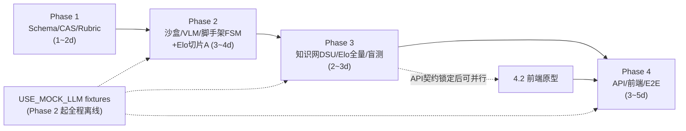

# 刷题 Harness 开发计划（Development Plan）

*   **基于**: [docs/designs/adaptive_practice_harness.md](./designs/adaptive_practice_harness.md)（Draft, 2026-11-13）
*   **Status**: 待评审
*   **Date**: 2026-11-13

---

## 0. 设计理解摘要（对齐确认）

### 0.1 系统定位

面向**数学/物理**的 **Local-First 单机 Web** 自适应刷题与验证框架：接收「题干 + 配图 + 手写草稿截图」的 Markdown 错题，在**零预设考纲、零静态题库**的完全冷启动条件下，把题目从"看懂解析"推进到"脱离提示独立解出"，并自收敛出个人知识图谱与分模块能力水位。

技术栈：FastAPI + 原生 ES Modules 前端（KaTeX，零构建）+ SQLite(WAL) + SHA-256 CAS 资产库 + 受限 Python/SymPy 子进程沙盒 + OpenAI 兼容 LLM/VLM 网关（httpx 异步，支持 `USE_MOCK_LLM` 全离线）。

### 0.2 双层架构与五大模块

| 层 | 模块 | 核心机制 |
| :--- | :--- | :--- |
| 微观单题闭环 | M1 录入诊断 | 分区剪贴板 → CAS 归档 → VLM 一次性草稿转录 + 四维 Rubric 打标 → 步骤对齐微确认条（Diff Gate，<3s，拦截 VLM 归因偏差，兼容一题多解分支） |
| 微观单题闭环 | M2 三阶脚手架 | 倒置防剧透：一阶条件遮罩盲探 → 二阶脱壳微母题 → 三阶无提示回原题；一阶思考窗口**异步预热**二阶/四阶题（内核先行 + AST 探针 + SymPy 沙盒 ≤5s，重试 ≤2，失败降级双盲 LLM） |
| 微观单题闭环 | M3 拆拐杖与盲测 | 双层正交 FSM（宏观 🔴ACTIVE/🟡PENDING_RETEST/🟢MASTERED × 微观 STAGE_0~4）；L≥2 半程立式（代数等价校验）；2~4 天/3~7 天双轨盲测窗口；每日 ≤3 题配额熔断 + 幂等题单锁；原题回退双重核验（中间子目标 + 最终答案） |
| 宏观全局导航 | M4 知识网 | L1/L2 骨架注入 + 同父 L2 Top-15 召回（>25 节点时字符 N-gram Jaccard 预筛）+ AI 裁判复用；**同域**可逆并查集 Compaction（redirect 跳数 ≤1、悲观半格状态归并、标红边去自环、审计快照一键 Un-merge）；版图攻克率 + 分布熵校准收敛度 |
| 宏观全局导航 | M5 双轨 Elo | 按 L1 模块独立核算覆盖分/实战分（初始 1200/1200）；事件溯源账本 + 单题 Escrow 托管池；水位线高斯门控、单调性硬锁子步保底、100% 冻结零预支、温和超时衰减 |

### 0.3 必须用测试锁死的核心不变量

1.  **难度确定性**：`base_elo = min(2800, max(800, 750 + 85·(2^C−1) + 105·S + 115·T + 65·L))` + 8 档 tier 阶梯（C≤2 封顶 L4-A；C=4 按 2250/2550 分裂 L5-1/2/3）。
2.  **子步单调性硬锁**：`C_sub ≤ max(1,C−1)`、`S_sub ≤ max(1,S−1)`、`T_sub ≤ T`、`L_sub ≤ L`；`D_sub = max(800, min(2650, D_orig−150, base_elo(sub)))`，永不触发 SQLite CHECK 违约。
3.  **双轨不倒挂**：任何事件后 `Combat ≤ Coverage`（保底发放后强制 `R_cov ← max(R_cov, R_combat)`）。
4.  **Escrow 严格守恒**：`ΔR_floor + escrow_delta ≡ ΔR_target`（基于入库快照 `R_combat^(0)` 计算，K_combat=24）；盲测通过按 `decay_factor` 兑现，失败清零退回 ACTIVE；**绝不倒扣已掌握基线与覆盖分**。
5.  **幂等**：账本幂等键 `{question_uid}:{session_id}:{trigger}`；覆盖分 `is_cov_settled` 只结算一次；每日题单 `slated_drill_date` 当日刷新幂等；Markdown 重入库按 `stem_hash` 增量不毁进度。
6.  **图谱作用域**：Compaction 严禁跨 L1/L2；回滚按 batch 精确恢复两跳指针 + aliases + 标红边快照；Elo 账本与并查集完全解耦（回滚不重放 Elo）。
7.  **沙盒安全**：AST 白名单（sympy/math/fractions）+ 危险内置/双下划线拦截 + 必含真实符号求解调用（反 VACUOUS 伪脚本）；macOS 跳过 RLIMIT_AS、宿主 timeout 强杀进程组。
8.  **衰减边界**：仅对 `slated_exposure_count > 3` 的逾期题每日 −0.15；系统配额顺延期间（`system_deferred_days`）完全冻结衰减。

### 0.4 明确不做（Non-Goals 对齐）

静态题库/教材绑定、多租户 SaaS、浏览器手写画板、Lean/Coq 形式化证明、文科 RST 语篇拓扑。AnkiConnect 与 KST 日志校准列入 Future，不进本期。

---

## 1. 开发总策略

1.  **确定性内核先行，LLM 最后接线**：M1 难度引擎、M5 Elo 账本、M4 并查集、沙盒全部是纯确定性逻辑，先以单测锁死；LLM/VLM 全程走 `USE_MOCK_LLM=True` 的固定 fixture 开发，真实网关只在 Phase 4 联调时接入。任何阶段断网可全量跑测。
2.  **严格沿用设计文档的 4 阶段与门禁命令**，每阶段结束必须绿灯才进入下一阶段；每阶段一个 git commit 节点并推送 `shuati-harness` 仓库。
3.  **测试即规格**：设计文档给出的测试向量（1120/1630/2800/2085/1290、守恒律、两跳回滚、冷启动除零）逐条落成断言，核心五引擎分支覆盖率 ≥90%，全局 ≥85%。
4.  **事件溯源不做原地标量**：模块 Elo 当前值 = `elo_mutation_ledger` 折叠结果（初始 1200/1200），不建可变标量表，天然支持 Replay。
5.  **前端零构建**：Vanilla ES Modules + CDN KaTeX，四页签最小可用，不做框架化。

---

## 2. 分阶段任务分解

### Phase 1 — 存储、CAS 与四维难度基座（设计文件 #1~#6 + #15 前半）

| # | 任务 | 产出文件 | 要点 |
| :--- | :--- | :--- | :--- |
| 1.1 | 项目骨架与依赖 | `pyproject.toml`、`backend/` 包结构、`.gitignore`（补 `data/`、`.venv/`） | Python ≥3.11；依赖清单严格按设计 #1；`pytest pythonpath=["."]` |
| 1.2 | 集中配置 | `backend/config.py` | `Settings(BaseSettings)`：网关/存储/沙盒配额/知识网阈值/盲测窗口/K 系数全量常量化，杜绝魔数 |
| 1.3 | 数据库基座 | `backend/db/schema.py` | 9 张表 + 索引幂等建表；`WAL + foreign_keys + busy_timeout=5000`；连接上下文管理器 |
| 1.4 | CAS 资产服务 | `backend/services/cas_store.py` | Pillow 长边 ≤1536px → WebP → SHA-256 分桶落盘；frontmatter 注入 `question_uid`；`stem_hash` 增量识别 |
| 1.5 | 难度引擎 | `backend/services/difficulty_rubric.py` | `calculate_base_elo`（公式 + 8 档阶梯，严格按序匹配）；`clamp_substep_difficulty`（单调性硬锁 + 800/2650 边界） |
| 1.6 | 测试（前半） | `tests/test_difficulty_and_elo.py` | 向量：(1,1,1,1)→1120/L1；(2,3,1,3)→1630/L4-A；(4,3,3,3)→2800/L5-3；(3,3,2,3)→2085；clamp 边界（S_orig=1、D_orig<950） |

**依赖**：无（纯本地）。
**验收门禁**：`pytest tests/test_difficulty_and_elo.py -k "rubric or clamp" -v` + `python3 -m compileall -q backend tests`
**里程碑 M1**：离线确定性难度引擎 + 全量 Schema 可用，CAS 图片归档可单测验证。
**预估**：1~2 人日。

### Phase 2 — 受限沙盒、VLM 诊断与脚手架（设计文件 #7~#9 + #16）

| # | 任务 | 产出文件 | 要点 |
| :--- | :--- | :--- | :--- |
| 2.1 | AST 静态探针 | `backend/sandbox/sympy_verifier.py`（上） | 导入白名单；拦截 open/eval/exec/`__import__`/getattr/globals/locals；禁双下划线属性；必含真实 solve 调用否则 `VACUOUS_SCRIPT_REJECTED` |
| 2.2 | 子进程沙盒 | 同上（中） | Linux: RLIMIT_AS 256MB + CPU 5s；macOS: 仅 CPU + 捕获 AS 异常降级；宿主 `timeout=5.0, start_new_session=True` 杀进程组；`solve_kernel()` 返回契约校验 |
| 2.3 | 代数等价引擎 | 同上（下） | `parse_expr` + implicit_multiplication + convert_xor + `nsimplify(rational=True)`；`e1−e2=0` / `e1+e2=0` / 常数比率三判据；多方程 `;`/换行切分 |
| 2.4 | LLM 网关（**新增文件**，见 §6.3） | `backend/services/llm_gateway.py` | httpx.AsyncClient 统一封装：重试 2 次指数退避、结构化 JSON 解析 + Pydantic 校验修复、`USE_MOCK_LLM` fixture 路由 |
| 2.5 | VLM 诊断 | `backend/services/vlm_diagnosis.py` | `OptimalSolutionTrace`/`StepSkeletonItem`/`DraftAlignmentResult` Schema；空白草稿默认 (0,1,CONCEPT_BOTTLENECK)；一题多解分支 `user_alt_1`；六大 TRAP 算子；遮罩条件提取 |
| 2.6 | Elo 账本原语（**从 Phase 3 前置**，见 §6.2） | `backend/services/elo_engine.py`（切片 A） | 账本写入基座 + `record_mastered_init` + `apply_draft_subgoal_floor` + 模块 Elo 折叠读取 + 不倒挂不变量（confirm-gate 直接依赖） |
| 2.7 | 脚手架引擎 | `backend/services/scaffold_engine.py` | 微观 FSM 全流转；`in_flight_prewarm_tasks` 字典 + 同步 await 在途任务；confirm-gate 三分支；本地检索优先（SCAFFOLD_PRE: ΔD≥200 且 ≤2 步；ISOMORPHIC: |ΔD|≤150）→ 内核先行生成 → 沙盒 → 双盲降级；合成题禁止再衍生 |
| 2.8 | 沙盒测试 | `tests/test_sympy_sandbox.py` | 伪脚本/恶意导入/内省拦截；macOS 不崩；死循环 5s 强杀 → 降级；移项反号与常数倍等价判据 |

**依赖**：Phase 1 全部。
**验收门禁**：`pytest tests/test_sympy_sandbox.py -v`
**里程碑 M2**：Mock 模式下「草稿转录 → 确认门禁 → 预热 → 三阶流转」服务层跑通；沙盒安全套件全绿（含本机 macOS 实测）。
**预估**：3~4 人日（全项目技术风险最高段）。

### Phase 3 — 并查集知识网、双轨 Elo 全量与盲测调度（设计文件 #10~#12 + #15 全量 + #17）

| # | 任务 | 产出文件 | 要点 |
| :--- | :--- | :--- | :--- |
| 3.1 | 知识网引擎 | `backend/services/knowledge_graph.py` | CanonicalNodeResolver；L1/L2 注入 + Top-15 Jaccard 召回 + aliases≤8；同域 Compaction（单对小事务、路径压缩 ≤1 跳、仅聚合 is_blocked_step=1 的悲观半格、标红边去自环/归并）；batch 回滚（两跳指针 + aliases + 边快照）；双指标（w<5→ρ=0，N<3→η=0，0ln0=0） |
| 3.2 | Elo 引擎全量 | `backend/services/elo_engine.py`（切片 B） | 高斯水位线 γ（σ=150，−200/−500 分段）；`freeze_decrutch_escrow`（is_cov_settled 一次性 + 快照目标增量 + 100% 冻结）；`realize_or_forfeit_blind_test`；`apply_overdue_escrow_decay`（曝光>3 才衰减，顺延期冻结）；`replay_module_elo_from_ledger` |
| 3.3 | 盲测调度器 | `backend/services/blind_drill_scheduler.py` | 每日 ≤3 题幂等锁（slated_drill_date）；溢出顺延 + system_deferred_days；剥标签防剧透；变式优先/原题回退双重核验；母题连带销账（SCAFFOLD_PRE 且 I≥0.85）；失败重训分流（一阶 vs 四阶起点） |
| 3.4 | 守恒与图谱测试 | `tests/test_difficulty_and_elo.py`（补全）、`tests/test_knowledge_graph_dsu.py` | 四阶段全流程守恒 ≡ 直接做对；全程不倒挂；衰减只碰托管池；跨域合并硬拒；回滚精确恢复；冷启动指标无 NaN |

**依赖**：Phase 2（切片 A 已就位）。
**验收门禁**：`pytest tests/test_difficulty_and_elo.py tests/test_knowledge_graph_dsu.py -v`
**里程碑 M3**：五大确定性引擎全部完成，守恒律/可逆性/幂等性被测试证明。
**预估**：2~3 人日。

### Phase 4 — REST API、Web 工作台与全链路 E2E（设计文件 #13~#14 + #18 + #2）

| # | 任务 | 产出文件 | 要点 |
| :--- | :--- | :--- | :--- |
| 4.1 | FastAPI 入口 | `backend/main.py` | 7 个 `/api/v1/*` 端点 + `/assets/{cas_hash}` 静态路由 + `./frontend/` 挂载；Pydantic DTO；预热后台任务接线 |
| 4.2 | Web 工作台 | `frontend/index.html`、`app.js`、`styles.css` | 四页签：①双槽剪贴板录入 + Diff Gate（回车确认/归因切换）②三阶脚手架遮罩视图 + 半程立式输入（allowed_symbols 芯片）③每日盲测（无标签）④知识网 SVG + 双轨 Elo 曲线 + Un-merge 面板；`cas://` 正则重写 `/assets/$1`；KaTeX 渲染 |
| 4.3 | E2E 验收 | `tests/test_e2e_cuj_flows.py` | Mock VLM/LLM + 真实 SQLite + 真实 SymPy，跑通 CUJ1~4 全链路（含预热并发、配额顺延、双重核验销账） |
| 4.4 | 文档与总门禁 | `README.md`（重写） | 启动指南/目录导航/设计文档索引；`pytest -v --cov=backend --cov-fail-under=85 && ruff check backend/ tests/ && mypy backend/` |
| 4.5 | 真实网关联调（可选收尾） | `.env`（不入库） | 接入真实 LLM_BASE_URL/API_KEY，抽 3~5 道真实错题人工走查 CUJ1~3 |

**依赖**：Phase 3 全部；4.2 可在 Phase 3 期间按 API 契约并行起步。
**验收门禁**：设计 Phase 4 命令全绿 + CUJ1~4 人工走查通过。
**里程碑 M4**：本地 `uvicorn backend.main:app` 一键启动，完整闭环可用。
**预估**：3~5 人日（前端占大头）。

---

## 3. 依赖关系总览

**总预估：9~14 人日**（单人 + AI 辅助；不含真实 LLM 调优与题目内容运营）。

---

## 4. 实施风险与对策（工程执行层，补充设计文档 Risks 表）

| 风险 | 对策 |
| :--- | :--- |
| LLM 结构化输出漂移（JSON 缺字段/维度非整数/越界） | Pydantic 严格校验 + 一次修复重试；Rubric 入参整数与范围校验直接拒绝；Mock fixture 覆盖畸形输出用例 |
| SymPy 等价判定假阴性（超越函数、定义域、多解） | 三判据之外保留「人工确认通过」兜底通道；等价引擎单测覆盖三角/根式/分式典型 case |
| 手写转录质量不可控 | Diff Gate 本就是设计内的人工保险丝；E2E 用低质量转录 fixture 验证用户修正路径 |
| 每日题单跨日/时区边界 bug | `active_date` 显式入参（可注入测试日期），不隐式取 `now()`；E2E 用模拟日期推进验证顺延与衰减冻结 |
| SQLite 写锁争用（预热/Compaction/前台并发） | busy_timeout=5000 + Compaction 单对小事务 + 预热独立事务重试（设计已定，测试加并发用例） |
| 前端范围蔓延 | 锁死四页签 + 零构建；SVG 图谱只做三层树 + 标红边，不做力导向布局 |

---

## 5. 每阶段 Definition of Done

- [ ] 门禁命令全绿（见各阶段）
- [ ] `ruff check` + `mypy` 对新增文件零告警
- [ ] 新增确定性逻辑均有对应断言（核心引擎分支覆盖 ≥90%）
- [ ] git commit（含阶段标签）并推送 `nakseuksa/shuati-harness`
- [ ] 不引入设计 Non-Goals 范围外功能

---

## 6. 阅读中发现的差异与待确认项（不阻塞 Phase 1 启动）

### 6.1 难度公式与 exercise_grading 旧实现不一致 ⚠️

本设计文档公式为 `750 + 85·(2^C−1) + 105S + 115T + 65L`（最易题 **1120** 分），与 `0_work/exercise_grading/difficulty_scorer.py` 的旧公式（`800 + 86.96·(raw−6.5)`，最易题 800 分）**不同**，tier 判定阶梯也不同（本设计 8 档硬规则 vs 旧版区间映射）。
**本计划以设计文档为准**（CUJ 示例 2085/1290 均按新公式核验通过）。旧仓库是否需要同步更新，请确认。

### 6.2 跨阶段依赖调整：Elo 切片 A 前置到 Phase 2

设计把 `elo_engine.py` 整体放在 Phase 3（#11），但 Phase 2 的 `scaffold_engine.confirm_diagnostic_gate` 直接调用 `record_mastered_init` / `apply_draft_subgoal_floor`。为避免接口桩返工，计划将**账本写入基座 + 这两个函数 + 不倒挂不变量**作为切片 A 前置到 Phase 2（任务 2.6），Escrow/衰减/Replay 留在 Phase 3 切片 B。阶段门禁命令不变。

### 6.3 新增 `llm_gateway.py`（设计 18 文件清单之外）

设计的 Risks 表要求 httpx 统一封装 + 重试退避 + Mock 模式，但文件清单未单列网关模块。计划新增 `backend/services/llm_gateway.py` 供 vlm_diagnosis / scaffold_engine / 双盲校验共用，避免三处重复实现。

### 6.4 真实 LLM 网关凭据（Phase 4.5 前需要）

默认配置指向 OpenAI 兼容接口（gpt-4o / gpt-4o-mini）。实际接入时需您提供 `LLM_BASE_URL` / `LLM_API_KEY` / 模型名（可指向您现有的 qwen 网关）。此前全程 Mock，不阻塞开发。

---

## 7. 启动建议

评审通过后从 **Phase 1 任务 1.1** 开始：先落 `pyproject.toml` + 包骨架 + Schema + 难度引擎 + 测试向量，当天即可拿到 M1 绿灯。

---

## 8. 编排执行日志（PM 变更记录）

| 日期 | 变更 | 原因 |
| :--- | :--- | :--- |
| 2026-11-13 | Phase 1 完成（M1，commit a733a58）：121 测试全绿 | p1-schema/p1-cas/p1-rubric 三 worker 并行，DDL token 级保真审计 + 12096 组 clamp 全遍历 |
| 2026-11-13 | `freeze_decrutch_escrow` 从切片 B 前置到切片 A | P2-E 脚手架 STAGE_4→PENDING_RETEST 直接依赖，消除跨阶段接口桩 |
| 2026-11-13 | 新增 `ingest_service.py`（P2-D） | 设计将落库隐含在 API_Ingest，独立成服务保持 Phase 4 路由轻薄 |
| 2026-11-13 | P3-A（知识网）/P3-B（Elo 切片 B）提前与 Phase 2 尾部并行 | 依赖仅 Phase 1 基座 + 网关，文件所有权零交集，压缩关键路径 |
| 2026-11-13 | 新增 `blind_drill_attempts` 表（P3-C，PM 批准 schema 追加） | 支撑变式曝光追踪与失败重训分流的作答日志，设计未显式定义 |
| 2026-11-13 | 契约笔误修正：γ 在 D=R-500 处为 exp(-2) 而非 0 | p2-elo-a 按设计公式正确裁决，中段含左端点 |
| 2026-11-13 | 多方程「消去中间变量比对解集」完全体延后 | P2-A 已实现切分+逐方程等价，完全体超出 Phase 2 范围，列入后续优化 |
| 2026-11-13 | PM 集成修复：VLM 注册表测试改为子集断言 | P3-A 按契约追加 node_judge 与硬编码精确集合冲突；保留测试意图同时允许批准扩展 |
| 2026-11-13 | Phase 3 切片 B 验收：155 门禁测试，四阶段守恒律 1e-9 精度证明 | p3-elo-b；forfeit 无账本事件（枚举无 trigger）、衰减四条件合取、replay 断链校验 |
| 2026-11-13 | P3-D 集成完成：ingest 节点匹配升级 CanonicalNodeResolver（17 测试） | 复用裁决改由 AI 裁判，Mock 默认保守新建；满 15 自动 compaction 在录入事务内验证 |
| 2026-11-13 | PM 决策：blind_drill_attempts 进 TABLE_DDLS（方案 B），授权 p3-drill 更新 test_schema.py 表数断言 9→10 | schema 单一来源优先；拒绝影子表方案 A，避免 init_db 与调度器 schema 分裂 |
