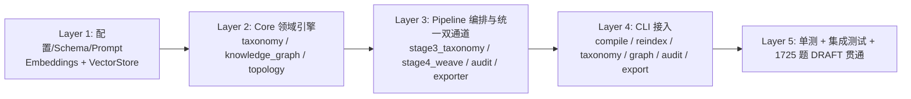

# M2 阶段实施计划（对齐终版）：Stage 3 知识网 + Stage 4 五边拓扑 + Stage Q 体检与导出

## Goal Description

在当前已完成全量 **1,728 题 Stage 0/1/1.5/2**（`1,725` 有效题 `S2='OK'`、5,385 条步骤、`4,493` 组去重 `(raw_l1, raw_l2)`、`7,230` 个候选概念、`S3C/S3D/S4` 均为 `STALE`）的基线上，完成 **M2 里程碑**的全部核心工程交付与真机 `DRAFT` 全链路贯通：

1. **向量与嵌入基础设施**：实现 OpenAI 兼容异步 Embedding 客户端（对接 `.env` 的 `google/gemini-embedding-2`，并支持离线确定性 `--mock`）与跨进程锁保护的 `.npz` 本地向量仓（`surface_<slug>` / `skeleton_<slug>` / `l3_nodes_<slug>` / `concepts_method` / `concepts_motif`）及 `meta.json` 冻结相似度分位表。
2. **Stage 3 自底向上知识网（树 → 网）**：
   - 完整实现 `DRAFT → LOCKED` 词表生命周期（`taxonomy propose` / `lock` / `migrate` / `candidates`）；
   - **Stage 3a (`propose`)**：对全库 **4,493 组** `(raw_l1, raw_l2)` 全量 Embedding 聚类为 60~100 个频次加权语义簇 + 高频 Top 列表，归纳 **7~10 个 `L1`** 与 **40~70 个 `L2`**；
   - **Stage 3c (`S3C`)**：零成本精确/别名命中后，未命中项按**每批 20 题（脱敏 `abstract_skeleton` + 步骤上下文）**批映射每步 `(m_l1, m_l2)` 与整题 `primary/secondary L1`，严格保护 `raw_l1/raw_l2` 只读；
   - **Stage 3d (`S3D`)**：L3 节点挂载 + **全量无预筛召回（同域 `Top-5 ∪ 2/3-gram Jaccard > 0.15`）**送 `judge_llm` / Subagent 批裁判，执行可逆并查集归并（`L3` 节点与全局 `METHOD`/`MOTIF` 概念）及 `revert-merge`；
   - **Stage 3e (`S3E`)**：`PREREQUISITE` L2 先修 DAG（Kahn 环检测断环）+ `CO_OCCURRENCE` 跨模块共现边。
3. **Stage 4 四通道五边拓扑织网**：仅对 `eff_is_servable = 1`（当前 1,649 题，保留 `--include-unservable` 开关）计算“kNN 互近邻 + 冻结分位数 + 硬下界 + IDF 加权 Tversky/陷阱重合度”五边判定，全面启用 `enable_stage4_llm_refine` 精裁，合并 `relation_overrides`，支持单题增量补边 `weave_single_question` 与校准候选对抽样（~150 对）供阈值微调。
4. **Stage Q 自动质量体检与 4 份标准 JSONL 导出**：实现 `shuati audit`（7 大板块报告 + 假共识抽检 + `--prune-runs`）与 `shuati export`（脱离 SQLite 的 4 份标准 JSONL）。
5. **全 5 步统一 Subagent JSONL 双通道**：`propose` / `3c` / `compact` / `3e` / `4` 均支持 `--mode api|export|import`，统一使用 `data/unified/stage3_4/` 脱敏批任务包与隔离 `*_task_map.json`。

---

## User Review Required

> [!IMPORTANT]
> **已通过 `/grill-me` 逐项确认的 6 项关键设计决策**
> 1. **全库 `DRAFT` 先行 → 人工审定后 `LOCKED 1.0`**：先用全部 1,725 题涌现草案并跑通 `DRAFT` 全链路（含 `audit` 与 `export`），待您微调 `taxonomy_primary_olympiad.draft.yaml` 并审定 Stage 4 校准样本后，再锁定 `1.0` 重编。
> 2. **Stage 3a 全量聚类**：全部 4,493 组 `(raw_l1, raw_l2)` 经 Embedding 聚类（60~100 个频次加权语义簇）+ 高频榜归纳 7~10 个 `L1` 与 40~70 个 `L2`。
> 3. **Stage 3c 逐题上下文批映射**：零成本精确/别名命中之外的题目，按每批 20 题（脱敏 `abstract_skeleton` + 各步 `raw_l1/raw_l2`）上下文映射，兼顾跨步/一词多义消歧。
> 4. **Stage 3d 全量召回无预筛**：严格按 `Top-5 ∪ 2/3-gram Jaccard > 0.15` 全量召回候选对（不对 `concepts` 截断单次长尾或设硬余弦门槛），通过 30~50 对/批的 Subagent/API 批裁判全量覆盖。
> 5. **Stage 4 隔离 76 题 `NEEDS_REVIEW`**：`S3C/S3D` 覆盖全量 1,725 题，`S4` 默认仅对 `eff_is_servable = 1`（1,649 题）织边（76 题置 `S4='BLOCKED'`，保留 `--include-unservable`）。
> 6. **全 5 步统一 `--mode api|export|import` 脱敏双通道 + ~150 对校准抽样**：`propose` / `3c` / `compact` / `3e` / `4` 全部支持脱敏批导出与 Pydantic 强校验回灌；`DRAFT` 跑通后抽样 ~150 对 5 类边及边界带候选供您审定并调优 `settings.yaml` 阈值。

> [!NOTE]
> **范围边界**
> 本计划不包含对 M0 3 条 `assert == 122` 遗留测试断言的修改、不包含 `drafts/skills/` 安装、也不代办 76 题 `NEEDS_REVIEW` 人工复核（可随时通过 `shuati review` 并行处理）。

---

## Proposed Changes

按依赖层级由底向上组织，共分 5 个组件层。



---

### Layer 1: 配置、Schema、Prompt、Embedding 与向量存储

#### [MODIFY] [settings.yaml](file:///D:/0.default/shuati-harness/config/settings.yaml) & [config.py](file:///D:/0.default/shuati-harness/src/shuati/config.py)
- 为 `EmbeddingConfig` 补充 `timeout_seconds: float = 60.0`、`max_concurrency: int = 8`、`rpm_limit: int = 120`、`max_retries: int = 3`。
- 在 `TopologyConfig` 下新增可校准的 `thresholds: TopologyThresholdsConfig`（默认值对齐 `DESIGN.md §4.6-2`）：
  - `clone`: `knn_k=3, surface_pct=0.995, surface_sim_min=0.85, skeleton_pct=0.995, skeleton_sim_min=0.88, max_elo_diff=120, degree_cap=5`
  - `isomorphic`: `knn_k=10, skeleton_pct=0.98, skeleton_sim_min=0.76, surface_pct_max=0.60, k_jaccard_min=0.45, max_elo_diff=180, boundary_band=0.10, degree_cap=8`
  - `scaffold`: `min_k_size=2, containment_min=0.80, reverse_containment_max=0.60, min_elo_diff=200, skeleton_pct_min=0.90, boundary_band=0.10, in_degree_cap=5, out_degree_cap=5`
  - `contrastive`: `knn_k=10, surface_pct_min=0.98, k_jaccard_max=0.35, degree_cap=5`
  - `shared_trap`: `min_shared=1, idf_overlap_min=0.65, skeleton_pct_max=0.60, cross_l1_bonus=1.3, degree_cap=5`

#### [MODIFY] [schemas.py](file:///D:/0.default/shuati-harness/src/shuati/models/schemas.py)
新增 Stage 3 / Stage 4 结构化输出 Pydantic 模型：
- `TaxonomyL2Proposal` / `TaxonomyL1Proposal` / `TaxonomyProposeOutput`：Stage 3a 归纳输出（`modules`: 7~10 个 L1，每 L1 下含 L2 `name`/`aliases`）。
- `Stage3cStepMapping` / `Stage3cQuestionMapping` / `Stage3cBatchMappingOutput`：Stage 3c 逐题上下文批映射输出（`task_item_id`, `primary_l1_module`, `secondary_l1_modules`, `steps: [{step_index, mapped_l1, mapped_l2, is_novel_l2}]`）。
- `MergeJudgeItem` / `MergeJudgeBatchOutput`：Stage 3d 批裁判输出（`pair_id`, `should_merge`, `canonical_name`, `reason`）。
- `PrerequisiteEdgeCandidate` / `PrerequisiteDagOutput`：Stage 3e `L2` 先修 DAG 输出（`source_l1`, `source_l2`, `target_l1`, `target_l2`, `confidence`, `reason`）。
- `Stage4RefineItem` / `Stage4RefineBatchOutput`：Stage 4 `CONTRASTIVE` 与边界带精裁输出（`pair_id`, `is_valid`, `pedagogical_note`, `reason`）。

#### [MODIFY] [prompt_builder.py](file:///D:/0.default/shuati-harness/src/shuati/llm/prompt_builder.py) & [mocks.py](file:///D:/0.default/shuati-harness/src/shuati/llm/mocks.py)
- 遵循字段白名单新增 Stage 3/4 Prompt 构造器（**严禁**写入 `question_uid`、`source_collection`、`raw_chapter`、`legacy_tags` 或原始图片路径）：
  - `build_taxonomy_propose_messages(grade_subject, clusters_summary, top_pairs)`
  - `build_stage3c_mapping_messages(grade_subject, taxonomy_enum_text, question_items)`（仅传入脱敏 `item_id`、`abstract_skeleton`、各步 `(step_index, raw_l1, raw_l2)`、原 `raw_primary_l1`）
  - `build_merge_judge_messages(target_kind, scope_desc, candidate_pairs)`
  - `build_prerequisite_dag_messages(grade_subject, taxonomy_enum_text, ordered_transitions)`
  - `build_stage4_refine_messages(candidate_pairs)`（仅传入两端题干/抽象骨架/生效知识点与待判边类型，零 `uid`）
- 在 `mocks.py` 为上述 5 个 Schema 补齐确定性 Mock 响应。

#### [NEW] [embeddings.py](file:///D:/0.default/shuati-harness/src/shuati/llm/embeddings.py)
- 实现 `EmbeddingClient(settings, conn=None, writer=None)`：
  - 支持 `provider="openai_compatible"`：异步 `httpx` 按 `batch_size` 批量请求 `/embeddings`，受 `Semaphore` + `_TokenBucket` 限流与退避重试，记录 `llm_calls(stage='EMBED', slot='embedding')`；
  - 支持 `use_mock=True`：基于文本 SHA-256 与字符 2-gram 哈希混合生成确定性 L2 归一化伪向量（`dim=64`），使字面接近的字符串在 Mock 下也拥有较高余弦相似度，方便单测验证聚类与近邻召回；
  - 支持 `provider="local_st"` 延迟导入 `sentence_transformers`（缺失依赖时抛清晰 `PreconditionError`）。

#### [NEW] [store.py](file:///D:/0.default/shuati-harness/src/shuati/vectors/store.py) & [\_\_init\_\_.py](file:///D:/0.default/shuati-harness/src/shuati/vectors/__init__.py)
- 实现 `VectorStore(vectors_dir: Path = Path("data/vectors"))`：
  - 跨进程文件锁 `data/vectors/.lock`（复用 `CompileLock` 同款 Windows `msvcrt.locking` / Unix `fcntl.flock`）；
  - 统一管理 5 类 `.npz` 矩阵（`ids`, `text_hashes`, `vectors: float32[N, D]`，原子写 `.tmp.npz` + `os.replace`）：
    - 按学段隔离：`surface_<slug>.npz`、`skeleton_<slug>.npz`、`l3_nodes_<slug>.npz`
    - 全局概念库：`concepts_method.npz`、`concepts_motif.npz`
  - `sync_vectors(...)`：按 `sha256(text)` 增量检测新增/过期/移除项，仅对差量调用 `EmbeddingClient`；
  - `meta.json` 管理：记录 `embedding_model`、`dimension`、`meta_version` 与 `quantiles[(scope, channel)]`（随机抽样最多 20,000 对计算 101 点经验分位 LUT）；
  - `lookup_percentile(scope, channel, sim)` 线性插值；
  - 切换 Embedding 模型校验：若 `meta.json` 的 `embedding_model` 与当前配置不一致，抛出 `PreconditionError` 提示执行 `shuati reindex --vectors --quantiles`；
  - `rebuild_quantiles(...)` 重建分位表并递增 `meta_version`。

---

### Layer 2: Core 领域引擎

#### [NEW] [taxonomy.py](file:///D:/0.default/shuati-harness/src/shuati/core/taxonomy.py)
- `TaxonomySpec`（Pydantic 模型）：解析并校验 `config/taxonomies/taxonomy_<slug>[.draft].yaml`，校验 L1/L2 唯一性、`status ∈ {'DRAFT', 'LOCKED'}` 与 `changelog`。
- `build_lookup_index(spec)`：构建名称与 `aliases` 查表索引，支持零 LLM 精确/规范化匹配。
- `transition_taxonomy(...)`：统一实现 `DRAFT` 换版（`draft-N → draft-N+1`）与正式锁表（`DRAFT → LOCKED 1.0`）：
  - 获取 `CompileLock` + `human_mirror.vacuum_backup(..., "taxonomy_lock")`；
  - 单事务内按 `DESIGN.md §4.5-1` 执行 4 步：
    1. 自动迁移 `human_overrides`（`taxonomy_override_json`、`primary_l1_module`、`secondary_l1_modules_json`），无法映射项导出 `data/reports/taxonomy_override_migration.json`（默认中止，传 `--allow-stale-overrides` 则置 `is_suspended=1, suspended_reason='TAXONOMY_UNMAPPED'`）；
    2. 清空 `question_steps.(m_l1, m_l2, m_knowledge_node_id)` 与 `questions.eff_node_ids_json='[]'`（严禁改写 `raw_l1/raw_l2/raw_l3`）；
    3. 清理旧 `draft-%` `knowledge_edges` 与 `knowledge_nodes`，将草案 `compaction_audit_ledger` 置 `is_reverted=1`；
    4. 更新 `grade_subjects` 状态与版本号，置全学段 `S3C/S3D/S4 = STALE`，对受影响覆写题调用 `effective.recompute` 并同步 `human/overrides.jsonl`。
- `migrate_taxonomy_incremental(...)`：按 `LOCKED` YAML `changelog`（`add`/`rename`/`merge`）精准迁移（`1.0 → 1.1`）。

#### [NEW] [knowledge_graph.py](file:///D:/0.default/shuati-harness/src/shuati/core/knowledge_graph.py)
- 读时并查集工具：
  - `find_canonical_node_id(conn, node_id)` / `find_canonical_concept_id(conn, concept_id)`
  - `expand_canonical_node_ids(conn, node_id) -> set[str]` / `expand_canonical_concept_ids(conn, concept_id) -> set[str]`（路径压缩跳数 $\le 1$，一次查齐主节点与重定向子节点）。
- **全量无预筛**同域双路召回：
  - `recall_l3_merge_candidates(...)`：硬断言限定同一 `(grade_subject, taxonomy_version, node_level='L3', l1_module, l2_entity)`（排除 `node_level='L2'`），取作用域内全部 `Top-5` 余弦 $\cup$ 字符 2/3-gram Jaccard (`> 0.15`) 候选对（不设额外余弦截断门槛）；
  - `recall_concept_merge_candidates(...)`：硬断言限定同一 `kind ∈ {'METHOD', 'MOTIF'}` 且 `is_seed = 0`（严禁合并 `TRAP`），取 `concepts_<kind>.npz` 全部 `Top-5` 余弦 $\cup$ 2/3-gram Jaccard (`> 0.15`) 候选对。
- 原子并查集归并 & 审计回滚：
  - `apply_merge_pairs(conn, target_kind, scope_dict, pairs, batch_id)`：每对在 `SAVEPOINT` 事务内完成路径压缩（更新 `from` 及直属子节点指 `to`，记录 `affected_child_ids_json`）、合并 `aliases_json`（上限 12）、写 `compaction_audit_ledger`；并对关联 `questions`（由 `question_steps.m_knowledge_node_id` 反查）调用 `effective.recompute` 刷新 `eff_node_ids_json`（合并概念时同步去重合并 `question_concepts` 避免主键冲突）。
  - `revert_merge_batch(conn, batch_id)`：先 `vacuum_backup`，按 `merge_id` 逆序校验无后续活跃合并依赖，拒绝乱序回滚，无损恢复 `redirect_to_id`、`aliases_json`、置 `is_reverted=1` 并刷新受影响题目。
- `check_dag_and_break_cycles(edges)`：Kahn 拓扑排序检测 `PREREQUISITE` 有向环，迭代剔除当前环内最低权重边直至强无环，返回 `(acyclic_edges, broken_edges)`。
- `compute_l3_distribution_entropy(conn, grade_subject, taxonomy_version)`：仅统计活跃 `node_level='L3'` 节点分布熵。

#### [NEW] [topology.py](file:///D:/0.default/shuati-harness/src/shuati/core/topology.py)
- `normalize_edge_endpoints(relation_type, u, v)`：`SCAFFOLD` 有向，其余 4 类边强制 `u < v`。
- 指纹与 IDF 计算：
  - 基于 `eff_node_ids_json`（无 `REPLACE` 覆写且含多解分支时按分支取最大覆盖）$\cup$ 经并查集归一的活跃 `MOTIF` `concept_id` 构建 $K_{\text{set}}$；
  - 基于活跃 `TRAP` `concept_id` 构建 $E_{\text{trap}}$；
  - 计算 $\text{idf}(x) = \ln\frac{N+1}{\text{df}(x)+1}$、$I_w(A \subset B)$、$\text{Jaccard}(K_A, K_B)$ 与 $S_{\text{trap}}^{\text{IDF}}(A, B)$。
- 四通道五边规则矩阵：
  - 矩阵化计算 `Top-25` 近邻 rank 表 + 倒排索引召回共享 `K_set` / `E_trap` 对；
  - 依据 `VectorStore.lookup_percentile` 与 `Settings.topology.thresholds` 判定 5 类边，提取全部 `CONTRASTIVE` 及 `±10%` 边界带 `ISOMORPHIC` / `SCAFFOLD` 对送二级精裁。
- 度数上限截断 & `relation_overrides` 最终合并（`REJECT` 删除机器边，`ASSERT` 写入/覆写为 `HUMAN_VERIFIED`）。
- `weave_single_question(...)`：单题 1 vs N 增量补边与受影响端点度数重截断。

---

### Layer 3: 流水线、统一 Subagent 双通道、Stage Q 与导出

#### [NEW] [subagent_bridge.py](file:///D:/0.default/shuati-harness/src/shuati/pipeline/subagent_bridge.py)
轻量通用双通道脱敏任务包引擎（复用 `unified_import.py` 的匿名 `task_id` 隔离规范）：
- 为 `propose` / `3c` / `compact` / `3e` / `4` 统一提供：
  - `export_task_batches(step_kind, tasks, out_dir, batch_size)`：写出脱敏批任务至 `data/unified/stage3_4/<step_kind>/batches/batch_*.jsonl`（含内联精简 JSON Schema 说明），并将真实 `uid`/`node_id`/`concept_id` 映射隔离在 `<step_kind>_task_map.json`；
  - `load_and_validate_results(step_kind, results_file, task_map_file, schema_cls)`：逐条校验 Pydantic Schema，将不合法或解析失败条目写入 `retry_tasks.jsonl` 并返回已通过校验的结构化结果供事务落库。

#### [NEW] [stage3_taxonomy.py](file:///D:/0.default/shuati-harness/src/shuati/pipeline/stage3_taxonomy.py)
- **Stage 3a (`propose_taxonomy`)**：
  - 汇总 `S2='OK'` 有效题全部 `4,493` 组 `(raw_l1, raw_l2)` 与 `raw_l1_candidates_json` 频次；
  - 使用 `EmbeddingClient` 对全部 `4,493` 个去重 `(raw_l1, raw_l2)` 编码并做贪心/K-Means 聚拢成 `60~100` 个频次加权语义簇（附代表词、覆盖频次、关联高频 `raw_l1`），连同高频 Top-100 原词表；
  - 支持 `mode='api'`（调 `text_llm`）、`mode='export'`（导出 1 份脱敏聚类摘要任务至 `data/unified/stage3_4/propose/`）或 `mode='import'`（回灌并落盘 `config/taxonomies/taxonomy_<slug>.draft.yaml`，若处于 `NONE` 则登记 `DRAFT`）。
- **Stage 3c (`run_stage3c`)**：
  - 按题校验 `s3c_input_hash`；优先零成本精确/别名命中整题全部步骤与 `primary_l1_module`；
  - 未完全命中的题目按 **20 题/批** 构造脱敏上下文任务（`abstract_skeleton` + 步骤 `(raw_l1, raw_l2)` + 词表枚举），支持 `mode='api|export|import'`；
  - `LOCKED` 模式下遇未知 `is_novel_l2` 写入 `taxonomy_candidates(status='PENDING')` 并暂挂最接近 L2；
  - 落库 `question_steps.(m_l1, m_l2)`（保护 `raw_*` 不动）、`questions.(m_primary_l1_module, m_secondary_l1_modules_json)`、建齐 `knowledge_nodes(node_level='L2')`、调 `effective.recompute`、置 `S3C='OK'` 并传播 `S3D, S4 = STALE`。
- **Stage 3d (`run_stage3d` & `run_compaction`)**：
  - `run_stage3d`（确定性无 LLM 调用）：为每步 `(m_l1, m_l2, raw_l3)` 及激活 `taxonomy_override_json` 在同域内精确/别名匹配或新建 `L3` 节点，写 `question_steps.m_knowledge_node_id`，调 `effective.recompute` 物化 `eff_node_ids_json`，置 `S3D='OK'` 并传播 `S4='STALE'`；
  - `run_compaction`：同步 `l3_nodes_<slug>.npz`、`concepts_method.npz`、`concepts_motif.npz` → 全量无预筛召回 `Top-5 ∪ 2/3-gram > 0.15` 候选对 → 按 **40 对/批** 支持 `mode='api|export|import'` 批裁判 → 调用 `knowledge_graph.apply_merge_pairs` 执行原子可逆并查集归并。
- **Stage 3e (`run_stage3e`)**：
  - 确定性写入跨模块 `CO_OCCURRENCE` 边；
  - 统计 `L2` 步序转移矩阵并支持 `mode='api|export|import'` 输出 `PREREQUISITE` DAG → Kahn 环检测断环 → 写入 `knowledge_edges`。

#### [NEW] [stage4_weave.py](file:///D:/0.default/shuati-harness/src/shuati/pipeline/stage4_weave.py)
- `run_stage4_weave(...)`：
  - 门禁校验 `S3D='OK'`；默认过滤 `eff_is_servable = 1`（`NEEDS_REVIEW` 置 `S4='BLOCKED'`，传 `--include-unservable` 可包含）；
  - 同步 `surface_<slug>.npz` 与 `skeleton_<slug>.npz`，若无冻结分位表则自动生成 `meta.json`；
  - 调用 `topology.py` 计算一级规则候选；对 `CONTRASTIVE` 与边界带候选按 **25 对/批** 支持 `mode='api|export|import'` 二级精裁（`enable_stage4_llm_refine=True`）；
  - 截断度数上限、合并 `relation_overrides`、写入 `question_relations` 并置 `S4='OK'`。
- `evaluate_calibration_pairs(...)`：
  - 评估 `config/stress_test_25.yaml` 中 `calibration_pairs` 的命中率与误报率；
  - 支持 `--propose-candidates`：从 5 类边规则命中区与边界带抽样约 150 对（每类约 30 对，含正例候选与表皮相似负例候选），输出脱敏候选包供人工/Subagent 粗标并审定回填 `stress_test_25.yaml`。

#### [NEW] [audit.py](file:///D:/0.default/shuati-harness/src/shuati/pipeline/audit.py)
- 实现 `run_stage_q_audit(...)`：输出严格对齐 `DESIGN.md §4.7` 的 7 大板块体检报告（`data/reports/audit_<ts>.md` 与 `.json`），并支持 `--prune-runs` 清理未引用的 `FAILED` `stage1_vlm_runs`。

#### [NEW] [exporter.py](file:///D:/0.default/shuati-harness/src/shuati/db/exporter.py)
- 实现 `export_all_jsonl(...)`：一键原子导出 `questions_enriched.jsonl`、`knowledge_nodes.jsonl`、`knowledge_edges.jsonl`、`question_relations.jsonl` 至 `data/exports/`（只读 `eff_*` 与活跃节点/概念，默认排除 `is_retired`/`eff_is_excluded`）。

---

### Layer 4: CLI 扩展

#### [MODIFY] [main.py](file:///D:/0.default/shuati-harness/src/shuati/cli/main.py)
- 扩展 `shuati compile`：支持 `--stage 1|3c|3d|3e|4|all`、`--mode api|export|import`、`--tasks-dir`、`--results`、`--batch-size`、`--include-unservable`、`--mock`。
- 扩展 `shuati reindex`：新增 `--vectors`、`--quantiles`、`--mock`。
- 新增 `taxonomy` 子命令组：`propose`、`lock`、`migrate`、`candidates`。
- 新增 `graph` 子命令组：`compact`、`revert-merge`、`check-dag`、`calibrate-eval`。
- 新增 `audit` 与 `export` 命令。

---

## Verification Plan

### Automated Tests
新增以下测试文件（全部使用 `--mock` / 临时 SQLite DB，零 API 费用）：
1. `tests/unit/test_vectors_and_embeddings.py`：`.npz` 增量 hash 刷新、`meta.json` 冻结分位表与 `meta_version` 递增、切换模型校验阻断、`data/vectors/.lock` 锁。
2. `tests/unit/test_taxonomy.py`：`DRAFT → LOCKED` 4 步事务、`human_overrides` 自动重签与 `TAXONOMY_UNMAPPED` 挂起、`raw_l1/raw_l2/raw_l3` 不可变保护、`changelog` 增量迁移、`--dry-run`。
3. `tests/unit/test_knowledge_graph.py`：同域硬隔离（严禁跨 `L1/L2` 或合并 `L2` 汇总节点 / `is_seed=1` `TRAP`）、路径压缩跳数 $\le 1$、`expand_canonical_ids` 不漏旧题、`revert-merge` 乱序拒止与逆序无损回滚、Kahn 拓扑排序破环。
4. `tests/unit/test_topology.py`：端点规范化、`IDF` Tversky 包含度、5 类边判定矩阵、`SHARED_TRAP` 跨 L1 $\times 1.3$ 加权与 Top-5 硬截断、`relation_overrides` 合并、`weave_single_question` 增量一致性。
5. `tests/integration/test_stage3_stage4_e2e.py`：Mock 端到端贯通 `ingest → S1/S2 → propose(DRAFT) → S3C → S3D + compact + revert-merge → S3E → S4 → lock(1.0) → re-run`，含 `api` 与 `export/import` 双通道等价性与 Prompt 零 `uid`/章节泄漏断言。
6. `tests/integration/test_audit_and_export.py`：Stage Q 7 板块体检报告、`eff_*` 差异数为 0、4 份 JSONL 导出完整性与 `--include-retired`。

验证命令（`ruff`/`mypy` 沙盒内执行，`pytest` 沙盒外执行）：
```powershell
.venv\Scripts\ruff.exe check --no-cache src tests
.venv\Scripts\mypy.exe --cache-dir "$env:TEMP\shuati_mypy_cache" src
.venv\Scripts\pytest.exe tests/unit/test_vectors_and_embeddings.py tests/unit/test_taxonomy.py tests/unit/test_knowledge_graph.py tests/unit/test_topology.py tests/integration/test_stage3_stage4_e2e.py tests/integration/test_audit_and_export.py -v
```
*(注：既有 `pytest -q` 中已知有 3 条 M0 硬编码 `== 122` 遗留断言，本轮按范围约定不作修改；M1 相关旧测试将同步回归跑通。)*

### Manual Verification (Live 1,728-Question DB — `DRAFT` Flow)
代码与测试全部通过后，冷备 `data/shuati.db` 至 `data/backups/`，按以下步骤在实库跑通 `DRAFT` 全链路并交付结果供您审定：
1. 生成全库 5 类向量矩阵与冻结分位表（调用 `.env` `google/gemini-embedding-2`）：
   - `.venv\Scripts\python.exe -m shuati.cli.main reindex --vectors --quantiles --json`
2. 聚类全库 4,493 组 `(raw_l1, raw_l2)` 并涌现 `taxonomy_primary_olympiad.draft.yaml`：
   - `.venv\Scripts\python.exe -m shuati.cli.main taxonomy propose --grade-subject 小学奥数 --mode <api|export/import> --json`
3. 跑通 `DRAFT` 全链路 `S3C → S3D → graph compact → S3E → S4`（重负载批处理按实际速度/成本选用 `.env` API 或 Subagent `run_workflow`）：
   - `.venv\Scripts\python.exe -m shuati.cli.main compile --stage 3c --grade-subject 小学奥数 --json`
   - `.venv\Scripts\python.exe -m shuati.cli.main compile --stage 3d --grade-subject 小学奥数 --json`
   - `.venv\Scripts\python.exe -m shuati.cli.main graph compact --grade-subject 小学奥数 --json`
   - `.venv\Scripts\python.exe -m shuati.cli.main compile --stage 3e --grade-subject 小学奥数 --json`
   - `.venv\Scripts\python.exe -m shuati.cli.main compile --stage 4 --grade-subject 小学奥数 --json`
4. 导出 ~150 对校准候选 + Stage Q 体检报告 + 4 份 JSONL：
   - `.venv\Scripts\python.exe -m shuati.cli.main graph calibrate-eval --propose-candidates --json`
   - `.venv\Scripts\python.exe -m shuati.cli.main audit --json`
   - `.venv\Scripts\python.exe -m shuati.cli.main export --json`
5. 您审定微调词表与校准对后，执行 `taxonomy lock` 锁定 `1.0` 并重编正式知识网。
